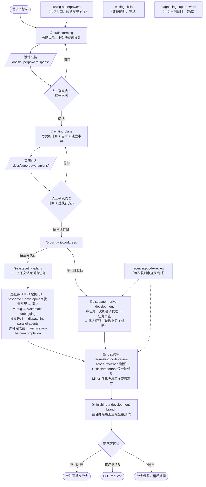

# Superpowers 技能地图

> 依据 superpowers 7.0.0 各 skill 原文整理。用途：在设计自己的开发工作流之前，先看清每个 skill 解决什么问题、在链路的哪个位置、产出什么。
> 面向读者：工作流的规划者，不是执行时的 agent。

## 一张图：主链路

两条人工确认门是链路上仅有的强制停顿点：设计文档确认（意图）、计划确认（规格）。其余环节任务之间都不停顿。

产物链：设计文档 → 实施计划 → 台账与审查包（`.superpowers/sdd/`，git 忽略，随工作区删除）→ 提交 → 审查报告 → Rulings / Deferred minors 清单 → 合并或 PR。

---

## 入口（贯穿全程）

**using-superpowers** —— 元技能：确立「行动前先查技能，有 1% 可能适用就必须调用」的规则，并按所在平台适配工具。
- 触发：每次会话开始（由 harness 注入，不是被调用）。
- 输出：无独立产物；它约束的是后续一切行为。

## ① 构思与设计

**brainstorming** —— 通过逐轮提问弄清需求方真正想要什么，先复述、再定稿，避免把理解偏差直接建成代码。
- 触发：任何创造性工作开始之前——功能、组件、计划，软件内外都算。
- 输出：项目级工作产出设计文档 `docs/superpowers/specs/YYYY-MM-DD-<topic>-design.md`（写完过 builder check 再交付）；小改动止于聊天内确认。

## ② 计划

**writing-plans** —— 把设计文档转成「可判真伪」的实施计划：任务写到 Files / Interfaces / 边界条件 / 验收标准为止，红绿循环不预写；写完自审八项，再派未参与的子代理独立审读。
- 触发：已有设计文档或需求、多步骤任务、动代码之前。
- 输出：实施计划 `docs/superpowers/plans/YYYY-MM-DD-<feature>.md`（固定五章 + 执行交接）+ 独立审读处置记录 + 执行方式建议（子代理驱动 / 会话内）。

## ③ 执行准备

**using-git-worktrees** —— 确保实施发生在隔离工作区：先检测既有隔离，优先平台原生工具，没有才回退手动 `git worktree`。
- 触发：开始需要隔离的功能开发之前、执行计划之前——实际由执行技能在准备阶段调用。
- 输出：隔离工作树（或「已在隔离区」的确认）+ 依赖安装 + 干净的基线测试。

## ④ 执行（二选一）

| | executing-plans（会话内） | subagent-driven-development（子代理驱动） |
|---|---|---|
| 何时选 | 强耦合小改动；探索性强到写不出稳定验收标准；没有子代理工具 | 任务边界清晰、验收标准稳定；想要每任务一双独立的眼睛 |
| 上下文成本 | 一个上下文 + 一个终审审查者 | 每任务一个实施者 + 一次审查 + 一个终审 |
| 审查时机 | 只在最后：整分支终审 | 每任务后任务审查 + 最后整分支终审 |

**executing-plans** —— 由原会话亲自逐任务执行：简报即需求、台账即记忆，每任务从验收标准展开 TDD，最后派全新上下文的整分支终审。
- 触发：需求方在计划交接时选了会话内执行，或 harness 没有子代理工具。
- 输出：逐任务提交 + 台账（progress.md，含全部 Ruling）+ 终审修复/裁决 + 移交 finishing-a-development-branch。

**subagent-driven-development** —— 控制者逐任务派发全新实施者子代理，任务审查作为每任务闸门（修复循环有轮数上限和熔断），最后最强档模型做整分支终审。
- 触发：有实施计划、任务大体独立、有子代理工具、需求方未选会话内执行。
- 输出：同上，外加每任务的审查包与修复循环记录；中断后可由台账恢复。

### 执行中反复触发的内嵌闸门

**test-driven-development** —— 证据双形态铁律：新行为测试先红后绿；特征测试（锁定既有行为）改前改后双绿。默认按任务批量展开——全部测试先红、批量实现后全绿；bug 修复等三例外保留细粒度。
- 触发：编写任何实现代码之前——新功能、bug 修复、重构、行为变更；例外（原型、生成代码、配置）需需求方点头。
- 输出：经双形态验证的代码与测试；无独立文档产物。

**systematic-debugging** —— 未经根因调查绝不修复：四阶段（根因 → 模式 → 假设 → 实施），3 次修复失败即停下质疑架构。
- 触发：任何 bug、测试失败、意外行为、构建失败——提出任何修复方案之前。
- 输出：根因结论 + 能复现的失败测试 + 针对根因的单一修复。

**verification-before-completion** —— 证据先于声明：没有刚运行的验证命令和输出，不得声称完成/通过/修复；轻信子代理的成功报告同样算违例。
- 触发：即将做出任何完成声明、提交、建 PR、转下一个任务之前。
- 输出：附带证据的声明；无独立产物。

**dispatching-parallel-agents** —— 相互独立的问题域各派一个 agent，同一条响应内派发即并行；返回后检查冲突并跑完整套件。
- 触发：2 个以上相互独立、无共享状态、无顺序依赖的任务或失败。
- 输出：各 agent 的发现与修复总结 + 冲突检查 + 整套件验证结果。

## 审查（每任务后与收尾前）

### 三份审查模板的分工

每任务审查不是独立 skill，而是执行技能内置的派发模板；三份模板各管一段：

| 模板 | 位置 | 审什么 | 输出 |
|---|---|---|---|
| `task-reviewer-prompt.md` | subagent-driven-development | 每任务闸门：规格符合性（缺失/多余/误解，对照任务简报）+ 代码质量 | Spec Compliance（✅/❌/⚠️）+ Issues + Approved / Needs fixes |
| `code-reviewer.md` | requesting-code-review | 整分支终审（两种执行方式共用）：双层基准（设计文档=意图、计划=规格）+ Declined to judge | Ready to merge? Yes / No / With fixes |
| `re-review-prompt.md` | subagent-driven-development | 修复轮之后的限定范围复审，只验证修复本身 | 复审判定 |

**requesting-code-review** —— 派发拿到专门构造上下文（绝不是会话历史）的审查者子代理，在问题级联前捕获；模板 code-reviewer.md 按双层基准审（设计文档=意图基准，计划=规格基准），文档未提及的行为按理性之人预期评。
- 触发：整分支终审（两种执行方式都派它）；skill 原文也把「SDD 每任务后」列为强制项——实际由上表的 task-reviewer-prompt.md 承担。可选：卡住时、重构前、复杂 bug 修复后。
- 输出：Strengths / Issues（Critical / Important / Minor）/ Recommendations / Assessment（Ready to merge?），每条发现项带 file:line。

**receiving-code-review** —— 先验证再实施：对照代码库核查每条反馈，能反驳就用技术论证反驳；禁止表演性认同与道谢，正确回应是直接修掉。
- 触发：收到任何代码审查反馈、实施建议之前——子代理审查者、外部审查者、PR 评论都算。
- 输出：逐项验证后的实施（一次一项、每项测试）或有理有据的反驳。

## ⑤ 收尾集成

**finishing-a-development-branch** —— 测试全绿后把集成决定交还需求方：菜单逐字呈现（本地合并 / 推送建 PR / 保留），绝不自作主张合并或丢弃；合并后在合并结果上重跑测试。
- 触发：实现完成、完整测试套件通过、需要决定如何集成。
- 输出：所选选项的执行结果（合并 + 删分支 / PR URL / 保留报告）+ 工作树清理。

## 旁路（不属于主链路）

**writing-skills** —— 把 TDD 应用到技能文档：先跑无技能基线看 agent 怎么失败，再写最小技能，再堵新冒出来的合理化借口。
- 触发：创建新技能、修改既有技能、部署前验证。
- 输出：经过基线—验证—堵漏循环的 SKILL.md 及压力测试记录。

**diagnosing-superpowers** —— 解剖一场出问题的会话（重复劳动、技能没触发、结果差、太贵），定位原因或产出可提交的 bug 报告。
- 触发：会话出了问题、需求方想知道为什么，或要给上游报 bug。
- 输出：诊断案件文档 / bug 报告（含脱敏流程）。

---

## 自己搭工作流时，这条链上可调的旋钮

1. **确认门数量**——这里是两道（设计 + 计划）；小工作流可并成一道或只留计划门。
2. **执行方式**——会话内 vs 子代理驱动，本质是「每任务一双独立的眼睛」花不花得起。
3. **审查深度与时机**——每任务审 + 终审 / 只终审 / 加独立安全审查；审查模板（双层基准 + 理性之人预期 + Declined to judge）可整体复用。
4. **台账与可恢复性**——上下文压缩后靠台账和 git log 续命；任何长流程都值得抄这一层。
5. **剩余风险的出口**——修复循环上限 + 熔断 + Rulings 清单移交：流程兜不住的部分显式交给人，而不是无限审下去。
