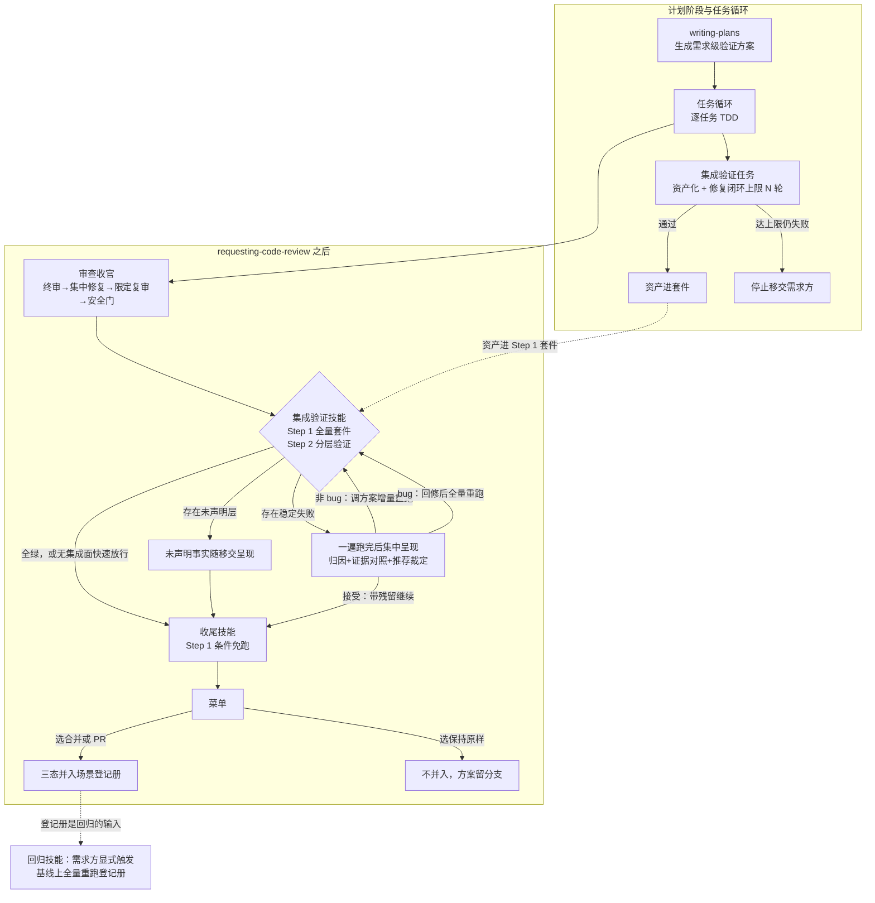
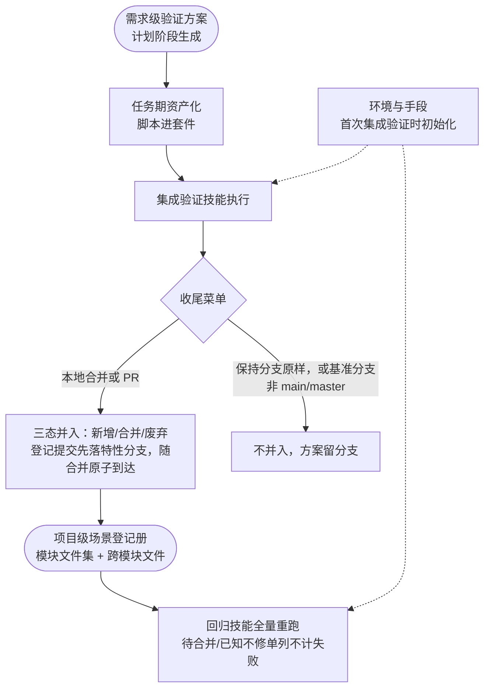
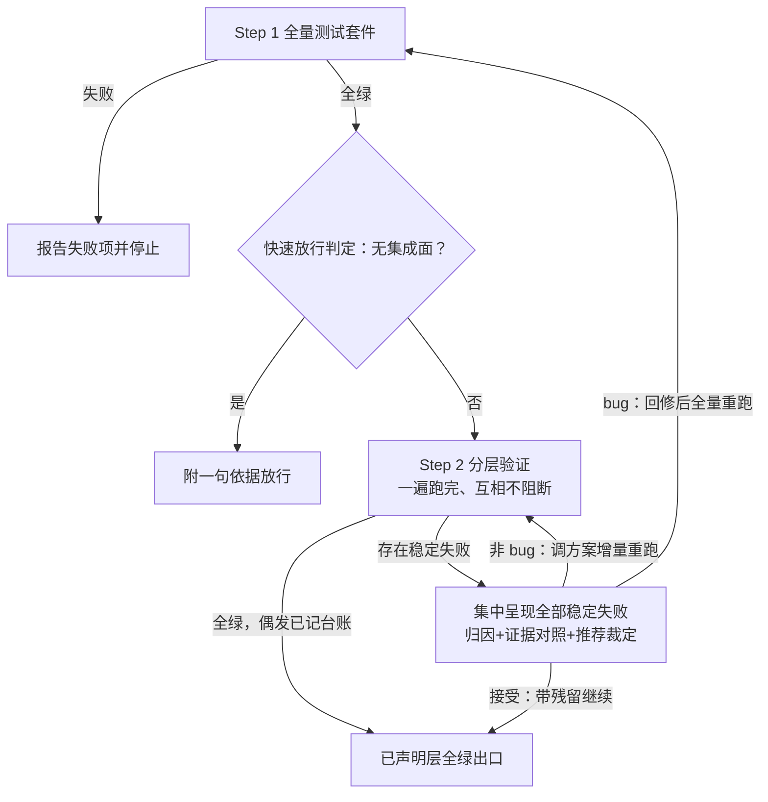

# 集成验证与全量回归 — 设计文档

> 读者假设：懂软件研发流程，不熟悉产生本文档的对话；不需要了解本仓库内部实现。

## 术语表

| 术语 | 含义 |
|------|------|
| 需求方 | 提出需求、做确认的人；分支的最终裁决者 |
| 控制者 | 走本工作流、逐任务推进计划的代理 |
| 审查收官技能 | requesting-code-review：整分支终审 → 集中修复 → 限定复审 → 安全门 → 收尾裁决清单，全链唯一的收尾移交点 |
| 集成验证技能 | 本文新增：独立技能，插在审查收官技能之后、收尾技能之前；先跑全量测试套件，再按需求级验证方案做分层验证 |
| 收尾技能 | finishing-a-development-branch：验证测试 → 呈现菜单 → 执行合并/PR/保留 |
| 需求级验证方案 | 一次需求的验证方案：集成面声明、验证环境、场景清单、手段、通过判据、产出物；计划阶段生成，集成验证技能执行 |
| 项目级整体验证方案 | 整个软件项目的验证方案全集：环境与手段声明章节 + 场景登记册；收尾阶段并入，回归技能消费 |
| 场景登记册 | 按模块拆分的场景文件集（含跨模块场景文件）；并入时逐场景登记：新增 / 合并 / 废弃——废弃即移除条目、不留记录 |
| 结果过期 | 台账存在集成验证出口凭据（通过或带残留继续）之后分支又有代码改动（HEAD 变化或工作区不干净）；此时验证结论不再可信 |
| 形态路由 | 集成验证与回归按项目形态（后端服务 / Web 应用 / 手机 App）加载对应参考文件的机制 |
| 深度分级 | L1 组装验证 / L2 可运行验证 / L3 端到端场景验证；只覆盖三个运行层（集成层=L1、可运行层=L2、端到端层=L3）；单测层与接口兼容层不参与分级——前者由全量套件覆盖，后者是 diff 型检查、不依赖运行环境 |
| 项目声明 | 项目级整体验证方案的「环境与手段」章节：各层怎么跑（入口命令、环境要求） |
| 行为验证方案 | 结构化用例文档：场景、前置状态、操作步骤、期望结果、清理（每场景自带数据清理） |
| 稳定失败 | 场景失败后自动重跑一次仍失败；重跑通过的记为偶发（台账记稳定性信号），不阻塞移交 |
| 资产化 | 验证脚本进版本库、可重复执行、断言确定性——进回归与门禁的唯一资格标准 |
| 修复闭环 | 跑测试 → 读失败日志 → 修复 → 重跑的有界循环，轮次有硬上限 |
| 交互式探索工具 | 开发期实时驱动应用确认操作路径的工具（如浏览器调试类 MCP），不进回归与门禁 |
| 快速放行 | 集成验证技能判定本分支无集成面，附一句依据放行（安全门中的同名判定指不触及安全面，本文指无集成面） |
| 基线 | 作对照的分支状态：接口兼容层以分支分叉出的基准分支为基线；回归重跑默认以主开发线最新为基线 |
| 台账 | 控制者维护的进度与裁决记录 |
| 回归技能 | 本文新增：按项目级整体验证方案在基线上全量重跑的技能，显式触发 |
| 定性裁决 | 需求方对验证失败项的裁定：非 bug（行为符合预期或方案期望有误 → 调整验证方案使下次正常通过）或 bug（→ 修复、接受残留，或标注已知不修） |

## 实施前决策记录 + 日期

- 2026-11-01：总体方向（集成验证关 + 回归技能 + 深度分级/项目声明/降级移交骨架）由需求方拍板；依赖限制放宽（技能可绑定工具链、插件本体不装依赖）；形态范围定为后端/Web/手机 App（依据需求方调研文档）。
- 2026-11-02：需求方四项拍板修订架构：① 集成验证做成独立技能，插在审查收官技能之后、收尾技能之前；② 集成验证技能内复制收尾技能的 Step 1（全量测试套件先行）；③ 收尾技能 Step 1 条件免跑（上游全绿后无代码改动则不重跑）；④ 新增全量回归独立技能（验证整个项目、必须显式触发）与验证方案管理流程（计划阶段生成需求级方案、收尾阶段并入项目级方案）。同日追加拍板：验证失败（集成验证与全量回归）必须呈现问题与原因、由需求方定性——接受（非 bug）则调整验证方案使下次正常通过，否则按 bug 修复（决策 5 重写）。
- 标注「提议」的决策待需求方确认本文档时一并裁决；决策 1、10 为需求方已拍板。

## 流程位置图

集成验证技能是独立技能，单点挂载：审查收官技能的收尾段是全链唯一的收尾移交点，移交对象从收尾技能改为集成验证技能，集成验证技能完成后再移交收尾技能。需求级验证方案在计划阶段生成、任务期资产化；收尾技能在需求方菜单选择合并或 PR 之后将其并入项目级方案；回归技能在分支链路之外显式触发。

图 1 为链路位置总览，图 2 为验证方案两层资产的生命周期——两个主题各一张图。

## 1. 背景与目标

- **解决什么问题**：走完工作流的分支，把关链路证明的是「单任务行为 + 代码质量与安全」，从未证明「集成层成立」。具体失效方式：每个任务 TDD 全绿（mock 隔离下的单任务行为）、终审与安全门通过、收尾跑「完整测试套件」（实际通常只覆盖单测）——分支合并后才发现模块组装失败、接口破坏性变更未被发现、构建产物起不来、存量关键路径被改坏。另有两类次生失效：行为验证靠临场手工探索、无沉淀资产，验证成果不可重复；失败修复无界空转，或未验证就声称完成。验证成果没有管理机制——本次需求验证过什么、项目整体要回归什么，无从回答。
- **给谁用**：用本工作流开发真实软件项目的控制者与需求方；验证对象覆盖三类形态——后端服务、Web 应用、手机 App。
- **成功判断标准**（可观察行为）：
  1. 各任务单测全绿但跨任务组装失败的分支：集成验证技能一遍跑完后集中呈现全部稳定失败（按层分组，指明层级、场景与归属模块），不移交收尾技能；
  2. 项目声明了接口规范与检测方式时：引入接口破坏性变更的分支被集成验证技能拦下；
  3. 无集成面的分支（经改动面推导判定）：集成验证技能放行，放行依据恰好一句，不产生发现项；
  4. 回归技能被显式触发后：按项目级整体验证方案在基线上全量重跑，产出留痕报告，失败项含层级、场景与归属；
  5. 后端与 Web 两形态的项目各自走通「生成需求级验证方案 → 资产化执行 → 集成验证通过」链路；手机 App 形态以模拟器环境可用为前提单独补验；
  6. 需求方在菜单选择合并或 PR 后并入完成：本次需求方案的场景全部出现在场景登记册——新场景登记为新增、与既有场景重复的合并、被本次需求推翻的既有场景废弃移除；选择保持原样则不并入；
  7. 集成验证技能以「全绿」或「带残留继续」出口结束后无任何代码改动（HEAD 一致且工作区干净）→ 收尾技能 Step 1 免跑全量套件；有改动 → 照跑并移交「结果过期」事实。
  8. 验证失败（集成验证或回归）经需求方定性「非 bug」后：验证方案被调整、重跑通过；定性「bug」后：走修复路径。需求方未定性时控制者不改方案期望（drill 压力场景验证）。
  9. 场景失败重跑一次即通过的：记为偶发稳定性信号、不停下定性；两次均失败才进入定性裁决。

**需求方指定的四类检查的落位**（对话中给出的业界常见清单）：

| 检查 | 落位 |
|------|------|
| 集成测试（真实数据库/中间件协作） | 集成验证技能的集成层（L1）；后端路由执行器：pytest/Jest + testcontainers |
| API 破坏性变更检测 | 集成验证技能的接口兼容层（diff 型检查，不依赖运行环境与形态） |
| E2E 关键路径回归 | 集成验证技能的端到端层（冒烟集）；Web 路由：docker-compose + Playwright；App 路由：Appium + Android Emulator；定期回归的主要对象 |
| 部署冒烟 | 集成验证技能的可运行层（L2）：构建产物启动 + 健康检查本地执行；预览环境基建不做（§3 第 4 条） |

单测层由集成验证技能 Step 1 的全量套件覆盖，不经形态路由。桌面应用：Electron/Tauri 按 Web 路由处理；原生桌面不做（§3 第 8 条）。

## 2. 功能清单

### 功能 1：集成验证技能

1. **定位：** 独立技能，补「集成层成立」这道闸——单任务 TDD 与终审、安全门都没有证明过的模块组装、接口兼容、构建可运行、端到端成立。
2. **触发与输入：** 链路接力（审查收官技能移交进入）或需求方单独调用（开发中途验证分支集成状态、失败修复后的复查）。输入 = 目标分支 + 需求级验证方案（specs 下各 `<date-feature>/verification.md`，遍历全部；如有）+ 项目声明。
3. **执行要点：**
   - Step 1 跑项目全量测试套件（语义复制自收尾技能 Step 1）；失败阻断 Step 2，报告失败项。
   - Step 2 按层验证——集成层、接口兼容层、可运行层、端到端层（执行 specs 下能找到的所有验证用例——遍历各 `<date-feature>/verification.md`——与形态路由；一篇 verification.md 都不存在 → 无可执行项，全绿出口附一句「specs 下无验证用例」）。
   - Step 2 内各层与场景一遍跑完，不因失败中断。
   - 每个失败项先自动重跑一次：重跑通过记偶发（台账记稳定性信号），重跑仍失败为稳定失败。
   - 全部层执行完毕后，所有稳定失败集中成一份报告呈现——按层分组，逐项含层级/场景/归属 + 失败原因初步归因及证据对照（失败日志摘录与方案期望原文）+ 控制者的推荐裁定及理由。
   - 定性「非 bug」（行为符合预期或方案期望有误）→ 控制者调整需求级验证方案（修正场景期望/前置/判据），仅重跑被定性的失败条目——增量重跑，通过则并入当次结果，其余层结果沿用。
   - 定性「bug」→ 指示回修（一次有界修复 + 一次覆盖回修 diff 的限定复审，触及安全敏感面用安全视角模板，复审通过后重跑本技能）或明确指令带残留继续（残留记入台账随移交呈现）。
   - 存在未声明层 → 逐层标注「未声明」随移交呈现，不阻塞移交。
   - 单独调用时出口为验证报告（全绿，或集中呈现 + 定性裁决），不产生移交语义；出口凭据机制与链路调用共用——免跑判据三条件通用，独立验证全绿后未改代码的，链路内重跑免跑。
   - 合并结果上的重跑同样按层执行、同一判据。
4. **出口表：**

   | 出口 | 条件 | 去向 |
   |------|------|------|
   | 已声明层全绿 | Step 2 无稳定失败（偶发已记台账） | 链路接力 → 移交收尾技能；单独调用 → 验证报告 |
   | 快速放行 | Step 1 全绿后经改动面推导判定无集成面 | 附一句依据放行；判定记台账但不产生出口凭据——放行跳过的是无对象的分层执行，不是本技能（判定语义见功能 9） |
   | 带残留继续 | 需求方明确指令接受 | 链路接力 → 移交收尾技能（残留随移交呈现）；单独调用 → 含残留清单的报告 |
   | 存在未声明层 / 环境受限降级 | 层未在声明与方案中出现，或运行层环境不可达 | 不阻塞——标注「未声明」、降级至环境可支撑的最深层，环境外验证项逐项随移交呈现；单独调用时单列进报告 |
   | 失败即停 | Step 1 全量套件失败 | 报告失败项并停止，Step 2 不执行 |

5. **流程图：**

6. **本次不做：** 自动修复轮（§3 第 1 条）；验证方案并入（§3 第 9 条）；控制者未经需求方定性调整方案期望（§3 第 10 条）。

### 功能 2：收尾技能两处改动

1. **定位：** 收尾技能保持「集成决策」单一职责，只加条件免跑与方案并入两点。
2. **触发与输入：** 收尾时读台账出口凭据与 HEAD；菜单选择合并/PR 后触发并入。
3. **执行要点：**
   - Step 1 条件免跑：集成验证技能结束时在台账记录出口凭据（「已声明层全绿」或「带残留继续」）与当时的 HEAD；收尾时凭据存在、HEAD 一致且工作区干净（`git status --porcelain` 为空）→ 免跑全量套件。
   - 任一不满足 → 照跑全量测试套件（单测层兜底），并移交「集成验证结果过期」事实，需求方可指示重跑集成验证技能。
   - 验证方案并入：前置条件为基准分支是 main/master 且需求方在菜单选择「本地合并」或「推送并创建 PR」——满足时在合并/推送之前于特性分支完成登记册三态登记提交（见功能 4），随后的 merge commit（或 forge 合并）使「功能代码 + 登记册更新」原子到达 main/master；基准分支非 main/master 或选择「保持分支原样」则不并入、不归档。
4. **本次不做：** 把分层验证复制进收尾技能——分层验证只属于集成验证技能，收尾技能只负责套件兜底与过期移交。

### 功能 3：需求级验证方案（计划阶段生成）

1. **定位：** 一次需求的验证执行依据，载体为独立文件 `docs/superpowers/specs/<date-feature>/verification.md`（与 design.md / plan.md 同目录三件套）；计划阶段生成、集成验证技能执行。
2. **触发与输入：** 存在跨任务组装点或触及外部接口的实施计划 → 同目录另产出验证方案文件 verification.md（plan.md 只留指针句）。
3. **执行要点：**
   - 内容六项：集成面声明、验证环境、场景清单（主路径、高风险分支、跨模块契约点）、执行手段、通过判据、产出物（资产化测试进套件，或人工验证清单）。
   - 用例采用结构化文档：场景、前置状态、操作步骤、期望结果、清理——每场景自带数据清理，防全量重跑时的跨场景状态污染。
   - 可选先经交互式探索确认操作路径，探索结果固化为脚本资产。
   - 质量由四项机制保证（决策 11）：出处锚定、双向映射、粒度判据、可操作性判据；writing-plans 自审含验证方案专项项（核查对象 verification.md），验证方案文件随计划一并独立审读。
4. **本次不做：** 一切计划强制含验证方案（§3 第 5 条）；把交互式探索纳入门禁（§3 第 2 条）；协作共享场景的 Gherkin 引入。

### 功能 4：项目级整体验证方案

1. **定位：** 回归技能的唯一输入——整个项目按模块拆分的方案文件集。
2. **触发与输入：** 「环境与手段」在首次集成验证技能运行时初始化——不存在时控制者代拟、需求方确认后创建，避免首轮验证整体陷入「未声明」；场景登记册在首次并入时初始化。
3. **执行要点：**
   - 文件集 = 「环境与手段」（项目声明，各层一行怎么跑：入口命令、环境要求）+ 每模块一份场景登记册文件 + 跨模块场景文件。
   - 并入三态：新增（新场景）、合并（与既有场景覆盖面重复 → 合并判据）、废弃（本次需求推翻既有行为 → 既有场景条目直接移除，不留记录）。
   - 场景可处于两类非正常状态——待合并（资产不在基线，如 PR 未合并）、已知不修（bug 定性后需求方裁定暂不修复）——均不计入回归失败，回归报告中各自单列呈现；待合并持续呈现直至合并或指示废弃，已知不修持续呈现直至指示修复或废弃（废弃即移除条目）。
   - 登记册写操作约定为串行，不接受并行并入：收尾并入前先同步基线上的最新登记册；若仍与并行分支的并入冲突，合并规则为——控制者能机械判定的合并（互不重叠的新增条目）自行处理，覆盖面重叠或同场景相冲突的非机械合并，与需求方讨论后决定。
4. **本次不做：** 新配置机制；强制统一的模板字段。

### 功能 5：定期回归技能

1. **定位：** 按项目级整体验证方案在基线上全量重跑，检测跨分支的历史累积回归；不承担代码修复。
2. **触发与输入：** 需求方显式触发（口头明示或外部调度器显式调用——绝不隐式自动运行）+ 基线（默认主开发线最新）。
3. **执行要点：**
   - 控制者收到留痕报告：登记册全部场景的全量重跑结果、失败项的层级/场景/归属、资产不在基线的「待合并」场景清单。
   - 每个失败项先自动重跑一次：重跑通过记偶发（台账记稳定性信号）；重跑仍失败（稳定失败）进入归因——附失败原因初步归因（含证据对照：失败日志摘录与方案期望原文）与控制者的推荐裁定及理由。
   - 定性「非 bug」→ 控制者调整项目级整体验证方案（修正场景期望或废弃场景），仅重跑被定性的失败条目（增量重跑）。
   - 定性「bug」→ 需求方再选处置——走正常工作流回修（作为新需求进入计划），或裁定「已知不修」（失败场景在登记册标注，此后回归单列呈现、不计为失败，直至指示修复或废弃）。
   - 裁决完成后技能结束。
4. **本次不做：** 内置定时调度（§3 第 6 条）。

### 功能 6：形态路由与执行器参考

1. **定位：** 按项目形态加载参考文件，让控制者获得该形态的执行器默认方案。
2. **触发与输入：** 项目形态（可声明多个）。
3. **执行要点：**
   - 内置三份：后端路由（pytest/Jest 用例 + testcontainers 依赖清单）、Web 路由（docker-compose 栈定义 + Playwright 场景）、App 路由（Appium 场景 + Android 模拟器启动配置）；Electron/Tauri 应用走 Web 路由。
   - 混合形态项目按模块声明形态，各模块走各自路由，验证对每个已声明形态执行对应层；路由的模块即场景登记册的文件单元——同一模块概念贯穿形态路由与登记册拆分，跨模块场景归属跨模块场景文件、由涉及模块的路由共同执行。
   - 参考文件是默认方案：项目声明可覆盖执行器选择（如已用 Cypress 的 Web 项目声明 Cypress 即可），覆盖后方案结构与资产化标准不变。
   - 形态外的项目（CLI 工具、库）不走路由，按项目声明执行可运行层与集成层。
4. **本次不做：** iOS（后置，见决策 8）；原生桌面（见 §3 第 8 条）。

### 功能 7：修复闭环与门禁

1. **定位：** 任务期的有界修复循环与可选门禁钩子。
2. **触发与输入：** 行为验证资产执行结果。
3. **执行要点：**
   - 控制者按「读失败日志 → 修复 → 重跑」循环推进，轮次有硬上限（N 轮，默认值由构建者定）；达上限仍失败 → 停止并移交需求方，按决策 5 的定性裁决处置（非 bug 调整方案与资产、bug 继续修复或放弃该场景）。
   - 提供可选的门禁钩子配置（在支持钩子机制的 harness 上，测试未通过不允许结束会话），作为项目级配置提供，不默认强加。
4. **本次不做：** 把门禁钩子做成插件默认全局行为；无钩子机制的 harness 以技能停止条件兜底。

### 功能 8：接口兼容层

1. **定位：** 分支对基线的破坏性变更 diff 检查，纳入集成验证。
2. **触发与输入：** 项目级方案中声明的接口规范与检测方式。
3. **执行要点：**
   - 对分支与基线跑兼容检测，破坏性变更按集成层失败同语义停下报告。
   - 形态路由的参考文件可给推荐检测工具，工具由项目安装。
4. **本次不做：** 生成或维护接口规范本身。

### 功能 9：快速放行

1. **定位：** 无集成面分支的技能内出口——是出口而非免检（同安全门哲学）。
2. **触发与输入：** 分支改动面 + 需求级验证方案的集成面声明（如有）。
3. **执行要点：**
   - 判定「无集成面」时附一句依据放行，判定记入台账；放行依据恰好一句，不产生发现项。
   - 判定的真值来源是控制者对改动面的推导：分支是否触及任何模块组装点、外部接口、运行边界；需求级方案的集成面声明是对照输入而非真值来源——推导与声明不一致时以推导为准，差异记入台账。
   - 不经计划的分支同样适用；放行跳过的是无对象的分层执行，不是本技能。
4. **本次不做：** 跳过整个技能——集成验证必过。

### 功能 10：环境受限降级

1. **定位：** 运行层环境不可达时的降级验证与人工移交。
2. **触发与输入：** 某运行层在当前环境不可执行（无容器运行时、无浏览器、模拟器不可达）。
3. **执行要点：**
   - 在三个运行层（L1/L2/L3）内降级到环境可支撑的最深层级，剩余层级以「环境外验证项」移交需求方，逐项写明人工验证步骤。
   - 接口兼容层不依赖运行环境，不随运行层降级。
4. **本次不做：** 为补环境安装重型依赖到插件本体。

## 3. 明确不做

1. **集成验证技能不做自动修复轮**。因为修复闭环已在计划任务期完成（归因信息最全，见决策 9）；技能位置的失败是最终状态失败，回修需要需求方裁决。回修由需求方指示触发，不是技能自主机制。
2. **交互式驱动工具不承担回归与门禁**。因为交互式操作每次依赖模型重新探索，无沉淀、断言靠目测、token 成本高且不可并行；统一标准：进门禁的必须是确定性脚本资产。交互式工具只用于开发期确认操作路径、复现边界场景。
3. **插件本体不安装运行时依赖**。因为需求方放宽的是「工作流绑定工具链」的限制，不是「插件随身携带工具」；被绑定的工具属于被验证的项目。技能文案可点名工具链并给出前置检查。
4. **不做部署预览环境类基建**。因为那是 CI/CD 平台能力，会话制工作流无法承载；其内核「构建产物能启动、健康检查通过」由可运行层本地覆盖。
5. **不强制一切计划含需求级验证方案**。因为纯单模块、无接口的计划没有集成对象，强制会产生形式任务。触发判据：计划存在跨任务组装点，或触及外部接口。
6. **回归技能不隐式自动运行**。因为回归是全项目成本动作，隐式触发会让需求方失去对成本的控制；触发必须显式——需求方口头明示或外部调度器显式调用，技能文案写死这一触发条件。
7. **不承诺「验证全绿 = 无缺陷」**。因为验证提高把握、不证明无缺陷；文案写明这一点。
8. **原生桌面不做**。因为原生桌面（非 Electron/Tauri）的 UI 自动化基建成本远超当前收益。iOS 后置属交付排序决策，见决策 8。
9. **集成验证技能不做验证方案并入，并入也不在菜单之前无条件执行**。因为并入是「接受本次成果为项目资产」的集成决策动作，只有需求方在菜单选择合并或 PR 才构成接受——选「保持分支原样」时并入会把资产不在基线的死场景塞进登记册；验证与并入分离，使未接受分支的方案不污染项目资产。
10. **控制者不得未经需求方定性调整验证方案**。因为「为通过而改期望」会让验证迁就实现——测试搬运是最廉价的作弊路径，验证从把关退化为仪式。调整必须由需求方定性裁决触发：定性「非 bug」才调，且只调被定性的失败项；drill 须含「需求方未定性时控制者改期望通过验证」的压力场景。

## 4. 关键决策记录

| 决策 | 一句话结论 | 拍板状态 | 影响功能项 |
|------|-----------|---------|-----------|
| 1 挂载位置 | 独立技能，插在审查收官之后、收尾之前 | 需求方 2026-11-02 拍板（推翻原稿） | 功能 1、2 |
| 2 验证深度 | 三层分级，判据「已声明且环境可达的最深层完成验证」 | 提议 | 功能 1、10 |
| 3 驱动手段 | 路由式形态参考 + 项目声明参数 | 提议（依据需求方调研拍板） | 功能 6 |
| 4 接口兼容层 | 单列一层，纳入集成验证 | 提议 | 功能 8 |
| 5 验证失败处置 | 呈现与定性裁决：非 bug 调方案、bug 走修复 | 需求方拍板，本稿细化 | 功能 1、5、7 |
| 6 全量回归 | 独立技能、显式触发、消费项目级方案 | 需求方拍板框架，本稿细化 | 功能 5 |
| 7 三方依赖边界 | 技能可绑定工具链，插件本体不装依赖 | 提议 | 功能 6、10 |
| 8 行为验证形态范围 | 后端/Web/App 三形态 | 需求方已拍板 | 功能 6 |
| 9 修复闭环归位 | 任务期有界闭环，验证只判最终状态 | 提议 | 功能 7 |
| 10 验证方案两层管理 | 需求级与项目级分离，收尾阶段并入 | 需求方 2026-11-02 拍板框架，本稿细化 | 功能 2、3、4 |
| 11 验证方案质量机制 | 出处锚定 + 双向映射 + 粒度判据 + 可操作性判据 + 自审专项 | 需求方拍板方向，本稿细化 | 功能 3 |

### 决策 1：挂载位置——独立技能，插在审查收官之后、收尾之前（需求方 2026-11-02 拍板，推翻原稿）

- 候选：① 独立技能（拍板方案）；② 分层化收尾技能的既有验证测试步骤（本设计文档原稿方案）；③ 塞进审查收官技能的收尾段。
- 选 ①。依据：验证职责获得归属地——需求级验证方案的执行者需要独立入口；收尾技能保持「集成决策」单一职责（免跑后的 Step 1 只剩兜底与过期移交）；失败处置自成体系（停下报告/回修/带残留继续都有明确的技能边界）。
- 排除 ②（原稿方案，需求方否决）：验证职责塞进收尾技能使收尾从「集成决策」膨胀为「验证 + 决策」两职。
- 排除 ③：审查收官技能已承载终审/修复/复审/安全门四个环节，再塞验证域继续稀释；且审查域与验证域失败语义不同质（审查失败走修复轮，验证失败走停下裁决）。
- 挂载事实：审查收官技能的收尾段是全链唯一收尾移交点（两执行技能只接力到它），单点改动即可挂载，无逐字对齐问题。
- 代价：收尾技能的 Step 1 文案要加免跑条件（调优文案，改动需证据）；新技能一个的编写与验证成本。

### 决策 2：验证深度——三层分级，判据为「已声明且环境可达的最深层完成验证」（提议）

- 候选：① 统一要求端到端验证；② 分层 L1/L2/L3，要求到已声明且环境可达的最深层；③ 不分级，项目声明跑什么就算什么。
- 选 ②。依据：早期项目、部分功能交付没有端到端对象（需求方明确给出此场景），① 会让门形同虚设或永久阻塞；③ 在声明缺失时无法判「该跑没跑」；② 的判据在声明的各层上可判真伪；混合形态项目按形态分别评估，不合并求平均。声明滞后于环境能力时按声明执行，缺口经「未声明」移交可见——未声明层的把关弱化由风险 1 承认，不构成阻塞。
- 代价：验证内多一步「当前可达层」判定，需对照项目声明与环境现实。

### 决策 3：驱动手段——路由式形态参考 + 项目声明参数（提议，依据需求方调研拍板）

- 候选：① 纯项目声明制；② 路由式——内置后端/Web/App 三形态参考文件，声明承载本项目入口参数；③ 全内置无声明。
- 选 ②。依据：需求方已解除工具绑定限制并指定三形态（决策 8）；三种形态对控制者同构——都是「执行命令 → 读文本日志 → 判定通过/失败 → 修复重跑」，差异全部在环境基建层，适合按形态沉淀参考文件；项目声明回答「本项目入口命令与环境」，参考文件回答「这类形态怎么验」。
- 落地语义：参考文件是默认方案，项目声明可覆盖执行器选择——绑定的是「方案怎么组织、资产什么标准」，不绑定「项目必须迁移工具」；混合形态项目按模块声明形态、各走各的路由。
- 代价：三份形态参考文件的编写与验证成本；形态外项目退回纯声明制路径。

### 决策 4：接口兼容层单列，纳入集成验证（提议）

- 候选：① 单列为一层；② 并入集成层的场景清单（作为跨模块契约点）；③ 不做，靠终审把关。
- 选 ①。依据：计划内契约点与对基线的向后兼容是两个失效面——后者面向分支外已存在的消费者，是 diff 型机械检查、不依赖运行环境、成本最低；单列才不会依赖「恰好写进了场景」。需求方明确列出此项。
- 排除 ③：终审是枚举式人工审查，覆盖不了 diff 型机械检查能确定的事。
- 排除 ②：契约点验证组装正确性，兼容性验证分支与历史的差异，检查方向相反。
- 代价：多一层判定；项目未声明接口规范时该层标注「未声明」。

### 决策 5：验证失败处置——呈现与定性裁决，非 bug 调方案、bug 走修复（需求方拍板，本稿细化）

- 候选：① 需求方定性裁决——非 bug 调整验证方案重跑 / bug 指示回修 / bug 接受残留（拍板方案）；② 技能自动判型——方案问题自动调方案、代码问题自动修复；③ 一律按 bug 修复（本设计原稿的单一回修路径）。
- 选 ①。依据：验证失败有两种不同质的根因——代码缺陷与方案期望错误，只有需求方能裁定「当前行为是否符合预期」；未声明层阻塞则给工作流加一个它自己无法自行满足的确认点（工作流无法替项目发明验证手段，阻塞只会造成死锁），未声明仍走移交。有界修复闭环已前置于归因新鲜的任务期（决策 9），技能位置的失败是最终状态失败。失败集中呈现而非逐个中断：一个根因常引发多层失败，逐失败中断会造成多次往返；一遍跑完的全景让需求方一次性看到失败全貌与相互关联，再逐项定性。
- 排除 ②：让控制者既当运动员又当裁判员——「为通过而改期望」的作弊通道全开（§3 第 10 条）。
- 排除 ③：把方案误报也当 bug 修，会把正确行为改坏或陷入无解修复循环。
- 代价：每次失败需求方多一轮定性裁决——控制者的推荐裁定与证据对照用于降低裁决成本；初步归因由控制者给出、可能归因错误（甚至有诱导倾向），证据对照与定性权在需求方兜底；「非 bug 调方案重跑」为增量重跑（只跑被定性条目），成本低，不设机械轮次上限——每轮调整都由需求方定性触发，裁决即天然熔断（§3 第 10 条禁止未经定性的调整）；控制者连续调整仍未通过的，应提示需求方考虑改判带残留继续或废弃场景。bug 回修路径的重跑为全量——代码已变，需全量确认无回归。

### 决策 6：全量回归——独立技能、显式触发、消费项目级方案（需求方拍板框架，本稿细化）

- 候选：① 独立回归技能，消费项目级整体验证方案，显式触发（拍板方案）；② 写进收尾技能作为可选步骤；③ 纯文档约定。
- 选 ①。依据：回归与收尾是两种对象、两种触发、两种失败语义——回归在基线上按整体验证方案全集重跑，检测跨分支的历史累积回归；收尾把关本分支改动。回归由外部显式触发，收尾在分支链路内触发。独立技能给需求方一个可被显式调用与外部调度稳定调用的入口。「必须明确触发」写进技能触发条件（§3 第 6 条）——全项目成本动作的控制权留在需求方手里。
- 排除 ③：既有测试文档已写明分层模型的方向——「静态门在合并请求上跑、定期全面重跑靠夜间或按需触发」——但全仓库没有任何机制承接这句话；文档约定无实体即落空，本仓库自身就是实例。
- 代价：多一次技能编写与验证（同一次 drill 交付的成本量级）；每次触发为全量重跑时间（随场景登记册增长，见风险 6）。
- 子决策 a（需求方裁决，2026-11-03）：回归双模式——基线模式 + feature 分支模式。判定机械：工作区处于基线（HEAD = 基线最新）→ 基线模式，现状语义保留——读登记册全量重跑，报告呈现当次结果；工作区不在基线（feature 分支上显式触发）→ 按工作区自动判定进入 feature 分支模式，无需需求方声明。feature 分支模式的用例集为双源并集——登记册 ∪ specs 下全部 verification.md（`docs/superpowers/specs/*/verification.md`），双源执行、一遍跑完。失败分类两路：登记册条目在 feature 分支上失败时——若 specs 中存在通过的用例覆盖其行为（机械判据：同资产路径）→ 归入「已覆盖行为变更」清单，逐项附对照（登记册旧期望 vs specs 新期望与通过证据）呈现给需求方确认，确认后在并入时三态正式化（specs 用例入册、旧条目合并或废弃）；specs 无覆盖 → 疑似回归，走既有归因（证据对照 + 推荐裁定）与定性三路（非 bug 调方案 / bug 回修 / 已知不修）。两条红线：覆盖判定只做推荐归类、不自动吞失败——定性权在需求方；判据机械可查（资产路径比对），模糊时保守归入疑似回归。基线模式的既有全部语义（显式触发、登记册读取、重跑一次、归因、定性三路、无场景出口、报告落盘）两种模式共用；报告在 feature 分支模式下增三节（specs 结果、已覆盖行为变更、疑似回归），报告口径仍为只呈现当次结果（无变更摘要、无跨次对比——既有裁决）。排除候选：① 仅跑单一登记册源在 feature 分支上跑——登记册旧期望失败被当回归误报；② 仅跑 specs——丢失存量回归覆盖。

### 决策 7：三方依赖边界——技能可绑定工具链，插件本体不装依赖（提议）

- 候选：① 技能文案绑定形态工具链，插件本体零安装依赖；② 插件引入运行时依赖（自带工具封装）。
- 选 ①。依据：需求方放宽限制的目的是实现集成验证与定期回归——工具属于被验证的项目，由项目按自身技术栈安装；随插件分发运行时依赖会破坏轻量安装与跨项目适配。技能文案负责点名工具链、给出前置检查；工具或环境缺失统一走环境受限降级（§2 第 10 条）——任务期前置检查发现的缺口与验证时发现的缺失，移交出口同构。
- 排除 ②：封装层把「项目怎么装工具」的多样性扛到插件侧，维护面无限膨胀。
- 代价：用户项目需自行具备工具链（前置缺口见风险 4）；技能文案须写清前置检查而非假设工具存在。

### 决策 8：行为验证形态范围——后端/Web/App 三形态（需求方已拍板）

- 需求方调研结论：后端服务做（pytest/Jest + testcontainers）、Web 应用做（docker-compose + Playwright）、手机 App 做（Appium + Android Emulator）；Electron/Tauri 应用并入 Web 路由（做，换路走）；原生桌面不做；iOS 视需求后置，Android 单模拟器起步。
- 依据：基建重量分级——backend/web 成熟先行，mobile 断崖式最重（模拟器管理、设备矩阵、天然 flaky），按调研建议最后接入。
- 代价：iOS 项目在解锁前走「环境外验证项」移交；mobile 参考文件的验证证据依赖模拟器环境可用。

### 决策 9：修复闭环归位——任务期有界闭环，验证只判最终状态（提议）

- 候选：① 两阶段分离——资产生成与执行期走「读失败日志 → 修复 → 重跑」闭环（轮次上限 N + 可用 harness 上配门禁钩子），集成验证失败停下报告需求方；② 集成验证技能内也做闭环。
- 选 ①。依据：需求方调研确立的闭环机制发生在行为验证资产的生成与执行阶段，此时失败归因信息最全（刚写完的方案与代码）；验证是最终状态把关，内嵌闭环与决策 5 的「停下报告」语义矛盾，也让验证时长不可控。门禁钩子防的是「声称完成」，作为项目级可选配置提供。
- 排除 ②：见上，与决策 5 矛盾。
- 代价：验证失败仍需需求方裁决一次；闭环轮次上限 N 需要在「给足修复空间」与「防空转烧 token」之间取值。

### 决策 10：验证方案两层管理——需求级方案与项目级方案分离，收尾阶段并入（需求方 2026-11-02 拍板框架，本稿细化）

- 候选：① 两层资产——需求级验证方案（计划阶段生成、集成验证技能执行）+ 项目级整体验证方案（收尾阶段并入、回归消费），项目声明整合为项目级方案的「环境与手段」章节；② 单层——只有项目级方案，需求方案作为临时清单用完即弃；③ 单层——只有需求级方案，回归时逐个重跑历史需求方案。
- 选 ①。依据：两层各有不可替代的职责——需求级方案回答「本次需求怎么验证」（集成验证技能的执行依据），项目级方案回答「整个项目要回归什么」（回归技能的唯一输入）；② 让回归无资产可依（临时清单用完即弃，历史验证成果丢失）；③ 让回归的输入随需求数量线性膨胀且无去重（100 个需求方案就是 100 份清单，场景重复无人管）。并入三态登记（新增/合并/废弃）是场景去重与失效淘汰的机制。
- 子决策 a（作者决定）：项目声明不单独存在，整合为项目级方案的「环境与手段」章节——声明本就是「项目怎么跑验证」的常量，与方案全集同源，分开存放会造成同一信息两处维护。
- 子决策 b（需求方已裁决：同意建议答案，2026-11-02；2026-11-03 再修订——原子化 + 目标限定 + 载体拆分）：并入放在收尾技能、且在需求方菜单选择「本地合并」或「推送并创建 PR」之后执行——并入是「接受本次成果为项目资产」的集成决策动作，选择即接受。2026-11-03 再修订：前置条件限定为基准分支是 main/master；两条件满足时，登记册三态登记提交先落在特性分支上（在合并/推送之前执行），随后的 merge commit（或 forge 合并）使「功能代码 + 登记册更新」原子到达 main/master——登记提交不再在合并执行后补做。基准分支不是 main/master，或选「保持分支原样」→ 不并入、不归档，方案留作分支上的需求级文档。归档仅在本地合并路径当场执行；PR 路径推送时不归档，条件由下次基线侧收尾并入或回归顺带。场景随合并到达基线后自下次回归起生效；「待合并」（功能 4，不计为失败）仅适用于回归时资产路径在基线不可定位的其他情形——工作流无法感知 forge 的合并事件，用资产可定位性做机械判据。验证与并入分离，未接受分支的方案不污染项目资产（§3 第 9 条）。
- 子决策 c（作者决定）：免跑判据 = 台账存在集成验证出口凭据（「已声明层全绿」或「带残留继续」）+ HEAD 一致 + 工作区干净——三者都机械可判；仅比 HEAD 会漏掉「未提交的工作区改动」（风险 7）；带残留继续的凭据计入，因为残留已被需求方接受、HEAD 未变则状态未变。
- 子决策 d（需求方拍板）：项目级方案按模块拆分为文件集——「环境与手段」一份 + 各模块场景登记册一份 + 跨模块场景文件；废弃条目直接移除、不留记录，不在场景文件中保留。依据：复杂项目单文件方案随新增持续膨胀，废弃条目只增不减难维护；登记册规模与活跃场景数成正比（风险 6 缓解）。2026-11-03 再修订（需求方裁决：归档全量化）：规格目录归档语义从「按 date-feature 目录逐个归档」升级为「feature 分支合并到 main/master 执行后，`docs/superpowers/specs/` 下全部内容原样移入 `docs/superpowers/archived/`——`<date-feature>` 目录照搬、遗留平面文件照搬，不要求先按新目录结构规范化；specs/ 清空，下次需求从空目录开始」；PR 路径推送时不归档，由下次 feature 分支合并到 main 时全量归档顺带完成（修订子决策 b 的「归档仅在本地合并路径当场执行；条件由下次基线侧收尾并入或回归顺带」旧口径）；废弃条目直接移除的语义不变。
- 子决策 e（需求方裁决，2026-11-02）：登记册条目 id 为登记册自有命名——模块前缀 + 序号（如 `REC-L1-002`）；方案声明的场景 id 不入条目格式，经台账与计划文档溯源。条目格式行（五字段）不变。
- 子决策 f（需求方拍板，2026-11-03）：需求级验证方案载体为独立文件 `docs/superpowers/specs/<date-feature>/verification.md`，与 design.md / plan.md 同目录三件套；plan.md 只留一句指针，内嵌章废止——需求方拍板推翻计划层「内嵌」决策（计划 §3 设计依据「计划定内嵌」）。理由：验证用例独立成文件易查看；内容按需求方审核动线排序（集成面声明与双向映射表在前，完备性当场可查）；writing-plans 阶段同时产出 plan.md 与 verification.md，自审第十项核查对象随之改为 verification.md；集成验证技能遍历 specs 下全部 verification.md 全量执行（功能 1）。
- 代价：收尾技能多一个并入步骤（时长增加：登记册操作是文档动作，分钟级）；三态登记的「合并/废弃」判定需要比对字段（构建者定），首次实施有判定成本。

### 决策 11：验证方案质量机制——出处锚定 + 双向映射 + 粒度判据 + 可操作性判据 + 自审专项（需求方拍板方向，本稿细化）

- 问题：验证方案是集成验证的执行依据——方案期望写错、集成面遗漏、粒度粗到无法归因、操作不可执行，集成验证就失去参考性；计划阶段的方案质量决定验证效果的上限。
- 机制（每条可判真伪）：
  1. **正确性 → 出处锚定**：每条场景期望标注设计出处（设计文档章节或需求条目）；无出处的期望不得进入方案；期望与设计冲突以设计为准——期望不能由计划者发明，设计文档是意图基准（与终审双层基准同源）。
  2. **完备性 → 双向映射**：集成面声明的每个组装点/接口与场景清单双向核对——有面无场景是缺口、有场景无面是跑偏；主路径、高风险分支、跨模块契约点各有至少一条场景。
  3. **粒度 → 两判据**：一个场景一个行为目标（失败可归因到单一路径）；期望为可观测的具体结果（❌「表现正常」/ ✅「返回 200 且响应体包含 X 字段」）。
  4. **可操作性 → 三判据**：前置写明搭建方式或数据来源；每步为明确动作（命令/调用/输入）；写不出确定性步骤的场景标人工验证清单，不伪装自动化。

- **内容要求**（六项，与四性判据共同构成方案质量标准）：
  5. **确定性固定策略**：期望不得依赖未固定的非确定源（真实时钟、随机数、外部实时数据）；确需依赖时写固定策略（固定时钟、固定种子、固定数据集）——防「非确定性通过」污染回归基线。
  6. **保真度声明**：方案声明各依赖的真实/替换状态及对结论的影响（真实数据库、替换的第三方 stub）——「通过」的含义随保真度明确。
  7. **副作用隔离**：具破坏性外部副作用的操作（真实支付、邮件、删数据）必须声明隔离手段（沙箱、测试账号、stub）；无隔离手段的标人工验证清单。
  8. **顺序依赖显式化**：场景间依赖链显式声明（回归按链执行）；无依赖的场景标注可并行。
  9. **既有登记册查重**：项目登记册已存在时，方案生成对照既有场景查重，重叠场景标注「预期合并」。
  10. **失败证据采集**：每场景写明失败时的证据采集物（截图、trace、日志范围）——运行期归因与证据对照依赖它。
- 自审：writing-plans 自审清单增验证方案专项项——四性逐查、内容要求六项逐查、出处抽查、双向映射核对；验证方案随计划一并进入独立审读，不另设评审环节。
- 排除：② 派专职评审代理对方案做开放式评审——独立审读已覆盖计划全文，开放式评审不可判真伪且成本高；③ 事后再校（集成验证首轮跑完再校方案）——错误发现后移，首轮结果不可信，验证参考性从第一轮就应成立。
- 代价：计划阶段成本增加——方案编写需细读设计文档（出处锚定），自审多一项；收益是集成验证从首轮起即可信。

### 留给构建者的部分

以下各项的最终措辞与格式依赖具体文案语境和验证反馈，属执行层判断，故交由构建者：

- 集成验证技能的命名、SKILL.md 结构与三份形态参考文件的章节划分——走技能编写流程开发，附对抗性验证证据。
- 结构化用例文档的模板字段与格式——构建者定；须覆盖场景/前置状态/操作步骤/期望结果/清理五要素。
- 审查收官技能收尾段的接力句改写（移交对象从收尾技能改为集成验证技能）——单点挂载；终审与安全门的既有文案不动，只动移交句与流程图节点。
- 收尾技能 Step 1 免跑条件文案与「结果过期」移交句——须附对抗性验证证据；免跑判据（出口凭据存在 + HEAD 一致 + 工作区干净）的机械检查命令写进文案。
- 需求级验证方案的载体——已由需求方拍板为独立文件 verification.md（决策 10 子决策 f，内嵌章废止）；须可被集成验证技能经 specs 目录遍历定位与读取。
- 项目级方案的文件位置与目录结构——「环境与手段」+ 按模块拆分的场景登记册文件集 + 跨模块场景文件的命名与索引形式——构建者定；须随项目入库、可检索。
- 三态登记的比对字段与判据（新增/合并/废弃各看什么：场景 id、覆盖的接口/行为清单）——构建者定。
- 集成验证技能结束时出口凭据与 HEAD 记录的台账行格式；放行/失败/未声明/降级/过期五类出口的台账行格式——构建者定，须为可检索格式。
- 修复闭环轮次上限 N 的默认值——构建者定。
- 门禁钩子的提供形态——项目级可选配置模板，不默认强加。
- 交互式探索工具在文案中的边界句——写明其只活在开发期、产物须固化为脚本资产。
- 回归报告的存放位置与格式——构建者定，须可检索。
- 冒烟集的「有界」定义——声明推荐格式中每层标注预期时长上限。
- 移动端 flaky 对策的机制设计（失败重试策略、截图诊断）——从一开始设计进 App 路由参考文件。
- drill 场景设计与落点——至少覆盖成功判断标准 1-9，外加「有集成面却判无」「HEAD 变了却免跑」两个反向场景，以及「需求方未定性时控制者改期望通过验证」「偶发失败重跑通过仍停下定性」两个压力场景；验证证据随新机制交付。
- 失败呈现的报告格式——失败原因初步归因（代码缺陷嫌疑 / 方案期望不符）的字段与措辞、证据对照（失败日志摘录 vs 方案期望原文）的呈现方式、推荐裁定（建议 + 理由）的格式；「定性非 bug」路径的方案调整操作指引。
- 失败重试策略——重跑整场景还是失败步骤、偶发与稳定失败的台账行格式。
- 登记册并入冲突的机械合并判据——哪些算互不重叠的新增条目（可自行合并）、哪些必须升级需求方讨论。

## 5. 关键约束与可行性风险

- **依赖边界**：技能文案可绑定形态工具链（后端 pytest/Jest + testcontainers、Web docker-compose + Playwright、App Appium + Android Emulator）；插件本体不引入运行时依赖，工具由被验证项目安装（fork 政策；上游 PR 仍按上游零依赖规则）。
- **调优文案需证据**：收尾技能与计划技能都是经对抗性验证调优的内容，按仓库贡献规则，行为改动须附验证证据，无证据不得合入。
- **成本量级**：常态（有方案、全绿）= 集成验证技能两步执行，收尾技能 Step 1 因免跑节省——全量套件从收尾前移到集成验证跑一次，净增的是集成层与端到端层（分钟级到十分钟级；上限取决于冒烟集规模）；未声明项目首次多一轮补声明；修复闭环的 token 成本与 N 正相关；回归每次触发为全量重跑（随登记册增长）。主要成本来源是集成层与端到端层的执行时间。
- **风险 1：需求级验证方案缺失或过时** → 集成层把关弱化为「未声明」标注流。缓解：有组装点的计划强制产出方案（§3 第 5 条的反面触发判据）；未声明是移交不是放行，每次验证可见；资产化测试进套件，方案随项目成长补齐。
- **风险 2：端到端/可运行层环境不可达** → 真机、无容器、模拟器不可达场景。缓解：降级移交语义（§2 第 10 条），剩余层级逐项写明人工验证步骤。
- **风险 3：分层判定被滥用为放行借口** → 「无集成面」被用来免掉本该跑的层。缓解：判据为改动面推导、可判真伪，方案声明仅作对照输入；drill 须含「有集成面却判无」反向场景。
- **风险 4：项目环境基建缺口** → 三形态验证的前提是项目具备「一条命令把应用+依赖跑起来」的能力；不具备时行为验证无法执行。缓解：前置检查写进参考文件，缺口结构化移交需求方（工程底座不代建）；backend/web 先行，mobile 最后接入。
- **风险 5：移动端天然 flaky** → 误报稀释验证公信力。缓解：失败重试与截图诊断从第一天设计进 App 路由；Android 单模拟器起步。
- **风险 6：活跃场景总量增长** → 回归全量时长随活跃场景数增长。缓解：废弃条目直接移除（台账留痕），登记册规模与活跃场景数成正比；按模块拆分控制单文件规模；回归报告标注各层时长；必要时标注核心子集优先跑（构建者定）。
- **风险 7：免跑判据被误用** → 只比 HEAD 会漏掉未提交的工作区改动——HEAD 相同但代码已变。缓解：判据为台账出口凭据存在、HEAD 一致且 `git status --porcelain` 为空，三者机械可判；drill 含「HEAD 变了却免跑」反向场景。

## 附录：独立审读处置记录

**审读者**：全新通用子代理，未参与写作。前三轮处置记录见下方留存；第四轮处置随本轮审读补充。

**第一轮审读（初稿）与第二、三轮处置（留存摘要，措辞以当时版本为准）**

| 轮次 | 发现 | 处置 |
|------|------|------|
| 第一轮 A1/A2（高） | 无集成面真值来源缺失；失败出口死路 | 真值来源改为改动面推导；失败加两出口（指示回修 / 明确指令带残留继续） |
| 第一轮 A3-A5、A6-A9（中低） | 判据冲突、分级映射、回归处置、声明写入者、台账格式、合并重跑分层 | 判据精确化「已声明且环境可达最深层」；分级只覆盖三运行层；回归报告后即结束；控制者代拟声明；台账行交构建者；合并重跑同判据 |
| 第一轮 C2/C6 | 决策 2/6「有疑问」 | 判据调和；排除依据改为可核验表述 |
| 第二轮（依赖解禁 + 三形态） | A1 回修把关真空、A2 绑定优先级、A3 章锚点、A4 混合形态、A5-A6、B1-B9 | 回修走有界修复+限定复审；参考文件为默认方案、声明可覆盖；§1 补两类次生失效；按模块多路由；工具缺失统一降级移交；风险 1 区分资产与人工清单；B 清单措辞修订 |
| 第三轮复读 R1-R3 | 排除 ② 区分点、把关措辞强于机制、混合形态判据归属 | 排除 ② 补触发者区分；措辞收敛为「触及安全面用安全视角模板」；决策 2 写明按形态分别评估 |

**第四轮修订**（2026-11-02，需求方四项拍板触发）

变更点：

1. 集成验证从「分层化收尾技能 Step 1」改为独立技能（决策 1 重写，需求方拍板）：插在审查收官技能之后、收尾技能之前；技能内复制全量测试套件步骤（收尾技能 Step 1 语义）；单点挂载（审查收官技能收尾段是全链唯一收尾移交点）。
2. 收尾技能 Step 1 条件免跑（决策 10 子决策 c）：判据为 HEAD 一致且工作区干净；不满足则照跑并移交「结果过期」事实（功能 2）。
3. 验证方案两层管理（决策 10，需求方拍板框架 + 本稿细化）：需求级验证方案（计划阶段生成，合并原「行为验证方案生成」与「计划内集成验证任务」）→ 项目级整体验证方案（收尾阶段并入、三态登记、项目声明整合为环境与手段章节）→ 回归技能消费全集。
4. 回归技能强化「显式触发」为触发条件的一部分（§3 第 6 条）。
5. 成功标准扩为 7 条（加并入三态、免跑判据两条）；风险加 6（登记册膨胀）、7（免跑判据误用）。

**第四轮审读处置**（2026-11-02 修订；同一子代理）

| # | 问题 | 处置 |
|---|------|------|
| A1（中，归需求方） | 并入在菜单之前无条件执行 → 选「保持分支原样」时死场景入册 | 已处置（需求方已裁决同意，2026-11-02）：并入移到菜单选择「合并或 PR」**之后**——选择即接受；保持原样不并入；PR 场景先入册、资产不在基线的标注「待合并」跳过不计失败（资产可定位性为机械判据，工作流不感知 forge 合并事件）（子决策 b、功能 2/4、§3 第 9 条、成功标准 6、流程图 M2/K2 节点） |
| A2（低） | 带残留继续路径被误标「结果过期」 | 已处置：免跑判据升为三条件——出口凭据（全绿或带残留继续）+ HEAD 一致 + 工作区干净；术语表与成功标准 7 同步 |
| A3（低） | 废弃场景是否参与回归未写 | 已处置：功能 5 写明废弃场景不参与重跑、报告尾部列废弃清单供复核 |
| A4（低） | 冷启动首轮验证必然整体「未声明」 | 已处置：功能 4 写明「环境与手段」章节在首次集成验证时初始化（控制者代拟、需求方确认），登记册仍在首次并入时初始化 |
| B1（低） | 「照跑套件」与「单测层兜底」口径不一 | 已处置：统一为「照跑全量测试套件（单测层兜底）」 |
| B2（低） | 流程图缺任务循环→收官、资产→套件、登记册→回归三条衔接边 | 已处置：补 A→CR、R2→IV、M2→H 三条边；FIN/G 拆分出 M2（合并/PR 后并入）与 K2（保持原样不并入） |
| B3（低） | 决策 6 排除 ③ 引文移除 | 已处置：恢复可核验引文「静态门在合并请求上跑、定期全面重跑靠夜间或按需触发」 |
| C 判定 | 决策 1/6/10 合理、挂载事实与仓库相符；决策 2-5/7-9 维持「合理」 | 无需处置 |

**第四轮复读**（同一子代理）：7 项改动全部消解，无中级以上新问题；新发现 1 处低级：

| # | 问题 | 处置 |
|---|------|------|
| N1（低） | 免跑判据三处残留旧两条件口径（留给构建者两处、风险 7 缓解一处） | 已处置：三处统一为「出口凭据存在 + HEAD 一致 + 工作区干净」三条件口径 |

复读总判定「不阻塞提交需求方确认」；N1 已修，本文档现提交需求方确认。

**第四轮补充拍板复读**（验证失败定性裁决；同一子代理）：拍板五处落点全部一致落地，三处核对（语义一致性/引用编号/新旧口径同步）通过；上轮 N1 顺带修复。新发现 2 处低级：

| # | 问题 | 处置 |
|---|------|------|
| N5-1（低） | 回归语境缺「bug 知晓不修」的登记册落点——失败场景将每次回归重复报失败 | 已处置：bug 定性后需求方再选处置——回修或裁定「已知不修」；登记册新增该状态，与待合并/废弃同属非正常状态，均不计入回归失败、单列呈现（功能 4/5、术语表、H 节点） |
| N5-2（低） | 「非 bug 调方案重跑」循环无轮次上限 | 已处置：决策 5 代价写明不设机械上限的理由——每轮调整由需求方定性触发、裁决即天然熔断（§3 第 10 条禁止未经定性的调整）；连续未通过时控制者提示改判带残留或废弃 |

补充复读总判定「不阻塞提交需求方确认」；N5-1/N5-2 已修，本文档现提交需求方确认。

**第五轮补充**（2026-11-02，需求方评审意见采纳：7 项工程补强，其中并行合并按需求方裁定——不接受并行并入、合并规则为「机械可判定自行合并、非机械升级需求方讨论」）：① 稳定失败判定——场景失败自动重跑一次，重跑通过记偶发不停下（功能 1、术语表、成功标准 9）；② 失败呈报附控制者推荐裁定与证据对照（功能 1/5、决策 5 代价）；③ 行为验证方案加第五要素「清理」（功能 3、术语表）；④ 任务期闭环达上限的移交接决策 5 定性裁决（功能 7）；⑤ 登记册串行写入与合并规则（功能 4）；⑥ 留给构建者新增重试策略与合并判据条目；⑦ drill 加「偶发失败重跑通过仍停下定性」压力场景。

第五轮复读：7 项补强全部落地一致（稳定失败/偶发五处口径统一、串行约定与决策 10 无矛盾、任务期接决策 5 语义顺、机械项全过）。新发现 2 处低级：

| # | 问题 | 处置 |
|---|------|------|
| N6-1（低） | 留给构建者的「结构化用例文档模板」条目在五要素更新时被删而非同步 | 已处置：补回五要素版（场景/前置状态/操作步骤/期望结果/清理） |
| N6-2（低） | 稳定失败/偶发语义只落集成验证侧，回归不对称——全量重跑恰是 flaky 堆积最疼处 | 已处置：功能 5 补同款判定——失败先自动重跑一次，重跑通过记偶发，稳定失败才进归因与定性 |

第五轮复读总判定「不阻塞提交需求方确认」；N6-1/N6-2 已修，本文档现提交需求方确认。

**第五轮补充之二**（2026-11-02，需求方追加拍板）：项目级方案按模块拆分为文件集（环境与手段 + 各模块登记册 + 跨模块场景文件），废弃条目直接移除、台账留痕，不保留在方案文件中——单文件膨胀与废弃只增不减难维护（决策 10 子决策 d）。同步改动：功能 4 重写（文件集结构、废弃即移除、变更摘要替代废弃清单）、功能 5（报告口径）、成功标准 6、风险 6 缓解、术语表、H 节点、留给构建者目录结构条目。

第五轮补充之二复读：4 项改动全部落地，误废弃复核闭环成立、移除语义与在册状态自洽、机械项通过。新发现 3 处低级 + 1 处误报查证：

| # | 问题 | 处置 |
|---|------|------|
| N7-1（低） | 功能 4「本次不做」行重复两遍（编辑残留） | 已处置：删重复行 |
| N7-2（低） | 登记册动作行（新增/合并/废弃）的台账格式无委托去处 | 已处置：留给构建者台账条目补登记册动作行（含场景名、原因、日期） |
| N7-3（低） | 「模块」在功能 4 与功能 6 未声明同一性 | 已处置：功能 6 补一句——路由的模块即登记册文件单元，跨模块场景归属跨模块文件、由涉及模块的路由共同执行 |
| N6-1 复查 | 审读称「结构化用例文档模板」条目仍未回清单 | 经查证为误报：条目已在留给构建者清单（213 行，五要素版），上轮已修 |

补充之二复读总判定「不阻塞提交需求方确认」；N7-1/N7-2/N7-3 已修，本文档现提交需求方确认。

**第五轮补充之三**（2026-11-02）：需求方提问「上次回归的时间与状态记在哪里」后，作者曾设计「回归与登记册日志 + 变更摘要」机制；需求方裁决**不采纳**——不做变更摘要、不做动作与回归记录，回归报告只呈现当次结果（失败项、待合并清单、归因与推荐裁定）。日志机制全部移除（功能 4/5、术语表、决策 10 子决策 d、成功标准 6、留给构建者），废弃即移除且不留记录。

**第五轮补充之四**（2026-11-02，需求方拍板：一遍跑完集中呈现）：集成验证 Step 2 内各层与场景一遍跑完、不互相阻断，全部稳定失败集中成一份按层分组的报告呈现，需求方逐项定性；定性三路机制不变。同步改动：功能 1（执行规则）、决策 5 依据（集中呈现论证）、成功标准 1、流程图 E 节点与边标签。

**第五轮补充之六**（2026-11-02，需求方修正）：Step 1（全量测试套件）失败**阻断** Step 2——单测是基础，挂了集成验证无意义，恢复收尾技能 Step 1 原语义（报告失败项并停止）；Step 2 内部保持一遍跑完不互相阻断。同步改动：功能 1 执行规则。

**第五轮补充之七**（2026-11-02，需求方拍板方向：计划阶段保证验证方案效果）：新增决策 11——验证方案四性质量机制（出处锚定/双向映射/粒度判据/可操作性判据，每条可判真伪）+ writing-plans 自审验证方案专项项 + 验证方案随计划独立审读；排除专职评审代理与事后再校。同步改动：功能 3、决策 11（新增）。

**第五轮补充之八**（2026-11-02，需求方两项补充）：① 决策 11 机制扩至十项——四性判据之外新增内容要求六项：确定性固定策略、保真度声明、副作用隔离、顺序依赖显式化、既有登记册查重、失败证据采集；自审专项同步扩。② 集成验证技能支持单独调用——两种触发（链路接力/单独调用）写进触发小节与技能描述；单独调用出口为验证报告、无移交语义；出口凭据机制与链路调用共用（免跑判据三条件通用）。同步改动：功能 1、决策 11。

**第五轮补充之五**（2026-11-02，需求方拍板：非 bug 增量重跑）：定性「非 bug」调整方案后，仅重跑被定性的失败条目（通过则并入当次结果，其余层结果沿用），不重跑全量；bug 回修路径的重跑保持全量（代码已变，需确认无回归）。同步改动：功能 1、功能 5、决策 5 代价。

**补充修正**（2026-11-02，需求方指认）：功能 1 出口表漏「快速放行」与「存在未声明层/降级」两行——实现（集成验证 SKILL.md 出口表）为四行，设计功能卡片未同步；终审「两技能出口表补终态行」修正只落了技能文件，功能卡片漏跟。已补齐两行，并同步功能 1 流程图的快速放行判定分支（与计划文档 Task 1 流程图一致）。

**第五轮补充之九**（2026-11-02，需求方三项裁决，随整分支终审集中修复落地）：① 链路内重跑免跑——集成验证技能 Step 1 之前加凭据新鲜度检查：台账存在出口凭据（全绿或带残留继续）、凭据记录的 HEAD 与当前 HEAD 一致且工作区干净 → 附一句依据免跑本技能（本次不重跑），判据与收尾技能免跑判据同构；凭据缺失或任一不满足 → 正常执行 Step 1（集成验证 SKILL.md，测试断言同步增补）。② 「待合并」定义修订——并入的登记册改动随特性分支提交、经 PR 到达基线后自下次回归起生效；「待合并」仅适用于回归时资产路径在基线不可定位的其他情形（决策 10 子决策 b、收尾技能并入小节）。③ 登记册条目 id 为登记册自有命名——模块前缀 + 序号（如 REC-L1-002）；方案声明 id 不入条目格式，经台账与计划文档溯源；条目格式行（五字段）不变（决策 10 子决策 e、集成验证文件集约定段）。另随终审 Minor 一并修正：README 断言数改相对表述、两技能出口表补终态行（Step 1 失败即停 / 切不到基线停下移交）、收尾并入小节标题改按选项名并补 detached-HEAD 对应措辞、代拟指引补每层预期时长上限、回归报告 label 限文件名安全字符；两个已搁置 drill 变体不重跑。

**第五轮补充之十二**（2026-11-03，需求方三组裁决：验证方案拆分 + 集成验证全量执行 + 并入原子化；载体裁决推翻计划层「内嵌」决策，记录见子决策 f）：① 需求级验证方案从 plan 内嵌章拆为独立文件 `docs/superpowers/specs/<date-feature>/verification.md`，与 design.md / plan.md 同目录三件套，plan.md 只留一句指针；内容按审核动线排序（集成面声明→双向映射表→场景清单→通过判据→验证环境→执行手段→产出物→章末轮次上限 N 与人工清单），六项、出处标注、映射、判据、内容要求语义不变（决策 10 子决策 f、功能 3）；writing-plans 阶段同时产出 plan.md 与 verification.md，自审第十项核查对象改为 verification.md。② 集成验证技能 Step 2 执行 specs 下能找到的所有验证用例——遍历各 `<date-feature>/verification.md`，一遍跑完、集中呈现（语义不变）；specs 下无验证用例 → 无可执行项，全绿出口附一句「specs 下无验证用例」（功能 1）。③ 并入原子化 + 目标限定——基准分支为 main/master 且菜单选「本地合并」或「推送并创建 PR」时，登记册三态登记提交先落在特性分支上（合并/推送之前），merge commit（或 forge 合并）使「功能代码 + 登记册更新」原子到达 main/master；基准分支非 main/master 或选「保持分支原样」→ 不并入、不归档（决策 10 子决策 b 再修订、功能 2、图 2 MERGE/KEEP 节点）。回归技能消费的登记册（`docs/superpowers/verification/`）路径、语义全部不变。同步改动：writing-plans SKILL.md 与 plan-template（「验证方案文件」段）、integration-verification SKILL.md、finishing-a-development-branch SKILL.md（并入小节按选项 1/2 执行前时序改写，归档段语义不变）、留给构建者「挂载形式」条目按拍板收敛。

**第五轮补充之十三**（2026-11-03，需求方裁决：回归双模式——基线模式 + feature 分支模式）：① 基线模式保留现状语义——工作区处于基线（HEAD = 基线最新）→ 读登记册全量重跑，报告呈现当次结果；② feature 分支模式新增——工作区不在基线（feature 分支上显式触发）→ 按工作区自动判定进入此模式（无需需求方声明），用例集 = 登记册 ∪ specs 下全部 verification.md（`docs/superpowers/specs/*/verification.md`）双源执行、一遍跑完；③ 失败分类两路——登记册条目在 feature 分支上失败时，若 specs 中存在通过的用例覆盖其行为（机械判据：同资产路径）→ 归入「已覆盖行为变更」清单，逐项附对照（登记册旧期望 vs specs 新期望与通过证据）呈现给需求方确认，确认后在并入时三态正式化（specs 用例入册、旧条目合并或废弃）；specs 无覆盖 → 疑似回归，走既有归因（证据对照 + 推荐裁定）与定性三路（非 bug 调方案 / bug 回修 / 已知不修）；④ 两条红线——覆盖判定只做推荐归类、不自动吞失败（定性权在需求方），判据机械可查（资产路径比对）、模糊时保守归入疑似回归；⑤ 报告在 feature 分支模式下增三节：specs 结果、已覆盖行为变更、疑似回归；报告口径仍为只呈现当次结果（无变更摘要、无跨次对比——第五轮补充之三既有裁决）；⑥ 基线模式的既有全部语义（显式触发、登记册读取、重跑一次、归因、定性三路、无场景出口、报告落盘）两种模式共用（决策 6 子决策 a）。

**第五轮补充之十四**（2026-11-03，需求方裁决：归档全量化）：① feature 分支合并到 main/master 执行后，`docs/superpowers/specs/` 下全部内容原样移入 `docs/superpowers/archived/`——`<date-feature>` 目录照搬、遗留平面文件照搬，不要求先按新目录结构规范化；specs/ 清空，下次需求从空目录开始（决策 10 子决策 d 再修订）；② PR 路径推送时不归档，由下次 feature 分支合并到 main 时全量归档顺带完成；③ 一次性清扫：现存 specs/ 下 26 个 `<date-feature>/` 目录均已随快进合并到达 main，本次一并移入 archived/。
