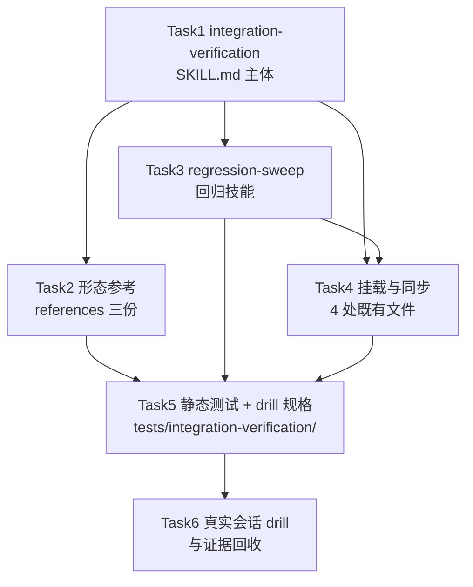
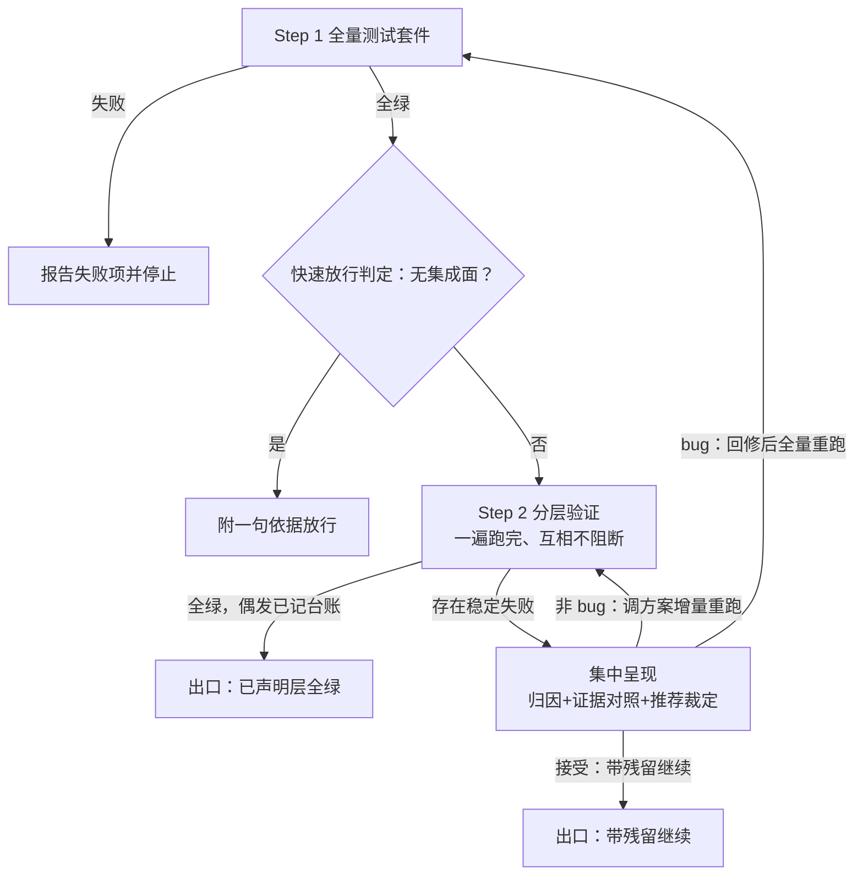
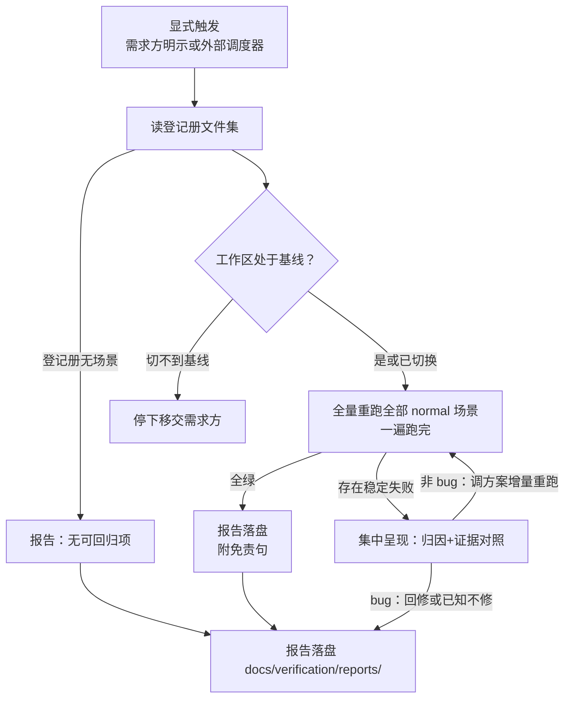
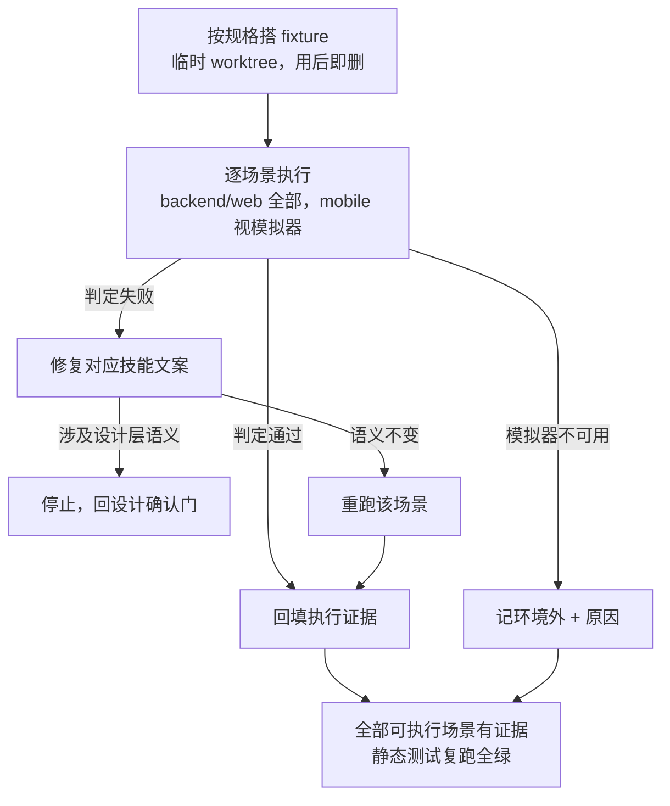

# 集成验证与全量回归 — 实施计划

- **目标：** 需求方走完工作流的分支，在并入 main 前多一道集成层验证关：需求级验证方案在计划阶段生成、任务期资产化、独立技能执行；收尾阶段并入项目级场景登记册；回归技能显式触发后在基线上全量重跑整个项目。
- **架构：** 两个新技能（`integration-verification`、`regression-sweep`）+ 四处既有文件挂载改动（requesting-code-review 接力句、finishing 免跑与并入、writing-plans 验证方案要求、skills-map/README 同步）+ 静态测试与真实会话 drill 证据。项目级方案为运行时生成的文件集（`docs/verification/`），本仓库不预置。
- **技术栈：** Markdown 技能与提示词模板；bash 静态测试（仿 `tests/security-gate/test-security-gate.sh` 与 `tests/skill-size/test-skill-size.sh` 体例）。
- **设计文档（Spec）：** `docs/superpowers/specs/2026-11-01-integration-gate-and-regression/design.md`
- **实施前决策记录 + 日期：** 2026-11-02（设计文档已获批；计划层决策见 §3）

## 1. 改动地图

| 文件 | 动作 | 职责 |
|------|------|------|
| `skills/integration-verification/SKILL.md` | 新增 | 集成验证技能：Step 1 全量套件 → Step 2 分层验证；五出口与定性裁决；文件集与登记册条目格式约定 |
| `skills/integration-verification/references/backend.md` | 新增 | 后端路由默认方案：pytest/Jest + testcontainers |
| `skills/integration-verification/references/web.md` | 新增 | Web 路由默认方案：docker-compose + Playwright |
| `skills/integration-verification/references/mobile.md` | 新增 | App 路由默认方案：Appium + Android Emulator |
| `skills/regression-sweep/SKILL.md` | 新增 | 回归技能：显式触发、基线全量重跑、定性裁决 |
| `skills/requesting-code-review/SKILL.md` | 修改 | 收官流程图节点：CO → 集成验证 → FIN |
| `skills/requesting-code-review/references/closeout.md` | 修改 | 末行移交句改为集成验证技能 |
| `skills/finishing-a-development-branch/SKILL.md` | 修改 | Step 1 免跑条件 + 菜单后并入小节 |
| `skills/writing-plans/SKILL.md` | 修改 | 计划完整性要求：组装型计划须含验证方案 |
| `skills/writing-plans/references/plan-template.md` | 修改 | 模板增「验证方案」内嵌章节要求 |
| `docs/skills-map.md` | 修改 | 主链路图、模板分工表、两技能条目 |
| `README.md` | 修改 | 两处技能清单各加两名 |
| `tests/integration-verification/test-integration-verification.sh` | 新增 | 静态断言：存在性、挂载对齐、大小红线 |
| `tests/integration-verification/drills.md` | 新增 | drill 场景规格 + Task 6 执行记录 |

依赖方向：T1 定义技能名与文件集/登记册格式（T2/T3/T4 引用）；T4 挂载需要 T1/T3 的技能名；T5 断言全部前序产物；T6 依赖 T5 的场景规格。命名与格式是本计划的决策（设计留构建者处，见 §3）。

## 2. 功能单元规格

### Task 1: integration-verification 技能主体

**职责：** 交付集成验证技能主体（两步执行、五出口、定性裁决、文件集与登记册约定）——技能名与格式约定被 T2/T3/T4 引用。

**Files:**
- Create: `skills/integration-verification/SKILL.md`
- 参照（不修改）：`skills/requesting-code-review/SKILL.md` 的章节组织与 frontmatter 体例

**Interfaces:**
- Consumes: 无（本任务无先前任务产物）。
- Produces:
  - 技能名 `integration-verification`（T2/T4 引用）。
  - 文件集约定（逐字，T3/T4 引用）：项目级方案目录 `docs/verification/`，含 `environment.md`（环境与手段：各层一行怎么跑——入口命令、环境要求）、`modules/<module>.md`（模块场景登记册）、`cross-module.md`（跨模块场景）。
  - 场景登记册条目格式（逐字，T3/T4 引用）：每条一行 `- <场景id> | <层级 L1|L2|L3|兼容> | <资产路径> | <状态 normal|待合并|已知不修> | <期望一句话>`。

**流程图：**

**边界条件：**

**逐字契约（Task 5 断言对象）：**

- SKILL.md 必含小节（节名逐字，Task 5 断言）：触发、Step 1 全量测试套件、Step 2 分层验证、出口、失败定性裁决、快速放行、环境受限降级、台账记录。

**触发与凭据：**

- 触发小节写两种触发：链路接力（审查收官技能移交，产生移交语义）与单独调用（开发中途验证分支集成状态、失败修复后的复查，出口为验证报告、无移交语义）；frontmatter description 同步写明可单独调用。
- 单独调用与链路调用共用出口凭据机制：全绿或带残留继续均记台账凭据 + HEAD；免跑判据三条件通用。

**Step 1 与快速放行：**

- Step 1 失败阻断 Step 2：报告单测失败项并停止，Step 2 不执行（❌「单测失败仍跑集成层」/ ✅「单测失败即报告并停止」）。
- 快速放行判据：改动面推导（不触及模块组装点、外部接口、运行边界）→ 附一句依据放行；计划的集成面声明仅作对照，不一致以推导为准并记台账。

**Step 2 执行与重跑：**

- Step 2 内各层与场景一遍跑完、互相不阻断（❌「首个稳定失败即中断后续层」/ ✅「全部层执行完毕后集中呈现」）。
- 各场景失败先自动重跑一次：重跑通过 → 台账记偶发稳定性信号、不阻塞；重跑仍失败（稳定失败）→ 不中断执行、收集至集中报告。
- 全部层执行完毕后按层分组集中呈现（层级/场景/归属 + 初步归因及证据对照 + 推荐裁定及理由），等待需求方逐项定性。
- 未声明层 → 标注「未声明」随移交呈现，不阻塞。
- 「环境与手段」初始化：`docs/verification/environment.md` 不存在 → 控制者代拟初稿、需求方确认后创建。
- 验证全绿不承诺无缺陷：技能文案写明「集成层全绿提高把握、不证明无缺陷」（设计「明确不做」第 7 条落点）。
- 登记册写操作约定为串行、不接受并行并入：并入前先同步基线最新登记册；冲突合并规则——控制者能机械判定的（互不重叠新增条目）自行合并，覆盖面重叠或同场景冲突的与需求方讨论后决定（写入文件集约定段）。

**失败定性裁决：**

- 定性「非 bug」→ 调整需求级验证方案（修正场景期望/前置/判据），仅重跑被定性的失败条目（增量重跑，通过则并入当次结果）。
- 定性「bug」→ 指示回修（一次有界修复 + 一次覆盖回修 diff 的限定复审，安全敏感面用安全视角模板），回修完成后全量重跑本技能（Step 1 + Step 2 全部层——代码已变，需全量确认无回归）。
- 或明确指令带残留继续。
- 需求方未定性时控制者不得修改方案期望（❌「场景连败两轮后控制者放宽期望让验证通过」/ ✅「两轮定性裁决均由需求方明示后才调整」）。

**出口与台账：**

- 通过或带残留继续出口 → 台账记录出口凭据与当时 HEAD（供收尾技能免跑判据）。

**大小与 harness 红线：**

- 文件大小 ≤ 20000 字节（`tests/skill-size/test-skill-size.sh` 红线）；不引用任何单一 harness 专有命令；门禁钩子写为「按所在 harness 的钩子机制配置」的项目级可选说明，不绑定实现。

**验收标准：**
- 静态断言（Task 5 执行）：八个小节节名逐一可 grep 到；四个运行层名（集成层、接口兼容层、可运行层、端到端层）与单测层逐字出现；「自动重跑一次」「集中呈现」「推荐裁定」「不得修改方案期望」「待需求方定性」等关键句可 grep 到。
- `tests/skill-size/test-skill-size.sh` 全绿。
- 条目格式行在 SKILL.md 中逐字存在（T3/T4 按此引用）。

### Task 2: 形态参考文件三份

**职责：** 交付三份形态路由参考（backend/web/mobile），被 T1 的路由指向、T5 断言存在性与大小。

**Files:**
- Create: `skills/integration-verification/references/backend.md`
- Create: `skills/integration-verification/references/web.md`
- Create: `skills/integration-verification/references/mobile.md`

**Interfaces:**
- Consumes: Task 1 的技能目录与加载约定（SKILL.md 按 `<形态>` 指向 references 文件名）。
- Produces: 三份参考文件，文件名固定（T5 断言存在性）。

**边界条件：**
- 每份必含五个小节：默认执行器、环境拉起、前置检查、资产化标准、声明覆盖。
  - backend：pytest/Jest 用例 + testcontainers 依赖清单（每次测试一套一次性真实容器，用后销毁）。
  - web：docker-compose 栈定义 + Playwright 场景；交互式浏览器调试工具只出现在「开发期探索」小节，且写明产物须固化为脚本资产。
  - mobile：Appium 场景 + Android 模拟器启动配置；失败重试与截图诊断小节；iOS 写明后置、走环境外验证项移交。
- 每份末行逐字：`本文件是默认方案，项目声明可覆盖执行器选择；覆盖后方案结构与资产化标准不变。`
- 前置检查小节写明工具缺失时的处置 → 移交需求方（环境外验证项），不在技能内安装任何工具。
- 每份文件 ≤ 8000 字节（加载进上下文的代价上限）。
- ❌「参考文件包含某具体项目的 compose 文件内容」/ ✅「参考文件给出 compose 栈应包含哪些服务的清单式指引」。

**验收标准：**
- 三文件存在，各 ≤ 8000 字节（Task 5 断言）。
- 每份五个小节节名与末行覆盖句可 grep 到。
- mobile 含「已知不修」「环境外验证项」处置句；web 交互式工具小节含「固化为脚本资产」句。

### Task 3: regression-sweep 回归技能

**职责：** 交付全量回归技能（显式触发、基线全量重跑、定性三路、报告落盘），消费 T1 的文件集约定与登记册格式。

**Files:**
- Create: `skills/regression-sweep/SKILL.md`

**Interfaces:**
- Consumes: Task 1 的文件集约定（`docs/verification/`）与登记册条目格式；Task 2 的 references（形态路由按模块形态加载，跨技能引用写 `superpowers:integration-verification` 的 references 路径）。
- Produces: 技能名 `regression-sweep`（T4/T5 引用）。

**流程图：**

**边界条件：**

**逐字契约（Task 5 断言对象）：**

- 触发小节逐字含：仅显式触发——需求方口头明示或外部调度器显式调用，绝不隐式自动运行。

**触发与基线：**

- 基线：默认主开发线最新，需求方可指定。

**执行与重跑：**

- 执行：读登记册文件集（模块文件 + 跨模块文件）全量重跑；待合并、已知不修条目跳过并单列呈现，不计失败。
- 每个失败项先自动重跑一次：重跑通过记偶发（台账稳定性信号）；稳定失败进入归因——证据对照（失败日志摘录与期望原文）+ 推荐裁定及理由。

**定性裁决三路：**

- 定性裁决三路：非 bug → 调整项目级方案（修正期望或废弃场景，废弃即移除条目），仅重跑被定性条目（增量重跑）；bug → 需求方再选回修（走正常工作流，作为新需求进入计划）或已知不修（登记册标注状态）。

**报告与出口：**

- 报告落盘：`docs/verification/reports/YYYY-MM-DD-<label>.md`，含当次结果、失败项、待合并清单；不产生任何变更摘要、动作日志或与上次回归的对比（设计已裁决不做记录）。
- 首次回归（登记册为空或无场景）→ 报告写明「登记册无场景，无可回归项」，出口正常。

**红线：**

- 文件大小 ≤ 20000 字节；不内置定时器；不承担代码修复。

**验收标准：**
- 静态断言：显式触发句、报告落盘路径、定性三路句、`docs/verification/reports/` 逐字存在。
- 全文 grep 不到「变更摘要」「上次回归」（设计裁决不做记录的反向断言）。
- `tests/skill-size/test-skill-size.sh` 全绿。

### Task 4: 既有技能挂载与同步

**职责：** 把两个新技能接进收官链路与计划模板，同步既有技能、地图与 README——挂载是全链唯一收尾移交点的单点改动。

**Files:**
- Modify: `skills/requesting-code-review/SKILL.md`（收官流程图：`CO --> FIN` 节点链改为 `CO --> IV --> FIN`，IV 节点标注集成验证技能）
- Modify: `skills/requesting-code-review/references/closeout.md`（末行 `使用 superpowers:finishing-a-development-branch。` 改为 `使用 superpowers:integration-verification。`）
- Modify: `skills/finishing-a-development-branch/SKILL.md`（Step 1 增免跑条件段；菜单执行后增并入小节）
- Modify: `skills/writing-plans/SKILL.md`（范围检查章增计划完整性要求句）
- Modify: `skills/writing-plans/references/plan-template.md`（模板增「验证方案」内嵌章节）
- Modify: `docs/skills-map.md`（主链路图、审查模板分工表、两技能条目）
- Modify: `README.md`（第 340 行列表与第 377 行摘要各加两名）

**Interfaces:**
- Consumes: Task 1 的技能名 `integration-verification`、文件集约定、登记册格式、出口凭据语义；Task 3 的技能名 `regression-sweep`。
- Produces: 挂载完成的工作流链路（收官 → 集成验证 → 收尾）。

**边界条件：**

**移交双处同步：**

- 逐字对齐（Task 5 断言）：`SKILL.md:58` 流程图与 `closeout.md` 末行的移交语义一致，均指向 `integration-verification`；❌「只改流程图漏掉 closeout.md 末行」/ ✅「两处同步修改，静态断言双绿」。

**finishing 免跑与并入：**

- finishing 的免跑条件段逐字含三判据：出口凭据（全绿或带残留继续）、HEAD 一致、`git status --porcelain` 为空；任一不满足 → 照跑全量套件（单测层兜底）并移交「结果过期」。
- finishing 增并入小节：菜单选择「本地合并」或「推送并创建 PR」后 → 按条目格式三态登记进 `docs/verification/`（写入前先同步基线最新登记册；冲突按串行合并规则——机械可判定自行合并、非机械升级需求方讨论）；选「保持分支原样」不并入。

**特征锁定：**

- 不得改变的既有行为（特征锁定）：finishing 菜单三项逐字文案、丢弃确认 `discard` 流程、合理化借口表全部条目；requesting-code-review 收官段（终审/修复/复审/安全门）既有句零改动——只动移交句与流程图节点；writing-plans 自审既有九项零改写——只按设计决策 11 增补第十项（验证方案专项），且在范围检查章增句。

**writing-plans 增句与模板：**

- writing-plans 增句（范围检查章）：计划存在跨任务组装点或触及外部接口 → 计划须含「验证方案」内嵌章节（六项：集成面声明、验证环境、场景清单、执行手段、通过判据、产出物；每条场景期望标注设计出处，无出处不得入方案；集成面与场景清单双向映射；附修复闭环轮次上限 N，默认 3，需求方可改）；纯单模块无接口计划不加。
- plan-template 模板：增「验证方案」章节说明（可选项，触发判据同上；章节内含出处标注列、集成面↔场景双向映射表、粒度与可操作性判据、人工验证清单标注；内容要求六项——确定性固定策略、保真度声明、副作用隔离、顺序依赖显式化、既有登记册查重、失败证据采集），不改动既有五章骨架。
- writing-plans 自审清单：增补第十项「验证方案专项」（四性逐查、内容要求六项逐查、出处抽查、双向映射核对）——既有九项零改写，仅追加。

**skills-map 与 README：**

- skills-map：主链路图 `CR --> IV --> FIN`（house mermaid 风格：英文 id、引号文本、` `）；模板分工表不变（两新技能不派审查模板）；新增两技能条目段。
- README 两处清单各加 `integration-verification` 与 `regression-sweep` 两条。

**验收标准：**
- Task 5 静态断言全绿：两处移交句指向 `integration-verification`；finishing 含三判据词与并入小节；writing-plans 与 plan-template 含验证方案要求句；skills-map 主链路含集成验证节点；README 两处含两技能名。
- 特征锁定清单逐项 grep 确认原句未变（菜单三项、`discard` 流程、自审既有九项）；writing-plans 自审第十项存在（验证方案专项）。

### Task 5: 静态测试与 drill 规格

**职责：** 交付可重复执行的静态测试套件（断言 T1-T4 全部产物）与 drill 场景规格（T6 的执行依据）。

**Files:**
- Create: `tests/integration-verification/test-integration-verification.sh`
- Create: `tests/integration-verification/drills.md`

**Interfaces:**
- Consumes: T1-T4 全部产物（断言对象）。
- Produces: 可重复执行的静态测试（exit 0/1）；drill 场景规格（T6 的执行依据）。

**边界条件：**
- 测试体例仿 `tests/security-gate/test-security-gate.sh`：`set -euo pipefail`、`ck` 断言助手、无网络无子代理、幂等。
- 断言清单（逐条）：两技能 SKILL.md 存在且节名齐全；三 references 存在且 ≤ 8000 字节；条目格式行逐字存在；两处移交句指向 `integration-verification`；finishing 三判据词与并入小节存在；writing-plans 验证方案句与自审第十项存在；plan-template 含出处标注与双向映射句及内容要求句；T1 含「不证明无缺陷」句、「增量重跑」句、「失败阻断 Step 2」句与「单独调用」句；regression-sweep 含显式触发句且 grep 不到「变更摘要」「上次回归」；`tests/skill-size/test-skill-size.sh` 通过；两新 SKILL.md 过 `check-mermaid.sh`。
- drills.md 场景规格覆盖成功标准 1-9 与四个特殊场景：有集成面却判无（反向）、HEAD 变了却免跑（反向）、未定性改期望（压力）、偶发失败重跑通过仍停下定性（压力）；每个场景写：名称、预置（项目形态/方案状态）、驱动消息、验收观察点；backend/web 场景标可执行，mobile 场景标注「模拟器可用为前提，不可用则记环境外」。
- 测试失败输出格式与 security-gate 一致（`FAIL: <断言名>` 到 stderr，退出码 1）。

**验收标准：**
- `bash tests/integration-verification/test-integration-verification.sh` 退出码 0（在 T1-T4 完成的树上）。
- 对人为破坏任一断言对象（如改掉移交句）→ 对应断言红（执行者用临时改动自证一次后还原）。
- drills.md 含成功标准 1-9 与四个特殊场景的规格，共不少于 13 个场景条目。

### Task 6: 真实会话 drill 与证据回收

**职责：** 在真实会话中按 T5 的场景规格执行 drill，回填执行证据到 drills.md。

**Files:**
- Modify: `tests/integration-verification/drills.md`（回填执行记录与证据）

**Interfaces:**
- Consumes: Task 5 的场景规格；已完成的 T1-T4 工作树状态。

**流程图：**

**边界条件：**
- 每个 backend/web 场景在真实会话中执行（headless 或交互式），回填：执行时间、会话证据（关键输出摘录）、判定（通过/失败/环境外）。
- 定性裁决类场景由驱动消息内预设需求方应答（如「定性：非 bug，调整场景期望」），不需真实需求方在线。
- mobile 场景：模拟器不可用 → 判「环境外」，记录原因，不阻塞本任务收尾（设计：mobile 以环境可用为前提单独补验）。
- 任一场景判定失败 → 该场景对应技能文案修复后重跑该场景；修复涉及设计层语义时停止并回设计确认门。
- 全部可执行场景有证据、环境外场景有原因记录 → 任务收尾。

**验收标准：**
- drills.md 中每个 backend/web 场景条目含执行证据；mobile 场景含执行结果或环境外原因。
- 静态测试在证据回填后仍全绿（drills.md 为纯文档，不影响断言）。

## 3. 设计依据

- **技能拆两个而非一个**：集成验证与回归是两种对象（本分支 vs 项目基线）、两种触发（链路内 vs 显式外部），设计文档决策 6/10 已论证；计划照此落为两个技能目录。
- **技能命名**（设计留构建者，计划定）：`integration-verification` 与 `regression-sweep`。候选 `verify-integration`（动词开头）被排除——仓库既有命名是名词短语风格（`finishing-a-development-branch`、`requesting-code-review`），保持一致。
- **文件集目录约定 `docs/verification/`**（设计留构建者，计划定）：候选放项目测试文档同级散文件被排除——模块拆分要求目录结构，且环境/登记册/报告三类产物同域存放才可检索；随项目入库（设计要求可检索）。
- **需求级验证方案内嵌计划章节**（设计留构建者：内嵌 vs 独立文件，计划定内嵌）：方案与计划同生命周期，独立文件多一套命名与定位约定；集成验证技能经控制者持有的计划路径即可定位。候选独立文件被排除。
- **登记册条目为行式格式**（设计留格式构建者，计划定）：一行一条便于追加与串行合并冲突最小化；字段五项覆盖设计要求（层级、资产路径、状态、期望）与登记定位（场景 id）。

## 4. 约束

- **零插件运行时依赖**：技能不安装工具；工具由被验证项目安装，技能只写前置检查。
- **调优文案锁定清单**（改动只增补，不得改写既有句）：finishing 菜单三项逐字文案、`discard` 丢弃确认流程、合理化借口表全部条目；requesting-code-review 收官段（终审→修复→复审→安全门）全部既有句；writing-plans 自审既有九项（第十项验证方案专项为设计决策 11 批准的增补）。
- **跨 harness**：技能文案不引用单一 harness 专有命令与路径；门禁钩子写为按所在 harness 钩子机制配置的项目级可选说明。
- **mermaid 红线**：所有图用 `id["标题"]` 形态、引号文本、` `；提交前跑 `scripts/check-mermaid.sh` 与 `scripts/check-tables.sh`。
- **测试体例**：静态测试仿 security-gate（幂等、无网络、无子代理）；skill-size 20000 字节红线对全部 SKILL.md 生效。
- **TDD 红绿循环不预写**：任务只到边界条件 + 验收标准，测试代码由执行者按 superpowers:test-driven-development 展开。

## 5. 风险清单

| 风险 | 触发条件 | 影响 | 缓解方式 |
|------|---------|------|---------|
| 收官接力句改动破坏收官流程 | 只改 SKILL.md 流程图漏改 closeout.md 末行（或反向） | 终审完成后流程断裂，全分支收官后无处移交 | Task 4 双处同步修改 + Task 5 双断言 + 「对人为破坏自证一次红」 |
| 新 SKILL.md 超限 | 单文件超 20000 字节 | 触发 harness 压缩截断，技能尾部指令丢失，出口/裁决语义静默失效 | 大小红线进 Task 1/3 边界条件与 Task 5 断言；过量内容下沉 references |
| 形态参考臆写具体项目细节 | 执行者把示例写成具体实现 | 参考文件绑定不存在的项目结构，其他项目不可用，路由参考失去通用性 | Task 2 边界条件 ❌/✅ 对照 + 每份末行覆盖句 + ≤ 8000 字节上限 |
| drill 会话成本失控 | 场景数 13+ 全串行执行 | 时间与 token 成本高，交付周期拉长 | backend/web 先行、mobile 允许环境外记录；失败场景修复后只重跑该场景 |
| 验证方案章节与既有计划模板冲突 | plan-template 增章节方式不当 | 模板使用者困惑，非组装型计划被误加空章节 | 模板写明可选性与触发判据（跨任务组装点或外部接口）；writing-plans 增句同样带判据 |
| mobile 模拟器环境不可用 | 本机无 Android 模拟器 | mobile drill 无法执行，mobile 参考文件缺真实会话证据 | 设计已允许环境外记录；不阻塞其余交付，证据后补 |

## 执行交接

- 建议执行方式：**子代理驱动**。六个任务边界清晰、验收标准全部可静态或会话判定，任务间只通过技能名/格式约定耦合（已在 Interfaces 逐字固定）；每任务由全新子代理实施、全新审查者把关，最后整分支终审。
- 必需子技能（若选子代理驱动）：superpowers:subagent-driven-development；若选会话内执行：superpowers:executing-plans。
- 请需求方审查：各任务的边界条件与验收标准是否忠实覆盖设计文档的功能清单与「明确不做」清单。
- 明确确认后才进入实施；「嗯」「继续」不算明确确认。
- 实施开始后发现设计必须改：停止实施，回到设计确认门；返工还是回滚由需求方决定；已合入 main 的部分用新提交修正，不改写历史。

## 独立审读处置记录附录

**审读者**：自审（计划者本人；独立审读子代理被需求方手动停止，按 writing-plans 无子代理回退路径执行，需求方已知悉本次无独立审读）。

**自审记录（九项清单）**：

| 项 | 结果 |
|----|------|
| 1 设计文档覆盖 | 功能清单 10 项逐项对到 T1-T4；明确不做 10 条对到约束章与各任务边界——发现「不承诺全绿=无缺陷」缺落点，已补 T1 边界条件 + T5 断言 |
| 2 单元五问 | 六任务输入/输出/边界/失败路径/证明齐备 |
| 3 类型一致性 | 技能名、文件集路径、条目格式在 T1/T3/T4 间逐字一致 |
| 4 失败模式覆盖 | 设计风险 1-7 对到计划风险清单与任务边界（基建缺口→T2 前置检查；flaky→T2 mobile 小节 + T1/T3 重试语义） |
| 5 比例 | 计划 229 行 vs 设计 321 行，无誊抄 |
| 6 可判真伪与锚定 | 挂载锚点（SKILL.md:58、closeout.md 末行、README:340/377、skill-size 20000 字节）全部实测核对，非记忆臆写 |
| 7 五章完整与写作要求 | 五章齐、无禁词、图合规、预检双绿 |
| 8 实现效果 | 计划→任务资产→收官→集成验证→收尾→并入→回归链路串得起；功能清单每条「输入→看到什么」有产生点 |
| 9 接口可测性 | 全部产物为 Markdown 技能文本，验收标准均为静态 grep/大小/脚本断言，可测 |

自审后修订：T1 补「不承诺无缺陷」句、T5 断言清单同步、T4 writing-plans 增句补 N 轮上限默认 3、T1/T4 补登记册串行写入与合并规则、T1 验收标准补四层名断言。

**需求方修改（2026-11-02，确认审查中提出）**：集成验证与回归由「逐失败中断」改为「一遍跑完、集中呈现」——设计回炉修订（功能 1、决策 5 依据、成功标准 1、流程图 E 节点），计划同步（T1 边界条件与验收标准、T5 断言清单）；T3 回归本为批式报告，无改动。

**需求方修改二（2026-11-02）**：定性「非 bug」调整方案后仅重跑被定性条目（增量重跑），bug 回修路径保持全量重跑——设计修订（功能 1/5、决策 5 代价），计划同步（T1/T3 边界条件、T5 断言清单）。

**需求方修改三（2026-11-02，计划确认审查中提出）**：T1 边界条件补 bug 回修完成后的全量重跑语义（设计决策 5 已有、计划 T1 漏落）。

**需求方修改四（2026-11-02，设计补充之七联动）**：验证方案质量机制落计划——T4 writing-plans 增句扩出处锚定与双向映射、plan-template 章节要求扩四性判据与人工清单标注、自审增补第十项（验证方案专项）、T5 断言同步；约束章特征锁定清单更新（自审既有九项零改写、第十项为批准增补）。

**需求方修改五（2026-11-02，设计补充之八联动）**：T1 触发双模式（链路接力/单独调用）与凭据共用写进边界条件；T4 plan-template 章节要求补内容要求六项；T5 断言同步（单独调用句、内容要求句）。

**已告知需求方：本次计划审读为自审，无独立子代理审读。**
