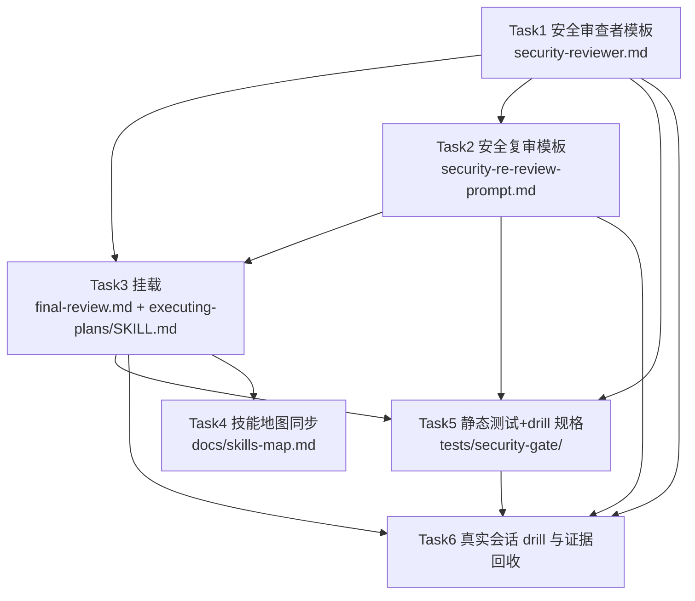

# 安全审查门 — 实施计划

- **目标：** 需求方走完工作流后，分支在并入 main 前多一道专职安全关卡：数据流类缺陷被系统性查出并修复，纯文档改动快速放行，残留项全部可见地移交需求方。
- **架构：** 新增两个专职提示词模板（安全审查者、安全复审者），挂在两种执行方式共用的收尾链路末端（限定复审之后、裁决清单编制之前）；用 bash 静态测试钉住跨文件逐字对齐；技能地图文档同步；本会话内执行真实会话 drill 并回收证据。
- **技术栈：** Markdown 技能/提示词模板；bash 静态测试（仿 `tests/skill-size/test-skill-size.sh` 风格）。
- **设计文档（Spec）：** `docs/superpowers/specs/2026-11-01-security-gate/design.md`
- **实施前决策记录 + 日期：** 2026-11-01（设计文档已获批；计划层决策见 §3）

## 1. 改动地图

| 文件 | 动作 | 职责 |
|------|------|------|
| `skills/requesting-code-review/security-reviewer.md` | 新增 | 安全门审查者提示词模板：数据流检查结构、快速放行判据、分级输出 |
| `skills/requesting-code-review/security-re-review-prompt.md` | 新增 | 安全修复轮后的限定复审模板：逐项判定 + 新安全问题 |
| `skills/subagent-driven-development/references/final-review.md` | 修改 | 在限定复审之后插入安全门段（与 executing-plans 逐字一致）；收尾段末尾追加一句安全门收集句 |
| `skills/executing-plans/SKILL.md` | 修改 | 终审章后插入同一安全门段；流程图加安全门节点；收尾段末尾追加同一句安全门收集句 |
| `docs/skills-map.md` | 修改 | 主链路图加安全门节点；审查模板说明与表补安全门 |
| `tests/security-gate/test-security-gate.sh` | 新增 | 跨文件静态断言：存在性、逐字对齐、禁句、判据覆盖、大小上限 |
| `tests/security-gate/drills.md` | 新增 | drill 场景规格 + Task 6 执行记录（真实会话证据） |

依赖方向：模板（T1/T2）被挂载（T3）引用、被测试（T5）断言、被 drill（T6）真实调用；模板并列放在 requesting-code-review 下，因为两种执行方式都经由该技能的模板族获取审查者提示词，安全门与整分支终审同级、跨方式共用。

## 2. 功能单元规格

### Task 1: 安全审查者模板

**Files:**
- Create: `skills/requesting-code-review/security-reviewer.md`
- 参照（不修改）：`skills/requesting-code-review/code-reviewer.md`（占位符与「Subagent (general-purpose):」派发格式、只读约束、不派子代理约束的行文风格）

**Interfaces:**
- Consumes: 无（本任务无先前任务产物）。
- Produces: 模板文件，须含以下逐字固定的节名（Task 3 与 Task 5 引用）：
  - `## 输入` — 三项：审查包路径、终审发现清单（含已修复项标记，格式见 Task 3 规则 2）、台账中搁置/暂缓行的指引
  - `## 检查结构` — 数据流追踪（源清单：用户输入、文件、网络、环境变量、LLM/工具输出；汇清单：命令执行、SQL、路径拼接、URL 请求、反序列化、HTML 渲染）+ 认证授权边界 + 密钥与依赖
  - `## 快速放行` — 判据按「面」组织的封闭清单：外部输入处理、认证授权、密钥/依赖、外部通信、LLM 输入/输出处理；每面显式写明归入其下的源条目
  - `## 输出格式` — Clean-Pass / Findings（Critical/Important/Minor）/ Non-Security Observations / Verdict 四节
  - 只读约束与「不得派发子代理」约束（沿用 code-reviewer.md 既有行文风格改写为安全门语境）

**边界条件：**
- 五个判据面逐一对照后全部不触及 → Clean-Pass，依据恰为一句；任一面触及 → 完整检查结构走完。❌「改动很小所以放行」/ ✅「五面逐一对照、依据写明未触及哪五面」。
- 判据面与源清单的映射必须显式写在 `## 快速放行` 节内，不留靠推断的对应（设计文档附录 R2 处置）。
- 「文件」源按窄解执行：指不可信来源的文件内容作为输入（用户上传、外部数据文件）；不含代码自身的配置文件读取与本仓库文件访问。宽解会使任何含配置读取的分支都无法放行，快速放行形同虚设。
- 终审发现清单占位符缺失时 → 审查者在报告开头注明「终审发现清单未提供，已修复项未知」，照常执行检查结构；不得臆测哪些问题已被修复。
- 非安全发现 → 只进 Non-Security Observations，不进分级、不阻塞 Verdict。
- 已被终审修复的安全问题 → 依据 `[已修复]` 前缀标记跳过，不复述为发现项。
- 报告中每条 Critical/Important 发现项必须含：位置（file:line）、缺陷描述、为什么可被利用（触发输入 → 危险汇路径）、修复方向。
- 说明性文字避免同一句内「还会/之后/后续」与「终审」先后出现（会误命中禁句正则）；表达先后顺序用「在此之前已完成」等不含触发词的句式。
- 文件大小 ≤ 12000 字节（模板全文会被审查者一次读入，臃肿稀释判断力；同族 code-reviewer.md 实测 7190 字节，本模板多出判据映射与分级细则，上限取其约 1.7 倍）。

**验收标准：**
- 模板含上述五个节名；`## 检查结构` 内源清单五项、汇清单六项逐项可 grep 到。
- `## 快速放行` 节内五个面各出现一次，且每个面词出现的行内或紧随 3 行内出现其映射的至少一个源条目词。
- 禁句断言：模板中 grep 不到正则 `(还会|之后|后续)[^。]*终审`（禁「后续还会终审」语义；「终审发现清单」作为输入名不匹配该正则，合法出现）。
- 四条行为边界各有对应指令句：占位符缺失处置、非安全观察处置、`[已修复]` 前缀跳过、发现项四要素——各可 grep 到（关键词：`未提供`、`Non-Security`、`已修复]`、`可被利用`）。
- 按 superpowers:writing-skills 的预检清单自检通过：每条指令可判真伪、无「适当」「必要时」「等等」、占位符在文末集中列出。
- 字节数 ≤ 12000（`wc -c` 证）。

### Task 2: 安全复审模板

**Files:**
- Create: `skills/requesting-code-review/security-re-review-prompt.md`
- 参照（不修改）：`skills/subagent-driven-development/re-review-prompt.md`（限定复审的行文结构与输出格式范本）

**Interfaces:**
- Consumes: Task 1 模板的分级词汇（Critical/Important/Minor）与发现项格式（位置+缺陷+可利用性+修复方向）。
- Produces: 复审模板，占位符逐字为：`[MODEL]`（必填，注明按 Model Selection 选最强档）、`[FINDINGS]`（安全发现清单，逐字复制，已修复项带 `[已修复]` 前缀）、`[REPORT_FILE]`（安全修复者报告文件，与范本同名同义）、`[FIX_BASE_SHA]`、`[HEAD_SHA]`、`[DIFF_FILE]`（由控制者运行 review-package 生成并填入路径）；输出四节逐字为：`### Finding Verdicts`、`### New Security Issues in the Fix Diff`、`### Out-of-Scope Observations`、`### Verdict`。另含「## 测试」节（沿用范本语义）：把修复报告中的测试声明视为未经证实的声明，确认报告写明覆盖被修改代码的测试及输出，并对照 diff 核验。

**边界条件：**
- ADDRESSED 的判定标准与 re-review-prompt 同义：「已尝试」不算——发现项所指缺陷必须已不复存在，附 file:line 证据。
- 复审发现修复引入的新安全问题 → 标注严重度记入 `New Security Issues` 节；不自动触发第二轮修复（后续处置由挂载段定义，模板本身只报告）。
- 非安全观察 → `Out-of-Scope Observations`，不阻塞。
- 禁句：模板中 grep 不到正则 `(还会|之后|后续)[^。]*终审`——安全复审是该分支的最后一次审查（设计文档附录 A6 处置）；行文避免同句内「还会/之后/后续」与「终审」先后出现，防止误命中。
- `[MODEL]` 占位符说明与 re-review-prompt 的「最低档到中档」相反：安全复审是合并前判断型任务，写明最强档，并注明「Model Selection 中限定范围重审的低档规则不适用于安全门复审，依据为设计文档决策 6」。

**验收标准：**
- 六个占位符逐字存在且在文末集中列出；四个输出节名与「## 测试」节逐字存在。
- 禁句正则断言通过。
- 按 writing-skills 预检清单自检通过；文件大小 ≤ 8000 字节（对照同族 re-review-prompt.md 实测 4958 字节与新增的安全语义说明）。

### Task 3: 两种执行方式挂载

**Files:**
- Modify: `skills/subagent-driven-development/references/final-review.md`（现结构：终审段 → 修复与限定复审段 → `### 收尾` Rulings 段 → 删工作区 → finishing）
- Modify: `skills/executing-plans/SKILL.md:140-163`（`## 终审` 与 `## 收尾` 两章）及 `skills/executing-plans/SKILL.md:34-69`（流程图）

**Interfaces:**
- Consumes: Task 1/2 模板路径与节名、分级词汇、Clean-Pass 语义。
- Produces: 两文件中各一个安全门段，标题逐字为 `### 安全门`，两段正文逐字相同（对齐不变量，差异只允许语境括注，见边界条件）。挂载段必须覆盖的规则清单：
  1. 位置声明：终审及其后的一切修复/复审工作收尾之后、Rulings 编制与工作区删除之前。
  2. 派发：最强档（按 Model Selection），用 `security-reviewer.md` 模板；输入 = 整分支审查包 + 终审发现清单 + 台账搁置行指引。终审发现清单格式：已被修复的项加 `[已修复] ` 前缀，未修复项无标记；清单由控制者从终审台账与修复记录整理。
  3. Clean-Pass → 台账行 `Final: security-gate: clean-pass: <一句依据>`。
  4. Critical/Important → 恰好一轮安全修复：SDD 语境派单个修复子代理携带完整发现清单，会话内语境由你亲自修复；每项修复 RED→GREEN + 全绿套件；修复报告（SDD 为修复者报告文件，会话内为台账行）必须含覆盖测试的命令与输出证据；报告的每项发现项以 `Final: security-gate: finding (<severity>): <one-liner>` 记入台账；随后恰好一次安全复审，用 `security-re-review-prompt.md`——SDD 语境派发子代理，会话内语境由你亲自按模板执行，以台账中的安全修复行及其测试输出作为 `[REPORT_FILE]` 的等价物（设计文档 §2 第 6 条：复审同样会话内完成）。安全复审派发档位为最强档——Model Selection 中「限定范围重审用最低档到中档」的规则不适用于安全门复审，依据为设计文档决策 6。
  5. 复审后的 NOT ADDRESSED 残留与新安全问题 → 记台账裁决行，移交需求方，不进第二轮修复（熔断有界，设计文档 §3 第 6 条）。
  6. Minor → 台账行 `Final: security-gate: minor (deferred): <one-liner>`。
  7. 非安全观察：门与安全复审两处的非安全观察都记台账，不阻塞。
  8. 无子代理工具 → 阅读 `security-reviewer.md` 亲自按模板自查，台账行 `Final: security-gate: self-review (no subagent tool)`，并在最终消息说明（与终审既有降级句式一致）；其后的安全修复与安全复审同样会话内完成。
  9. 移交渠道（不修改任何既有句子，以本规则实现）：收尾时把台账中全部 `Final: security-gate:` 行收进最终消息，在 Rulings I made 之下单列 `Security gate` 小节——其中裁决行（含 `Ruling:` 子串）同时进入 Rulings 本体，clean-pass 与 minor (deferred) 行进 Security gate 小节。为此两文件的收尾段各自**追加**一句（新增句，不嵌入既有句），插入位置为收尾段末句「使用 superpowers:finishing-a-development-branch」**之前**：「安全门的全部行（clean-pass、裁决、minor deferred、self-review）收进你最终消息的 Security gate 小节，其中裁决行同时进 Rulings I made。」
  - 另：`executing-plans/SKILL.md:34-69` 流程图在「重新分级修复」节点之后、「终审通过」之前插入安全门判定节点与分支边，mermaid 语法保持有效。

**边界条件：**
- 不得改变的既有行为（特征测试锁定来源）：终审段、分级段、修复段、两收尾段的全部既有句子逐字保留，一切补充以新增句或新增段实现；「恰好一轮集中修复」的语义不被安全门改写——安全修复轮是独立的有界轮，不与终审集中修复合并计数。
- 挂载段插入位置：`### 安全门` 标题在 final-review.md 中位于限定复审内容之后、`### 收尾` 标题之前；在 executing-plans/SKILL.md 中位于终审章修复内容之后、`## 收尾` 标题之前。
- 两文件安全门段正文逐行 diff，不同行数 ≤ 2 行；每处差异为一处语境括注（SDD 语境/会话内语境的执行者指称）。
- 流程图新增节点含「快速放行」「Critical/Important」两条出边，与 Task 1 输出格式对应。

**验收标准：**
- 两文件中 `### 安全门` 段按「标题行起、至下一个以 `#` 开头的标题行（不含）止」提取，逐行 diff 不同行数 ≤ 2。
- 特征检查：终审/分级/修复/收尾段的既有代表性句子（每文件至少各 1 句，由执行者从改前版本取）在改后版本中逐字仍在。
- 位置断言（分文件）：final-review.md 中 `### 安全门` 行号小于 `### 收尾` 行号且大于限定复审段首行行号；executing-plans/SKILL.md 中 `### 安全门` 行号小于 `## 收尾` 行号且大于 `## 终审` 行号。
- executing-plans 流程图 mermaid 块语法结构完整（无悬空节点/边，本机无渲染器时以边引用闭合性检查替代）。
- 台账行格式四条（clean-pass / minor (deferred) / self-review / `[已修复] ` 前缀说明）逐字存在于挂载段。
- 两收尾段的追加句逐字存在（Task 3 规则 9 引号内原句）。

### Task 4: 技能地图同步

**Files:**
- Modify: `docs/skills-map.md:29`（主链路图 FR 节点之后）、`docs/skills-map.md:108-110`（模板分工标题与引言）、`docs/skills-map.md:115-119`（审查技能表与说明）

**Interfaces:**
- Consumes: Task 1/2 模板路径、Task 3 的挂载位置与台账行格式。
- Produces: 文档更新，无代码接口。

**边界条件：**
- 主链路图：安全门节点在整分支终审/修复链节点之后、finishing 节点之前，节点文案含「安全门」与「requesting-code-review（security-reviewer 模板）」。
- `108-110` 行区域：模板分工标题与引言从「三份」更新为覆盖全部五份审查提示词文件（三份既有 + 两份新增）的表述，各模板一句分工。
- 审查技能表：按现有表格式新增两行（两个模板：触发、产出、判定），并把现有 code-reviewer 行的「审查时机」说明补一句「其后为安全门」。
- 表格列数与现有表一致；不改动表中其他行的既有文案。

**验收标准：**
- 图中安全门节点位置断言：介于终审链节点与 finishing 节点之间（读取 mermaid 边关系可判）。
- 表新增两行且列数与表头一致；既有行文案未被改动（改前改后逐字对照）。
- 分工引言覆盖全部五个模板文件名。

### Task 5: 静态一致性测试与 drill 规格

**Files:**
- Create: `tests/security-gate/test-security-gate.sh`
- Create: `tests/security-gate/drills.md`

**Interfaces:**
- Consumes: Task 1-4 的全部产物（断言对象）。
- Produces: 可重复运行的 bash 测试脚本（无参数、退出码 0/1）与 drill 场景规格文档（Task 6 将向其追加执行记录）。

**边界条件：**
- 脚本幂等：重复运行结果一致；不依赖 git 状态、网络或子代理工具。
- 断言清单（每条失败输出 `FAIL: <文件> <断言名>` 并置 exit 1，全部通过输出一行 `PASS`，风格仿 `tests/skill-size/test-skill-size.sh`）：
  1. 两模板文件存在。
  2. Task 1 的五个节名、源清单五项、汇清单六项逐项可 grep。
  3. 判据五面逐项可 grep；每个面词出现的行内或紧随 3 行内出现其映射的至少一个源条目词（机械判定：面词行号与源词行号差 ≤ 3）。
  4. 禁句断言：两模板中 grep 不到正则 `(还会|之后|后续)[^。]*终审`。
  5. 两文件 `### 安全门` 段按「标题行起、至下一个以 `#` 开头的标题行（不含）止」提取，逐行 diff，不同行数 ≤ 2。
  6. 挂载段台账行格式三条（clean-pass / minor (deferred) / self-review）与 `[已修复] ` 前缀逐字存在（两文件各查）；两收尾段的安全门收集追加句逐字存在且位于「使用 superpowers:finishing-a-development-branch」句之前。
  7. 复审模板六占位符、四输出节名、「## 测试」节逐字存在。
  8. 字节上限：security-reviewer.md ≤ 12000、security-re-review-prompt.md ≤ 8000。
- drills.md 场景规格至少含四个场景，每个含：前置（分支预置内容）、执行（走挂载后的收尾链路）、期望（可判真伪的成功判据）：
  - ① 预埋数据流缺陷分支（如环境变量拼接执行命令的最小文件）→ 安全门报 Critical 并触发修复轮，不放行；
  - ② 纯文档/测试改动分支 → Clean-Pass 且依据为一句；
  - ③ 预埋表述隐蔽但落在判据已覆盖面内的缺陷（如经中间变量间接拼接外部输入到命令）→ 安全门必须报 Critical，放行即该场景 FAIL；
  - ④ 触发修复且复审残留（修复者只修复部分发现项）→ 恰好一轮、残留进最终消息 Security gate 小节、无第二轮。
  - 文末注明：真实会话 drill 的执行记录（Task 6，场景①②）与未执行场景（③④）的落地仓库（外部 eval 仓库）的对应关系。

**验收标准：**
- `bash tests/security-gate/test-security-gate.sh` 退出码 0，输出含 PASS 行；对 Task 1-4 故意制造的任一破坏（删一个节名、改一处对齐句）脚本能 FAIL——执行者以临时改动验证后还原。
- drills.md 四场景齐全、每场景判据可判真伪。

### Task 6: 真实会话 drill 与证据回收

**Files:**
- Create: 无入库文件（drill 分支与报告存于临时 worktree 与会话内，不提交到任何共享分支）
- Modify: `tests/security-gate/drills.md`（文末追加「执行记录」小节）

**Interfaces:**
- Consumes: Task 3 挂载段（派发规则与台账行格式）、Task 1/2 模板、Task 5 的 drills.md 场景规格。
- Produces: drills.md 文末执行记录——设计文档成功标准 1/2 的真实会话证据。

**边界条件：**
- 场景②（放行路径）：对实施分支本身（纯文档/模板改动）按挂载段规则派发真实安全审查者子代理 → 期望 Clean-Pass，依据为一句，台账行按 clean-pass 格式记入。
- 场景①（触发路径）：临时 worktree（`git worktree add`）中构造预埋缺陷分支——一个含环境变量值拼接进 shell 命令执行的最小脚本文件加一次提交 → 按挂载段规则对该分支派发真实安全审查者子代理 → 期望 Critical 级发现项，且发现项含四要素（位置/缺陷/可利用性/修复方向）；随后派单个修复子代理修复 → 安全复审 → 期望全部 ADDRESSED。全部走完恰好一轮，不出现第二轮。
- 场景③与场景④不在本次执行，留待外部 eval 仓库：④构造「修复者故意不修完」需诱导真实子代理做出低质量工作，不做；③与①同构，其价值是隐蔽缺陷的召回率检验，留 eval 批量执行。两场景由 drills.md 规格 + Task 5 断言覆盖。
- 本任务要求当前环境有子代理工具；无子代理环境时，场景①②以会话内自查模式执行，并在执行记录注明降级（证据强度弱于派发）。
- drill 派发总计 4 次子代理：场景①审查、修复、复审各 1 次，场景②审查 1 次。
- 预埋缺陷文件只存在于临时 worktree：drill 完成（或失败核查完毕）后 `git worktree remove` 删除，`git worktree list` 无残留；worktree 不得位于任何共享分支上。
- drill 报告的关键内容（发现项、判定、Clean-Pass 依据句）抄录进 drills.md 执行记录，每场景一条：日期、派发方式（子代理/会话内）、报告要点、判定结果。

**验收标准：**
- drills.md 执行记录含场景①与场景②各一条，判据可判真伪（场景①：报告含 Critical 与四要素；场景②：Clean-Pass 与一句依据）。
- `git worktree list` 输出中无 drill 残留。

## 3. 设计依据

- **模板并列放在 requesting-code-review 下**：两种执行方式的终审都指向该技能的模板族（code-reviewer.md），安全门与终审同属「请求代码审查」职责；复审模板不放在 SDD 下（re-review-prompt.md 在 SDD 是因为它专述任务语境），安全复审跨方式共用，随安全审查者放同目录。代价：SDD 的模板分散在两目录；挂载段用完整路径引用消解。
- **挂载段逐字对齐机制**：设计文档风险 2（措辞不同步 → 静默跳过）的对策不是「小心写」，而是可机械判定的断言——两段提取后逐行 diff。为此 Task 3 Interfaces 把段标题（`### 安全门`）与规则清单写死；差异预算 ≤ 2 行语境括注是唯一允许的自由度。
- **移交渠道（计划层裁定，设计附录「已有答案」归类的修正）**：设计称移交「沿用仓库现有机制」，但 SDD 收尾段的收集判据是「含 `Ruling:` 的行」，clean-pass 与 minor deferred 天然不匹配——直接补写既有句会触碰调优内容。裁定：以挂载段规则 9 实现渠道（新增句、单列 Security gate 小节、裁决行同时进 Rulings 本体），不修改任何既有句子。Rulings 清单渠道经规则 9 兑现；收尾选项前呈现由既有机制顺带覆盖——安全门行记入台账，finishing 前的最终消息即含 Security gate 小节。设计功能不变，故不回设计确认门。
- **Model Selection 档位冲突（计划层裁定）**：既有句「限定范围重审用最低档到中档」与设计决策 6（安全复审最强档）相抵触。裁定：不改既有句，安全复审模板占位符说明与挂载段显式声明例外及依据（设计决策 6）。控制者按挂载段执行时例外优先。
- **drill 落点（计划层裁定）**：外部 eval 仓库是上游贡献的批量验证基建，fork 本地无 evals/ 目录；但真实会话 drill 不必然需要它——临时 worktree + 真实子代理派发即可执行。裁定：Task 6 在本会话执行场景①②并回收证据（覆盖设计成功标准 1/2），场景③④留外部 eval 仓库执行；预埋缺陷代码不入库。
- **模板大小上限**：skill-size 测试的 20000 字节理由（compaction 截断）同样适用于被一次读入审查者上下文的模板；以同族实测（code-reviewer.md 7190 字节、re-review-prompt.md 4958 字节）为参照定 12000/8000。
- **候选与排除**：挂载为独立任务而非并入终审段改写——因为 SDD 的每任务审查者可能否决挂载措辞而批准模板，或反之（设计文档风险 2 的处置粒度）；测试为独立收尾任务而非随写随测——它是跨文件集成断言，单任务内无法自证；drill 为独立任务而非并入测试任务——真实会话派发与静态断言是两类验证，失败时的处置路径不同（修模板 vs 修断言）。

## 4. 约束

- **既有句子逐字不动**：`code-reviewer.md` 完全不修改（设计文档 §3 第 5 条红线）；其余既有文件（final-review.md、executing-plans/SKILL.md、skills-map.md 的既有行）的一切补充以新增句或新增段实现，不嵌入既有句子中间。
- **既有内容的改写豁免**：仅限三处——skills-map 108-110 区域模板分工标题与引言的更新（三份→五份表述）、两张流程图（skills-map 主链路图、executing-plans 流程图）节点插入所必需的边拆分与新增；skills-map 表格既有行仍逐字不动（单元格内追加除外）。其余内容一律不改。
- 两个新模板在撰写时遵循 superpowers:writing-skills（行为塑形内容：可判真伪措辞、占位符集中、对抗性预检）。
- 全中文措辞，术语与设计文档术语表一致（安全门、快速放行、承重、集中修复）。
- 零依赖：不引用任何单一平台专有命令或内置安全审查命令（设计文档 §3 第 2 条）。
- 每任务至少一个提交；Task 3 的两文件改动在**同一个提交**内完成，保证任一提交快照下逐字对齐不变量都成立。

## 5. 风险清单

| 风险 | 触发条件 | 影响 | 缓解 |
|------|----------|------|------|
| 挂载段两处措辞漂移 | 实施中只改一处 | 安全门在一种方式中被静默跳过（设计文档风险 2） | Task 3 同提交双改 + Task 5 断言 5 |
| 模板超长稀释审查者判断 | 模板写入过多检查细则 | 审查质量下降、接近 compaction 截断 | 字节上限断言（Task 5 断言 8） |
| 禁句残留 | 复审模板照抄 re-review-prompt 范文 | 审查者误信「后续还会终审」而放行 | Task 5 断言 4（禁句正则） |
| Model Selection 既有句误导降档 | 控制者按被引用章节为复审降档 | 设计决策 6 落空 | 挂载段与模板占位符显式声明例外（Task 2/3） |
| 特征行为被顺带改写 | 挂载时「顺手」调整既有段措辞 | 违反设计文档不触碰约束，破坏调优内容 | Task 3 特征检查 + 约束章追加式红线 |
| drill 证据缺口 | 只交付规格不执行 drill | 新机制无真实会话证据（设计 §5 合入门） | Task 6 本会话执行场景①②并回收证据；场景③④留 eval 仓库且 drills.md 注明 |
| 「文件」源宽解失控 | 判据把配置读取也算触及安全面 | 常态放行形同虚设（设计风险 1 通道） | Task 1 边界窄解定义 + Task 5 断言 3 映射检查；真实校准靠 Task 6 场景② |

## 执行交接

- **建议执行方式：会话内执行（Native）。** 理由：六个任务共享同一批逐字接口（挂载段文本、节名、台账行格式），核心不变量是跨文件逐字对齐——子代理驱动会让每个任务缺少其他任务的上下文，反而增加返工；且 Task 6 的真实会话派发本就由控制者本人执行。
- **必需子技能：** superpowers:executing-plans。
- 请需求方审查：各任务的边界条件与验收标准是否忠实覆盖设计文档的功能清单与「明确不做」清单。
- 明确确认后才进入实施；「嗯」「继续」不算明确确认。
- 实施开始后发现设计必须改：停止实施，回到设计确认门；返工还是回滚由需求方决定；已合入 main 的部分用新提交修正，不改写历史。

## 附录：独立审读处置记录

**审读者**：全新通用子代理，未参与写作。两回合：首轮三清单（完备性 A / 可读性 B / 实现效果 C）+ 改动复读。

**首轮清单 A（完备性，16 项）**

| # | 问题 | 处置 |
|---|------|------|
| A1 | SDD 路径移交渠道断裂（Rulings 收集判据为 `Ruling:` 行，clean-pass/deferred 不匹配）；审读归为需求方裁决 | 计划层裁定：新增挂载规则 9——两收尾段各追加一句（不嵌入既有句）、最终消息单列 Security gate 小节、裁决行同时进 Rulings 本体。规避红线且有第三条修法，无需需求方裁决，降级为计划层决定 |
| A2 | Model Selection 既有句与安全复审最强档相抵触 | 不改既有句；规则 4 与 Task 2 占位符显式声明例外及依据（设计决策 6） |
| A3 | 设计合入门要求 drill 证据，计划无执行任务 | 新增 Task 6：本会话执行场景①②并回收证据进 drills.md |
| A4 | 无子代理环境的复审执行者未定义 | 规则 4/8 补「复审同样会话内完成」（设计 §2.6 已有答案） |
| A5 | 约束「不触碰既有句」与补词方案自相矛盾 | 红线收窄为追加式：一切补充以新增句/新增段实现 |
| A6 | 发现项台账行与裁决行格式未定义 | 规则 4 补 `Final: security-gate: finding (<severity>): <one-liner>`；裁决行为含 `Ruling:` 的既有族格式 |
| A7 | 修复报告证据要求缺失 | 规则 4 补「覆盖测试命令与输出」；Task 2 补「## 测试」核验节 |
| A8 | 复审非安全观察的台账归属未定义 | 规则 7 扩展覆盖门与复审两处 |
| A9 | 断言 4 全词禁止「终审」与 Task 1 接口相撞 | 禁句正则化 `(还会\|之后\|后续)[^。]*终审`，「终审发现清单」合法；三处口径统一 |
| A10 | 断言 8 三数字与两文件计数错位 | 改两文件两上限（12000/8000） |
| A11 | 断言 3/5 机械判定欠定义 | 断言 3＝面词与源词行号差 ≤ 3；断言 5＝逐行 diff 不同行数 ≤ 2 |
| A12 | Task 1 四条边界无验收对应 | 验收补四条 grep 依据（`未提供`/`Non-Security`/`已修复]`/`可被利用`） |
| A13 | 场景③期望不可判真伪 | 重写为「隐蔽缺陷落在已覆盖面内 → 必须报 Critical，放行即 FAIL」 |
| A14 | 「相邻提交且每快照成立」不可执行 | 改为 Task 3 两文件同一提交 |
| A15 | 流程图边改写无豁免；skills-map「三份」标题失真无人负责 | 约束章改写豁免扩展至 108-110 区域；Task 4 范围补该区域 |
| A16 | `[已修复]` 标记格式未定义 | 规则 2 定义前缀格式与清单来源（控制者从终审台账整理） |

**首轮清单 B（可读性，10 项）**：断言 4 主干缠绕（随 A9 重写）；规则 5 格式不明（随 A6）；「审查者」误读→「每任务审查者」；风险表 drill 行像缺口已闭合→改为 Task 6 执行+场景③④留 eval；「逐字节名」自造词→「逐字固定的节名」；`[REPORT_FILE]` 与范本统一并注明 review-package 由控制者运行；「该短语」回指过远→重写版已消解；位置断言分文件分述（EP 无复审内容）；mermaid 点线带标签边改实线；设计「收尾选项前的呈现」落实难→计划侧由规则 9 落地（设计文档已获批不改）。

**首轮清单 C（实现效果，功能 1-7 逐项判定）**：功能 5 SDD 路径「不能达成」→随 A1 闭合；功能 1/3/4/6「有疑问」→随 A3/A4/A7 闭合；功能 2 结构证明足、行为证明由 Task 6 真实会话补；「文件」源宽解失控→Task 1 窄解定义 + Task 6 场景②校准（窄解只证不误报、不证不漏报，已在 §3 如实声明）。未发现设计不可行；设计附录「已有答案」归类中 A1 一处与仓库事实不符，经计划层裁定修正且设计功能不变，不回设计确认门。

**复读（第二回合，同一子代理）**：16 项处置中 11 项完全到位、无未处置项。复读新发现 10 处不一致，处置如下：

| # | 问题 | 处置 |
|---|------|------|
| R1 | 风险表声称挂载段有档位例外声明，规则 4 实无 | 规则 4 补档位例外声明 |
| R2 | 断言 5 提取规则「下一同级标题」在 EP 无 H3 可依 | 统一为「至下一个以 `#` 开头的标题行」 |
| R3 | 约束 append-only 与 Task 4 标题改写冲突；「四份/四个」计数错 | 豁免扩展至 108-110；计数改五份/五个 |
| R4 | 场景③四处口径不一；派发上限 3 与枚举 4 次不闭合 | 统一「③④留 eval」；上限改「总计 4 次」并明算 |
| R5 | 追加句会落在 finishing 句之后；不在断言内 | 位置定为 finishing 句之前；断言 6 补 |
| R6 | 会话内修复报告为台账行，`[REPORT_FILE]` 为文件 | 规则 4 补台账等价物说明 |
| R7 | 禁句正则误命中合法句式 | Task 1/2 补行文避让提示 |
| R8 | Task 6 未声明子代理工具前置 | 边界补前置与无工具降级说明 |
| R9 | §3「两条渠道均兑现」措辞强于内容 | 改为「Rulings 经规则 9 兑现；收尾前呈现由既有机制顺带覆盖」 |
| R10 | 挂载规则 1「限定复审收尾之后」在 EP 语境失真 | 改为两语境皆真的表述 |

复读总判定为「先修 4 处（R1-R4），修后可提交需求方确认」；R1-R4 与 R5-R10 已全部修复，本文档现已提交需求方。
