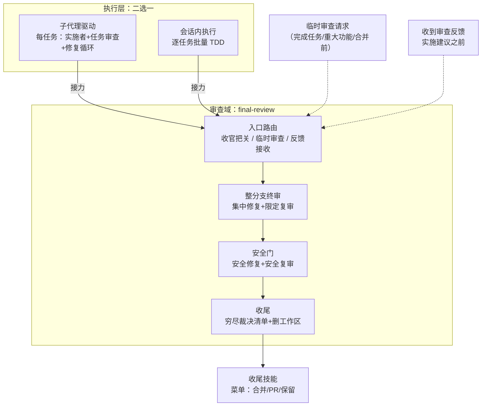

# 审查域合并为 final-review 技能 — 设计文档

> 读者假设：懂软件研发流程与技能（skill）机制，不熟悉产生本文档的对话；不需要了解本仓库内部实现。
>
> 本文档回答：做什么、不做什么、为什么这样取舍、成本量级与主要风险。实现细节留给计划。

## 术语表

| 术语 | 含义 |
|------|------|
| 需求方 | 提出需求、做确认的人；分支的最终裁决者 |
| 控制者 | 走工作流、逐任务推进计划的代理 |
| 两种执行方式 | 同一实施计划的两条执行路径：子代理驱动（subagent-driven-development）与会话内执行（executing-plans） |
| 执行技能 | 承载两种执行方式的两个技能的统称 |
| 整分支终审 | 代码审查环节：整分支审查 → 恰好一轮集中修复 → 恰好一次限定复审 |
| 安全门 | 合并前的安全把关：安全审查 → 恰好一轮安全修复 → 恰好一次安全复审 |
| 收尾 | 穷尽裁决清单编制、工作区删除、向收尾技能交接 |
| 接力 | 一个技能在流程终点用一句话（技能名 + 进入时机）移交控制权给下一个技能的机制 |
| 双形态 | 同一规程对「有子代理工具 / 没有子代理工具」两种环境的两种执行形态；缺工具只降级形态，不免除环节 |
| 权威源 | 某段规程文本唯一存在的位置；其他位置只允许引用或接力 |
| final-review | 本文新增的审查域技能：代码审查（含整分支终审）、安全审查（安全门）、审查反馈接收、收官收尾 |
| 审查反馈纪律 | 收到审查反馈后、实施建议之前的验证纪律（原 receiving-code-review 的全部内容） |
| 结构测试 | 以文本断言钉住技能文案结构的机械测试 |
| 防漂移测试 | 逐字节比较重复资产副本、副本漂移即失败的机械测试 |
| 集成验证门 | 分层的集成验证把关；独立设计（另文，未定稿），本次不实现、不预留挂载位 |

## 实施前决策记录 + 日期：2026-11-02

需求方 2026-11-02 拍板：① 构建单一审查域技能，负责代码审查——含现行整分支终审与安全门两套审查（首拍定名 code-review）；② 删除 requesting-code-review 与 receiving-code-review，两者内容并入该技能；③ 两种执行方式在全部任务完成后接力进入该技能；④ 本次不考虑集成验证，不预留挂载位。同日追加拍板：技能名由 code-review 改为 `final-review`，避免与运行时内建命令重名。本文档将拍板结论连同候选与依据成文；成文时新细化的项标注「提议」，随本文档一并裁决。

## 流程位置图

审查域收敛为单一技能：执行技能在任务循环结束后一句接力进入收官把关；日常审查请求与审查反馈接收走同一技能的其他入口。审查模板与收口规程全部住在技能内，不再有跨技能模板引用。

## 1. 背景与目标

- **解决什么问题**：审查域内容现分散在三处，产生五类已发生的失效：
  1. **双份漂移**：会话内执行技能的终审段与子代理驱动技能的终审规程各自维护；2026-11-01 修订后前者出现过时表述而后者没有——同日逐处修复，实证双份必然漂移。
  2. **职责域分居**：整分支审查的模板在 requesting-code-review、规程在子代理驱动的参考文件里——同一职责域两户，修订须跨目录对齐。
  3. **跨技能寄居**：会话内执行技能执行安全门与审查包时要跨技能引用另一执行技能目录内的规程与脚本；结构测试含一条断言专门钉住这个本不该存在的耦合。
  4. **收尾分裂**：裁决清单穷尽性规则与安全门移交渠道存在两份近似文本。
  5. **零耦合维护面**：receiving-code-review 作为独立技能与把关链路零文本耦合，仅服务反馈接收场景——独立成户的维护成本高于其触发频度。
- **给谁用**：走工作流的控制者与需求方；工作流之外需要审查或正在接收审查反馈的任何代理。
- **成功判断标准**（可观察行为）：
  1. 整分支终审、安全门、收尾规程，三个审查模板，接收反馈纪律——各自只有一份，都在 final-review 内；文本搜索可机械判定；
  2. requesting-code-review 与 receiving-code-review 目录不复存在，全仓引用清零（历史文档除外）；
  3. 两种执行方式走到「全部任务完成」后经同一接力进入收官把关，收官消息同构（穷尽裁决清单 + 安全门小节）；
  4. 没有子代理工具时，集中修复与复审由控制者亲自执行，台账含自查标记行；
  5. 结构测试重钉后全绿，防漂移测试全绿；
  6. 三类入口（收官接力 / 临时审查请求 / 反馈接收）各自可靠进入，收官流程不被临时请求触发。

## 2. 功能清单

1. **final-review 技能**：输入 = 审查请求 / 已完成全部任务的分支与台账 / 收到的审查反馈 → 控制者按入口路由分别进入：收官把关（整分支终审 → 安全门 → 收尾）、临时审查（按模板派发即止）、反馈接收（按纪律验证再实施）。审查模板三件随迁至技能根目录，接收反馈纪律随迁至参考文件，收口规程随迁至参考文件。
   - 本次不做：集成验证门（需求方明示先不考虑）。
2. **执行技能的接力替换**：输入 = 两执行技能既有的终审段、安全门段、收尾段 → 各收缩为一句接力（技能名 + 进入时机），流程图节点同步更新；会话内执行技能不再跨技能引用另一执行技能目录。
   - 本次不做：任务循环、预检、模型选择中任务循环相关档位规则的任何改动。
3. **单一权威源与资产安置**：输入 = 既有终审规程文件、安全门文案、审查包脚本 → 收口规程逐字搬运（仅枚举例外区可差异）；审查包脚本复制一份并入防漂移测试对；复审提示词与任务审查模板留在子代理驱动技能（主用点与任务循环绑定），final-review 跨技能引用复审提示词。
   - 本次不做：task-reviewer-prompt.md 与 re-review-prompt.md 的内容改动。
4. **结构测试重钉**：输入 = 既有安全门结构测试 → 模板路径改指新目录；会话内执行相关断言替换为「执行技能只含接力句、不含规程复述」断言；防漂移测试覆盖新增脚本对。
   - 本次不做：drill 场景增补（指称同步除外）。
5. **引用清理与地图同步**：输入 = 全仓对两个被删技能的引用 → 执行技能、平台参考文档、术语地图逐处清理或改指；drill 记录指称同步。
   - 本次不做：`docs/superpowers/specs/` 与 `docs/superpowers/plans/` 下历史文档的回改。

## 3. 明确不做

1. **不实现集成验证门、不预留挂载位**。因为需求方明示先不考虑；将来其设计定稿后，在本技能安全门与收尾之间插入一句接力即可，无需预先留痕。
2. **任务循环内容不上提、task-reviewer-prompt.md 不迁**。因为任务审查的派发规程与子代理驱动的任务循环深度绑定（简报/报告/约束块），迁出破坏执行技能自包含；且本次判据只覆盖审查域的收官部分。
3. **re-review-prompt.md 不迁**。因为其主用点在子代理驱动的任务循环修复轮，收官集中修复的复审只是复用者；迁移会把主客倒置并破坏执行技能自包含。
4. **收口规程与三模板不做语义级重写**。因为它们是经对抗性验证调优的内容；本次是位置迁移，语义变更仅限两类：指涉自足化、双形态句新增（须微测证据）。
5. **接收反馈纪律不做语义级重写**。因为同理；随迁仅去除技能头部、正文逐字进参考文件。
6. **不做运行时钩子强制接力**。因为仓库门禁哲学是流程文本约束加结构测试钉住。
7. **历史文档不回改**。因为 `docs/superpowers/` 下的既有规格与计划是既成记录。

## 4. 关键决策记录

### 决策 1：审查域合并为单一技能 final-review，吸收两个能力技能（需求方已拍板）

- 候选：① 阶段技能（merge-readiness）+ 保留 requesting/receiving 两能力技能（原提案）；② 单一域技能 final-review 吸收两者（本决策）；③ 审查家族扩展（终审并入 requesting-code-review、安全门独立成技能、无阶段技能——对话中已否决）。
- 选 ②。依据：审查域全部内容单一归属，修订不再跨目录对齐（失效 2 消除）；技能内无跨技能模板引用，按技能安装生存性最优（失效 3 消除）；技能数净减一（15→14），维护面收缩。
- 排除 ①：模板与规程分居两户的格局保留，失效 2 仍在；三技能并存于同一职责域，边界靠纪律维持。
- 排除 ③：循环机器（集中修复、熔断、裁决清单）塞进「请求审查」技能 = 请求方技能吞下审查后生命周期；收尾在执行技能双份保留，失效 1 与 4 不解。
- 代价：技能承载三类触发时机（收官把关、临时审查请求、反馈接收）——以入口路由与 description 分族措辞处置（决策 3）；「外部调用者」判据在本决策下的适用方式：两能力技能原有的调用者随域合并成为同一技能的不同入口族，判据从「技能拆分依据」转为「技能内入口分节依据」。

### 决策 2：命名 requesting-code-review（需求方已拍板，三度定名）

- 候选：① requesting-code-review（终拍，实施收官后由需求方改定——沿用原能力技能旧名，连续性最强，无内建命令重名）；② final-review（二拍，实施期名，因需求方后续改定而退役）；③ code-review（首拍，因与运行时内建命令重名撤回）；④ merge-readiness（原提案名）。
- 选 ①。依据：避免与运行时内建命令重名；沿用旧名使外部引用与使用者习惯连续。
- 排除 ④：辖域过窄且已被域合并取代。
- 代价：技能域宽于「requesting」字面（含接收反馈与收官收尾）——由 description 三族触发与入口路由节承担；指称纪律：文档中环节一律称「整分支终审」，技能一律带 `superpowers:requesting-code-review` 全名。

### 决策 3：三入口路由——收官把关、临时审查、反馈接收（提议）

- 候选：① 三入口在主文件路由分节；② 只保留收官入口，临时审查与反馈接收的调用场景放弃。
- 选 ①。依据：三类场景都有真实调用者（两执行方式收官接力、工作流外的审查请求、任何收到反馈的时刻）；放弃 ③ 类场景等于丢失接收纪律（需求方明确要求并入）。description 覆盖三族触发，主文件按入口分节，收官流程仅由接力进入。
- 排除 ②：与拍板要求（receiving 内容并入）矛盾。
- 代价：description 较长（三族触发词），由构建者微测误触发与漏触发。

### 决策 4：收尾并入 final-review，为第三部分（提议）

- 候选：① 收尾并入（终审 → 安全门 → 收尾三部分）；② 收尾留两执行技能。
- 选 ①。依据：裁决清单穷尽性覆盖全计划裁决（预检+任务+终审+安全门），必须在最后一道环节之后单点拥有；工作区删除以「终审干净且修复已合并」为前提，与门出口耦合；留执行技能即保留最敏感的双份文本（失效 4 不解）。
- 排除 ②：失效 4 原样存在，且收官消息同构失去结构保证。
- 代价：两执行技能在任务循环结束处直接接接力句，无本地收尾答案——由结构测试的「只含接力句」断言钉住。

### 决策 5：双形态贯穿终审与复审（提议）

- 候选：① 维持现状（双形态仅安全门有）；② 贯穿集中修复与限定复审。
- 选 ②。依据：会话内执行技能的终审自查形态已有成文实践；贯穿后两执行方式共用同一份收口规程，执行技能的终审散文整体消亡（含已漂移的那句）。
- 排除 ①：终审单形态迫使执行技能保留本地散文——回到寄居。
- 代价：新增双形态句是语义变更，须微测（RED/GREEN 各一）；其余文案逐字搬运。

### 决策 6：资产安置——模板随迁、脚本复制、两提示词留执行技能（提议）

- 候选：① 三模板与收口规程全部随迁 final-review，审查包脚本复制副本并入防漂移对，re-review-prompt 与 task-reviewer-prompt 留子代理驱动技能；② 全部内容留原位、final-review 全跨引；③ 连 re-review-prompt、task-reviewer-prompt 一起迁入。
- 选 ①。依据：模板随迁实现审查域单户（失效 2 消除）；脚本自包含以保按技能安装（复制+防漂移先例）；两个提示词的主用点与任务循环绑定（边界条件、简报、修复轮），迁入会把主客倒置并破坏执行技能自包含。
- 排除 ②：跨技能模板引用正是失效 2/3 的实体；排除 ③：见上。
- 代价：final-review 对 re-review-prompt 保留一处跨技能引用（现状水平的跨引，不恶化）；review-package 双份靠防漂移测试对齐。

### 留给构建者的部分

- final-review 主文件的章节结构与入口路由措辞——走技能编写流程开发，附微测证据。
- description 的三族触发词措辞——要求覆盖收官接力、临时审查请求、反馈接收三场景，误触发与漏触发微测定稿。
- 两种执行方式的接力句措辞——含技能名与时机，各一句。
- 停止条件四件事的自足表述与模型规则的重述边界（审查与安全门用最强档、限定复审用最低到中档、安全复审例外依据指针保留）。
- 双形态句措辞与微测方案（集中修复、限定复审两处，各 RED/GREEN 一）。
- 接收反馈纪律的入口摘要句（主文件）与正文（参考文件）的分工。
- 结构测试重钉的断言集、防漂移测试的覆盖对。
- 术语地图的节点合并方案与 drill 指称清单。

## 5. 关键约束与可行性风险

- **逐字搬运纪律**：收口规程、三模板、接收反馈纪律三类随迁内容零语义变更；例外区（身份句、指涉自足化、双形态句）各自有界。可判定：与底本 diff 逐行对照，非枚举区零差异。
- **迁移原子性**：结构测试与文件位置耦合，切换中间态测试必然红。约束：新旧切换一次提交完成；重钉后全绿是完成判据。
- **触发面三族合一**：收官把关与日常审查请求、反馈接收共居一个 description，存在相互误触发风险。约束：description 分族措辞 + 主文件入口路由分节；可判定：三类场景各走各的入口，收官流程不被临时请求触发（微测）。
- **技能名与环节名相近**：技能名 final-review 与环节称谓「整分支终审」同源，存在指称混用风险。约束：文档与 drill 中环节一律称「整分支终审」、技能一律带 `superpowers:final-review` 全名；可判定：接力句与文档指称均含全名前缀。
- **删除技能的引用清理面**：两个被删技能在执行技能、平台参考文档、结构测试、术语地图中共 4 个文件有引用，任一漏改即断链。约束：全仓 grep 清零（历史文档除外），验收逐文件点名。
- **成本量级**：一次性迁移，来源依次为：结构测试重钉、双形态句微测、术语地图重做（两个被删技能的行与节点移除）、引用清理、打包验证。收益：技能数净减一，审查域单户，失效 1-5 全部消除；无运行时成本增量。
- **依赖**：集成验证门不在本设计辖域；将来接入点为安全门与收尾之间，一句接力，无需本设计预先留痕。

## 附录：独立审读处置记录

**审读者**：自审（作者亲自按审读提示词三张清单执行；独立子代理审读沿用需求方既有选择——不派发）。本次无独立审读，由需求方在确认时知悉。

自审核对记录：

- 清单 A（完备性）：五章齐全；功能清单五项均含「输入 → 最终用户看到什么」与本次不做；明确不做七项均附因果理由；决策 1-6 均含候选/选择/依据/代价；约束均可判定（diff 零差异、grep 清零、三场景路由判定、命名空间前缀）。「归需求方」堆为空——拍板项已由需求方 2026-11-02 给出，细化项（三入口措辞、接力句措辞、微测方案）标注交构建者。
- 清单 B（可读性）：术语表覆盖正文全部自造词；「失效 1-5」编号在第 1 章定义、第 4 章决策引用一致；交叉引用无裸引用。
- 清单 C（方案合理性）：决策 1 的排除 ③ 引用的是对话中已经过完整论证并被否决的方案（循环机器归属两难），候选真实；决策 3 的代价（description 三族合一）如实标注并交微测；最强挑战「域合并导致一个技能承载两种触发时机」已在决策 1 代价中如实承认并以入口路由处置——该取舍由需求方拍板，本文档记录而非回避。
- 设计与计划的锚定核对在计划附录中执行（计划自审第 3 项），本文档不重复。
