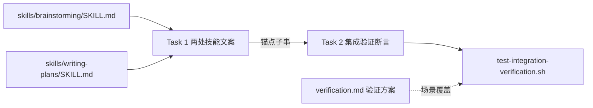

# 实施计划：产物目录唯一约定——去掉需求方偏好口子

- **目标：** 设计文档与实施计划的存放位置不再受需求方对话指定影响——需求方读两份技能文案能确认「位置固定、不接受指定」，集成验证测试能机械拦截偏好表述回潮。
- **架构：** 两处技能文案各删一句偏好句、各补一句固定句与一句告知要求；集成验证测试新增一组组合断言（正向锚定新文案、反向拦截旧句回潮）。
- **技术栈：** Markdown 技能文案 + bash 测试脚本（`tests/integration-verification/test-integration-verification.sh` 既有 `ck` 编排）。
- **设计文档（Spec）：** `docs/superpowers/specs/2026-11-03-spec-dir-convention/design.md`（2026-11-03 获批，含需求方裁决记录）。
- **实施前决策记录 + 日期：** 2026-11-03。设计留给执行者的「是否新增反向断言」在本计划落定为**新增**——理由：需求方选择弱验证路径的前提叙事是「文案回潮另有机械断言可拦截」，不落定断言则该前提不成立；断言编排遵照测试脚本既有 `ck` 惯例。

## 1. 改动地图

- `skills/brainstorming/SKILL.md` — 修改：存放位置段删偏好句，补固定句与告知要求。
- `skills/writing-plans/SKILL.md` — 修改：「计划保存到」段删偏好句行，补固定句与告知要求。
- `tests/integration-verification/test-integration-verification.sh` — 修改：新增组合断言（消费 Task 1 锚点子串）。
- `docs/superpowers/specs/2026-11-03-spec-dir-convention/verification.md` — 新建：需求级验证方案（已随计划同步产出）。

依赖方向：Task 1 → Task 2 单向；两技能文件互不依赖；测试脚本只被断言任务触碰。验证方案见同目录 `verification.md`。

## 2. 功能单元规格

### Task 1: 两处技能文案的去口子改动

**职责：** 删除两处偏好句、补固定句与告知要求，并产出供 Task 2 断言消费的锚点子串；开工前置（分支与基准核实）并入本任务。

**Files:**
- Modify: `skills/brainstorming/SKILL.md`（存放位置段；行号以 main 基线 c4c7687 计为 L128，兄弟需求合并后须重测）
- Modify: `skills/writing-plans/SKILL.md`（「计划保存到」段；main 基线 L20-22）
- 随本任务首个提交入库：`docs/superpowers/specs/2026-11-03-spec-dir-convention/` 三件套（design/plan/verification——既有惯例：需求文档随分支提交；此为我的落定决定）

**前置（并入本任务，先于文案改动）：**
- 第 0 条（合并顺序已裁决，2026-11-03 会话）：兄弟需求 `uniform-full-workflow` 先行——开工前置为其已完成收尾合并（技能改动与断言已入 main）；未合并即停，报需求方。
- 从合并后的 `main` 创建并切换 feature 分支 `feature/spec-dir-convention`。
- 重测基线：以合并后 main 为准重测两条旧偏好句逐字存续、存放位置段行号、测试脚本 `ck` 断言计数与插入点（本计划中 main c4c7687 的行号与「94 条」仅作审读记录）。
- `environment.md` 不设前置：ck 测试脚本不消费该文件（实测零引用）；缺席属集成验证技能自身定义的合法态，若走技能全流程按其规则在首次运行时初始化。
- 若工作区因并发改动无法干净切换：停下来报告需求方裁决，不 stash、不提交、不丢弃他需求产物。

**Interfaces:**
- Consumes: 无。
- Produces: 两处固定句各自的**锚点子串**各一段——判据：≥4 个连续汉字、不含标点、从固定句正文（非告知句）中截取、`grep -rF` 全仓 `skills/` 命中恰为该技能 1 处；子串在 Task 1 提交信息中逐字登记，格式 `锚点(brainstorming)=<子串>`、`锚点(writing-plans)=<子串>`。

**边界条件：**
- 删除对象逐字契约：`skills/brainstorming/SKILL.md` 存放位置段中「需求方的偏好优先于以上两者。」整句删除，段内其余文字（含「否则，询问。」）原样保留；`skills/writing-plans/SKILL.md` 中「- （需求方对计划存放位置的偏好覆盖此默认值）」整行删除，其余列表项原样保留。
- 固定句语义判据（两处各自成立，逐条判真）：含「有软件仓库时」限定；含「不接受指定」或等义否定式表述，且语义涵盖任何来源的位置指定均不生效——仓库自身的其他文档惯例不构成例外；含无例外上位性语义（目录约定优先于该技能内任何「按需求方要求去做」类条款）；固定句为单句；不含应对剧本（不出现「如何说服」「话术」类多步内容）。
- 告知句语义判据（两处各自成立，逐条判真）：独立成句（不并入固定句）；含两成分——告知产物已落约定目录（落点）+ 告知指定未被采用（需求方 2026-11-03 会话裁决，设计判据 2 已同步修订）；不含「询问是否照办」「等待确认」类表述。
- 落点判据：brainstorming 的固定句与告知句紧跟「否则，询问。」之后、归档冻结句之前；writing-plans 的两条新句位于「计划保存到」段的列表项区，替换原偏好句行的位置。
- 不得改变的既有行为：brainstorming「否则，询问。」保留原样（writing-plans 无对应询问句——仓库事实，本计划不为其新增）；通用条款按兄弟需求合并后文本为准、本计划零改动（兄弟需求已裁决先行，其对 L30/L46 的删除与改写随其合并生效；上位性固定句语义不受影响——对合并后残余的让步路径仍成立）；`skills/using-git-worktrees/` 整文件零改动（`git diff --stat` 不得出现该路径）。

**验收标准：**
- 两文件中旧偏好句字面 `grep -F` 零命中。
- 固定句与告知句按上列语义判据逐条可判真且全部为真。
- 提交信息含两条锚点子串登记行；`grep -rF "<锚点>" skills/` 对每个锚点恰好命中登记时声明的 1 处。
- 落点验收：brainstorming 固定句与「否则，询问。」同段相邻（读取该段核对）；writing-plans 新句位于原偏好句行位置（列表项区）。
- 内容级保留验收：「否则，询问。」在改动后文件中 `grep -c` 恰为 1；开工基线记录的「按其要求去做」类通用条款原文在改动后文件中逐字仍在（`grep -cF` 计数不减——`git show --stat` 只限文件级，本条补内容级）。
- 提交后 `git show --stat` 含三件套目录与两个技能文件、不含其他路径；工作树 porcelain 为空（三件套与本任务改动均已提交）。

### Task 2: 集成验证断言增补

**职责：** 在集成验证测试中新增组合断言，正向锚定 Task 1 新文案、反向拦截偏好句回潮；被集成验证全量运行依赖。

**Files:**
- Modify: `tests/integration-verification/test-integration-verification.sh`（断言编排区，`ck` 调用序列末尾）

**Interfaces:**
- Consumes: Task 1 提交信息中登记的两条锚点子串（逐字）。
- Produces: 两条新 `ck` 断言，`id` 分别为 `spec-dir-fixed-convention`（正向）与 `spec-dir-no-preference`（反向），随测试脚本进入集成验证全量运行。
- 调用示例（引用脚本既有形态，锚点执行期填入）：`ck "spec-dir-fixed-convention" "grep -qF '<锚点A>' \"$BS\" && grep -qF '<锚点B>' \"$WP\""`——两命中同时成立则该断言通过。`$BS` 与 `$WP` 均为脚本既有变量（L22/L23），无需新增定义。

**边界条件：**
- 正向断言 `spec-dir-fixed-convention`：对两技能文件各 `grep -qF` 其锚点子串，两命中以 `&&` 组合——任一缺失即断言失败。
- 反向断言 `spec-dir-no-preference`：对两技能文件断言两条旧句整句全部缺席，以 `! grep -qF` 与 `&&` 组合：「需求方的偏好优先于以上两者」「需求方对计划存放位置的偏好覆盖此默认值」。禁用 `grep -q`（正则）改用 `grep -qF`（固定串）——中文文案含正则元字符风险。
- 泛化短语前置核实（于 Task 1 删除两旧句并提交之后、写断言之前执行）：对候选短语「偏好优先」「偏好覆盖」在全仓 `skills/` 运行 `grep -rn`；仅当命中为零时才可加入反向断言，否则放弃该短语并在此断言的行内注释记录放弃原因——`skills/using-git-worktrees/` 的合法偏好表述不得被反向断言误伤（计划期已实测：两短语在 `skills/` 除两句旧文外零命中，核实预期通过）。
- 断言编排位置：以兄弟需求合并后的脚本为基线，追加于最后一个既有 `ck` 调用（含兄弟需求新增断言）之后、末尾失败汇总分支（输出「drifted from the design」并 `exit 1` 的代码段）之前；不改动任何既有断言行（`git diff` 中既有 `ck` 行零变更）——合并顺序已裁决：兄弟需求先行，本任务串行追加（2026-11-03 会话）。
- 失败路径：任一新断言失败时，测试脚本以非零码退出并在输出中标注该断言 `id`——与既有 `ck` 失败行为一致，不引入新的失败报告机制。

**验收标准：**
- 全量运行测试脚本，既有断言与新断言全部通过、退出码零（此为设计判据 3）。
- 回潮演练：临时将「需求方的偏好优先于以上两者。」写回 `skills/brainstorming/SKILL.md`，重跑测试——`spec-dir-no-preference` 失败、退出码非零、输出含该断言 `id`；随后 `git checkout --` 撤销演练，porcelain 恢复为空。
- 锚点破坏演练：临时删除 writing-plans 中含锚点子串的固定句，重跑测试——`spec-dir-fixed-convention` 失败；随后撤销恢复。
- `git diff` 确认既有断言零改动、演练残留零残留。

## 3. 设计依据

- **删除 + 补固定句，而非纯删除：** 需求方裁决「需求方无法指定此目录或文件位置」——沉默默认堵不住技能内「按其要求去做」条款（brainstorming L30/L46）在需求方坚持场景下的让步路径；固定句以无例外上位性规则显式覆盖。详见设计文档 §4 决策 1。
- **告知但不询问：** 静默不照办会让需求方按指定位置查找扑空，违背「位置可预测」目标；询问则重新打开已被取消的输入通道。告知单句承载两者平衡。详见设计文档 §2.1 执行要点 2。
- **范围限两处文案：** 工作树目录偏好是运行环境选择、非产物目录；无仓库询问兜底在约定不存在时必要；两条通用条款是技能交互骨架，由上位性规则覆盖而非改写。详见设计文档 §3、§4 决策 2。
- **反向断言落定为新增：** 设计留执行者决定，本计划落定「加」——弱验证路径（需求方 2026-11-03 裁决）的回潮拦截叙事依赖机械断言；旧句字面已知且稳定，反向断言成本低、判据确定。
- **锚点子串机制：** 设计锁语义不锁措辞，断言需要稳定锚——以「执行者定措辞、提交信息登记锚点」衔接两者，避免计划预写文案（誊抄）又保证 Task 2 可消费。

## 4. 约束

- 分支红线：全部改动在 `feature/spec-dir-convention` 上进行；`main` 不直接开发；合并顺序已裁决（2026-11-03 会话）：兄弟需求 `uniform-full-workflow` 先行，本需求随后——开工前置为兄弟需求已完成收尾合并，本需求从合并后的 main 分出，共享工作区串行化（兄弟需求会话完工后再开工）。
- 基线声明：开工时以兄弟需求合并后的 main 重测基线（行号、断言计数、插入点）；本计划中 main c4c7687 的数字仅作审读记录。
- 禁触清单：`skills/using-git-worktrees/` 整文件；brainstorming 通用条款（以开工重测的合并后文本为准，本计划零改动）；既有集成验证断言行；规格归档链路零改动（finishing 技能与归档目录均不在本次改动射程）。
- 文案红线：固定句不展开应对剧本；两处文案各自独立成句，不做跨技能引用。
- 每任务以可独立测试的交付物收尾并提交；工作树在每次非演练验证运行前 porcelain 为空——演练运行（S2/S3）处于有意弄脏态，收尾必须恢复为空。
- 执行中发现设计必须改：停止实施，回到设计确认门；不悄悄绕过。

## 5. 风险清单

| 风险 | 触发条件 | 影响 | 缓解方式 |
|------|---------|------|---------|
| 基准不含偏好句 | `main` 上两技能文案与工作分支认知不符（兄弟需求先行合并改写） | Task 1 删除对象不存在，断言反向目标失准 | 前置核实两旧句在基准逐字存在；不符即停，报需求方 |
| 反向断言误伤合法表述 | 泛化短语在 worktrees 等技能合法在场 | 既有全量断言转红，集成验证被误判 | 锚定范围收窄为旧句整句与经全仓核实的短语；核实不过即放弃短语 |
| 兄弟需求合并冲突 | 两需求在存放位置段与测试脚本插入点正面重叠（兄弟需求计划宣告改动域含 main 基线 L110-128 与「断言 19」插入点，且实施已在共享工作树进行中） | 后实施者基线失准、边界条件指向已变文本、同插入点断言互相覆盖 | 合并顺序已裁决（2026-11-03 会话）：兄弟需求先行；本需求开工前重测基线；共享工作区串行化 |
| 集成验证环境受阻 | 工作区含并发改动（porcelain 非空，审读时点实况） | ck 脚本可跑但结果反映混合态，验收失真 | 串行化已裁决：兄弟需求会话完工后再开工；本计划实施以干净分支为前提，受阻即停 |
| 固定句语义漂移 | 执行者措辞偏离语义判据（夹带剧本、丢上位性） | 行为塑形弱验证路径失去文案基础 | 验收标准语义判据逐条判真；审查者按判据对照 |

## 执行交接

- **建议执行方式：** 会话内执行（Native）——仅 2 个任务、单向锚点依赖、改动面小，子代理驱动的每任务全新上下文成本与体量不成比例。
- **必需子技能（REQUIRED SUB-SKILL）：** 使用 superpowers:executing-plans。
- **请需求方审查：** 各任务的边界条件与验收标准是否忠实覆盖设计文档的功能清单与「明确不做」清单。
- **明确确认后才进入实施**；「嗯」「继续」不算明确确认。
- 实施开始后发现设计必须改：停止实施，回到设计确认门；返工还是回滚由需求方决定；已合入 main 的部分用新提交修正，不改写历史。

## 附录：独立审读处置记录

**审读者身份：** 全新 general-purpose 子代理（未参与计划写作，与设计阶段审读者不同代理），按 writing-plans `review-prompt.md` 输出三张清单（完备性 / 可读性 / 实现效果）。审读期间核实了全部仓库事实（两旧句逐字、脚本 ck 编排与变量、兄弟需求计划原文、main 与共享工作树差异）。

**清单 A 处置：**

- A-1（高，兄弟需求正面重叠、合并顺序悬空）：**归需求方裁决**，计划留占位。审读证伪「天然错开」：兄弟需求计划宣告改动域含存放位置段（main L110-128）、删除 L30 分句、改写 L43-46、测试脚本同一插入点（「断言 19」）；共享工作树并发实施实况已核（brainstorming SKILL.md 与测试脚本均 M 状态、兄弟需求三件套已 staged）。风险表第 3 行改写为事实描述；Task 1/Task 2 相关边界条件加「待裁决联动」标注；约束章「裁决前不开工」。裁决后基线与边界条件联动重测，实质改动部分交回复读。
- A-2（高，environment.md 前提与事实相反）：采纳。实测脚本零 environment 引用；Task 1 前置删去该条，改为「缺席属合法态、走技能全流程时按其规则初始化」；verification.md §4 同步。
- A-3（中，writing-plans 无询问句、计划臆写）：采纳。边界条件改为「brainstorming『否则，询问。』保留原样（writing-plans 无对应询问句——仓库事实，不为其新增）」。设计执行要点 4 说「维持既有行为」，writing-plans 既有行为即无询问句，设计无需回改。
- A-4（中，告知句缺「落点告知」半边）：**归需求方裁决**，计划留占位。设计内部不一致（执行要点 2 两成分 vs 判据 2 单成分）属实；裁决前告知句语义成分条不构成执行依据。
- A-5（低，$WP 已存在）：采纳。调用示例改为「$BS 与 $WP 均为脚本既有变量（L22/L23），无需新增定义」。
- A-6（中，三件套提交无承接）：采纳（我的落定决定：随 Task 1 首个提交入库，沿用兄弟需求先例）。Files 补条目、验收改为 `git show --stat` 判据。
- A-7（中，落点与保留项无验收对应）：采纳。验收补两条——落点验收（同段相邻/原行位置）与内容级保留验收（「否则，询问。」grep -c 恰为 1）；L30/L46 的保留验收随 A-1 裁决联动。
- A-8（低，基线树未声明）：采纳。约束章补基线声明（main c4c7687）；Files 行号标注基线；verification.md 内容要求 5 标注重测条件。
- A-9（低，反向断言第三条为子串冗余）：采纳。砍为两条整句；I3 描述同步。
- A-10（低，porcelain 约束与演练冲突）：采纳。约束改为「非演练验证运行前 porcelain 为空；演练收尾必须恢复为空」，verification.md §4 同步。
- A-11（低，泛化核实时点未写）：采纳。补「于 Task 1 删除两旧句并提交之后执行」，并记录计划期实测结论（两短语除旧文外零命中）。
- A-12（低，「仓库惯例不构成例外」无判据承接）：采纳。固定句语义判据补「语义涵盖任何来源的位置指定均不生效——仓库自身的其他文档惯例不构成例外」。

**清单 B 处置：**

- 「当前 L128」基线不明：经 A-8 处置（行号标注 main 基线）。
- 「窄锚定」行话：采纳，风险表改白话「锚定范围收窄为旧句整句与经全仓核实的短语」。
- 排版清点（设计/计划/验证三文档表格列数、围栏配对、mermaid 实测）：全部通过，无需动作。
- porcelain 句困惑：经 A-10 处置。

**清单 C 处置：**

- 执行要点 1「能达成（文案级）+ 行为级有疑问」：行为级限制为需求方 2026-11-03 弱验证裁决的已接受范围，计划与 verification.md 不再加码；S5 作为观察载体保留。
- 执行要点 2「有疑问（无验收证明）」：验收载体即 S5 人工观察项（弱验证裁决的既定安排）；「落点告知」半边经 A-4 归需求方裁决。
- 执行要点 3「能达成（文案级）」：无需动作；其让步路径被兄弟需求删除的缩水影响随 A-1 裁决联动（设计 §3 第 2 条「不改通用条款」的立意不受影响——上位性规则对残余路径仍成立）。
- 执行要点 4「brainstorming 半边能达成、writing-plans 半边有疑问」：writing-plans 半边经 A-3 处置（仓库事实：无句可保）。
- 组合闭合缺口（与兄弟需求的组合态）：归 A-1 裁决。
- 设计可行性结论（文案级可行、无不可行新暴露）：采纳，不回设计确认门；A-4 的设计判据 2 一行修订待裁决后随裁决一并确认。

**待需求方裁决项（呈报于对话）：** A-1 合并顺序与共享工作区串行化；A-4 告知句语义成分（含设计判据 2 的一行修订确认）。

**裁决落定记录（2026-11-03 会话，需求方选项裁决）：**

- A-1：**兄弟需求先行，本需求随后**——开工前置为兄弟需求已完成收尾合并；开工时重测基线；共享工作区串行化。计划正文（Task 1 前置第 0 条、Task 2 编排位置、约束章分支红线与基线声明、风险表）已按裁决改写。
- A-4：**两成分（落点 + 未采用）**——设计判据 2 已同步补落点半边（该修订随裁决一并获需求方确认）；计划告知句语义判据已落定为两成分。

裁决落定的实质改动段落已交回同一审读子代理复读，结果与处置如下：

**复读新问题处置（全部为裁决同步遗漏，无重开项）：**

- N-1a（中，design.md「留给构建者」告知义务仍单成分）：采纳。改为两成分口径。
- N-1b（中，verification.md S5 期望仍单成分）：采纳。S5 期望补落点告知半边。
- N-2（中，verification.md L34/L115 仍写「三条字面」而断言实为两条）：采纳。两处改「两条字面」，S1 期望注明泛化短语核实后可追加。
- N-3a（低，通用条款「零改动」无验收条目）：采纳。Task 1 验收补内容级保留验收（基线原文 `grep -cF` 计数不减）。
- N-3b（低，约束章禁触清单仍锚 main 基线 L30/L46）：采纳。改为「以开工重测的合并后文本为准」口径；设计依据章对 L30/L46 的引用为成稿时点历史理据，保持原文不改。

复读其余各段全部通过；三文档排版机械校验全绿。
