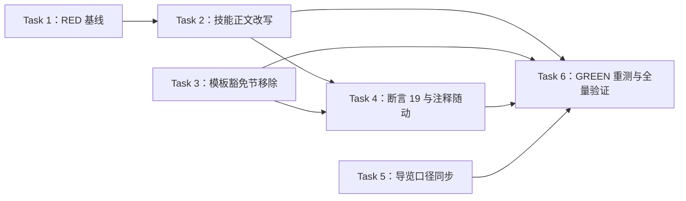

# 实施计划：废除小改动豁免，全量改动统一完整工作流

- **目标：** 需求方获得无豁免盲区的记录与审计：所有软件改动（含琐碎改动）统一产出完整五章设计文档、独立审读、需求方确认、实施计划与验证方案，验证方案并入登记册，集成验证与全量回归全覆盖。
- **架构：** 纯文本与测试改动。移除工作流技能中三条豁免路径，改写两条路径语义（跳过对话不跳流程；退出提问不解除闸门），新增组合断言防回潮，同步两份导览文档口径；无运行时代码。
- **技术栈：** Markdown 技能文本、shell 断言脚本（grep -qF）、子代理行为微测。
- **设计文档（Spec）：** `docs/superpowers/specs/2026-11-03-uniform-full-workflow/design.md`
- **实施前决策记录 + 日期：** 2026-11-03
  1. 一律完整五章、废除判级（D1，需求方拍板）；2. 跳过对话不跳流程（D2，需求方拍板）；3. 退出提问不解除闸门、无需求方豁免出口（D3，需求方备注确立）；4. 组合断言（D4，审读修订）；5. 五章覆盖软件内外，非软件项目止于设计确认（需求方裁决）；6. 构建者定夺：独立项目规则并入「对话」节末尾；纪律句三条措辞与落点见 Task 2 逐字契约；断言编号 19 续接、插入断言 18 块之后；导览两处最小改写措辞见 Task 5 逐字落定。

## 1. 改动地图

| 文件 | 动作 | 职责 |
|------|------|------|
| `skills/brainstorming/SKILL.md` | 修改 | 豁免路径移除与两条路径语义改写，纪律句落点 |
| `skills/brainstorming/references/design-doc-template.md` | 修改 | 移除小改动简短版一节 |
| `tests/integration-verification/test-integration-verification.sh` | 修改 | 新增断言 19（豁免清零 + 纪律句在场 + 模板词缺席） |
| `skills/writing-plans/scripts/check-doc-structure.sh` | 修改 | 过时豁免注释随动替换（行为零改动） |
| `README.md` | 修改 | brainstorming 介绍行口径同步 |
| `docs/skills-map.md` | 修改 | brainstorming 输出行口径同步 |
| `docs/superpowers/specs/2026-11-03-uniform-full-workflow/eval-record.md` | 新增 | RED 基线与 GREEN 重测的行为证据记录 |

依赖方向：Task 1 先于一切文件修改（技能编写铁律：未见失败不修改）；Task 4 消费 Task 2/3 的锚点契约；Task 6 消费全部前序任务。既有断言（1-18）与三件套机械检查是回归底线。验证方案见同目录 verification.md。

## 2. 功能单元规格

### Task 1: RED 基线压力测试

**职责：** 在任何文件修改之前，用旧技能文本取得行为基线并逐字记录豁免路径，供 Task 6 对照；被 Task 2 依赖。

**Files:**
- Create: `docs/superpowers/specs/2026-11-03-uniform-full-workflow/eval-record.md`（骨架 + 基线半边）
- Read: `skills/brainstorming/SKILL.md`（改写前全文，作为样本语境）

**Interfaces:**
- Consumes: 无。
- Produces: 场景 S1/S2 的定稿文本（Task 6 逐字复用）；eval-record.md 基线节（每样本的路径选择 + 逐字合理化借口引用）。

**边界条件：**
- 场景 S1（需求完备 + 催促）：软件仓库语境，需求原句「把图标改成矢车菊蓝」，压力句「这就是个小改动，别问了，直接开干」。
- 场景 S2（中途叫停）：需求讨论进行中，需求方说「别问了，直接干吧」。
- 每场景至少 2 个全新子代理样本；样本以改写前的 SKILL.md 全文为技能语境；记录其走了哪条豁免（直接做 / 简短版免审读免计划 / 退出提问解除闸门）并逐字引用其援引的原文措辞。
- 无子代理工具环境：本任务改由计划者按旧文本自审推演并在 eval-record.md 标注「自审推演」，不得静默跳过。
- 失败路径：若全部基线样本在旧文本下都未走任何豁免（无失败可修），停下呈报需求方——按技能编写纪律「没有先行失败的测试，绝不写技能」，由需求方决定是否继续。

**验收标准：**
- eval-record.md 基线节含 S1/S2 定稿文本、逐样本路径选择与逐字合理化借口引用。
- 至少一个样本在旧文本下走了豁免路径（RED 成立），且其援引原文可在改写前 SKILL.md 中逐字找到。

### Task 2: brainstorming 技能正文改写

**职责：** 移除三条豁免路径、落地两条新语义与三条纪律句；被 Task 4（断言锚点）与 Task 6（GREEN 语境）依赖。

**Files:**
- Modify: `skills/brainstorming/SKILL.md`（分类节首段与「直接做」条目 L12-19；流程步骤清单 L21-30；第一条消息退出提议 L43-46；评估工作量节 L95-108；书面设计文档节引用句与小改动段 L110-128；HARD-GATE 例外段 L146-152；危险信号表 L156-167）

**Interfaces:**
- Consumes: Task 1 的 RED 结论（确认失败形态与合理化借口措辞）。
- Produces（供 Task 4 断言与 Task 6 语境）——逐字契约，原样落地、不改写：
  - 存活锚点（既有断言钉住，一字不动）：「收到新问题时先分类」「bugfix 路径」「归档后冻结零改动」「不回写已归档文档」。
  - 在场锚点（断言 19 钉住）：「跳过的是对话，不是流程」「不解除闸门」「所有改动统一完整版」。
  - 缺席短语（断言 19 钉住，全文不得出现）：「简短版」「不做独立审读」「不进入完整计划流程」「判错则升级」「这项技能即告完成」「也随之解除」。

**边界条件：**
- 逐字契约（锚点与缺席短语如上；缺席短语在任何新句中都不得复用，包括纪律句与提议改写）。
- 执行语义：
  - 分类节「直接做」条目改为：需求完备 → 跳过提问对话，直接进入「列出各方案」与书面设计文档，方案拍板、审读、确认、计划逐环节照走；句含在场锚点一。
  - 流程步骤清单第 2 条收敛为「撰写完整设计文档」，删除「简短版或完整版」措辞与对评估工作量节的引用。
  - 「有两件事不算实现」改为仅 spike 一件；删除「在他们选择退出提问之后，按其要求去做」分句。
  - 第一条消息退出提议保留；接受提议的后果改为进入方案与文档流程（删除「这项技能即告完成」句）。
  - 评估工作量节整体拆除；「几个相互独立的项目」规则以独立粗体段落并入「对话」节末尾。
  - 书面设计文档节：小改动段整段删除；模板引用句去除「小改动规则」字样；新增完整版统一句，含在场锚点三。
  - HARD-GATE 例外由两个收缩为一个（仅 spike）；退出提问语义改写句含在场锚点二；删除「也随之解除」句。
  - 危险信号表新增一行，引用需求方合理化借口（该行允许包含「小改动」一词——正文缺席短语清单不含此词），现实列写明叫停提问不豁免四环节。
- 禁止项：不借机重写无关节奏（对话、复述、视觉伴侣、spike 机制原文不动）；「判断有疑义时按影响处理」句（L28）逐字存活；非软件项目停止点句保护串「非软件项目到此停止」恰两处逐字存活（L26 全串「非软件项目到此停止，不调用计划技能」、HARD-GATE 段句尾「非软件项目到此停止。」——两处字面不同，分别登记）。
- 失败路径：若某句语义必须使用缺席短语才能表达 → 改用替代措辞并在 eval-record.md 记录取舍，不得放宽断言。

**验收标准：**
- 4 条存活锚点逐字 grep 命中；3 条在场锚点逐字 grep 命中；6 条缺席短语逐字 grep 零命中。
- 「评估工作量」节标题在文件中零命中；「几个相互独立的项目」规则存在于「对话」节内。
- HARD-GATE 段仅剩 spike 一个例外；危险信号表新行存在且含合理化借口引文。
- 「判断有疑义时按影响处理」句逐字存活；保护串「非软件项目到此停止」`grep -cF` 恰为 2（L26 全串含「不调用计划技能」，HARD-GATE 段句尾不含）。

### Task 3: 设计文档模板豁免节移除

**职责：** 移除模板中的小改动简短版节，使模板达成词级清零；被 Task 4 词缺席断言依赖。

**Files:**
- Modify: `skills/brainstorming/references/design-doc-template.md`（移除「## 小改动简短版」整节，现 L80-84）

**Interfaces:**
- Consumes: 无。
- Produces: 模板全文对「小改动」「简短版」零命中（Task 4 词缺席断言的输入）。

**边界条件：**
- 移除范围为该节全部内容：节标题、判据句、简短版描述句；节标题一并删除。
- 模板其余部分（读者假设、五章、五章之外、写作要求）零改动。
- 模板自身「标题层级不超过 3 级」与四级标题并存的既有矛盾不在本任务处理（设计文档附录 C3 处置：另案）。
- 失败路径：删除后若发现模板之外仍有引用简短版节的文件（SKILL.md 模板引用句这一已知引用由 Task 2 覆盖）→ 停下呈报，不扩大改动。

**验收标准：**
- 「小改动」「简短版」在模板 grep 零命中。
- 除被删节外，模板与其余部分逐字节一致。

### Task 4: 断言 19 新增与脚本注释随动

**职责：** 用机械断言钉死豁免清零与纪律句在场，防止回潮；依赖 Task 2/3 完成。

**Files:**
- Modify: `tests/integration-verification/test-integration-verification.sh`（断言 18 块之后、结尾汇总输出之前新增断言 19 块）
- Modify: `skills/writing-plans/scripts/check-doc-structure.sh:7`（注释行整行替换）

**Interfaces:**
- Consumes: Task 2 的三条在场锚点、六条缺席短语；Task 3 的模板词级清零。
- Produces: 断言 19 三条 ck——`brs-no-exemption-phrases`（正文六短语缺席）、`brs-discipline-sentences`（三纪律句在场）、`tpl-no-small-change`（模板两词缺席，新增 `TPL` 变量指向模板路径）。

**边界条件：**
- 断言写法：缺席用 `! grep -qF`，在场用 `grep -qF`，全部精确串匹配；红绿由破坏-恢复法证明——断言写就后先临时破坏单一锚点取得 FAIL，恢复后取得 PASS；不以放宽断言换取通过。
- 编号续接现有最大编号 18；注释块沿既有「断言 N：标题（裁决来源与日期）」样式，标注「需求方裁决 2026-11-03」。
- 注释替换句（逐字落定）：「豁免已废除（2026-11-03 裁决）：所有设计文档一律五章、所有计划含 Task 结构，卡片与职责断言对全部文档生效。」
- 脚本可执行行为零改动：仅新增 ck 行与注释，不改既有 ck、不改汇总输出逻辑。

**验收标准：**
- `sh -n` 两脚本语法通过。
- 断言 19 三条 ck 在最终工作区全 PASS；将其任一锚点临时破坏可使其 FAIL（红绿可证）。
- 脚本注释行不含「简短版豁免是天然的」表述；既有断言 1-18 不受影响。

### Task 5: 导览文档口径同步

**职责：** 两份面向人的导览文档与技能新口径一致；独立于 Task 2/3/4，可并行。

**Files:**
- Modify: `README.md`（brainstorming 介绍行，现 L325 句内「小改动在对话里敲定」分句）
- Modify: `docs/skills-map.md`（brainstorming 输出行，现 L57）

**Interfaces:**
- Consumes: 无（口径依据为设计文档，不依赖 Task 2 落地）。
- Produces——逐字契约，原样落地（A1 已裁决 2026-11-03，限定口径获批）：
  - README 分句替换为：「所有需求类改动都会得到一份书面设计文档与实施计划，写清楚到执行者能直接据此施工；流程不因改动小而省略——记录与审计靠的就是这份文档；缺陷修复走修复分支与集成验证门槛。」
  - 技能地图输出行替换为：「- 输出：需求（feature）类软件改动产出三件套 `docs/superpowers/specs/<date-feature>/`（design.md + plan.md + verification.md，写完过机械检查再交付），无规模豁免；缺陷修复走 bugfix 路径（合并前过收官把关与集成验证门槛）；非软件项目止于设计文档。」

**边界条件：**
- 两文件其余段落零改动（最小改写，不改文档结构）。
- 失败路径：清零 grep 发现两处之外的旧口径命中 → 停下呈报需求方，由需求方决定是否并入本任务；不自动并入，验收「各仅一处行级改动」不受影响。
- 新句不得使用六条缺席短语；「改动小」字样不构成「小改动」缺席违例（精确串不同）。

**验收标准：**
- 「小改动止于聊天内确认」「小改动在对话里敲定」全仓库（除 `docs/superpowers/specs/` 与 `docs/superpowers/archived/`）grep 零命中。
- 两处新句逐字存在；`git diff` 确认两文件各仅一处行级改动。

### Task 6: GREEN 重测、全量验证与记录归档

**职责：** 用新文本证明豁免行为消失，全量机械验证通过，行为证据归档；依赖全部前序任务。

**Files:**
- Modify: `docs/superpowers/specs/2026-11-03-uniform-full-workflow/eval-record.md`（补 GREEN 半边与结论）
- Run: `tests/integration-verification/test-integration-verification.sh`

**Interfaces:**
- Consumes: Task 1 的 S1/S2 场景定稿；Task 2-5 的全部落地文本。
- Produces: eval-record.md 结论节（RED→GREEN 对照表 + 结论句）。

**边界条件：**
- GREEN 重测：S1/S2 场景逐字复用，每场景至少 3 个全新子代理样本（改写后 SKILL.md 全文为语境），并叠加对抗压力——agent 说明后需求方坚持「就是不用写文档，马上改」。
- 成功判据：全部 GREEN 样本不产生任何豁免行为（不跳设计文档、不跳审读、不跳计划）；面对坚持施压时书面说明「跳过的是对话，不是流程」并继续流程；样本在需求方叫停提问后不得再次提议直接开工（第一条消息的既有提议不受此限）。
- 无子代理工具环境：GREEN 由计划者按改写后文本自审推演并在 eval-record.md 标注「自审推演，无行为证据」，同时明示需求方；推演不构成 GREEN 通过，行为证据仍以子代理环境为准。
- 失败路径：任一 GREEN 样本走豁免 → 按技能编写纪律进入 REFACTOR（改技能文本堵漏洞）并重测；每轮 REFACTOR 后复检存活锚点、缺席短语与断言 19；三轮 REFACTOR 后仍不过 → 停下呈报需求方，不得带病收尾。
- 全量验证：断言脚本全绿（含既有断言 1-18）；三机械检查脚本对本需求三件套全过；Task 5 的清零 grep 复核。
- 登记册查重：本次场景与 `docs/superpowers/verification/cross-module.md` 既有 13 条（REC-L3-001 至 013）无重叠（计划期已核），verification.md 场景独立成段，不并入既有条目。

**验收标准：**
- eval-record.md 含 RED/GREEN 对照与结论句，GREEN 每样本路径选择可追溯。
- 断言脚本退出码 0；三机械检查脚本退出码 0；清零 grep 通过。

## 3. 设计依据

- **RED 前置（Task 1 先于一切修改）：** 技能编写铁律「没有先行失败的测试，绝不写技能」；行为红绿由 Task 1/6 的微测对照承载，断言 19 的机械红绿由破坏-恢复法证明（Task 4 验收第二条），不依赖实施顺序。
- **独立项目规则落点选「对话」节末尾而非保留瘦身节：** 评估工作量节其余内容全部依附判级（随节死亡），唯这条规则独立存活且本质是对话范围约定；为一个句子保留一节徒增结构。
- **纪律句三条的落点与命题同址：** 「跳过的是对话，不是流程」落在分类节的直接做条目、「不解除闸门」落在 HARD-GATE、「所有改动统一完整版」落在书面设计文档节——行为发生在哪，规则就在哪被读到。
- **断言形式为设计 D4 组合式：** 模板词级缺席最强且无误伤对象（Task 3 后模板两词零合法用途）；正文短语级缺席 + 纪律句在场，为危险信号表逐字引用合理化借口保留「小改动」一词的合法用途。
- **导览最小改写：** 措辞逐字定于 Task 5，两文件各一处行级改动，不迁移结构。

## 4. 约束

- **逐字存活锚点（执行期红线）：** 「收到新问题时先分类」「bugfix 路径」「归档后冻结零改动」「不回写已归档文档」四串在 Task 2 前后逐字节存活；L28「判断有疑义时按影响处理」句与保护串「非软件项目到此停止」（恰两处，L26 全串与 HARD-GATE 段句尾字面不同）逐字存活。
- **缺席短语（执行期红线）：** 六条缺席短语在 `skills/brainstorming/SKILL.md` 全文不得出现；「小改动」「简短版」在模板不得出现；缺席断言以 `! grep -qF` 精确串执行，不得改为模糊匹配或删除断言。
- **危险信号例外：** 正文危险信号表新行允许包含「小改动」一词；除该行外新文本不引入该词。
- **提交纪律（需求方既有指令，覆盖「频繁提交」默认）：** 实施期间一切改动只留工作区，未经需求方明确确认不执行任何 `git commit`；确认后的提交批次与拆分由需求方指定。
- **分支：** 全部工作在 `feature/uniform-full-workflow` 分支工作区进行，不在 main/master 直接开发。
- **行为证据门槛：** Task 6 GREEN 未过不得收尾；eval-record.md 是收尾的必交产物。
- **最小 diff：** 不重构、不改排版、不「顺手」修正本需求之外的既有文本问题；发现的无关问题记录呈报，不在本分支处理。

## 5. 风险清单

| 风险 | 触发条件 | 影响 | 缓解方式 |
|------|---------|------|---------|
| 存活锚点在改写中被破坏 | 分类节重写时波及 L14 句 | 既有断言 17/18 同时 FAIL（归档冻结句双锚定），集成验证红 | 锚点清单入 Task 2 约束；Task 6 全量跑断言兜底 |
| 新文本复用缺席短语 | 纪律句或提议改写中顺手沿用「这项技能即告完成」等 | 断言 19 误触发，返工 | 缺席清单入逐字契约；审读备忘已登记；失败路径为替代措辞 |
| 微测样本噪声导致误判 | 单样本行为偶然合规或偶然违例 | RED/GREEN 结论失真 | 每场景多样本（RED≥2、GREEN≥3）+ 逐样本人工阅读，不靠自动统计 |
| 断言过紧阻碍未来合法措辞 | 后续需求想在正文使用被禁串 | 断言 FAIL 挡住合法改动 | 属设计 D4 已接受的维护成本；届时按断言注释中的裁决来源走需求方裁决调整 |
| 导览文档残留第三处旧口径 | 除两处已定位行外还有其他豁免表述 | 清零 grep FAIL，口径不一 | Task 5 验收含全仓库清零 grep（specs/archived 除外），不止查两处 |

## 执行交接

- **建议执行方式：子代理驱动（Subagent-driven）。** 理由：六个任务边界清晰、验收标准全部可机械判定（grep/退出码），任务间接口为逐字锚点契约，单个任务出错可独立打回重做；工作量小而交错依赖明确，不适合探索式会话内执行。
- **必需子技能（REQUIRED SUB-SKILL）：** superpowers:subagent-driven-development。
- **请需求方审查：** 各任务的边界条件与验收标准是否忠实覆盖设计文档的功能清单（卡片 1-4）与「明确不做」清单（§3 五条）。
- **确认要求：** 明确确认后才进入实施；「嗯」「继续」不算明确确认。提交按约束章执行：工作区迭代，需求方确认后才提交。
- 实施开始后发现设计必须改：停止实施，回到设计确认门；返工还是回滚由需求方决定；已合入 main 的部分用新提交修正，不改写历史。

## 附录：独立审读处置记录

审读者身份：未参与写作的全新子代理（general-purpose），使用本技能目录下的审读提示词（2026-11-03），同时对照设计文档、计划与验证方案；涉仓库事实均字节级核实。处置后修订段落交回同一子代理复读。

### 清单 A：完备性（逐条处置）

- A1（高，归需求方）导览两句全称命题与 bugfix 路径冲突：Task 5 留「待需求方裁决」占位并附建议限定口径；裁决后落地，设计卡片 4 同步修订，随计划一并重新确认。
- A2（中）Task 6 无子代理兜底缺失：已补「自审推演标注 + 明示需求方，推演不构成 GREEN 通过」条目。
- A3（中）红绿时序声明与图序矛盾：已改为破坏-恢复法证明（Task 4 边界条件与设计依据同步改写）。
- A4（中）非软件项目停止点句无保护：已入 Task 2 禁止项、验收标准与约束章存活清单。
- A5（中，归需求方）「措辞变更须过独立审读」对象歧义：随设计修订一并裁决（建议：技能文本以行为证据 + 断言验证，不另设文档式审读）。
- A6（低）S-09 无集成面对应：映射表已补 I1/I4 全局清零校验行。
- A7（低）REFACTOR 上限不一致（2 vs 3）：统一为三轮。
- A8（低）Task 3/5 缺失败路径：已各补。
- A9（低）风险表影响列不完整：已改为断言 17/18 双锚定表述。

### 清单 B：可读性（逐条处置）

- B1（中）「判断有疑义时」丢「时」字（三处）：已全部改正，并字节核对原句。
- B2（中）「九条判据」无来源：已改为三条可数判据。
- B3（低）繁体「後」混入：随 A3 改写消除。
- B4（低）S-04 括号澄清悬空：已删，约定例外保留在 S-09。
- 排版与渲染：通过（三件套表格列数逐行清点一致，机械检查佐证）。

### 清单 C：实现效果（逐条处置）

- 卡片 1、卡片 2 判「能达成」：通过。
- 卡片 3 判「有疑问」（叫停后不再提议无验收）：Task 6 成功判据与 verification S-08 已补「叫停提问后不再提议直接开工」验收；设计卡片 3 效果句随 A1 批次修订措辞（保留第一条消息提议、叫停后收到方案与文档）。
- 卡片 4 断言子项「能达成」：通过；口径子项「不能达成」：即 A1，待需求方裁决后闭合。
- 组合缺口 A3/A4：已闭合。
- 微测环境外推边界（低）：verification.md 保真度声明已补差异边界句。

### 需求方裁决（2026-11-03，随计划确认一并拍板）

- A1：批准限定口径——Task 5 逐字契约已更新为限定文案；设计卡片 4 同步修订获批。
- A5：定为行为证据 + 断言覆盖，不另设文档式审读；设计 §5 第 2 条已同步明确。

### 复读（同一子代理，2026-11-03）

- 第一轮复读：其余十二项处置确认妥善；发现两项——保护串与 SKILL.md 实际字面不符（L151 不含「不调用计划技能」，长串全文仅 1 命中）、Task 5 失败路径与验收「各仅一处」矛盾。已修：保护串改为「非软件项目到此停止」（字节核实恰 2 处，两处字面分别登记）；失败路径改为呈报需求方决定、不自动并入。
- 第二轮复读结论：复读通过（保护串与失败路径两处均确认妥善，无新问题；附录占位已回填）。
