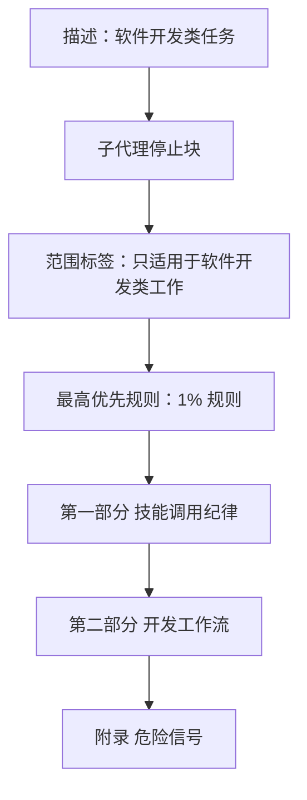

# 技能库适用范围收敛与启动技能结构重排

> 读者假设：懂软件开发与代码代理的行为约束，不熟悉本项目的技能档案；不需要了解技能文件的具体排版。
>
> 本文档回答：为什么要把技能库的适用范围收窄到软件开发、收窄到什么边界、启动技能如何重排、明确不做什么、主要风险是什么。逐文件改动留给计划。

## 术语表

- **需求方**：提出需求、做确认的人。
- **最终用户**：加载并执行本技能库的编码代理（agent）。
- **启动技能**：会话开始时由 harness 注入的元技能，规定代理如何查找与使用其他技能。
- **开发工作流**：三分类定性 + 十一个流程闸门环节。
- **范围措辞**：声明某技能适用于什么任务、什么项目的句子。
- **泛化触发语**：技能描述中「任何对话」「任何创造性工作」「任何新事物」等未限定软件开发范围的触发表述。
- **载体**：承载范围措辞或泛化触发语的技能档案、技能地图或项目说明。
- **项目说明**：仓库根目录的 README。
- **范围术语的语法变体**：「软件开发类工作」「软件开发类任务」「软件开发类请求」指同一适用范围，区别只在语境（范围声明 / 触发语 / 分类入口），不构成范围差异。

## 实施前决策记录 + 日期：2026-11-04

- **需求方裁决（2026-11-04）：** 项目整体定位已改为完全围绕软件开发；技能库的提示词按此收窄。
- **需求方裁决（2026-11-04）：** 适用范围声明与各技能的泛化触发语「都改」。
- **设计确认（2026-11-04）：** 需求方回复「确认」，设计文档获批。范围术语、两层结构重排、三分类改名随之拍板（§4 决策 1、4、6）。
- **需求方裁决（2026-11-04）：** 行为评估选 A（先探测）：克隆 eval 仓库，检查是否覆盖适用范围判定；有覆盖就跑 before/after，无覆盖则记录偏离并退回机械验证。见 §4 决策 7。

## 1. 背景与目标

**触发事实。** 需求方在 2026-11-04 直接指出：项目已经整体改为只做软件开发，但技能库的提示词仍写得像通用方法论。仓库检查确认了具体残留：

- 启动技能的描述写「在开始任何对话时使用」；范围句「本工作流只适用于软件开发项目」埋在工作流章节内，不在开头。
- 头脑风暴技能的描述写「在做任何创造性工作之前」「规划任何新事物」；正文保留「一件艺术品的媒介」「一块标牌」等非软件示例。
- 技能地图仍写「软件内外都算」，并残留「非软件项目止于设计文档」——后者与 2026-11-04 已裁决的适用域收敛直接冲突。
- 项目说明仍写「在构建任何东西之前激活」「agent 在做任何任务之前」。

**失效方式。** 代理在非软件开发请求上套用完整开发工作流，浪费需求方的流程成本；或者对文档类交付物是否适用工作流产生歧义。这不是推测的代码缺陷，而是需求方观察到的定位与文本不一致。

**给谁用。** 最终用户是加载技能库的编码代理；直接受益者是需求方——范围一致后，代理不再把开发流程套到非开发任务上，也不再漏掉文档类交付物。

**成功判断标准（可观察）。**

1. 启动技能的描述包含「软件开发类任务」；范围标签紧接子代理停止块之后、1% 规则之前；除范围标签内的一句外，正文不再出现以「只适用于」声明适用范围的句子。
2. §2 变更 3 列出的全部载体中，列出的旧表述不再出现；该判断以载体清单为界，不做全仓 grep。
3. 启动技能的结构符合 §2 变更 2：第一部分、第二部分、附录的归属与顺序正确，危险信号表逐字保留。
4. 正向锚点与新表述一致；反向锚点阻止旧表述回流；保留内容仍有正向断言，防止整段误删。
5. 现有测试套件通过，包括技能大小测试。

## 2. 功能清单（变更项）

### 变更 1：启动技能范围前置

1. **定位：** 让代理在读到任何行为规则之前，先知道本技能只服务软件开发类工作。
2. **触发与输入：** 会话开始、harness 注入启动技能全文时；输入是技能全文。
3. **执行要点：**
   - 描述触发语改为「在开始任何软件开发类任务时使用」，保留「先查技能再回应」的原有职责描述。
   - 在子代理停止块之后、最高优先规则（1% 规则）之前新增独立范围标签。标签内容同时覆盖两类 harness：
     - 按描述加载的 harness：非软件开发任务不触发加载。
     - 无条件注入全文的 harness：技能已加载，但范围标签声明本技能的工作流不适用于非软件开发任务，代理按用户指令正常应答。
   - 删除工作流章节内原有的孤立范围句。
   - 「收到开发类请求时」改为「收到软件开发类请求时」。
   - 三分类中的「非开发任务」改为「非实施任务」——它指问答、探索、回归执行，不是「非软件项目」，避免与项目范围混淆。
4. **出口：**

| 出口 | 条件 | 去向 |
|------|------|------|
| 继续 | 软件开发类任务 | 进入第二部分的工作流 |
| 正常应答 | 非软件开发类任务 | 不进入工作流，按用户指令应答 |
5. **本次不做：** 见 §3（全局边界，不逐项重复）。

### 变更 2：启动技能两层结构重排

1. **定位：** 把「技能调用纪律」与「只适用于软件开发的工作流」分开，消除交错与重复。
2. **触发与输入：** 同变更 1。
3. **执行要点：**
   - 第一部分「技能调用纪律」：规则、技能优先级、平台适配、用户指令。技能优先级只保留通用优先级与两个入口示例。
   - 第二部分「开发工作流」：流程闸门与定性、已裁决事项。以下三条从技能优先级迁入本部分开头：构建类走完整工作流、修复类在 bugfix 分支上进行、共同约束。
   - 附录「危险信号」：保留原表逐字不动，作为两部分共用的参考。
   - 「流程闸门与定性」与「技能优先级」两个标题保持不变。
   - 内容迁移涉及一处交叉引用：分支收尾技能引用「技能优先级」的两路径路由，需改为指向第二部分中承载该路由的段落；头脑风暴技能引用「流程闸门与定性」，该节标题与内容都保留，无需改动。只保留标题不足以保持引用有效，因为被引用的路由条目已迁出。
   - 不重写任何已调优的句子，只移动块、补范围标签、改描述。
4. **出口：** 单一出口。重排后的文本保持原规则集不变，仅改变阅读顺序与归属。
5. **流程图：** 重排后的文档骨架见下图。

### 变更 3：全库范围措辞收敛

1. **定位：** 清除与项目定位冲突的范围措辞与泛化触发语，统一范围术语。
2. **触发与输入：** 技能被加载、技能地图被阅读、项目说明被阅读时；输入是各载体现有文本。
3. **执行要点：** 下表每一行只含一个逐字锚点，可单独用于反向断言；不要把一格里的多个分句拼成一个串去 grep。

| 载体 | 现有表述（逐字） | 改后表述 | 理由 |
|------|-----------------|---------|------|
| 计划技能正文与模板 | 计划只适用于软件项目。 | 计划只适用于软件开发类工作（含代码与项目文档）。 | 与范围术语统一，覆盖文档类交付物 |
| 头脑风暴技能描述 | 在做任何创造性工作之前，你必须使用本技能——无论是创建特性、构建组件、添加功能、修改行为，还是规划任何新事物 | 在开始软件开发类的创造性工作之前，你必须使用本技能——无论是创建特性、构建组件、添加功能、修改行为，还是规划新功能或新文档 | 去掉泛化触发，保留原触发意图 |
| 头脑风暴技能正文 | 一件艺术品的媒介 | 删除该示例，只保留应用、平台、编程语言与库 | 非软件示例与定位冲突 |
| 头脑风暴技能正文 | 软件项目调用 superpowers:writing-plans | 调用 superpowers:writing-plans | 范围由启动技能统一声明，子技能不再重复 |
| 头脑风暴技能正文 | 软件项目的下一步是计划：调用 superpowers:writing-plans | 下一步是计划：调用 superpowers:writing-plans | 范围由启动技能统一声明，子技能不再重复 |
| 头脑风暴技能正文视觉示例 | 一个屏幕、一个页面、一份打印件、一块标牌 | 一个屏幕、一个页面、一个弹窗、一份报表 | 换成软件界面示例 |
| 头脑风暴技能正文视觉示例 | 屏幕的、房间的、日程的 | 页面的、面板的、流程的 | 换成软件界面示例 |
| 头脑风暴技能正文视觉示例 | 一张图、一条时间线、一幅地图 | 一张架构图、一条时间线、一张关系图 | 换成软件结构示例 |
| 头脑风暴技能正文 | 在任何东西被构建出来之前 | 在任何软件开发产物被构建出来之前 | 限定为软件开发产物 |
| 头脑风暴技能正文 | 比如一个页面、一个屏幕、一份日程或一份打印件？ | 比如一个页面、一个屏幕、一份报表或一个弹窗？ | 换成软件界面示例 |
| 分派并行代理技能描述 | 当面对 2 个以上相互独立、可在没有共享状态或顺序依赖的情况下处理的任务时使用 | 当面对 2 个以上相互独立、可在没有共享状态或顺序依赖的情况下处理的软件开发任务时使用 | 收窄触发语 |
| 系统化调试技能正文 | 适用于任何技术问题： | 适用于任何软件开发技术问题： | 收窄适用面 |
| 技能地图 | 任何创造性工作开始之前——功能、组件、计划，软件内外都算。 | 任何软件开发类创造性工作开始之前——功能、组件、计划。 | 删除「软件内外」 |
| 技能地图 | 非软件项目止于设计文档 | 删除该分句；同一行前面的 feature 三件套与 bugfix 路径分句保留 | 与 2026-11-04 已裁决的适用域收敛冲突的残留 |
| 项目说明基本工作流 | 在构建任何东西之前激活 | 在开始软件开发类构建之前激活 | 收窄触发语 |
| 项目说明 | agent 在做任何任务之前都会检查有无相关技能。 | agent 在做任何软件开发任务之前都会检查有无相关技能。 | 与技能描述的范围一致 |

4. **出口：** 单一出口。所有列出的载体指向同一范围术语与同一适用域。
5. **本次不做：** 见 §3。

### 变更 4：验证锚点同步

1. **定位：** 让测试锚点与新表述一致，并同时防旧表述回流与整段误删。
2. **触发与输入：** 运行测试套件时；输入是变更后的技能文本。
3. **执行要点：**
   - 集成验证测试中的范围断言改为新句「只适用于软件开发类工作」。
   - Antigravity 清单测试中的描述锚点改为「在开始任何软件开发类任务时使用」。只有该 harness 对描述做字面断言；其他 harness 的 bootstrap 是无条件注入全文。
   - 新增正向断言：计划技能含「计划只适用于软件开发类工作」；头脑风暴描述含「在开始软件开发类的创造性工作之前」。
   - 反向断言扩展到技能地图：旧表述「软件内外」「非软件项目」不得再出现。
   - 新增保留内容正向断言：技能地图中 feature 三件套与 bugfix 路径的说明仍在，防止整行误删。
   - 运行技能大小测试与全量测试套件。
4. **出口：**

| 出口 | 条件 | 去向 |
|------|------|------|
| 通过 | 断言与套件全绿 | 进入收官把关 |
| 失败 | 任一断言或套件失败 | 修复后重跑，不得带失败推进 |

5. **本次不做：** 见 §3。

## 3. 明确不做

1. **不改写危险信号表、合理化借口清单与禁令措辞。** 因为这些内容经过行为调优，改写缺少 eval 证据，所以本次只移动位置。
2. **不重命名两个被交叉引用的标题。** 因为头脑风暴技能引用「流程闸门与定性」，分支收尾技能引用「技能优先级」，改名会产生失配，所以保持原名；引用指向的内容迁移时同步更新引用措辞。
3. **不改写已归档文档。** 因为 `docs/superpowers/archived/` 归档后冻结，所以历史设计不回写。
4. **不修改诊断技能的「任何 harness」。** 因为那是 harness 适用范围，不是任务适用范围，改动会歪曲原意，所以保留。
5. **不新增或删除技能。** 因为本次只收敛范围与结构，不改变技能集合，所以技能数量不变。
6. **不修改技能编写方法论文档中的示例文本。** 因为它们是方法论文档的示例，不是本技能库的适用范围声明，所以保留；成功标准 2 以载体清单为界，不按全仓 grep 判定。
7. **不在本轮新增自研 eval 场景。** 因为 eval 基建位于独立仓库、当前检出未克隆；是否克隆并运行 before/after 由需求方在 §4 决策 7 拍板。

## 4. 关键决策记录

| 决策 | 一句话结论 | 拍板状态 | 影响变更项 |
|------|-----------|---------|-----------|
| 决策 1：范围术语 | 用「软件开发类工作（含代码与项目文档）」 | 已裁决（2026-11-04 设计确认） | 变更 1、3 |
| 决策 2：收窄对象 | 整个技能收窄，不只工作流 | 需求方已裁决（2026-11-04） | 变更 1 |
| 决策 3：触发语 | 描述收窄为软件开发类任务 | 需求方方向已定；测试锚点改动随设计确认拍板 | 变更 1、4 |
| 决策 4：结构 | 两层加附录，只移动块不改写 | 已裁决（2026-11-04 设计确认） | 变更 2 |
| 决策 5：收敛边界 | 只改范围措辞与泛化触发语 | 需求方已裁决「都改」；边界由作者建议 | 变更 3 |
| 决策 6：三分类改名 | 「非开发任务」改为「非实施任务」 | 已裁决（2026-11-04 设计确认） | 变更 1 |
| 决策 7：行为评估 | 克隆外部 eval 仓库，先探测覆盖，再决定是否跑 before/after | 已裁决（2026-11-04）：选 A | 变更 4 |

### 决策 1：范围术语

- **候选方案：** 「软件开发类工作（含代码与项目文档）」；「编码任务」；「软件项目」。
- **选择：** 第一项。
- **依据：** 「编码任务」排除了设计文档、计划、验证方案等本工作流明确覆盖的交付物；「软件项目」无法区分整个项目与项目内单项工作。第一项同时覆盖代码与文档，且与三分类中 feature 的定义一致。
- **代价与量级：** 术语略长，涉及约 8 个载体、每处多几个字；主要成本是逐条核对措辞，约半小时。收益是范围无歧义。

### 决策 2：收窄对象

- **候选方案：** 只收窄工作流；收窄整个技能。
- **选择：** 整个技能。
- **依据：** 需求方已裁决项目整体只做软件开发；描述与开头规则也属于技能的适用范围，只收窄工作流会留下「任何对话」这类相互矛盾的表述。
- **代价与量级：** 按描述加载的 harness 不再为非软件开发会话加载本技能；无条件注入的 harness 仍会注入，此时由范围标签声明不适用。主要成本是两类 harness 的语义要在标签里分别写清。

### 决策 3：触发语与锚点

- **候选方案：** 保持宽触发、只在正文范围标签收窄；描述与正文一起收窄。
- **选择：** 一起收窄。
- **依据：** 项目定位已收窄；描述是最大的触发信号，保留「任何对话」会让代理在非开发会话加载本技能，与定位冲突。
- **代价与量级：** Antigravity 清单测试需要同步描述锚点；其他 harness 的无条件注入不受描述影响，顶部范围标签作为兜底。改动集中在 1 个测试文件、1 处断言。

### 决策 4：结构重排方式

- **候选方案：** 最小改动（只加范围标签、移一段）；两层结构重排；把工作流移入 references/、主技能只留通用纪律与指针；全面重写。
- **选择：** 两层结构重排。
- **依据：** 最小改动解决不了「通用纪律与开发工作流交织」的根因；全面重写会触碰经过行为调优的句子，缺少 eval 证据；把工作流移入 references/ 会让强制闸门变成按需读取，削弱强制执行，而当前技能仅约 6,100 字节，没有体积压力。两层结构只移动块，既解决根因又保留原文。
- **代价与量级：** 阅读顺序变化可能轻微改变强调；缓解是保留最高优先规则在最前、危险信号表逐字不动。改动集中在 1 个技能档案，预计 1 小时内完成。

### 决策 5：收敛边界

- **候选方案：** 只改范围声明句；连泛化触发语一起改；全库重写所有提示词。
- **选择：** 连泛化触发语一起改，但不重写行为规则。
- **依据：** 需求方已裁决「都改」；范围声明与触发语是同一类问题——都决定代理是否把技能套到非开发任务上。行为规则不属于范围问题，重写会扩大风险面。
- **代价与量级：** 改动跨越约 8 个载体、15 处文本；主要成本是逐条核对与测试，约半天内完成。

### 决策 6：三分类改名

- **候选方案：** 保留「非开发任务」；改为「非实施任务」；改为「非软件开发任务」。
- **选择：** 「非实施任务」。
- **依据：** 保留原词会在「项目只做软件开发」的语境下被读成「非软件项目」；「非软件开发任务」与该类别实际含义（问答、探索、回归执行）不符；「非实施任务」准确表达「不产生实施动作」。
- **代价与量级：** 启动技能内 2 处措辞改动——分类入口句与类别定义行；无跨文件引用，成本可忽略。

### 决策 7：行为评估

- **候选方案：** 克隆 superpowers-evals 并跑受影响场景的 before/after；不跑，仅用机械断言与现有测试套件。
- **选择：** A（先探测）。
- **依据：** 先低成本确认 eval 仓库是否覆盖中文 fork 的适用范围判定；覆盖则跑前后对比，不覆盖则记录偏离并退回机械验证。这样既回应仓库贡献指南的要求，又不在不适用的场景上白跑。
- **代价与量级：** 探测成本约半小时；若覆盖并要求运行，另计配置与前后两轮执行。第二项成本低，但只能证明文本改变，不能证明代理行为改变。

### 留给构建者的部分

- **范围标签的精确排版：** 标签名、换行与措辞可微调。交给执行者是因为它不改变语义，只影响可读性；边界是必须位于子代理停止块之后、1% 规则之前，且同时声明两类 harness 的语义。
- **第一部分内部顺序：** 平台适配与用户指令的先后由执行者决定。交给执行者是因为两者互不依赖；边界是都留在第一部分。
- **技能地图是否新增一页「适用范围」说明：** 由执行者决定。交给执行者是因为它属于文档编排偏好；边界是不改变技能地图的既有结构。
- **测试断言的命名与反向断言集合：** 由执行者决定。交给执行者是因为命名不影响覆盖；边界是覆盖变更清单中所有旧表述，并保留内容正向断言。
- **变更 3 每条措辞的最终字面：** 可在不改变语义的前提下微调。交给执行者是因为排版上下文只有执行时可见；边界是保留原触发意图，且不引入新的泛化词。

## 5. 关键约束与可行性风险

- **会话启动钩子无条件注入：** Claude Code 在会话开始时直接注入启动技能全文，描述收窄不改变这一行为；正文范围标签是唯一兜底，不能省略。该约束可判定：钩子读取全文并注入，见仓库钩子脚本。
- **其他 harness 的加载方式不同：** 只有 Antigravity 的清单测试对描述做字面断言；其余 harness 的 bootstrap 是无条件注入全文。约束可判定：按测试文件逐一核对。
- **交叉引用约束：** 两个小节标题被其他技能正文引用；改名会造成跨文件失配，因此保持原名，并在内容迁移时更新引用措辞。约束可判定：两处引用位置固定。
- **技能大小上限：** 单个技能档案有 20,000 字节上限；当前启动技能约 6,100 字节。结构重排与范围标签预计增加少量字节，余量充足。约束可判定：运行技能大小测试。
- **缺少本地 eval 检出：** eval 基建位于独立仓库，当前检出未克隆。本次能否提供 before/after 行为证据取决于决策 7。风险等级中高——判据是：本次目标行为是「代理是否把工作流套到非开发任务上」，文本断言只能证明表述改变，不能证明行为改变。
- **归档冻结：** 历史设计文档不得回写；本次决策只落在新设计文档与计划中。约束可判定：归档目录不在改动清单内。

## 附录：独立审读处置记录

**审读者身份：** 独立子代理（未参与写作），2026-11-04。

**问题清单与逐条处置：**

| 编号 | 问题摘要 | 严重度 | 处置 |
|------|---------|--------|------|
| A1 | eval 前提与项目文档冲突：eval 基建在独立仓库 | 高 | 采纳。§3.7、§5、决策 7 改为「独立仓库、当前检出未克隆、是否运行待需求方裁决」 |
| A2 | 范围标签位置与「前 16 行」矛盾 | 高 | 采纳。改为「子代理停止块之后、1% 规则之前」，并同步流程图与成功标准 |
| A3 | 保留标题保不住被迁移的内容 | 高 | 采纳。变更 2 增加交叉引用同步更新；§3.2 补内容迁移说明 |
| A4 | 「不加载」在无条件注入的 harness 上不可执行 | 高 | 采纳。范围标签与决策 2 区分两类 harness 的语义 |
| A5 | 载体边界不一致，遗漏 README 与头脑风暴视觉示例 | 中高 | 采纳。变更 3 补齐 README 两处与视觉示例；成功标准 2 以载体清单为界 |
| A6 | 「元技能说明除外」是悬空引用 | 中 | 采纳。§3.6 改为「技能编写方法论文档中的示例文本」，并限定成功标准范围 |
| A7 | 缺少实际失效事例 | 中 | 采纳。§1 改为需求方 2026-11-04 的观察与仓库残留事实，不再写推测场景 |
| A8 | 未列举要迁移的总览条目 | 中 | 采纳。变更 2 逐条点名三条迁移条目 |
| A9 | 逐字锚点与转述混用 | 中 | 采纳。变更 3 表格全部改为逐字锚点并注明 |
| A10 | 只有反向断言，无法防整段误删 | 中高 | 采纳。变更 4 增加正向锚点与保留内容断言 |
| A11 | 「整句删除」删除单位不明 | 中 | 采纳。改为「删除该分句，保留同一行其余分句」 |
| A12 | 「Antigravity 等」成员不可判定 | 中 | 采纳。限定为 Antigravity，并说明其他 harness 的无条件注入 |
| A13 | 缺成本量级与「为什么交给执行者」 | 中 | 采纳。每个决策补代价与量级；留给构建者的部分补「为什么」 |
| A14 | 成功标准未覆盖结构与 README | 中 | 采纳。新增成功标准 3、4，并把 README 列入变更 3 |
| A15 | 「工作 / 任务 / 请求」三种词 | 低 | 采纳。术语表增加「语法变体」条目，明确三者同义 |
| A16 | 「技能目录」未定义 | 低 | 采纳。统一改为「技能档案」「载体」 |
| A17 | 各变更的「本次不做」指向偏松 | 低 | 采纳。统一改为「见 §3」 |
| A18 | 三分类改名未进入决策记录 | 低 | 采纳。新增决策 6 |
| A19 | 「孤立的范围句」未定义 | 低 | 采纳。成功标准 1 改为「范围标签之外的全局范围陈述」 |
| B2 | 决策 2 代价与无条件注入冲突 | 有疑问 | 采纳。按 A4 区分两类 harness 重写代价 |
| B4 | 决策 4 遗漏交叉引用后果 | 有疑问 | 采纳。按 A3 补交叉引用同步；决策 4 补备选 references/ 方案与排除理由 |
| B6 | 方案对无条件注入 harness 的效力弱 | 有疑问 | 采纳。§5 明确风险等级与判据；效力差异写入决策 2 |
| B7 | 风险被低估，反向断言不能证明行为 | 高 | 采纳。§5 风险等级改为中高并写判据；决策 7 把 eval 作为待裁决项 |
| B8 | 漏掉 references/ 拆分候选 | 低-中 | 采纳。决策 4 增加该候选与排除理由 |
| B9 | 「工作 / 任务」用词未给理由 | 低-中 | 采纳。术语表增加语法变体说明；决策 1 以「工作」为范围术语 |
| C1 | 成本量级与风险可接受性无法判断 | 中 | 采纳。补量级与风险判据 |
| C2 | 多处歧义与易失行号 | 中 | 采纳。逐条改为稳定指代，删除行号依赖 |
| C3 | 表格、围栏、标题层级通过；流程图语义与目标冲突 | 中 | 采纳。流程图改为线性骨架，范围标签前移 |
| C4 | 推理跳步 | 中 | 采纳。分别按 A1、A3、A4、B7 修正 |

**复读回执：** 独立审读者确认 A1、A2、A3、A4、A5、A6、A10、A13、B7、C3 全部闭环。复读新提出三项，均已处置：变更 3 的多分句锚点格拆成单锚点行；交叉引用更新范围收窄为分支收尾技能一处；本节补入复读回执。复读未留下阻塞设计确认的问题。

**计划审读回写（2026-11-04）：** 计划独立审读发现设计文档有六处事实或完整性问题，已在设计确认范围内回写：

- 变更 3 载体表补入头脑风暴正文两处：「在任何东西被构建出来之前」与「一份日程或一份打印件」；这两处属于既定的「全库范围措辞收敛」目标，不改变范围。
- 决策 6 的改动处数由 1 处更正为 2 处：分类入口句与类别定义行。
- 第 2 章标题改为「功能清单（变更项）」，与模板对齐。
- §2 变更 1 的「单一出口」改为三列出口表，列出「继续」与「正常应答」两个结局。
- §5 约束标题改为「其他 harness 的加载方式不同」，消除标题与正文的矛盾；成功标准 1 的「全局范围陈述」改为可判定的「以『只适用于』声明适用范围的句子」。
- 术语表补「项目说明 = 仓库根目录的 README」。
