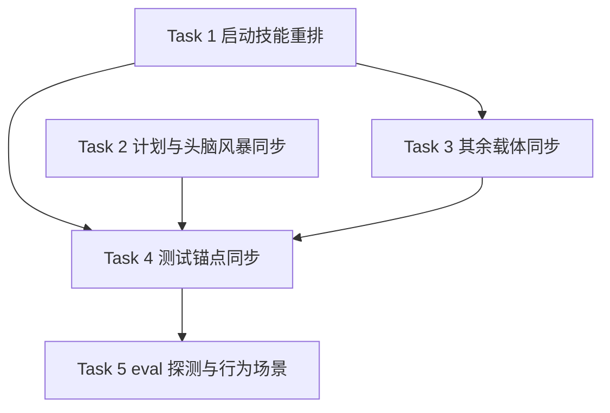

# 技能库适用范围收敛与启动技能结构重排 实施计划

- **目标：** 需求方在任意会话中看到的技能库不再把非软件开发任务纳入适用范围；启动技能开篇即声明范围，正文按「技能调用纪律」与「开发工作流」两层组织。
- **架构：** 纯文本改动，分四组：启动技能重排、范围措辞同步、文档载体同步、测试锚点同步；另加一次 eval 覆盖探测与行为场景记录。
- **技术栈：** Markdown 技能档案、Bash 测试脚本、Python 3（Antigravity 清单测试内嵌）。
- **设计文档（Spec）：** `docs/superpowers/specs/2026-11-04-dev-scope-convergence/design.md`
- **验证方案：** `docs/superpowers/specs/2026-11-04-dev-scope-convergence/verification.md`（S1–S8）
- **实施前决策记录 + 日期：** 2026-11-04。设计已确认；决策 7 选 A（先探测 eval 覆盖，再决定是否跑 before/after）。
- **计划确认 + 日期：** 2026-11-04，需求方回复「确认」；执行方式按计划建议取会话内执行。

## 1. 改动地图

| 文件 | 职责 | 所属任务 |
|------|------|---------|
| `skills/using-superpowers/SKILL.md` | 范围前置；两层结构重排；三分类改名 | Task 1 |
| `skills/writing-plans/SKILL.md` | 计划范围句统一 | Task 2 |
| `skills/writing-plans/references/plan-template.md` | 计划模板范围句统一 | Task 2 |
| `skills/brainstorming/SKILL.md` | 描述与正文的范围措辞、非软件示例收敛 | Task 2 |
| `skills/dispatching-parallel-agents/SKILL.md` | 描述收窄 | Task 3 |
| `skills/systematic-debugging/SKILL.md` | 正文适用面收窄 | Task 3 |
| `docs/skills-map.md` | 触发语收窄；删除与既有裁决冲突的残留 | Task 3 |
| `README.md` | 两处触发语收窄 | Task 3 |
| `skills/finishing-a-development-branch/SKILL.md` | 交叉引用改指第二部分 | Task 3 |
| `tests/integration-verification/test-integration-verification.sh` | 正反向断言与结构断言同步 | Task 4 |
| `tests/antigravity/test-plugin-manifest.sh` | 描述锚点同步 | Task 4 |
| `docs/superpowers/specs/2026-11-04-dev-scope-convergence/eval-probe.md` | eval 探测与行为场景记录 | Task 5 |
| `docs/superpowers/verification/cross-module.md` | 收尾阶段并入 `DSC-001`，注明与 `WDH-001` 同资产 | 收尾 |

依赖方向：Task 1 产出第二部分标题与工作流总览，Task 3 的交叉引用依赖它；Task 4 依赖 Task 1–3 的最终字面；Task 5 依赖 Task 1–4 完成。



## 2. 功能单元规格

### Task 1: 启动技能范围前置与两层结构重排

**职责：** 交付新的启动技能全文；Task 3 的交叉引用与 Task 4 的断言都以本任务产出的标题和字面为准。

**Files:**
- Modify: `skills/using-superpowers/SKILL.md`（结构重排；除下列允许改动外，正文逐字保留）

**Interfaces:**
- Consumes: 设计 §2 变更 1、变更 2；现有技能全文。
- Produces:
  - description 逐字：`在开始任何软件开发类任务时使用——规定如何查找与使用技能，要求在发出任何回应（包括澄清性问题）之前先调用技能`
  - 范围标签逐字：
    ```
    <SCOPE>
    本技能只适用于软件开发类工作——包括代码、测试与项目文档。
    按描述加载本技能的 harness：非软件开发类任务不触发加载。
    无条件注入本技能的 harness：技能已加载，但其工作流不适用于非软件开发类任务——按用户指令正常应答。
    </SCOPE>
    ```
  - 章节骨架逐字：
    ```
    # 第一部分：技能调用纪律
    ## 规则
    ## 技能优先级
    ## 平台适配
    ## 用户指令
    # 第二部分：开发工作流
    ## 工作流总览
    ## 流程闸门与定性
    ## 已裁决事项
    # 附录：危险信号
    ```
  - 「工作流总览」承载从「技能优先级」迁出的三条：构建类走完整工作流、修复类在 bugfix 分支上进行、共同约束。

**边界条件：**
- **位置契约：** `<SCOPE>` 是 `</SUBAGENT-STOP>` 之后的第一个非空内容；`</SCOPE>` 位于 `<EXTREMELY-IMPORTANT>` 之前。
- **允许的结构改动：** 新增三个一级标题、新增「## 工作流总览」、把三条工作流条目移入该节、把各节归入第一或第二部分、把危险信号表移到附录标题下。除这些移动与新增标题外，不新增或删除其他标题。
- **允许的文字改动（仅此六项）：**
  1. description 整句替换为上面的逐字文本。
  2. 插入范围标签。
  3. 删除「本工作流只适用于软件开发项目。」。
  4. 「收到开发类请求时」改为「收到软件开发类请求时」。
  5. 「feature、bugfix 或非开发任务三类之一」改为「feature、bugfix 或非实施任务三类之一」。
  6. 「**非开发任务：**」改为「**非实施任务：**」。
- **迁移契约：** 三条工作流条目从「技能优先级」移入「工作流总览」，原文逐字保留；「技能优先级」只保留通用优先级与两个入口示例。
- **保留契约：** 除上述结构改动与六项文字改动外，其余正文逐字保留，包括「规则」「技能优先级」剩余部分、「流程闸门与定性」「平台适配」「用户指令」「已裁决事项」「危险信号」全表。
- **标题契约：** 「流程闸门与定性」「技能优先级」两个标题名不改。
- **大小契约：** 文件仍小于 20,000 字节。

**验收标准：**
- 断言 `</SUBAGENT-STOP>` 之后第一个非空行为 `<SCOPE>`，且 `</SCOPE>` 行号小于 `<EXTREMELY-IMPORTANT>` 行号。
- 断言三个一级标题与七个二级标题按骨架顺序出现：「第一部分」在「第二部分」之前，「附录」在最后。
- 断言 description 与范围标签逐字在场；「只适用于」只出现 1 次且该行位于 `<SCOPE>` 与 `</SCOPE>` 之间。
- 断言旧范围句、「收到开发类请求时」、两处旧分类名均缺席。
- 断言三条工作流条目的行号位于「# 第二部分：开发工作流」之后。
- 提取基线中的危险信号表与工作区中的表逐字比较，必须完全一致；数据行数仍为 13。
- 运行 `git diff` 人工复核，确认除允许的结构改动与六项文字改动外没有其他文本变化。
- `tests/skill-size/test-skill-size.sh` 通过。

### Task 2: 计划与头脑风暴技能范围措辞同步

**职责：** 交付计划技能与头脑风暴技能的新范围措辞；Task 4 的断言以本任务产出的字面为准。

**Files:**
- Modify: `skills/writing-plans/SKILL.md:14`
- Modify: `skills/writing-plans/references/plan-template.md:5`
- Modify: `skills/brainstorming/SKILL.md:3,8,26,58,77,78,81,95,138`

**Interfaces:**
- Consumes: 设计 §2 变更 3 的逐字锚点表；范围术语「软件开发类工作（含代码与项目文档）」。
- Produces: 下表的新字面；每一行只含一个逐字锚点。

| 文件 | 现有表述（逐字） | 改后表述 |
|------|-----------------|---------|
| 计划技能 | 计划只适用于软件项目。 | 计划只适用于软件开发类工作（含代码与项目文档）。 |
| 计划模板 | 计划只适用于软件项目。 | 计划只适用于软件开发类工作（含代码与项目文档）。 |
| 头脑风暴 | 在做任何创造性工作之前，你必须使用本技能——无论是创建特性、构建组件、添加功能、修改行为，还是规划任何新事物 | 在开始软件开发类的创造性工作之前，你必须使用本技能——无论是创建特性、构建组件、添加功能、修改行为，还是规划新功能或新文档 |
| 头脑风暴 | 在任何东西被构建出来之前 | 在任何软件开发产物被构建出来之前 |
| 头脑风暴 | 软件项目调用 superpowers:writing-plans | 调用 superpowers:writing-plans |
| 头脑风暴 | ；一件艺术品的媒介 | （删除，保留「一个应用的平台、编程语言和库。」） |
| 头脑风暴 | 一个屏幕、一个页面、一份打印件、一块标牌 | 一个屏幕、一个页面、一个弹窗、一份报表 |
| 头脑风暴 | 屏幕的、房间的、日程的 | 页面的、面板的、流程的 |
| 头脑风暴 | 一张图、一条时间线、一幅地图 | 一张架构图、一条时间线、一张关系图 |
| 头脑风暴 | 比如一个页面、一个屏幕、一份日程或一份打印件？ | 比如一个页面、一个屏幕、一份报表或一个弹窗？ |
| 头脑风暴 | 软件项目的下一步是计划：调用 superpowers:writing-plans | 下一步是计划：调用 superpowers:writing-plans |

**边界条件：**
- 计划技能两处只替换范围句，保留前后文。
- 头脑风暴描述整句替换，保留「创建特性、构建组件、添加功能、修改行为」四项。
- 删除「；一件艺术品的媒介」后，保留「一个应用的平台、编程语言和库。」。
- 两处「软件项目」限定词删除后，句子语法完整。
- 视觉示例与正文示例按上表逐字替换，不新增示例。
- 不修改该文件的任何行为规则段。

**验收标准：**
- 上表每条新字面逐字在场，旧字面逐字缺席。
- 头脑风暴全文不再出现「软件项目」「一件艺术品的媒介」「一份日程」「一份打印件」。
- 保留句「一个应用的平台、编程语言和库。」仍在。
- 运行 `git diff` 人工复核，确认行为规则段没有被改写。

### Task 3: 其余载体范围措辞同步

**职责：** 交付分派、调试、技能地图、项目说明与分支收尾技能的范围措辞；Task 4 的断言以本任务产出的字面为准。

**Files:**
- Modify: `skills/dispatching-parallel-agents/SKILL.md:3`
- Modify: `skills/systematic-debugging/SKILL.md:24`
- Modify: `docs/skills-map.md:56-57`
- Modify: `README.md:325,343`
- Modify: `skills/finishing-a-development-branch/SKILL.md:181`

**Interfaces:**
- Consumes: Task 1 产出的「第二部分：开发工作流」标题。
- Produces: 下表的新字面；每一行只含一个逐字锚点。

| 文件 | 现有表述（逐字） | 改后表述 |
|------|-----------------|---------|
| 分派技能 | 当面对 2 个以上相互独立、可在没有共享状态或顺序依赖的情况下处理的任务时使用 | 当面对 2 个以上相互独立、可在没有共享状态或顺序依赖的情况下处理的软件开发任务时使用 |
| 调试技能 | 适用于任何技术问题： | 适用于任何软件开发技术问题： |
| 技能地图 | 任何创造性工作开始之前——功能、组件、计划，软件内外都算。 | 任何软件开发类创造性工作开始之前——功能、组件、计划。 |
| 技能地图 | ；非软件项目止于设计文档 | （删除该分句，保留同一行前面的 feature 三件套与 bugfix 路径分句） |
| 项目说明 | 在构建任何东西之前激活 | 在开始软件开发类构建之前激活 |
| 项目说明 | agent 在做任何任务之前都会检查有无相关技能。 | agent 在做任何软件开发任务之前都会检查有无相关技能。 |
| 分支收尾 | 上位载体：改动分类与两路径路由见 superpowers:using-superpowers 技能优先级；archived 冻结的存放策略见 superpowers:brainstorming 存放位置。 | 上位载体：改动分类与两路径路由见 superpowers:using-superpowers 的「第二部分：开发工作流」；archived 冻结的存放策略见 superpowers:brainstorming 存放位置。 |

**边界条件：**
- 技能地图只删除「；非软件项目止于设计文档」这一分句；同一行的 feature 三件套与 bugfix 路径分句保留。
- 分支收尾只替换「技能优先级」这个指向，保留同行 archived 指向。
- 项目说明两处只替换触发语，保留各条技能的职责描述。
- 不改写分派技能与调试技能的其他任何句子。

**验收标准：**
- 上表每条新字面逐字在场，旧字面逐字缺席。
- 技能地图「三件套」与「bugfix 路径」仍在。
- 分支收尾全文不再出现「技能优先级」，且 archived 指向仍在。
- 新引用指向的「第二部分：开发工作流」标题在启动技能中存在。
- 运行 `git diff` 人工复核，确认未改写其他句子。

### Task 4: 测试锚点同步

**职责：** 让机械断言覆盖结构、新表述、旧表述回流与保留内容；交付全绿的受影响测试与全量测试记录。

**Files:**
- Modify: `tests/integration-verification/test-integration-verification.sh`（Task 1–3 的正向、反向与结构断言段）
- Modify: `tests/antigravity/test-plugin-manifest.sh:85-87`

**Interfaces:**
- Consumes: Task 1–3 的全部新字面与结构。
- Produces: 通过的两个测试脚本；新增变量 `MAP="$REPO_ROOT/docs/skills-map.md"` 与 `README="$REPO_ROOT/README.md"`。
- **结构断言（S1、S2）：**
  - `</SUBAGENT-STOP>` 之后第一个非空内容为 `<SCOPE>`；`</SCOPE>` 行号小于 `<EXTREMELY-IMPORTANT>`。
  - 三个一级标题与七个二级标题按骨架顺序出现。
  - 「只适用于」出现次数为 1，且该行位于 `<SCOPE>` 与 `</SCOPE>` 之间。
  - 头脑风暴技能含「流程闸门与定性」，且启动技能存在同名标题。
  - 分支收尾含「第二部分：开发工作流」，且启动技能存在该标题。
  - 启动技能含 `<EXTREMELY-IMPORTANT>` 与「流程闸门的全部十一个环节」。
- **正向断言（S3、S5）：**
  - 启动技能含 `只适用于软件开发类工作`、`在开始任何软件开发类任务时使用`、`如果你认为哪怕只有 1% 的可能有一项技能适用于你正在做的事`、`流程闸门的全部十一个环节`、`# 第二部分：开发工作流`。
  - 计划技能与模板含 `计划只适用于软件开发类工作（含代码与项目文档）`。
  - 头脑风暴含 `在开始软件开发类的创造性工作之前`、`在任何软件开发产物被构建出来之前`、`一份报表或一个弹窗`、`一个屏幕、一个页面、一个弹窗、一份报表`、`页面的、面板的、流程的`、`一张架构图、一条时间线、一张关系图`、`一个应用的平台、编程语言和库。`、`流程闸门与定性`。
  - 分派技能含 `处理的软件开发任务时使用`；调试技能含 `适用于任何软件开发技术问题：`。
  - 技能地图含 `任何软件开发类创造性工作开始之前——功能、组件、计划。`、`三件套`、`bugfix 路径`。
  - 项目说明含 `在开始软件开发类构建之前激活`、`agent 在做任何软件开发任务之前都会检查有无相关技能。`。
  - 分支收尾含 `第二部分：开发工作流` 与 `archived 冻结的存放策略`。
  - Antigravity 描述锚点为 `在开始任何软件开发类任务时使用`。
- **反向断言（按承载文件限定）：**
  - 启动技能不含 `只适用于软件开发项目`、`在开始任何对话时使用`、`收到开发类请求时`、`非开发任务`。
  - 计划技能与模板不含 `计划只适用于软件项目`。
  - 头脑风暴不含 `在做任何创造性工作之前`、`在任何东西被构建出来之前`、`一件艺术品的媒介`、`一个屏幕、一个页面、一份打印件、一块标牌`、`屏幕的、房间的、日程的`、`一张图、一条时间线、一幅地图`、`比如一个页面、一个屏幕、一份日程或一份打印件？`、`软件项目`。
  - 分派技能不含 `当面对 2 个以上相互独立、可在没有共享状态或顺序依赖的情况下处理的任务时使用`。
  - 调试技能不含 `适用于任何技术问题：`。
  - 技能地图不含 `任何创造性工作开始之前——功能、组件、计划，软件内外都算。`、`软件内外`、`非软件项目`；项目说明不含 `在做任何任务之前`、`在构建任何东西之前激活`。
  - 分支收尾不含 `技能优先级`。

**边界条件：**
- 原有 `wdh-us-scope-software` 断言的期望串改为新句；断言名可保留。
- 断言使用 `grep -F` 逐字匹配，按承载文件限定，不做全仓 grep。
- Antigravity 测试的失败提示同步改为新句，避免提示与断言不一致。
- 不改动测试框架、`ck` 辅助函数或其他断言组。
- **全量测试定义：** 用 `find tests -type f \( -name 'test-*.sh' -o -name 'run-*.sh' \)` 枚举全部脚本并逐一运行；需要外部编码 CLI 或网络而无法运行的，记录脚本路径与错误，标为环境受限；其余必须全绿。至少必须全绿的集合：integration-verification、antigravity、hooks、skill-size、script-sync、codex-plugin-sync、shell-lint、version-bump。

**验收标准：**
- `tests/integration-verification/test-integration-verification.sh` 全绿。
- `tests/antigravity/test-plugin-manifest.sh` 全绿。
- `tests/skill-size/test-skill-size.sh` 全绿。
- `tests/hooks/test-session-start.sh` 全绿。
- 全量测试记录：至少必须全绿的集合全绿；环境受限项逐条列出脚本路径与错误。
- 破坏演练：把 `计划只适用于软件项目。` 写回计划技能，断言必须失败；还原后再次全绿。
- `git ls-files evals/` 输出为空。

### Task 5: eval 探测与行为场景记录

**职责：** 按决策 7 先探测外部 eval 仓库的覆盖情况；有覆盖则跑 before/after，无覆盖或不可运行则执行 S6–S8 人工场景；交付可复核的结论。

**Files:**
- Create: `docs/superpowers/specs/2026-11-04-dev-scope-convergence/eval-probe.md`
- Clone (gitignored, not committed): `evals/`
- Temporary baseline worktree: `/tmp/dsc-baseline-<pid>`（验证后移除）

**Interfaces:**
- Consumes: Task 1–4 完成后的工作区；设计 §4 决策 7。
- Produces: `eval-probe.md`，记录四种结论之一：有覆盖并已跑、有覆盖但运行失败、无覆盖场景、harness 不支持目标仓库；并记录 S6–S8 的执行结果或未执行原因。

**边界条件：**
- `evals/` 不存在时按 `AGENTS.md` 的说明克隆；已存在则直接读取。
- 先读 `evals/README.md`，确认目标仓库配置方式与场景清单。
- 覆盖判据：场景必须涉及「适用范围判定」「非软件开发任务是否触发工作流」「文档类交付物是否进入工作流」或「描述触发语」之一；仅有通用编码场景不算覆盖。
- **before 状态：** 用 `git worktree add /tmp/dsc-baseline-<pid> --detach c266c04` 创建独立基线工作区，不改动当前分支，不提交。
- **after 状态：** 当前特性工作区的工作树内容（含未提交改动）。
- 有覆盖但 harness 要求干净仓库或运行失败：记录为「有覆盖但运行失败」，附错误与配置；不得归入「无覆盖」。
- 无覆盖或 harness 不支持：S6–S8 需要新的交互式会话，当前执行会话不能自我观察；由需求方在实施完成后按清单手动执行，执行者在 `eval-probe.md` 记录「待需求方手动验证」并附清单，不编造结果。
- 人工场景在临时空目录中执行（`mktemp -d`），避免仓库已有 `docs/superpowers/specs/` 干扰判定。
- 不新增自研 eval 场景；不提交 `evals/` 下的任何文件；验证后移除临时基线工作区。

**验收标准：**
- `eval-probe.md` 明确写出四种结论之一，并附证据。
- 若运行了 eval，结果含 before/after 的场景 id、命令与通过/失败记录。
- 若未运行，原因可由文件清单、grep 输出或错误日志复核。
- S6–S8 每条都有执行结果或明确的未执行原因。
- `git ls-files evals/` 输出为空；`git worktree list` 不含临时基线工作区。

## 3. 设计依据

- **术语选择：** 用「软件开发类工作（含代码与项目文档）」，因为「编码任务」排除了设计文档、计划与验证方案，「软件项目」无法区分整个项目与项目内单项工作。详见设计 §4 决策 1。
- **结构选择：** 两层结构加附录，只移动块、不改写已调优句子；排除最小改动、全面重写与 references/ 拆分，理由见设计 §4 决策 4。
- **收敛边界：** 只改范围措辞与泛化触发语，不改写行为规则；边界由需求方「都改」裁决与作者建议共同确定，见设计 §4 决策 5。
- **为什么分四个文本任务：** 启动技能重排、两个技能的措辞、其余载体、测试断言各自有独立的验收面；合并会让审查者无法定位失败来源。
- **为什么 Task 5 先探测：** eval 场景是否覆盖中文 fork 的适用范围判定，克隆前无法确认；先探测避免在不适用场景上消耗完整前后两轮的成本。

## 4. 约束

- 所有产品改动只在 `feature/dev-scope-convergence` 工作树内进行；不触碰 `main`。Task 5 在 `/tmp` 创建的临时基线工作区仅用于验证，验证后移除、不提交，不构成产品改动。
- 不修改 `docs/superpowers/archived/` 下的任何文件。
- 不改写危险信号表、合理化借口清单与已裁决事项正文。
- 不重命名「流程闸门与定性」「技能优先级」两个标题。
- 不修改技能编写方法论文档中的示例文本。
- 不提交 `evals/` 下的文件；该目录已被忽略。
- 测试断言使用 `grep -F` 逐字匹配，不使用正则。
- 全量测试按 Task 4 的定义执行；环境受限项必须记录，不得静默跳过。
- 所有改动先留在工作区；需求方明确确认后再提交，不得按任务自动提交。
- 收尾阶段把新增机械场景并入 `docs/superpowers/verification/cross-module.md`，条目 `DSC-001` 注明与 `WDH-001` 同资产。

## 5. 风险清单

| 风险 | 触发条件 | 影响 | 缓解方式 |
|------|---------|------|---------|
| 范围标签仍被读成「整个技能无效」 | 代理只看 SCOPE 不看后文 | 技能发现纪律在开发任务上被跳过 | SCOPE 明确写「工作流不适用于非开发任务」；Task 4 断言 1% 规则仍在场 |
| 迁移后交叉引用指向空标题 | 只改标题不改引用，或反之 | 分支收尾技能的读者找不到路由说明 | Task 3 同步替换指向；Task 4 断言新标题存在 |
| 反向断言假通过 | 多分句格被当成一个整串，或旧句没有反向断言 | 旧表述残留但测试全绿 | 设计表格已拆成单锚点行；Task 4 为每条旧字面列反向断言；破坏演练选有断言的旧句 |
| 整段误删 | 删除技能地图残留时误删整行 | feature 三件套与 bugfix 路由说明丢失 | 边界条件限定只删一个分句；新增保留内容正向断言 |
| Antigravity 启动失败 | 描述锚点未同步 | 该 harness 不再加载启动技能 | Task 4 同步测试锚点；运行 Antigravity 清单测试 |
| 行为效果无证据 | eval 无覆盖且 S6–S8 未执行 | 只证明文本改变，不证明代理行为改变 | Task 5 承接 S6–S8；`eval-probe.md` 必须记录执行结果或明确未执行原因 |
| eval before/after 变成同一状态 | 未提交时两轮都读 HEAD | 两轮结果相同，探测无效 | before 用独立基线工作区 `c266c04`；after 用当前工作树；验证后移除基线工作区 |
| eval 仓库不覆盖目标场景 | 场景清单无适用范围判定 | 无法提供 before/after 行为证据 | 按 Task 5 记录无覆盖证据，转 S6–S8 人工场景；风险记入附录 |
| 测试环境缺 Python 3 | Antigravity 清单测试无法运行 | 该测试无法验收 | 环境已确认存在 `python3`；缺失时停下报告，不以其他测试替代 |

## 执行交接

- **建议执行方式：** 会话内执行。理由是五个任务都是小范围文本改动、由精确字面强耦合，子代理派发与上下文交接的成本高于收益；最终仍由独立审查者做整分支把关。
- **必需子技能：** `superpowers:executing-plans`。
- **行为场景责任：** S6–S8 需要新的交互式会话，由需求方在实施完成后按清单手动执行；eval 覆盖时可改为 eval 自动执行。执行者记录待验证项，不代替需求方观察。
- **登记册：** 收尾阶段按收尾技能把 `DSC-001` 并入 `docs/superpowers/verification/cross-module.md`，注明与 `WDH-001` 共用同一测试脚本。
- **请需求方审查：** 各任务的边界条件与验收标准是否忠实覆盖设计文档的功能清单与「明确不做」清单。
- **确认要求：** 明确确认后才进入实施；「嗯」「继续」不算明确确认。
- **设计变更回退：** 实施开始后若发现设计必须改，停止实施，回到设计确认门；返工还是回滚由需求方决定。

## 附录：独立审读处置记录

**审读者身份：** 独立子代理（未参与写作），2026-11-04。**机械检查：** `check-tables.sh`、`check-mermaid.sh`、`check-doc-structure.sh` 全部通过。

| 编号 | 问题摘要 | 严重度 | 处置 |
|------|---------|--------|------|
| A5-1 | before/after 在未提交时指向同一 HEAD | 高 | 采纳。before 用独立基线工作区 `c266c04`，after 用当前工作树；验证后移除 |
| A5-2 | S1/S2/S3/S5 未资产化进测试 | 高 | 采纳。Task 4 增加结构断言、交叉引用断言、技能档案措辞断言与文档断言 |
| A5-3 | 反向断言覆盖不全，破坏演练可假通过 | 高 | 采纳。为设计表中的每条旧字面列反向断言；破坏演练改用有断言的旧句 |
| A5-4 | 风险缓解声称的断言不存在 | 高 | 采纳。补 `<EXTREMELY-IMPORTANT>`、十一环节与第二部分标题断言 |
| A5-5 | IS1 的 harness 加载事实写反 | 中 | 采纳。改为「Claude Code 与其他 harness 无条件注入；Antigravity 按描述加载」 |
| A5-6 | S3 无对应集成面 | 中 | 采纳。新增 IS6 并映射 S3 |
| A5-7 | 「全量测试套件」无定义 | 中 | 采纳。Task 4 定义全量脚本范围与环境受限记录 |
| A5-8 | 头脑风暴 L8、L95 遗漏 | 中 | 采纳。设计变更表与 Task 2 补入两个载体 |
| A5-9 | 「全文重排」缺少保留保护 | 中 | 采纳。列出六项允许改动白名单，并要求全文 diff 复核 |
| A5-10 | 「紧接」被弱化为「之后」 | 中 | 采纳。改为「之后第一个非空内容」，并断言 `</SCOPE>` 在 1% 规则之前 |
| A5-11 | 保留内容缺少验收 | 中 | 采纳。补保留句、archived 指向与行为段 diff 复核 |
| A5-12 | 计划缺逐字替换值 | 中 | 采纳。Task 2、Task 3 增加逐字替换表 |
| A5-13 | `git status` 检查 `evals/` 是空断言 | 中 | 采纳。改为 `git ls-files evals/` 为空 |
| A5-14 | 登记册查重结论不准 | 中 | 采纳。明确与 `WDH-001` 同资产，新增 `DSC-001` 并注明关系 |
| A5-15 | 人工场景缺 harness 与工作目录 | 中 | 采纳。S6/S7 限定临时空目录与 Claude Code；新增 S8 文档类请求 |
| A5-16 | 决策 6 的改动处数不准 | 低 | 采纳。设计改为 2 处并列出 |
| A5-17 | 计划缺 verification 指针 | 低 | 采纳。元数据补验证方案路径 |
| A5-18 | 设计第 2 章标题偏离模板 | 低 | 采纳。改为「功能清单（变更项）」 |
| A5-19 | 变更 1 的「单一出口」与两个结局不符 | 低 | 采纳。改为三列出口表 |
| A5-20 | Task 4 Files 描述范围不符 | 低 | 采纳。改为 Task 1–3 的断言段 |
| A5-21 | Task 5 缺「有覆盖但运行失败」 | 低 | 采纳。增加第四类结论 |
| B 组 | 可读性：七标题歧义、旧句未列、项目说明未定义等 | 中/低 | 采纳。逐条改为稳定指代、补逐字表与术语 |
| C 组 | 实现效果：行为场景无承接、登记册未入计划、破坏演练假通过 | 高/中 | 采纳。S6–S8 归入 Task 5；登记册写入改动地图与执行交接；反向断言补齐 |

**复读回执：** 第二、三轮复读确认 A5-1 至 A5-21、B 组与 C 组全部闭环，未留下高严重度阻塞项。第三轮提出的五项低/中低残留均已处置：Task 4 的三个视觉示例新句改为逐字列出；技能地图旧触发语整串补入反向断言；S4 变更范围补入本规格目录三份文档；全量测试 `find` 增加 `run-*.sh`；Task 5 的 `/tmp` 临时基线工作区在约束中注明仅用于验证、不提交。
