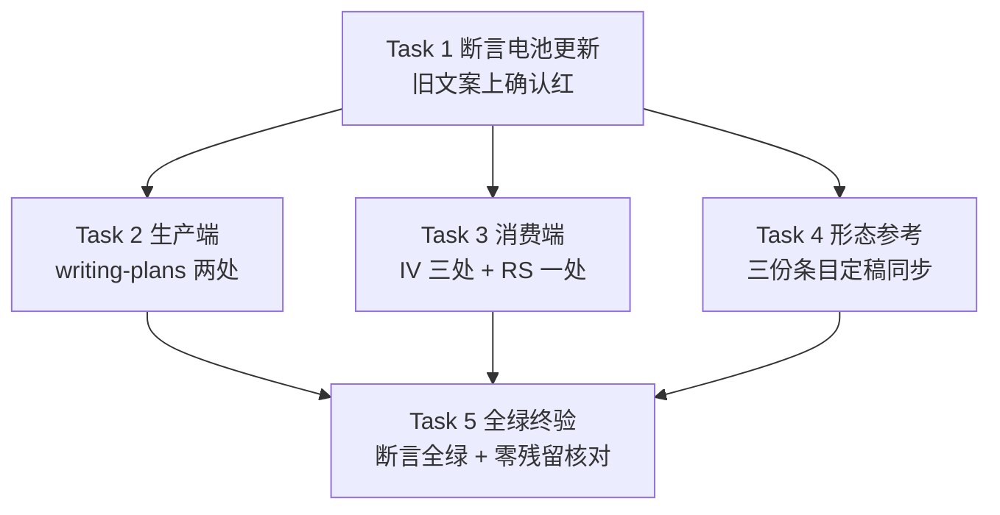

# 实施计划：验证场景自包含——场景间零依赖、并行调度无标注前提

## 元数据

- **目标：** 验证方案在计划阶段即按「场景自包含」判据产出（每场景独立可运行、并行安全），执行端不再以任何标注为并行前提——验证吞吐随场景数提升，判据在方案、登记册、回归三处机械可查。
- **架构：** 断言先行（TDD）：先更新断言电池并在旧文案上确认红，再按端替换九处技能文案（生产端 → 消费端 → 形态参考），终验全绿。判据名目「顺序依赖显式化」全库替换为「场景自包含」，消费端执行规则句改写为「可并行调度 + 容量池控制并发度」语义。
- **技术栈：** Markdown 技能文案 + bash 断言脚本（`ck` 函数 + `grep -qF` 正反向断言）。
- **设计文档（Spec）：** `docs/superpowers/specs/2026-11-04-scenario-self-contained/design.md`
- **实施前决策记录 + 日期：** 2026-11-05。**计划需求方确认：2026-11-05，执行方式：子代理驱动（采计划者推荐）。** 计划者敲定两项执行细节：(a) 回潮断言范围为 `skills/` 全库递归 grep 三串（对齐设计 §2.5「技能文档全库零出现」口径）；(b) ~~环境声明初始化描述句不改~~（已废止——计划独立审读 A1 呈报后需求方裁决（2026-11-05，设计裁决 7）：初始化描述句补容量池引导，改动面扩至 9 处，落点见 Task 3）。

## 范围判定：不产出验证方案

改动面清单：9 处技能文案（`skills/writing-plans/SKILL.md`、`skills/writing-plans/references/plan-template.md`、`skills/integration-verification/SKILL.md` 三处——执行规则、十项名目、环境声明初始化描述句（2026-11-05 裁决 7 新增）、`skills/regression-sweep/SKILL.md`、`skills/integration-verification/references/backend.md`、`web.md`、`mobile.md`）+ 1 处断言脚本（`tests/integration-verification/test-integration-verification.sh`）。推导链：全部改动为文案替换与断言更新 → 无跨任务组装点（任务间仅文本名目一致约束，无接口组装）→ 无外部接口（不触及任何运行时组件）→ 无运行边界（断言脚本是项目既有测试体系的扩展，不引入新运行环境）。故不产出 `verification.md`，plan.md 五章骨架不变；验证分两层：机械层由断言电池承担（Task 1 红态 + Task 5 全绿），语义完整性层由各任务的要素级验收标准与收官把关终审承担（独立审读 A4 处置——机械断言不覆盖语义完整性，两层各司其职，不宣称断言单层闭环）。

## 1. 改动地图

| 文件 | 改动 | 职责 |
|------|------|------|
| `tests/integration-verification/test-integration-verification.sh` | 改写两处旧串正向断言、新增语义锚断言与回潮断言 | 断言电池——门禁载体（Task 1） |
| `skills/writing-plans/SKILL.md`（自审第 10 项） | 六项名目替换 | 生产端口径（Task 2） |
| `skills/writing-plans/references/plan-template.md`（「验证方案文件」段） | 六项名目替换 + 判据定义落进模板 | 生产端判据定义载体（Task 2） |
| `skills/integration-verification/SKILL.md`（Step 2 核对句 + 执行规则条目 + 环境声明初始化描述句） | 十项名目替换 + 执行规则新句 + 容量池引导半句 | 消费端口径与并行语义（Task 3） |
| `skills/regression-sweep/SKILL.md`（执行规则条目） | 执行规则新句（与 IV 同语义） | 消费端并行语义（Task 3） |
| `skills/integration-verification/references/backend.md`（资产化标准条目） | 「场景自包含」条目定稿 | 形态参考口径源（Task 4） |
| `skills/integration-verification/references/web.md`、`mobile.md`（资产化标准条目） | 同文同步 | 形态参考口径同步（Task 4） |

依赖方向：Task 1（断言红态）→ Task 2/3/4（文案替换，彼此无依赖，名目一致性由逐字契约保证）→ Task 5（全绿终验）。任务关系图：

## 2. 功能单元规格

### Task 1: 断言电池更新与红态确认

**职责：** 更新断言电池使它断言新判据与新执行语义，并在当前（旧）文案上确认全部新断言为红——本任务的交付物被 Task 5 的全绿终验依赖。

**Files:**
- Modify: `tests/integration-verification/test-integration-verification.sh`（断言 8 的 `pt-content-requirements` 行、断言 11 的质量名目循环、文件后段新增断言组）

**Interfaces:**
- Consumes: 既有 `ck` 函数、变量 `IV/RS/BK/WB/MB/WP/PT`、断言 12e 的反向断言模式。
- Produces: 新断言名清单（Task 2/3/4 转绿的目标，也是其行文契约）——
  - `pt-content-requirements` 改写：正向断言新枚举句「内容要求六项逐项落实——确定性固定策略、保真度声明、副作用隔离、场景自包含、既有登记册查重、失败证据采集」（逐字契约，Task 2 落地目标）。
  - 断言 11 质量名目循环：「顺序依赖显式化」替换为「场景自包含」（逐字契约，Task 3 落地目标——该循环只 grep `$IV`）。
  - 新增正向断言：`WP`、`PT`、`BK`、`WB`、`MB` 各自 `grep -qF '场景自包含'`（Task 2/4 落地目标）。
  - 新增语义锚正向断言（锚定要素必现词，防语义完整性静默缺口——审读 A4 处置）：`PT`、`BK`、`WB`、`MB` 各自 `grep -qF '并行安全'`（判据五要素核心词，Task 2/4 落地目标）；`IV`、`RS` 各自 `grep -qF '默认容量 1'`（执行规则兜底语义，Task 3 落地目标）。
  - 新增正向断言：`IV`、`RS` 各自 `grep -qF '容量池'`（语义锚，Task 3 落地目标；锚定最小集，不锁行文其余部分）。
  - 新增落点级正向断言（审读 R3 处置）：`IV` 的初始化句同行检查——`grep '各层一行怎么跑' "$IV" | grep -qF '容量池'`，保证容量池引导落在初始化描述句内而非仅执行规则句（文件级 grep 无法区分两处落点）。
  - 新增回潮断言：三条递归反向断言 `! grep -rqF '<串>' "$REPO_ROOT/skills/"`（匹配模式为精确串，除递归 `-r` 与固定串 `-F` 外不加其他参数），串为「顺序依赖显式化」「标注可并行」「顺序依赖链」（Task 2/3/4 全部完成后转绿）。

**边界条件：**
- 旧文案（当前分支状态）在位时运行脚本：上述每条新断言均为 `FAIL:` 输出；既有断言（未被改写者）保持 `ok:`——红态逐条记录到任务提交信息。
- 三条回潮断言的匹配模式为精确串（除递归 `-r` 与固定串 `-F` 外不加其他参数）；不排除任何 `skills/` 子路径——设计口径为技能文档全库。
- 被改写的两条既有断言（`pt-content-requirements`、质量名目循环）不得保留旧串的正向版本——旧串正向断言与新回潮断言并存会让 Task 2-4 永远红。
- 不得改动既有断言的其余部分（断言 1–7、9–12e 等与本需求无关，禁止顺手修改）。
- ❌「新断言写出后直接跑一遍全绿就提交」　✅「在旧文案上逐条确认 FAIL 输出后再提交」

**验收标准：**
- 在旧文案上运行脚本：每条新断言（改写 + 新增）输出 `FAIL:`，无一条意外绿。
- 既有无关断言全部 `ok:`，脚本退出码非零（红态）。
- `git diff` 仅触及本任务 Files 声明的脚本文件。

### Task 2: 生产端判据替换（writing-plans 两处）

**职责：** 把「顺序依赖显式化」名目替换为「场景自包含」并把判据定义落进验证方案模板——计划阶段代理从此在生产端可读的载体上获得判据全文；被 Task 1 断言与 Task 5 终验依赖。

**Files:**
- Modify: `skills/writing-plans/SKILL.md`（自审第 10 项，六项名目枚举）
- Modify: `skills/writing-plans/references/plan-template.md`（「验证方案文件」段，六项名目枚举句 + 判据定义落点）

**Interfaces:**
- Consumes: Task 1 的逐字契约「内容要求六项逐项落实——确定性固定策略、保真度声明、副作用隔离、场景自包含、既有登记册查重、失败证据采集」；设计文档 §2.1 判据五要素与三出路。
- Produces: 「场景自包含」判据的生产端定义文本（Task 4 形态参考条目与之同名目；Task 3 消费端核对名目与之同形）。

**边界条件：**
- `PT` 枚举句替换后逐字等于 Task 1 契约句（顺序、顿号、破折号全同——`PT` 既有形态即「逐项落实——」破折号形态，断言锚定它）。
- `WP` 自审第 10 项保留既有「内容要求六项逐查（……）」括号形态，仅替换其中名目词「顺序依赖显式化」→「场景自包含」——两处枚举句形态本不相同（审读 A3 处置），不要求统一为契约句形态，不得改写 `WP` 既有句式。
- 判据定义五要素齐备且可判真伪：前置写明搭建方式或数据来源、清理自带、独立可运行、并行安全（无固定端口、固定容器名、共享临时路径等全局资源标识依赖）、顺序编排只存在于场景内操作步骤。
- 三出路按序写入：先造数自备前置（优先）；造数不可达 → 合并为路径级场景；仍不可达 → 人工验证清单（既有机制，不伪装自动化）。
- 判据定义落点由执行者定（设计「留给构建者的部分」第 4 项）：写作要求句或逐场景自查句、与既有「前置写明搭建方式或数据来源」短语并存或合并——边界：五要素不缺、贴合模板段既有句式、六项名目枚举句不受影响（契约句逐字保留）。
- 不得改动 plan-template「验证方案文件」段的其余结构（六项内容排序、双向映射表句、出处标注句均为既有断言锚定，禁止触碰）。
- ❌「判据定义写成『场景间依赖链显式声明』」　✅「定义明确跨场景承接即方案缺口、三出路消化」

**验收标准：**
- `pt-content-requirements` 断言转绿（枚举句逐字匹配契约）。
- `WP`、`PT` 的「场景自包含」正向断言转绿；`PT` 的「并行安全」语义锚断言转绿。
- 判据定义含全部五要素与三出路，逐要素可在模板文本中指出。
- 既有断言 7、8 的其余条目（`wp-*`、`pt-provenance`、`pt-bidirectional-map` 等）保持绿。

### Task 3: 消费端执行规则与名目改写（IV 三处 + RS 一处）

**职责：** 把集成验证与回归的执行规则从「标注驱动」改写为「可并行调度 + 容量池控制并发度」语义，把 Step 2 核对的十项名目同步替换，并在环境声明初始化描述句补容量池引导——两个消费端并行语义落地与声明引导的载体。

**Files:**
- Modify: `skills/integration-verification/SKILL.md`（执行规则条目 + Step 2 需求级验证方案核对句的十项名目 + 项目声明段环境声明初始化描述句）
- Modify: `skills/regression-sweep/SKILL.md`（执行规则条目）

**Interfaces:**
- Consumes: Task 1 断言锚「容量池」与「默认容量 1」；名目「场景自包含」与判据语义以设计文档 §2.1 五要素为共同真值（与 Task 2 并行，不消费其产物——审读 A2 处置）；设计文档 §2.2 执行要点与术语表「容量池」行。
- Produces: 两处执行规则新句（Task 5 终验与回潮断言转绿的最终载体）。

**边界条件：**
- 两处执行规则新句的语义要素齐备（行文由执行者按各文件既有句式定稿——设计「留给构建者的部分」第 2 项）：全部自动化场景可并行调度、不再以任何标注为前提；实际并发度按环境声明容量池执行（同池内排队串行、跨池并行；未声明默认容量 1）；场景内操作步骤按序执行；「一遍跑完、互相不阻断」语义原样保留。
- 新句必须含「容量池」一词（断言锚）。
- 同池判定依据由执行者在行文中定（设计「留给构建者的部分」第 5 项）：显式池名声明或按层归属推导——边界：判定必须机械可查（字符串精确匹配级）；未声明的池默认容量 1 的兜底语义必须写入新句（漏声明的失败方向偏向过度串行，安全）。
- 行文不得出现三串旧表述（「顺序依赖显式化」「标注可并行」「顺序依赖链」——回潮断言对象）。
- 「一遍跑完、互相不阻断」既有措辞在两文件保留（IV 执行规则第二条与 RS 对应句不改写）。
- 环境声明初始化描述句扩写（设计裁决 7、§2.2 执行要点 5）：IV 项目声明段的「各层一行怎么跑：入口命令、环境要求」句，在环境要求处扩为承载并发容量声明语义（设计构建者第 5 项边界：行文必须含「容量池」一词、语义为「环境要求承载并发声明」），使首次链路代拟环境声明初稿时自然写入容量池；只扩该句的环境要求部分，句式与其余部分（「每层标注预期时长上限」等）不改。
- 扩写落点仅为 Step 2 节内项目声明段的该句；「项目级方案文件集与登记册约定」节对 environment.md 的格式提及句（「含 environment.md（环境与手段：……）」）不在改动面，保持原样（审读 R5 处置——两处提及一详一略不构成语义矛盾，略者只是提及未定义内容）。
- IV Step 2 核对句十项名目中「顺序依赖显式化」替换为「场景自包含」，其余九项名目一字不动。
- 不得改动两文件的失败呈现格式块（初步归因封闭二值枚举「代码缺陷嫌疑 | 方案期望不符」保持原样——归因理由承载并行安全缺陷考察，不新增枚举值）。
- 不得改动登记册条目格式行（既有断言 4 逐字锚定）；初始化描述句仅按上一条边界扩写环境要求部分，句式与其余部分保持原样。
- ❌「执行规则写『标注可并行的可并行』变体」　✅「新句无标注前提、容量池语义与默认值齐备」

**验收标准：**
- `IV`、`RS` 的「容量池」与「默认容量 1」正向断言转绿；IV 初始化句同行落点级断言转绿（「各层一行怎么跑」句内含「容量池」）。
- 质量名目循环「场景自包含」在 `IV` 转绿（该循环只查 `IV`；与 Task 2 的 `WP`/`PT` 同名目由各自正向断言分别证明）。
- 两处执行规则新句逐要素可判：「可并行调度」「同池内排队串行、跨池并行」「未声明默认容量 1」「场景内操作步骤按序」各在其位。
- IV 环境声明初始化描述句含「容量池」且语义为「环境要求承载并发声明」；该句其余部分（含「每层标注预期时长上限」）逐字保留。
- 「一遍跑完、互相不阻断」在两文件保持可 grep。
- 三串旧表述在 `IV`、`RS` 零命中。

### Task 4: 形态参考条目定稿与同步（三份）

**职责：** 把资产化标准的「顺序依赖显式化」条目替换为「场景自包含」条目，以 backend.md 定稿、三处同文——执行期口径定义的最终居地与新判据对齐。

**Files:**
- Modify: `skills/integration-verification/references/backend.md`（资产化标准条目，定稿）
- Modify: `skills/integration-verification/references/web.md`（同文同步）
- Modify: `skills/integration-verification/references/mobile.md`（同文同步）

**Interfaces:**
- Consumes: Task 1 断言「场景自包含」与「并行安全」正向锚（三文件）；判据语义以设计文档 §2.1 五要素为共同真值（与 Task 2 并行，不消费其产物——审读 A2 处置）；设计「留给构建者的部分」第 1、3 项。
- Produces: 三处同文的资产化标准条目（Task 5 回潮断言转绿的最后一组载体）。

**边界条件：**
- 三处条目逐字同文（定稿一处、机械同步两处——构建者第 1 项）。
- 条目以「场景自包含：」开头，定义含并行安全要素（无固定端口、固定容器名、共享临时路径等全局资源标识依赖）与「顺序编排只存在于场景内操作步骤」。
- 条目风格贴合该节既有条目（「名目：一句话定义」形态，参照既有「副作用隔离：……」条目句式）。
- 旧条目「顺序依赖显式化：场景间依赖链显式声明，无依赖的标注可并行。」整行删除，不留变体。
- 不得改动三文件的其余条目与节结构（默认执行器表、环境拉起、前置检查等既有内容禁止顺手修改）。
- 改写后各文件字节数不超过 8000（既有断言 3 逐文件锚定该上限）。
- ❌「三处条目措辞各异」　✅「三处逐字同文、与生产端判据同语义」

**验收标准：**
- `BK`、`WB`、`MB` 的「场景自包含」与「并行安全」正向断言全部转绿。
- 三处条目逐字一致（diff 可证）。
- 三文件字节数均 ≤ 8000，既有断言 3 保持绿。
- 旧条目整行在三文件零命中。

### Task 5: 全绿终验与机械核对

**职责：** 断言电池全绿确认 + 三串零残留机械核对——本需求的验收出口（设计裁决 6：验收 = 断言电池全绿 + 回潮断言红绿有效）。

**Files:**
- Modify: 无（只读验证任务；若发现残留，回对应 Task 修复后重跑）

**Interfaces:**
- Consumes: Task 1–4 的全部产物。

**边界条件：**
- 断言电池运行输出无任何 `FAIL:`，退出码 0。
- Task 1 红态记录与 Task 5 全绿构成「先红后绿」闭环——回潮断言红绿有效性以此证明。
- 机械核对：三串在 `skills/` 递归 grep 零命中（与回潮断言同判据，独立跑一遍留档于提交信息）。
- `git status --porcelain` 干净（全部改动已分任务提交）。
- ❌「跳过机械核对，只看断言全绿」　✅「断言全绿 + 独立递归 grep 零命中双确认」

**验收标准：**
- 断言电池全绿（逐条 `ok:`，exit 0）。
- 三串递归 grep 零命中，输出留档。
- 工作区干净，九处文件改动 + 断言脚本改动全部在分支提交历史中。

## 3. 设计依据

- **断言先行而非文案先行：** 仓库既有断言电池是本改动的门禁（设计约束 2）——先更新断言并在旧文案上确认红，保证新断言本身有效（「红绿有效」裁决 6 的技术前提），文案任务以断言转绿为验收，杜绝「改了但没改对」的静默失配。
- **按端拆四任务而非一个大文案任务：** 生产端（计划阶段载体）、消费端（两技能执行规则）、形态参考（执行期口径居地）的审查关注点不同——审查者可能否决执行规则行文却认可名目替换，按端拆分让每个任务可独立把关；跨任务一致性分两层：名目与契约句由 Task 1 断言机械保证，判据语义以设计文档 §2.1 五要素为共同真值（Task 2/3/4 可并行，互不消费产物——审读 A2 处置），语义层兜底由 Task 5 终验与收官把关终审承担。
- **执行规则锚定「容量池」一词而非整句：** 行文自由度留给执行者（设计构建者第 2 项委托），断言只锚语义要素最小集——整句逐字契约会锁死贴合各文件句式的委托空间。
- **回潮断言用递归 grep 而非逐文件循环：** 设计口径是「技能文档全库零出现」——`grep -rqF` 递归天然覆盖新增文件，逐文件循环会漏未来新增的技能文档。
- **候选方案（放弃的）：** 先改文案后补断言——被否，门禁在中间态失效，违背设计约束 2；两处执行规则整句逐字契约——被否，与构建者委托冲突；回潮断言限定 8 文件——被否，漏新增文件且与设计口径不符。

## 4. 约束

- **逐字契约句（执行者不得改写，断言以此锚定）：** 「内容要求六项逐项落实——确定性固定策略、保真度声明、副作用隔离、场景自包含、既有登记册查重、失败证据采集」。
- **三串回潮禁令：** 「顺序依赖显式化」「标注可并行」「顺序依赖链」在 `skills/` 全库零出现——所有新行文的自查项。
- **改动面锁定：** 九处技能文案 + 断言脚本（含 environment.md 初始化描述句——按 Task 3 边界仅扩环境要求部分）；禁止触碰登记册条目格式行、失败呈现格式块、`docs/superpowers/archived/`（冻结零改动）、其余任何技能文件。
- **名目两端终态齐换：** 分支终态（Task 5 全绿时）生产端（Task 2）与消费端（Task 3）名目必须均已替换；单端已换的中间态提交允许存在，但不构成任务验收或分支收口——终态判据由 Task 5 全绿兜底（审读 A6 处置：「同批」按终态理解）。
- **既有行为锁定（特征测试来源）：** 断言 1–7、9–12e 的既有断言在全部任务中保持绿；「一遍跑完、互相不阻断」「初步归因」枚举、「登记册条目格式行」为不得改变的既有行为。
- **TDD 纪律：** Task 1 红态先于一切文案改动；每个文案任务以对应断言转绿为完成判据。
- **提交纪律：** 每任务一次提交，提交信息含该任务断言红/绿状态；技能改动的 before/after 问题陈述由分支合并说明承载（设计约束 1——真实问题陈述已记录于设计文档 §1）。

## 5. 风险清单

| 风险 | 触发条件 | 影响 | 缓解方式 |
|------|---------|------|---------|
| 断言锚词与执行者行文失配（锚「容量池」但行文用了别称） | Task 3 行文未用「容量池」一词 | 对应断言不转绿，Task 5 无法收口 | 边界条件钉死「新句必须含『容量池』一词」；不转绿即回 Task 3 修 |
| 形态参考改写超 8000 字节上限 | 执行者条目行文显著膨胀（当前三文件余量 3394–4124 字节，实际风险低） | 既有断言 3 红，任务验收失败 | Task 4 验收含逐文件字节数检查；超限即压缩条目行文（定义要素不减） |
| 判据定义落点与既有短语重复冗余 | 执行者选择并存而非合并，两处语义重叠 | 模板段落冗长，计划阶段代理执行口径分歧 | 构建者第 4 项边界（贴合既有句式）；冗余不构成验收失败，由收官把关审查裁量 |
| 红态确认遗漏（新断言笔误永绿） | 断言串与旧文案意外匹配，或 grep 模式写错 | 断言无效，终验假绿 | Task 1 验收逐条列出 FAIL 输出；任何新断言未红即修断言不进文案任务 |
| 引用行号漂移导致执行者改错位置 | 文案改动使本计划所引行号偏移 | 执行者定位失误 | 执行定位一律以内容锚定（grep 旧串定位），行号仅为本计划撰写时点参考 |

## 执行交接

- **建议执行方式：子代理驱动。** 理由：五个任务边界清晰、每个任务都有断言级的机械验收标准，誊抄风险低；文案任务间无共享状态，全新上下文逐任务把关的成本低于其收益。
- **必需子技能：** 使用 superpowers:subagent-driven-development。
- **请需求方审查：** 各任务的边界条件与验收标准是否忠实覆盖设计文档的功能清单（§2.1–2.5）与「明确不做」清单（§3 八条）。
- **明确确认后才进入实施；「嗯」「继续」不算明确确认。**
- **实施开始后发现设计必须改：** 停止实施，回到设计确认门；返工还是回滚由需求方决定；已合入 main 的部分用新提交修正，不改写历史。

## 附录：独立审读处置记录

**审读者身份：** 全新 general-purpose 子代理（未参与写作，2026-11-05），使用 `skills/writing-plans/review-prompt.md`；机械核验由审读者完成（断言脚本全文、八处引用点现文、三串全库 grep、skill-size 上限、表格列数逐行清点、围栏配对、mermaid 词法——两文档 exit 0）。

**映射与推演结论（审读者核对）：** 设计功能清单五项均有任务承接（§2.2 为部分覆盖，缺口即 A1）；「明确不做」八条无越界；五任务 Interfaces 均可独立构造测试调用，无 mock 缺口；任务顺序已声明（依赖图）；审读者另核验：断言名与脚本行号实存相符、三串现有落点与设计口径一致、「容量池」「场景自包含」当前零命中（红态可达）、形态参考距 8000 字节上限余量 3400+。

**清单 A（完备性）逐条处置：**

| 条目 | 处置 |
|------|------|
| A1（高）容量池声明语法无交付物承接——初始化描述句不含容量提示，首次链路默认全串行 | **归需求方，已裁决（2026-11-05，设计裁决 7）**：修订设计——初始化描述句补容量池引导，改动面 8→9；设计 §2.2 执行要点 5、「留给构建者的部分」第 5 项、D2 代价条同步更新；计划 Task 3 加该落点与验收项，元数据 (b) 决定废止标注 |
| A2（中）Task 3/4 Consumes 指向 Task 2 与依赖图并行矛盾 | 采纳修订：Consumes 改指「Task 1 断言锚 + 设计文档 §2.1 五要素为共同真值」，并行分派合法；语义层兜底表述补进设计依据章 |
| A3（中）Task 2 边界「两处枚举句逐字等于契约句」与 WP 既有括号句式冲突 | 采纳修订：边界拆两条——PT 逐字等于契约句；WP 保留既有「逐查（……）」形态仅换名目词，明确不得改写 WP 句式 |
| A4（中-高）语义完整性无断言设防，与「验证由断言承担」自述矛盾 | 采纳修订（作者决定）：范围判定改为两层表述（机械层断言承担 / 语义完整性层要素级验收与收官终审承担）；新增语义锚断言——`PT`/`BK`/`WB`/`MB` 各 grep「并行安全」、`IV`/`RS` 各 grep「默认容量 1」 |
| A5（低-中）Task 2 验收第三条指向不存在的机制（质量名目循环只查 IV） | 采纳修订：删除该条；Task 1 Interfaces 的循环落地目标改「Task 3」 |
| A6（低-中）约束「名目两端同批」与「每任务一次提交」两读 | 采纳修订：约束改「名目两端终态齐换」——中间态提交允许、不构成验收或收口，终态判据由 Task 5 兜底 |

**清单 B（可读性）逐条处置：** 排版全部通过（design 六表、plan 两表列数逐行一致，围栏配对，mermaid exit 0）；「不带 -r 以外任何匹配放宽」句式绕——采纳修订，改写为「除递归 -r 与固定串 -F 外不加其他参数」；其余卡点均随 A2/A3/A5/A6 修订消解。

**清单 C（实现效果）逐条处置：** §2.1/§2.3/§2.4/§2.5 判「能达成」（审读者引用验收原句佐证）；§2.2 判「有疑问（无验收证明）」——随 A1 裁决消解：初始化句引导落地后，文案要素（容量池、默认容量 1、引导句）全部有机械锚，「执行端实际并行发生」按设计裁决 6 留待下次链路观察（设计已自我声明，非计划缺口）。开环两处：A1 已裁决闭合；A4 以两层验证表述 + 语义锚补强——机械锚覆盖裁决 7 核心交付物与判据核心词，五要素全量仍由要素级人工验收与收官终审兜底（R3 复读后表述收敛，不称单层闭合）。

**次要项处置（作者决定）：** 风险表字节上限行触发条件改为如实表述（余量 3400+ 字节）；「五要素要不要补断言锚」——已按 A4 处置加「并行安全」锚（要素必现词，锁而不死）；WP/PT 正向断言已覆盖 Task 2 验收。

**复读（2026-11-05，同一子代理，13 处修订段落）：** 通过项——裁决 7 四处设计修订内部一致且与计划 Task 3 吻合；A2–A6 处置全部有效并与仓库事实吻合（PT/WP 枚举句形态拆分属实、质量名目循环只查 IV 属实、新增锚词当前零命中使红态可达）；两层验证表述自洽；排版机械复查全过。新发现问题 6 条及处置：

| 新发现 | 处置 |
|--------|------|
| R1（高）约束章「改动面锁定」残留「八处」且含「禁止触碰初始化描述句」——与 Task 3 直接相反 | 采纳修订：约束改「九处技能文案」、初始化句移出禁令并标注按 Task 3 边界仅扩环境要求部分 |
| R2（中）计数残留 4 处（元数据架构句、Task 3 标题、mermaid 节点、Task 5 验收） | 采纳修订：四处全部更新为「九处」「IV 三处」 |
| R3（低-中）新增锚均文件级、初始化句引导无落点级机械防线 | 采纳修订（作者决定）：新增落点级断言——「各层一行怎么跑」句同行 grep「容量池」（管道同行检查）；附录清单 C「闭合」措辞改为「补强」级表述 |
| R4（低-中）回潮断言旧句式在边界条件残留（与新句式并存） | 采纳修订：边界句改写为与 Interfaces 同款表述 |
| R5（低）IV 内两处 environment.md 描述句一详一略，执行者定位需自行辨认 | 采纳修订：Task 3 边界补「扩写落点仅为 Step 2 节内项目声明段该句；目录概述节提及句不在改动面」 |
| R6（低）附录身份句路径指向失实；风险表余量数字差 6 字节 | 采纳修订：身份句写精确路径 `skills/writing-plans/review-prompt.md`；余量改「3394–4124 字节」 |

R3 的五要素锚仍只锚「并行安全」一词——语义完整性层维持「要素级人工验收 + 收官把关终审」兜底，机械锚覆盖裁决 7 核心交付物（初始化句引导）与判据核心词，残余缺口与附录清单 C 的「补强」表述一致，不再升级。
