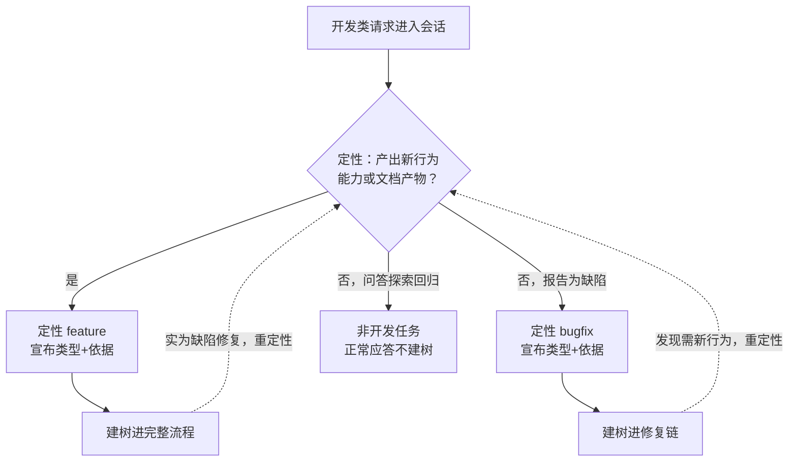
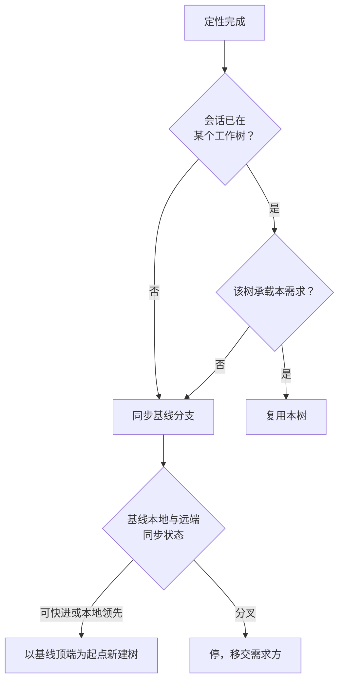
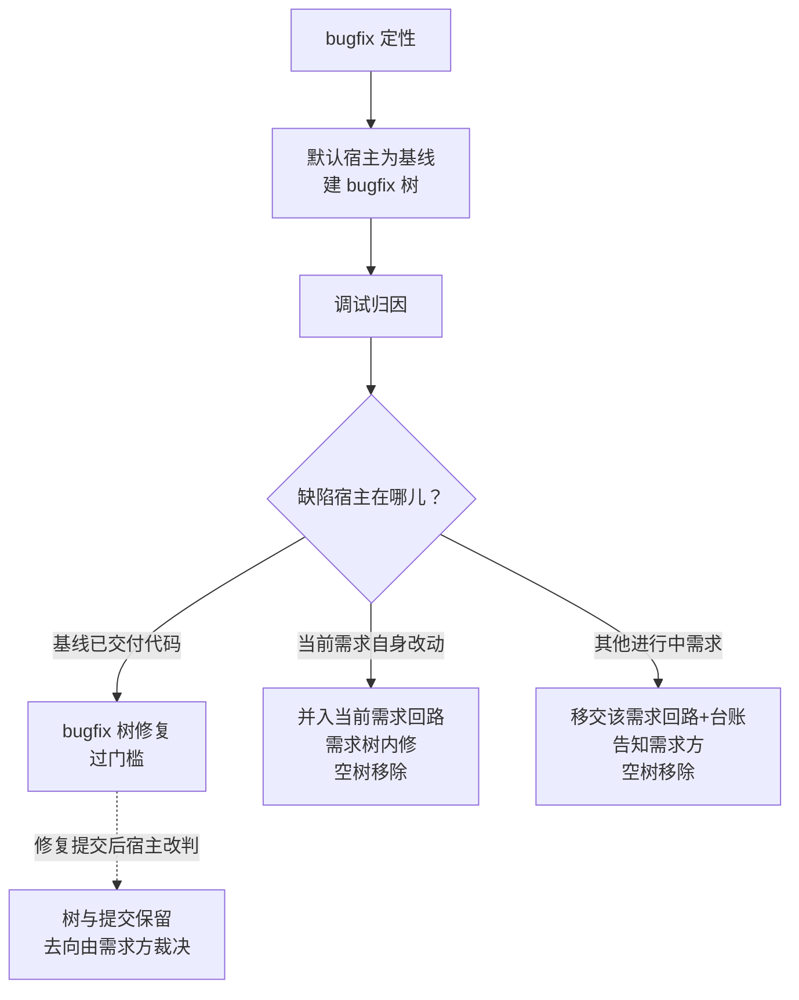
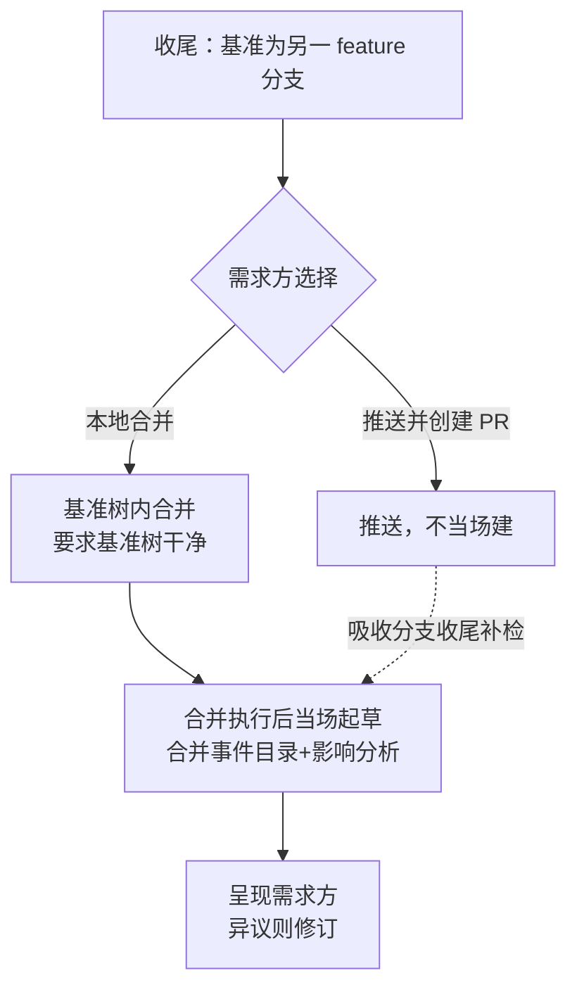

# 设计文档：流程纪律加固——定性防跳步、工作树纪律、并入事件记录

> 读者假设：懂软件工程，不熟悉产生本文档的对话；不需要了解项目内部实现。
>
> 本文档回答：做什么、不做什么、为什么这样取舍、成本量级与主要风险。实现细节留给计划。

**实施前决策记录 + 日期：2026-11-04。需求方裁决（三轮对话，2026-11-04）：**(1) 新需求一律从设计阶段起步、全链不能跳步；验证方案保留集成面判据——「如果确实没有集成验证方案，可以没有」；**(2)** 并入导致的方案变化以「合并事件目录」记录，源与目标原方案零改动；**(3)** feature 与 bugfix 定性即建工作树，一律基于基线分支，例外是当前需求工作树内的修复就地修；bugfix 需归因定宿主；**(4)** 对本文档中需求方未逐条点评的建议均表同意：豁免收窄（§2.1 执行要点 6）、重定性改名（§2.2 执行要点 7）、续作判定（§2.2 执行要点 5）、执行护栏升格（§2.2 执行要点 6）、机械护栏落点（§2.8）、移交规则（§2.3 执行要点 4）。决策 9 与决策 4 的工具半边已获需求方裁决（2026-11-04，均采纳作者建议）；审读处置中作者敲定的四处决定（沙箱回退废除 §2.2 要点 1、集成动作豁免 §2.2 要点 3、bugfix 主题取症状 §2.2 要点 4、定性判据句承载位置见「留给构建者的部分」）已获需求方追认（2026-11-04 计划确认环节确认——「待追认」标注系设计撰写会话的保守表述，实际已在三轮对话中确认）。**计划确认环节补充裁决（2026-11-04 需求方）：**(5) 本工作流只适用于软件开发项目——brainstorming 用于其他场景（演讲、生意、装修等非软件创造性工作）的表述改掉，非软件请求不触发工作流（落点见 §2.1 执行要点 8）。

**术语表**

| 术语 | 含义 |
|------|------|
| 需求方 | 提出需求、做确认的人 |
| 最终用户 | 执行本工作流的编码代理（含控制者会话与实施者子代理） |
| 定性 | 会话入口对任务的分类裁决：feature / bugfix / 非开发任务——前两类按改动二分判据区分（与收尾技能同口径），非开发任务不产生改动 |
| 基线分支 | main/master，只承载集成动作（见「集成动作」行） |
| 集成动作 | 收尾合并、并入登记、合并事件落盘、基线分支快进、归档移动——可写入基线树或目标树、不属开发写入的动作（§2.2 执行要点 3） |
| 工作树 | git worktree 检出的隔离工作区；一需求一棵，配一条专属分支 |
| 一树一写者 | 同一工作树同一时刻只允许一个会话开发写入；跨需求不复用树。集成动作不属开发写入，不在此限（§2.2 执行要点 3） |
| 三件套 | 设计文档、实施计划、需求级验证方案（验证方案按集成面判据可有例外，见 §2.7） |
| 流程闸门 | 全链十一个环节：定性→建树→设计起步→设计文档→独立审读→设计确认→计划→执行→收官把关→集成验证→收尾 |
| 并入登记 | 收尾时把需求级验证方案登记进项目级登记册的动作（现行规则：仅基点为基线分支时做） |
| 登记册 | 项目级验证场景登记文件集，回归技能的输入 |
| 合并事件 | 一条 feature 分支并入另一条 feature 分支的集成动作，及记录它的 spec 目录与验证方案文件 |
| 影响分析 | 合并事件文件中对源、目标既有场景逐条判定（仍适用/被取代/废弃/新增）的部分 |
| 吸收分支 | 被并入的目标分支，即合并事件的基准分支 |
| 阶段-技能映射 | 定性=using-superpowers 路由层；设计起步与三件套=brainstorming；计划=writing-plans；执行=executing-plans 或 subagent-driven-development；修复链=systematic-debugging；收官把关=requesting-code-review；集成验证=integration-verification；收尾=finishing-a-development-branch |
| 空树 | 尚无任何提交的工作树 |
| 回潮断言 | 拦截已删除表述重新出现的机械断言 |

## 1. 背景与目标

- **解决什么问题：** 五个具体失效场景——
  1. **跳步：** 入口技能的「用户指令」条款允许「需求方明确要求时跳过技能工作流」——需求方一句「小改动直接改」即合法绕过设计文档与验证方案；执行技能还容忍「无设计文档时裁决暂定」照做。
  2. **误标：** 设计起步技能的定性段只写「缺陷修复走 bugfix 路径」，无判据、无误标护栏——小 feature 被说成 bugfix 即绕开三件套；修复路径全文没有任何「发现新行为需求→转回完整流程」的回路由。
  3. **串树：** 工作树在执行计划时才创建（设计文档与计划的提交落在会话当时所在分支）；创建命令不带起点参数（从当前 HEAD 分叉）；「已在链接工作树中绝不再建」——feature A 半途时新会话接 feature B，会在 A 的树/分支上原地开发 B。
  4. **并入丢覆盖：** A 并入 B 后，并入登记只登记「本需求级」一份，A 的场景永不入册；B 合入基线后 A 的方案随归档冻结，基线回归从此丢掉 A 的覆盖面。且 A→B 的合并可能改变双方场景的适用性，现行文案对这一变化无记录、无处置载体。
  5. **合并卡死：** 收尾的本地合并先切到主仓库检出再 checkout 基准分支——并行工作树世界里基准分支常驻自己的树，checkout 会被 git 拒绝，收尾流程卡死。
- **给谁用：** 最终用户是执行本工作流的编码代理——定性、建树、修复、并入各步不再依赖无判据的自行裁量；需求方是仓库维护者——流程不可被绕过，验证覆盖不因并入而流失。
- **成功判断标准：** 四条可观察行为——(1) 小改动请求下，会话先输出定性结论（类型+一句依据）再建树（基点=基线分支最新提交），树内才开始设计对话；需求方要求跳过任一闸门环节被拒并说明；(2) A 并入 B 后，B 的规格目录出现合并事件目录，A、B 原方案文件字节不变，B 收尾后登记册含净结果集；(3) bugfix 三场景可观察：基线会话建 bugfix 树、当前需求树内缺陷就地修、他需求缺陷移交记录；(4) 无集成面的计划含推导依据落盘，既有断言电池全绿且新断言红绿有效。

## 2. 功能清单

### 2.1 定性闸门（防误标与防跳步）

- **定位：** 会话入口的分类裁决与全链闸门的不可豁免性。
- **触发与输入：** 触发——会话入口路由把请求判为构建类或修复类的时刻；输入——需求描述与改动二分判据。
- **执行要点：**
  1. 定性判据与收尾技能改动二分同口径：产出新行为、新能力或新文档产物 → feature；报告为缺陷且需修改既有代码 → bugfix（宿主由 §2.3 归因判定，含未交付代码）；二者皆非（问答、探索、回归执行）→ 非开发任务。
  2. 「小」「快」「顺手」「只是改一下」不构成降级理由——feature 与 bugfix 之外无第三类（❌「一行改动不用走流程」/ ✅「一行改动也是 feature，定性后建树走完整流程」）。
  3. 定性结论以一句宣布输出（类型 + 依据），随后立即建树（§2.2）——定性是流程闸门第一环。
  4. bugfix 路径中发现需要新行为或新能力 → 重定性为 feature，转回完整流程入口，树保留改名（§2.2 执行要点 7）。
  5. feature 路径设计阶段发现无新行为、实为缺陷修复 → 重定性为 bugfix，树保留改名。
  6. 用户指令豁免收窄：流程闸门十一环节（见术语表）不接受「跳过」类直接请求——可豁免对象仅限实现层做法（执行方式、审查模板细节等）；「退出提问对话」的现行豁免不在此列，其后续环节照走（现状保留）。
  7. 执行技能发现计划无可获取的设计文档 → 停止并回设计门；删除现行「记一条说明、裁决暂定」的容忍。
  8. 适用域收敛（2026-11-04 补充裁决，要点 5）：本工作流仅适用于软件开发项目。brainstorming 的 description 触发语改为软件开发语义（删除「软件内外皆然」及演讲/生意/装修括注）；正文的非软件分流表述删除（「非软件项目到此停止」两处）；writing-plans 的非软件分流与拒绝指令删除——SKILL.md 与 references/plan-template.md 中的「非软件项目止于设计文档」从句，以及 SKILL.md 中「收到非软件项目时，拒绝并返回设计阶段，不要套模板产出空章计划」整句；「计划只适用于软件项目」保留为适用域声明。using-superpowers 路由层补适用域声明句「只适用于软件开发项目」（2026-11-04 需求方补充）。非软件请求在路由层即不触发工作流，无分流规则。
- **出口表：**

| 出口 | 条件 | 去向 |
|------|------|------|
| feature | 产出新行为/能力/文档 | 建树（§2.2）→ 完整流程 |
| bugfix | 报告为缺陷、需改既有代码（宿主归因） | 建树（§2.2）→ 修复链（§2.3） |
| 非开发任务 | 问答、探索、回归 | 正常应答，不建树 |

- **流程图：**

- **本次不做：** 见 §3（明确不做）第 6 条。

### 2.2 工作树纪律（定性即建、基线为基）

- **定位：** 定性后立即建立隔离工作区；建树的时机、基点、归属与复用规则。
- **触发与输入：** 触发——定性为 feature 或 bugfix 的瞬间；续作会话进入时先判复用。输入——定性结论、基线分支状态、需求主题。
- **执行要点：**
  1. 必建：feature 与 bugfix 一律在专属工作树进行，删除现行「需求方不同意，就在原地工作」口子；需求方坚持就地开发时，最终用户说明利害并等待改道，不在原地开始开发（建树是流程闸门环节，见 §2.1 执行要点 6）。现行沙箱权限错误时「在原地工作」的回退一并废除：创建失败 → 停，移交需求方处理环境后重建——环境故障不解开闸门（此为审读处置中作者敲定的决定）。
  2. 基点=同步后的基线分支顶端：建树前同步基线分支（fetch 远端；本地落后则快进，分叉则停下移交需求方），再从基线分支顶端建树。
  3. 一需求一树、一树一写者：不同需求不同树；同一树同一时刻只允许一个会话开发写入；基线检出上直接开发禁止。集成动作（收尾合并、合并事件文件落盘、基线分支快进、归档移动——跨树场景子集，全集见术语表「集成动作」行）不属开发写入，可在目标树或基线树执行，前置=该树干净；此豁免为审读处置中作者敲定的决定——没有它，收尾合并在并行树世界无法执行。
  4. 分支命名带类型前缀：feature/<主题>、bugfix/<主题>，主题取自需求主题；bugfix 树建于归因之前，主题取缺陷症状主题，与宿主无关（审读处置中作者敲定的决定——宿主迁移走树移除路径，不需要改名）。
  5. 复用判定：会话已在某工作树 → 该树分支承载的正是本需求（分支名/主题一致，或需求方确认续作）→ 复用；否则一律新建（含在基线检出、在他人需求树上两种情形），绝不复用他人之树——修正现行「已在链接工作树中绝不再建」的无条件表述。
  6. 执行技能的工作区前置从「未经同意绝不在基线分支上实施」升格为「只能在本需求分支上实施」。
  7. 重定性改名：feature↔bugfix 互转时分支改名（换类型前缀），树保留。
  8. 原生工作树工具以「建后校验」方式使用：建树后核验合并基=同步后的基线顶端，不符则删除该树、以 git 显式起点重建（现行「原生工具优先」让位于基点保证）；需求方已声明的目录偏好优先（现状保留）。
- **出口表：**

| 出口 | 条件 | 去向 |
|------|------|------|
| 新建 | 会话不在本需求树上 | 同步基线→显式起点建树 |
| 复用 | 当前树即本需求之树 | 直接进入对应流程 |
| 停 | 基线分支分叉、需求方坚持就地、或树创建失败（环境故障） | 移交需求方裁决 |

- **流程图：**

- **本次不做：** 见 §3（明确不做）第 1、3 条。

### 2.3 bugfix 宿主判定与移交

- **定位：** bugfix 修复位置的归因判定——缺陷在谁的未交付代码里，修复就在谁的回路里。
- **触发与输入：** 触发——bugfix 定性后（默认宿主=基线，先建树）与归因得出后（二次判定）；输入——归因结论、当前会话所处需求。
- **执行要点：**
  1. bugfix 定性即建默认树（宿主=基线），修复链在其中开查——归因本身需要干净基线与工作区。
  2. 归因指向基线已交付代码 → 宿主=基线，默认树即归所，修后过收官把关与集成验证门槛（现状规则）。
  3. 归因指向当前需求自身未交付改动 → 修复并入当前需求回路，在当前需求树内进行，随该需求过门槛；bugfix 树为空树则移除。时序链：在需求树内发现缺陷 → 按要点 1 建 bugfix 树 → 归因 → 迁回需求树修复 → 移除空树。
  4. 归因指向其他进行中需求的未交付改动 → 不跨树修复（一树一写者）：记台账移交该需求回路并告知需求方，由该需求的会话修复；bugfix 树为空树则移除。
  5. bugfix 树已有修复提交后宿主才改判 → 树与提交保留，合并去向由需求方裁决（罕见路径）。
- **出口表：**

| 出口 | 条件 | 去向 |
|------|------|------|
| 基线宿主 | 缺陷在已交付代码 | bugfix 树修复→过门槛 |
| 当前需求宿主 | 缺陷由当前需求引入 | 需求树内修→随需求门槛 |
| 他需求宿主 | 缺陷由他人需求引入 | 移交该需求回路，空树移除 |
| 宿主后改判 | 修复提交已落，宿主才改判 | 树与提交保留，去向由需求方裁决 |

- **流程图：**

- **本次不做：** §3 无专属于本功能的排除项——范围边界由出口表四态穷尽（审读指出原指向第 2 条为误引，已改正）。

### 2.4 合并事件记录（feature 并入 feature）

- **定位：** 记录分支并入对验证方案造成的变化——源头不可变，变化可审计。
- **触发与输入：** 触发——收尾时基准分支为另一 feature 分支且选「本地合并」（合并执行后当场）；「推送并创建 PR」由吸收分支收尾在并入登记前补检触发。输入——源、目标的验证方案文件与合并后的代码树。
- **执行要点：**
  1. 合并执行后，在吸收分支新建规格目录（日期-merge-源主题-into-目标主题），内含一个验证方案文件。
  2. 文件两部分：合并事件记录（源/目标分支、日期、动机一句）+ 影响分析。
  3. 影响分析对源、目标既有场景逐条四态判定，判据区分：仍适用=场景针对的行为与期望在合并后均不变；被取代=该行为仍存在但其期望或判据因并入改变，新期望写入合并文件、场景由合并文件承载执行；废弃=该行为已不存在或其覆盖面被他场景完全包含，场景退出净结果集并写明取代行为；新增=合并产生的组合行为无既有场景覆盖，新场景写入合并文件执行。
  4. 源与目标的原方案文件零字节改动——各自忠实记录各自门槛时验证了什么。
  5. 影响分析随合并完成报告呈现需求方，异议则修订后继续。
  6. 吸收分支工作树脏 → 停，移交需求方协调（先提交或暂存）。
  7. PR 路径：吸收分支收尾并入登记前补检——发现外来规格目录无对应合并事件文件 → 从合并历史推导补建。
  8. 本地合并移动了吸收分支的 HEAD：合并完成后告知吸收分支会话「HEAD 已前移，既有验证凭据失效」——凭据新鲜度判据（HEAD 一致性）将自动拦截免跑，属现状机制，此处补的是告知义务（审读处置补充）。
  9. 吸收分支收尾时，合并事件目录随规格目录全量归档（现状规则覆盖，无需新动作）。
- **出口表：**

| 出口 | 条件 | 去向 |
|------|------|------|
| 当场建 | 本地合并执行后 | 起草→呈现→落盘 |
| 补检补建 | PR 路径，吸收分支收尾 | 并入登记前补建 |
| 停 | 吸收分支工作树脏 | 移交需求方协调 |

- **流程图：**

- **本次不做：** 见 §3（明确不做）第 2 条。

### 2.5 并入净结果登记

- **定位：** 登记册的登记范围与写点修正——只在基点为基线的收尾一次性写入裁决后的净结果。
- **触发与输入：** 触发——收尾选「本地合并」或「推送并创建 PR」；输入——规格目录下全部方案文件、合并事件文件、基线最新登记册。
- **执行要点：**
  1. 基点为基线分支的收尾：登记范围从「本需求一份」扩为规格目录下全部方案的净结果集 =（源方案 ∪ 目标方案 ∪ 合并文件新增）−（被取代 ∪ 废弃），逐条按登记册行格式三态登记（新增/合并/废弃）；多次并入按合并时间序滚动合成——每个合并事件文件在前一净结果之上做增量修订，终态为登记输入（审读处置补充）。影响分析四态到登记三态的映射：仍适用与新增 → 按新增登记；被取代 → 按新增登记、期望取合并文件新版本并注明出处；废弃之覆盖面包含 → 按「合并」语义不单独登记（登记册现行惯例）；废弃之行为不存在 → 不登记（若已在册则移除）。
  2. 被取代与废弃的判定以合并事件文件的影响分析为输入（§2.4）。
  3. 基点非基线分支（并入他分支）的收尾：不登记、不归档（现状保留）——中间分支不写登记册，杜绝「先登记、后调整」的二次回写。
  4. 登记写操作串行不变：写入前先同步基线最新登记册（现状规则承接）。
  5. 无方案需求（集成面判据不满足，§2.7）：无可登记条目，登记册零改动，归档照走。
- **出口表：**

| 出口 | 条件 | 去向 |
|------|------|------|
| 登记净结果 | 基点=基线且选合并或 PR | 三态登记+提交到特性分支 |
| 不登记 | 基点非基线，或保持原样，或无方案 | 登记册零改动 |

- **流程图：** 不配图——两出口的判定条件已在出口表穷尽，无内部决策分支。
- **本次不做：** 见 §3（明确不做）第 4 条。

### 2.6 本地合并执行位置修复

- **定位：** 收尾本地合并改在基准分支所在工作树内执行。
- **触发与输入：** 触发——收尾选「本地合并」；输入——基准分支的检出位置与工作树状态。
- **执行要点：**
  1. 合并一律在基准分支所在工作树内执行，不再切换主仓库检出（并行树纪律下 checkout 基准分支会被 git 拒绝）。
  2. 前置检查：基准树必须干净；脏 → 停，移交需求方协调。
  3. 基准分支无专属工作树（罕见：仅基线检出）→ 在基线检出执行——合并属集成动作，基线检出承载它合法。
  4. 合并后验证测试、工作树清理、删分支照现行规则。
  5. 合并移动了基准分支 HEAD → 告知该分支会话「HEAD 已前移，既有验证凭据失效」（§2.4 执行要点 8 同源义务）。
- **出口表：**

| 出口 | 条件 | 去向 |
|------|------|------|
| 合并成功 | 基准树干净 | 测试→清理→删分支 |
| 停 | 基准树脏 | 移交需求方协调 |

- **流程图：** 不配图——两出口判定条件机械可判，无分支循环。
- **本次不做：** 见 §3（明确不做）第 7 条。

### 2.7 验证方案豁免的判据落盘

- **定位：** 集成面判据保留，但「不产出」的决定必须有据可查，口径全局一致。
- **触发与输入：** 触发——计划阶段判定是否产出验证方案；输入——计划改动面。
- **执行要点：**
  1. 集成面判据保留：计划无跨任务组装点且不触及外部接口 → 不产出验证方案文件（需求方裁决：确实没有集成验证方案时可以没有）。
  2. 判定「无集成面」时，推导依据写入计划：改动面清单 → 无组装点、无外部接口、无运行边界的推导链——不写依据的「无方案」不合法。
  3. 入口技能「三件套」表述改为「验证方案按集成面判据产出」，消除其与计划技能条件性规则的现行矛盾。
  4. 无方案需求在集成验证门槛的出口=快速放行（现状规则承接，推导与声明不一致时以推导为准）。
- **出口表：**

| 出口 | 条件 | 去向 |
|------|------|------|
| 产出方案 | 有组装点或外部接口 | 三件套齐全 |
| 不产出但判据落盘 | 无集成面，推导依据入计划 | 门槛走快速放行 |

- **流程图：** 不配图——判据单一、出口二分机械可判。
- **本次不做：** 见 §3（明确不做）第 6 条。

### 2.8 机械护栏（断言与登记）

- **定位：** 新规则进既有断言电池，红绿可证。
- **触发与输入：** 触发——集成验证测试执行；输入——技能文案固定句锚点。
- **执行要点：**
  1. 本设计产出的固定句（定性判据句、建树必建句、基点句、宿主判定句、合并事件句、净结果登记句、闸门不可豁免句、判据落盘句）进既有断言电池：正向锚定在场、反向拦截回潮。
  2. 锚点全仓唯一性经字节级核实后才登记（在案教训：锚点双命中曾致多次运行误判）。
  3. 回潮演练与锚点破坏演练双验证断言红绿有效。
  4. 新场景条目按登记册惯例登记进跨模块登记册。
- **出口：** 单一出口——断言全绿并登记。
- **流程图：** 不配图——单出口线性动作。
- **本次不做：** 见 §3（明确不做）第 5 条。

## 3. 明确不做

- **不自动 rebase / 不自动追赶基线前进：** 因为基线前进后的冲突取舍属需求方裁决域，不可自动化；收尾合并前的基线同步（§2.2 执行要点 2）已覆盖建树时点，中途追赶不在范围。
- **不做 forge 合并事件自动感知：** 因为工作流不感知 forge 事件是既定哲学（推送时不归档同理），PR 路径以吸收分支收尾补检兜底（§2.4 执行要点 7）。
- **不为 spike 单独建树：** 因为 spike 属当前需求设计期活动，在需求树内进行、产物用完即弃（现行规则保留，树已由定性时建好）。
- **不改归档冻结区：** 因为归档后零改动是既定纪律；本设计对历史文档只读。
- **不新增服务端强制钩子：** 因为门禁钩子已有可选机制、各 harness 自行配置；强制钩子超出工作流文案的管辖边界。
- **不改「退出提问对话」的可跳过性：** 因为它是现行已调优的交互骨架（跳的只是提问，四环节照走）；本次豁免收窄只覆盖流程闸门，不含它（§2.7 的判据落盘同理不触碰它）。
- **不处理已推送共享分支的强推场景：** 因为超出本次问题域，现行收尾规则已禁止擅自强推。

## 4. 关键决策记录

| 决策 | 一句话结论 | 拍板状态 | 影响功能项 |
|------|-----------|---------|-----------|
| 决策 1：验证方案豁免去留 | 保留集成面判据，判定依据必须落盘 | 需求方已裁决（2026-11-04） | §2.7 |
| 决策 2：豁免收窄方式 | 闸门白名单不可豁免，实现层做法可豁免 | 需求方同意（2026-11-04） | §2.1 |
| 决策 3：建树时机 | 定性时建，不在执行时建 | 需求方已裁决（2026-11-04） | §2.2 |
| 决策 4：建树基点与工具 | 基线顶端为基点；原生工具建后校验、不符以 git 显式起点重建 | 需求方已裁决（2026-11-04，采纳作者建议） | §2.2 |
| 决策 5：并入方案变化的载体 | 合并事件目录（delta 文件），不改源方案 | 需求方已裁决（2026-11-04） | §2.4、§2.5 |
| 决策 6：登记时机 | 基点为基线的收尾一次性登记净结果 | 我提议、需求方同意（2026-11-04） | §2.5 |
| 决策 7：bugfix 宿主判定 | 归因驱动，默认树先行、宿主迁移删空树 | 需求方已裁决（2026-11-04） | §2.3 |
| 决策 8：他需求宿主的处理 | 移交该需求回路，不跨树修 | 我提议、需求方同意（2026-11-04） | §2.3 |
| 决策 9：本地合并执行位置 | 基准树内执行，不再切主仓库检出 | 需求方已裁决（2026-11-04，采纳作者建议） | §2.6 |

### 决策 1：验证方案豁免去留

- **候选方案：** A. 清零豁免——新需求一律必产验证方案；B. 保留集成面判据 + 判定依据落盘。
- **选了哪个：** B。
- **依据：** 需求方裁决原文「如果确实没有集成验证方案，可以没有」——语义是保留判据。真正的口子不在判据本身，而在「不产出」无需留痕：判据由想省事的同一最终用户自判，无据可查即无法审查。B 把豁免从沉默默认变为显式决定（推导依据入计划），门槛的快速放行推导与计划声明交叉核对、不一致以推导为准（现状规则）提供第二道核对。
- **代价或风险：** 豁免仍由最终用户自判——漏判集成面则该需求在无方案下通过门槛。缓解：快速放行推导为准的交叉核对 + §2.8 反向断言拦截无依据表述；行为级漏判无法由文案断言根除，属可接受残余风险。

### 决策 2：豁免收窄方式

- **候选方案：** A. 维持全局「需求方明确要求即可跳过」；B. 白名单——流程闸门不可豁免，实现层做法可豁免；C. 全禁豁免（连实现层也不可）。
- **选了哪个：** B。
- **依据：** 需求方拍板「严格按流程走，不能跳步」——指流程环节不可绕。实现层做法（如执行方式选型、审查模板细节）本就属需求方偏好域，全禁（C）会把需求方变成流程的囚徒，无对应问题；维持现状（A）则跳步口子原样保留，与裁决相悖。
- **代价或风险：** 需求方未来显式要求跳过某闸门时会被拒。缓解：拒绝不是终局——需求方可修订工作流本身（走完整流程改技能文案），裁决权仍在需求方，只是换了行使通道。

### 决策 3：建树时机

- **候选方案：** A. 维持执行时建（现状）；B. 定性时建。
- **选了哪个：** B。
- **依据：** 现状失效已实证（§1 场景 3）：设计文档与计划的提交落在会话当时分支，feature A 半途时 B 在 A 分支上起步。需求方裁决原文「一开始定性为新 feature 或 bugfix 时就创建」。A 方案无法修复设计期产物落错分支——那正是问题的主体。
- **代价或风险：** 定性误判（后来重定性）会造成树改名 churn——量级为一次分支改名（§2.2 执行要点 7），可忽略。

### 决策 4：建树基点与工具

- **候选方案：** A. 原生工作树工具优先（现状），基点随工具；B. git 显式起点为默认，原生工具仅在能保证基点时使用。
- **选了哪个：** B。
- **依据：** 需求方裁决基点=基线分支最新提交（「基于 main/master 创建」）；原生工具不承诺起点参数，「绝不与 harness 对抗」原则以建后校验兜底调和——基点错了，一树一写者与并行开发全落空。B 以「建后校验」操作化（§2.2 执行要点 8）：原生工具建树后核验合并基，不符即删树重建——审读指出的「能保证」判定方法由此闭合；首选路径仍是原生工具（清理自动化照收），git 重建是其不符时的兜底。
- **代价或风险：** git 显式创建的工作树由收尾清理承担（现行收尾已管理这类树，无新增缺口）；现行危险信号表谴责绕过原生工具——新默认使该行语义为假，按「留给构建者的部分」第 1 条的例外定点改写该行，不是撤掉约束而是换约束对象（谴责无基点保证的绕过，而非谴责绕过本身）。

### 决策 5：并入方案变化的载体

- **候选方案：** A. 原地修订——定性裁决时直接改源/目标方案文件；B. 合并事件目录——delta 文件记录变化，源方案零字节不动。
- **选了哪个：** B（需求方裁决）。
- **依据：** 方案文件是各需求门槛时验证了什么的忠实记录，与归档冻结区同属「历史不改写」哲学；合并改变系统行为，本身就是需要留痕的设计决策。A 会把「B 取代了 A 的行为」与「A 原期望写错」混为一谈，合并事件的审计线索消失。B 的 delta 文件同时是并入登记（§2.5）的判定输入，机制上顺接。
- **代价或风险：** 多一层文件、并入逻辑复杂化（净结果集需跨文件合成）。缓解：影响分析四态判定机械可查；量级为每并入事件一个目录、一个文件。

### 决策 6：登记时机

- **候选方案：** A. 各需求各自收尾时各自登记（含基点非基线者）；B. 只在基点为基线的收尾一次性登记净结果。
- **选了哪个：** B。
- **依据：** A 在并入链上产生两次写点——源分支先登记，吸收分支门槛又调整，登记册需要二次回写且串行纪律复杂化；B 让登记册只消费裁决后的终态，写点唯一，串行不变。中途回归依赖「登记册 ∪ 规格目录」双源（现状），B 不产生覆盖空窗。
- **代价或风险：** 并入链上源需求场景在吸收分支收尾前不入册——吸收分支中途回归时靠 specs 双源覆盖（现状机制，非空窗）。

### 决策 7：bugfix 宿主判定

- **候选方案：** A. 归因后才建树；B. 定性即建默认树（宿主=基线），归因后宿主迁移。
- **选了哪个：** B（需求方裁决「bugfix 需归因……空 bugfix worktree 移除」）。
- **依据：** 归因需要干净基线与工作区——不建树就没法可靠归因；「定性即建」与 feature 路径对称。A 让修复链的准备工作悬在归因之后，调试期改动无处落盘。
- **代价或风险：** 宿主迁走时留下空树，需移除（§2.3 执行要点 3、4）；量级为一次 worktree remove。

### 决策 8：他需求宿主的处理

- **候选方案：** A. 跨树修复——直接在他人需求树上修；B. 移交——记台账移交该需求回路，本会话不修。
- **选了哪个：** B。
- **依据：** 一树一写者（§2.2 执行要点 3）：跨树写入会与他需求会话的进行中状态冲突（脏树、半途改动），且修复越过该需求自己的门槛链。B 保住隔离与门槛完整性，代价只是修复延迟。
- **代价或风险：** 修复延迟到该需求的下一次会话——若该需求已停滞，缺陷修复跟着停滞。缓解：移交时告知需求方，由需求方决定催办或调整。

### 决策 9：本地合并执行位置

- **候选方案：** A. 维持主仓库检出切换（现状文案）；B. 基准分支所在工作树内执行。
- **选了哪个：** B。
- **依据：** 并行树纪律下基准分支常驻自己的树，git 拒绝同一分支双检出——A 在新世界里必然卡死（§1 场景 5）。B 的前置（基准树干净）与并行会话纪律一致：吸收分支会话写树中途被合并打断正是要防的冲突。
- **代价或风险：** 基准树脏时收尾停下等需求方协调——比现状（切换检出）多一次协调成本，但现状路径在新世界里走不通，无从比较；合并移动基准分支 HEAD 会使该分支会话的验证凭据过期，告知义务见 §2.6 执行要点 5——凭据失效后重跑正是既有新鲜度机制的正确行为，不是缺陷。

#### 留给构建者的部分

- **各技能文案的定点修订范围：** 交给执行者。边界：只做定点新增句与定点替换，不得重排既有调优段落（危险信号表、合理化借口表只增行不重排）；例外——与新纪律直接冲突为假的既有调流行允许定点改写（绕过原生工具的谴责行、原地工作相关借口行与沙箱回退行），改写限于该行语义、不重排表结构；每处固定句独立成句（技能独立加载，不做跨技能引用）。为什么交给执行者：措辞须融入各技能现有行文，设计只锁语义不锁字面。
- **固定句的选句与锚点唯一性核验：** 交给执行者。边界：锚点须全仓唯一（字节级核实后方可登记断言）；被锚定句承载 §2 各执行要点的语义。为什么交给执行者：选句依赖对全仓现有文案的检索结果，设计无法预知哪些短语已被占用。
- **定性判据句的承载位置：** 已由作者敲定（审读处置）：判据与定性宣布规则落 using-superpowers 路由层（会话入口、两路径公共上游）；brainstorming 定性段为引用与防误标护栏；systematic-debugging 承载回路由与宿主判定。边界：各技能独立成句，锚点唯一性按此分布核验。为什么：入口裁决放入口技能，执行路径技能只承载各自的执行细节。
- **各平台适配参考文件的同步范围：** 交给执行者。边界：以仓库实有清单为准逐份核对（不预设数量，审读核得七份），其中工作树相关表述与新纪律冲突处修订；无冲突处不触碰。为什么交给执行者：各文件 harness 细节差异大，需逐文件判断。
- **合并事件目录命名 slug 的生成规则：** 交给执行者。边界：日期-merge-源主题-into-目标主题的骨架不变，主题缩写规则从现行规格目录命名惯例推导。为什么交给执行者：惯例细节在仓库既有命名中，不在设计里。
- **影响分析的呈现格式：** 交给执行者。边界：四态判定逐条可判真伪、含取代行为出处。为什么交给执行者：格式须与收尾技能既有呈现风格一致。
- **HEAD 前移告知的送达载体：** 交给执行者。边界：载体必须落在吸收分支会话可见之处——控制者台账行、或合并提交信息注明凭据失效，二选一或并用。为什么交给执行者：台账惯例在仓库各技能间有差异，须按现场惯例落位（审读复注 N7 的处置）。
- **登记条目 id 分配：** 交给执行者。边界：沿用登记册模块前缀+序号惯例。为什么交给执行者：机械惯例。
- **执行方式：** 交给计划阶段确认点（会话内执行或子代理驱动，按任务边界与验收标准稳定性判定）。

## 5. 关键约束与可行性风险

- **行为塑形内容门槛：** 仓库纪律要求技能改动有证据、不无据重构调优内容。本次满足：五个具体失效场景（§1）+ 需求方逐条裁决。文案改动以定点修订为界（「留给构建者的部分」第 1 条）。
- **锚点唯一性与字节级验证：** 新固定句须全仓唯一，断言基准先经字节级核实再登记——在案教训：锚点双命中曾致多次运行误判。此约束可判定：断言登记前逐锚点全仓检索计数为 1。
- **行为级效果验证成本：** 文案级断言证明不了实际会话行为（跳步、误标、串树是否真被拦住）。按仓库惯例至少一次会话级演练（施压不跳步或并入全链）——成本量级：单会话演练；是否扩展多场景由计划定。此约束无量化上限标准，缺的是「演练次数上限」——按计划阶段裁决处理。
- **并行检出互斥：** git 同一分支不能同时检出两棵树——本设计的树纪律（一树一写者、分支唯一）与其相容，但文案与断言须显式表达；执行期违反时 git 报错兜底。
- **基线分支未推送提交：** 仓库基线分支现有未推送提交，与本需求无依赖关系；合并与推送动作照现行规则执行，本设计不改变推送时机。
- **平台适配文件漂移：** 各平台适配参考文件若漏改，同一纪律在不同 harness 下行为漂移。缓解：「留给构建者的部分」逐一核对义务（以仓库实有清单为准，审读核得七份，不预设数量）；此约束可判定：逐份核对有记录。

## 附录：独立审读处置记录

- **审读者身份：** 子代理（独立通用代理，未参与写作；模型 glm-5.3-flash[1M]，harness Claude Code）。读取本文档与仓库技能文案（skills/）、集成验证测试（tests/integration-verification/）、登记册后出具清单；共三轮：初读、N1–N7 复读、F1–F3 终读，每轮均含表格列数与围栏配对的机械清点。
- **初读清单 A（完备性，11 项）处置：** 归需求方 2 项——决策 9 与决策 4 工具半边拍板状态改「待需求方裁决」并呈报；「六份参考文件」改为按仓库实有清单（核得七份）逐份核对。次要 6 项——集成动作豁免（§2.2 要点 3）、沙箱回退废除（§2.2 要点 1）、bugfix 主题取症状（§2.2 要点 4）、定性判据句承载位置（留给构建者条）四处为作者敲定并标注；被取代/废弃判据展开（§2.4 要点 3）；多次并入滚动合成（§2.5 要点 1）。已有答案 2 项——§2.3 误引改为如实声明；§2.3 出口表与流程图补「宿主后改判」出口。末项为核实性确认。
- **初读清单 B（方案合理性）处置：** 九决策中七项判「合理」，无处置；决策 4 两缺口以「建后校验」操作化（§2.2 要点 8）与调流行改写例外（留给构建者第 1 条）闭合；决策 9 两缺口以凭据失效告知义务（§2.6 要点 5、§2.4 要点 8）与拍板状态转待裁决闭合；整体检查第三条（集成动作与一树一写者张力）由 §2.2 要点 3 豁免句闭合。
- **初读清单 C（可读性）处置：** §2.1 触发句改写；四态判据展开消歧；术语表补「吸收分支」「阶段-技能映射」（后补「集成动作」）并改写「定性」行；头部第 (4) 条补 § 映射；§2.3 要点 3 补时序链。排版九张表列数、围栏配对、图语法审读已机械核验通过。
- **复读轮（11 项修订）处置：** 11 项全部「通过」；新报 N1–N7（均低/极低）全部处置——追认清单补入头部（N1）；决策 4 结论行与依据段随建后校验同步（N2）；出口表「停」行补创建失败条件（N3）；四态到三态映射句新增（N4）；术语表新增「集成动作」权威行、两处改为引用（N5）；映射行补修复链（N6）；送达载体交执行者并给可见性判据（N7）。
- **终读轮（7 项修订）处置：** 7 项全部「闭合」；新报 F1（低）已修——头部追认清单的指针改为以该条自身为承载、「执行要点级」称谓改正；F2（极低）已修——§2.2 要点 3 括号声明为跨树场景子集、全集指向术语表；F3（极低）不修并说明理由：决策表保留候选 B 原文案属决策记录惯例（候选案文案记录的是拍板时点的表述，操作化结果由结论行与依据段承载），审读亦判定「读者可从依据段自洽解释」。
- **复读结论：** 终读轮确认「无其他新引入的矛盾、歧义或与仓库事实不符；渲染无新风险」，并判定文档不阻塞实施计划撰写。
- **计划确认环节修订（2026-11-04）：** 新增裁决记录第 (5) 条与 §2.1 执行要点 8（适用域收敛）。该修订段的复读因审读子代理 API 限额（429）改由作者自审，标注为自审、局限与处置见 `plan.md` 附录「复读（自审）记录」。
