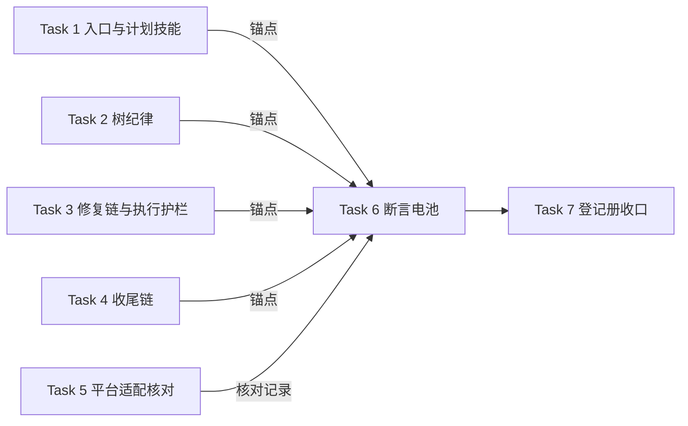

# 实施计划：流程纪律加固——定性防跳步、工作树纪律、并入事件记录

- **目标：** 五个失效场景闭合——需求方一句「小改动直接改」不能再绕过流程闸门；小 feature 不能靠说成 bugfix 逃出三件套；新会话不能在他人需求树上起步开发；A 并入 B 后验证覆盖不再流失且变化可审计；并行工作树世界的本地合并不再卡死。
- **架构：** 八功能项按承载技能分组为 7 个任务：5 个文案任务（每任务一组文件、产出各自固定句与锚点子串登记）→ 1 个平台适配核对任务 → 1 个断言电池任务（消费全部锚点）+ 登记册收口。锚点生产→消费为跨任务组装点，验证方案见同目录 verification.md。
- **技术栈：** Markdown 技能文案 + bash 断言脚本（既有 `ck` 编排）+ 登记册 Markdown。
- **设计文档（Spec）：** `docs/superpowers/specs/2026-11-04-workflow-discipline-hardening/design.md`（2026-11-04 获需求方确认；头部四处作者敲定决定已追认——原「待追认」标注系设计撰写会话保守表述）。
- **实施前决策记录 + 日期：** 2026-11-04。计划期落定的执行者决定：**会话级演练定为一次施压不跳步演练**（设计 §5 约束「至少一次、多场景由计划定」——取下限：五个失效场景中跳步是唯一可会话内低成本低风险复现的，并入全链演练需真实双分支并入事件，成本不成比例；记录为我的裁决）；**执行方式建议会话内执行**（见执行交接）。锚点选句与唯一性核验按设计「留给构建者的部分」由执行者逐任务落定。

## 1. 改动地图

- `skills/using-superpowers/SKILL.md` — 定性判据句、闸门不可豁免句、建树必建与基点句（路由层）、三件套表述改条件性、用户指令条款收窄。
- `skills/writing-plans/SKILL.md` — 无集成面时推导依据落盘句、非软件拒绝指令删除（适用域声明保留）。
- `skills/using-git-worktrees/SKILL.md` — 建树必建、基点句、复用判定条件式、沙箱回退废除、原生工具建后校验。
- `skills/brainstorming/SKILL.md` — 定性段引用与防误标护栏、原地工作调流行改写（危险信号表）。
- `skills/systematic-debugging/SKILL.md` — 回路由（新行为转 feature）与宿主判定四态。
- `skills/executing-plans/SKILL.md`、`skills/subagent-driven-development/SKILL.md` — 工作区前置升格为「只能在本需求分支上实施」、无设计文档停止回设计门。
- `skills/finishing-a-development-branch/SKILL.md` — 合并事件记录段、净结果登记扩围、基准树内合并、HEAD 前移告知、PR 补检。
- 七份平台适配参考（`skills/using-superpowers/references/` 下实有清单）— 工作树表述逐份核对修订。
- `tests/integration-verification/test-integration-verification.sh` — 断言组 21（消费 Task 1-4 锚点）。
- `docs/superpowers/verification/cross-module.md` — 新场景条目。

依赖方向：Task 1-4 各自产出锚点 → Task 6 单向消费；Task 5 独立；Task 7 收口。验证方案见同目录 `verification.md`。

## 2. 功能单元规格

### Task 1: 入口与计划技能——定性闸门、豁免收窄、判据落盘

**职责：** 在会话入口路由层落定性判据与闸门不可豁免规则，计划技能落无集成面判据落盘；产出本任务固定句锚点。

**Files:**
- Modify: `skills/using-superpowers/SKILL.md`（路由层、用户指令条款）
- Modify: `skills/writing-plans/SKILL.md`（「范围检查」段、适用域声明句）
- Modify: `skills/writing-plans/references/plan-template.md`（适用域声明句：仅删「非软件项目止于设计文档」从句）
- Modify: `tests/integration-verification/test-integration-verification.sh`（仅本任务 Files 涉及的既有断言随动修订，如有；逐处记台账，无则零改动）

**Interfaces:**
- Consumes: 无。
- Produces: 本任务全部固定句的锚点子串各一段——判据：≥4 连续汉字、不含标点、取自固定句正文、全仓 `grep -rcF` 命中恰 1 个文件；逐锚点在 Task 1 提交信息逐字登记，格式 `锚点(<技能目录名>)=<子串>`。

**边界条件：**
- 新增语义（逐字承载设计 §2.1 执行要点 1-3、6、8 与 §2.7 执行要点 2-3，措辞融入行文）：定性判据三分类（feature/bugfix/非开发）与宣布规则；「小」「快」类不构成降级理由（❌/✅ 对照形态）；流程闸门十一环节不接受「跳过」类直接请求、可豁免对象仅限实现层做法；无集成面时推导依据落盘句（改动面清单→无组装点/无外部接口/无运行边界的推导链）落 writing-plans「范围检查」段；三件套表述改「验证方案按集成面判据产出」；适用域收敛（§2.1 要点 8）——删除 writing-plans 三处非软件分流表述：SKILL.md 的「收到非软件项目时，拒绝并返回设计阶段，不要套模板产出空章计划」整句、SKILL.md 与 references/plan-template.md 各自的「；非软件项目止于设计文档」从句（两处均保留「计划只适用于软件项目」作适用域声明）；using-superpowers 补适用域声明句（只适用于软件开发项目）。（要点 7 的容忍删除在两执行技能，归 Task 3——本任务三份文案不含该容忍句。）
- 定性判据句承载位置按设计「留给构建者的部分」第 3 条：判据与宣布规则落 using-superpowers；brainstorming 定性段归 Task 2。
- 不得改变的既有行为：既有路由三行（feature/bugfix/收尾链路）语义不变、只增不改（若新纪律使某行语义为假，按留给构建者第 1 条例外定点改写该行并记台账）。
- **既有断言存活核对：** 本任务 Files 涉及的既有断言锚点须在新文案中存活，重点核对 `us-routing-feature-workflow`（锚定「三件套（design.md + plan.md + verification.md）」——三件套表述改条件性后必然失活，须随动修订为锚定新表述并记台账）、`us-routing-feature-closeout-relay`、`us-routing-fix-branch-gate`（后两者不应受影响）；失活则随动修订并记台账（修订属 Task 6「既有 ck 行零改动」约束的例外，例外凭证=台账行）。修订随本任务提交——测试文件已列入本任务 Files。
- 固定句单句、无剧本；每处独立成句。

**验收标准：**
- 新增语义逐条 grep 在场且锚点全仓恰 1 文件命中。
- 既有断言存活核对完成、失活项（如有）已随动修订并有台账行。
- 提交信息含全部锚点登记行；porcelain 干净。

### Task 2: 树纪律——建树必建、基点、复用、沙箱回退废除

**职责：** 在工作树技能与设计起步技能落建树纪律八要点；废除两类「原地工作」表述（需求方不同意口子与沙箱回退，共三处）；产出锚点。

**Files:**
- Modify: `skills/using-git-worktrees/SKILL.md`（建树流程、复用判定、沙箱回退正文与回退表）
- Modify: `skills/brainstorming/SKILL.md`（定性段、危险信号表/合理化借口表的原地工作相关行）
- Modify: `tests/integration-verification/test-integration-verification.sh`（仅本任务 Files 涉及的既有断言随动修订，如有；逐处记台账，无则零改动）

**Interfaces:**
- Consumes: Task 1 的定性宣布规则语义（引用形态，不复制文本）。
- Produces: 本任务固定句锚点（登记格式同 Task 1）。

**边界条件：**
- 新增语义（承载设计 §2.2 执行要点 1-8 与 §2.1 要点 8 的 brainstorming 侧，其中要点 6 明示归 Task 3）：建树必建句（含「需求方坚持就地开发→说明利害并等待改道」）；基点句（同步基线→fetch/快进/分叉停三步）；一树一写者与集成动作豁免；分支命名前缀与 bugfix 主题取症状；重定性改名句（feature↔bugfix 互转换类型前缀、树保留）；复用判定条件式（替换现行「绝不要再创建另一个工作树」无条件表述及其「已处于链接工作树中→跳过创建」表行）；原生工具建后校验（合并基不符→删树以 git 显式起点重建）；沙箱回退废除（创建失败→停→移交需求方处理环境后重建——「环境故障不解开闸门」）。原地工作表述共三处必须全数改写为拒绝语义：「需求方不同意，就在原地工作并跳到 Step 2」（UGW 偏好段）、沙箱回退正文「改为在当前目录中工作/在原地完成环境配置」（UGW Step 1）、回退表行「沙箱回退，在原地工作」（UGW 回退表）。
- brainstorming 适用域收敛（§2.1 要点 8）：description 触发语改软件开发语义（删除「软件内外皆然」及演讲/生意/装修括注）；正文「非软件项目到此停止」两处删除。
- brainstorming 定性段：引用定性判据（不复制全文）+ 双向护栏——防误标（小 feature 不得说成 bugfix，§2.1 要点 2）与回向重定性（设计期发现实为缺陷→重定性 bugfix、树保留改名，§2.1 要点 5）。
- 调流行改写例外（设计留给构建者第 1 条）：原地工作相关借口行与沙箱回退行允许定点改写，限该行语义、不重排表结构；改写逐处记台账。
- 不得改变的既有行为：spike 在需求树内进行不单独建树（§3 第 3 条）；「退出提问对话」现行豁免原样保留（该句在本任务文件 brainstorming:136 区域，`git diff` 不触及）；需求方已声明的目录偏好优先条款保留（§2.2 要点 8 后半）；现行工作树清理规则不动。
- **既有断言存活核对：** 本任务 Files 涉及的既有断言锚点（`bs-change-classification`、`brs-bugfix-closeout-gate`、`brs-archived-frozen` 等锚定 UGW/BRS 的断言串）须存活；失活则随动修订并记台账（Task 6 约束的例外，凭证=台账行）。

**验收标准：**
- 「需求方不同意，就在原地工作」与沙箱「在原地工作」回退表述零残留（specs/archived 目录除外——本需求 spec 文档引用旧句原文不算残留）。
- 「退出提问对话」豁免表述零改动。
- 新增语义逐条锚点在场且全仓唯一；调流行改写不重排（`git diff` 逐行核对只改被点名行）。
- 既有断言存活核对完成、失活项（如有）已随动修订并有台账行。
- 提交信息含锚点登记；porcelain 干净。

### Task 3: 修复链与执行护栏——回路由、宿主判定、前置升格

**职责：** 在调试技能落回路由与宿主四态判定，在两执行技能落工作区前置升格与无设计文档停止；产出锚点。

**Files:**
- Modify: `skills/systematic-debugging/SKILL.md`（修复链入口、宿主判定段）
- Modify: `skills/executing-plans/SKILL.md`（工作区前置、无设计文档容忍、停止条件计数句与危险信号行）
- Modify: `skills/subagent-driven-development/SKILL.md`（工作区前置、无设计文档容忍、停止条件计数句）
- Modify: `tests/integration-verification/test-integration-verification.sh`（仅本任务 Files 涉及的既有断言随动修订，如有；逐处记台账，无则零改动）

**Interfaces:**
- Consumes: Task 2 的树纪律语义（引用形态）；Task 1 的定性重转规则语义。
- Produces: 本任务固定句锚点。

**边界条件：**
- 新增语义（承载设计 §2.3 执行要点 1-5 与 §2.1 要点 4、7）：bugfix 定性即建默认树（宿主=基线）；归因四态（基线宿主→过门槛；当前需求宿主→需求树内修+空树移除；他需求宿主→移交+空树移除；宿主后改判→树与提交保留、去向需求方裁决）；bugfix 发现新行为→重定性 feature 树改名（承载位置：systematic-debugging 回路由句）；执行技能前置升格句「只能在本需求分支上实施」（两执行技能各自独立成句）；无设计文档→停止回设计门——删除两执行技能的现行容忍句（两处字面不同：executing-plans 为「没有设计文档时作出的裁决只是暂定的」，subagent-driven-development 为「在没有设计文档的情况下做出的裁决只是暂定的」），替换为停止并回设计门的指令。
- 调流行定点改写例外扩围（Ruling，凭证=台账）：四处停止条件计数表述与新增停止规则直接冲突为假——executing-plans「能让你停下来的只有四件事，而且仅此四件」（正文）与「只有那四个停止条件能让你停下」（危险信号表行）、subagent-driven-development「让你停下的只有四件事，且仅限这四种」（正文）与「停止的理由只有下文点名的四种，或全部任务完成」（持续执行段）；按设计留给构建者第 1 条例外精神定点改写计数表述（如「四件事」→含无设计文档回设计门的列举式），限该行语义、不重排表结构、逐处记台账——此为计划期对设计例外清单的扩围裁决，依据：该四行与新纪律的冲突性质与设计已点名行完全同类。
- 不得改变的既有行为：systematic-debugging 的调试四阶段结构不动；两执行技能停止条件的实质清单（四件实质事项）不动——只改计数表述；subagent-driven-development 的 SDD 契约不动。
- **既有断言存活核对：** 本任务 Files 涉及的既有断言锚点须存活；失活则随动修订并记台账。

**验收标准：**
- 「未经需求方明确同意，绝不在 main/master 分支上开始实施」句在两执行技能中被升格句替换或并存且新句在场（替换以台账记录选择）；既有集成验证断言若锚定该句须同步存活（`fin-discipline-upstream-pointer` 锚定的是收尾技能文件，不受本任务影响——实施时核对其三串仍逐字在场即可）。
- 「裁决只是暂定的」容忍句在两执行技能零残留；替换句（停止回设计门）在场。
- 停止条件计数表述的定点改写逐处有台账行。
- 宿主四态逐条锚点在场且全仓唯一；提交信息含锚点登记；porcelain 干净。

### Task 4: 收尾链——合并事件、净结果登记、基准树合并、HEAD 告知

**职责：** 在收尾技能落 §2.4-§2.6 三功能的全部新规则；产出锚点。

**Files:**
- Modify: `skills/finishing-a-development-branch/SKILL.md`（本地合并段、验证方案并入段、新增合并事件段）
- Modify: `tests/integration-verification/test-integration-verification.sh`（仅本任务 Files 涉及的既有断言随动修订，如有；逐处记台账，无则零改动）

**Interfaces:**
- Consumes: Task 2 的集成动作豁免与一树一写者语义（引用形态）。
- Produces: 本任务固定句锚点。

**边界条件：**
- 新增语义（承载设计 §2.4 要点 1-9、§2.5 要点 1-5、§2.6 要点 1-5）：合并事件记录段（触发=基准为另一 feature 且本地合并；目录命名骨架 日期-merge-源主题-into-目标主题，slug 规则执行者推导；影响分析四态判据逐条可判真伪；源目标原方案零字节改动；呈现需求方异议修订；吸收树脏→停；PR 补检；HEAD 前移告知义务——送达载体按留给构建者条执行者落定：控制者台账行或合并提交信息注明，二选一或并用）；净结果登记扩围句（登记范围=规格目录全部方案净结果集、四态到三态映射、基点非基线不登记、无方案零改动）；本地合并执行位置句（基准树内执行、前置基准树干净、无专属树则在基线检出、HEAD 前移告知）。
- 不得改变的既有行为：并入登记的串行纪律不动；推送不归档规则不动；丢弃路径与「保持原样」不登记不归档不动；现行收尾菜单三选项结构不动。
- **既有断言存活核对：** 本任务文件（FIN）承载的既有断言锚点最密集（`fin-merge-section`、`fin-merge-precondition`、`fin-atomic-order`、`fin-no-merge-non-main`、`fin-discipline-upstream-pointer` 等）——逐串核对存活，失活则随动修订并记台账（Task 6 约束的例外，凭证=台账行）。

**验收标准：**
- 现行本地合并命令组零残留（被基准树内表述替换）：`获取主仓库根目录`（注释行）、`cd "$MAIN_ROOT"`、`git checkout <base-branch>` 三处逐字 grep 缺席。
- 合并事件、净结果、执行位置三组语义逐条锚点在场且全仓唯一；HEAD 告知义务的载体落位有台账记录（选择了哪种载体）。
- FIN 既有断言锚点逐串存活核对完成、失活项（如有）已随动修订并有台账行。
- 收尾菜单三选项结构与推送不归档规则零改动（`git diff` 核对仅触及并入段、本地合并段与新增合并事件段——新增段为新内容、既有行零改动）。
- 提交信息含锚点登记；porcelain 干净。

### Task 5: 平台适配参考逐份核对

**职责：** 七份平台适配参考（`skills/using-superpowers/references/` 实有清单，以 `ls` 为准）逐份核对工作树相关表述，与新纪律冲突处修订。

**Files:**
- Modify: `skills/using-superpowers/references/*.md`（逐份判定，修订仅限冲突处）

**Interfaces:**
- Consumes: Task 1-4 的新纪律语义。
- Produces: 逐份核对记录（台账行：文件名 | 冲突/无冲突 | 修订摘要或「不触碰」）。

**边界条件：**
- 逐份核对义务：每份文件一行台账记录，无遗漏（以 `ls` 清单为准，不预设数量）。台账路径见约束章。
- 修订边界：仅限与工作树纪律、定性建树、原地工作回退直接冲突的表述；无冲突不触碰；措辞融入各文件 harness 语境。
- 不得改变的既有行为：各文件的 harness 专有指令、工具清单、非工作树段落零改动。

**验收标准：**
- 台账含七份（以实有清单数为准）逐份记录，无缺漏。
- 全仓兜底 grep（`grep -rn "在原地工作" skills/`，specs/archived 除外）：仅存于已改写为拒绝语义的行；若有目录外散布命中，逐处纳入修订或记台账说明。
- porcelain 干净。

### Task 6: 断言电池增补——锚点消费与双演练

**职责：** 消费 Task 1-4 全部登记锚点，新增断言组 21（续既有编号 1-20）；双演练验证红绿；全量电池收口。

**Files:**
- Modify: `tests/integration-verification/test-integration-verification.sh`（断言组 21，追加于既有 ck 序列末尾、失败汇总分支之前）

**Interfaces:**
- Consumes: Task 1-4 提交信息登记的全部锚点子串（逐字）；Task 5 的核对记录（台账行，落点见约束章）。
- Produces: 断言组 21（id 前缀 `wdh-`，workflow-discipline-hardening）。

**边界条件：**
- 正向：全部登记锚点逐字 `grep -qF` 在场，按承载文件限定。
- 反向：被删除/被替换的旧表述按真实字面拦截、按承载文件限定（不跨文件全仓 grep——本需求 spec 三份文档引用旧句原文属合法自引用）：「在原地工作」（UGW，覆盖偏好口子、沙箱回退正文与回退表行三处）、「裁决只是暂定的」（EP、SDD，两文件各自真实字面的共有子串）、「绝不要再创建另一个工作树」及「已处于链接工作树中 | 跳过创建」（UGW，替换后缺席）、「软件内外皆然」与「非软件项目到此停止」（BRS，后者两处）、「非软件项目止于设计文档」（WP SKILL 与 WP references/plan-template.md 各自命中，逐文件断言缺席）、「收到非软件项目时，拒绝并返回设计阶段」（WP SKILL）。反向目标为转述的须先核对其在源文件的逐字原文再登记断言——转述不入断言。
- 泛化短语纳入前置核实：候选短语在 skills/ 全仓 `grep -rn` 计数核实后才能入反向断言，核实结果记行内注释（在案教训：锚点双命中曾致误判——每锚点登记前全仓检索计数为 1）。
- 断言编排位置：追加于既有 ck 后、汇总前；既有 ck 行零改动（`git diff` 验证）——既有锚点失活的随动修订以 Task 1-4 台账行与对应修订提交为例外凭证，修订随各文案任务提交（本任务不回改）。
- 全部 `grep -qF` 固定串（禁正则）。

**验收标准：**
- 全量脚本绿、退出码零（既有全部断言 + 新增 wdh- 组；既有条数以实跑输出为准，终审时点约 151 条）。
- 回潮演练（写回任一旧句）→ 对应反向断言红、退出码非零；锚点破坏演练（删除任一锚点句）→ 对应正向断言红；撤销后 porcelain 干净、恢复全绿。
- 提交后 porcelain 干净。

### Task 7: 登记册收口与会话演练

**职责：** 新场景条目登记进跨模块登记册；执行一次施压不跳步会话演练（计划期裁决：单次）。

**Files:**
- Modify: `docs/superpowers/verification/cross-module.md`（新场景条目）
- 会话演练：一次性子代理派发，结果记台账（人工验证清单条目，不伪装自动化）

**Interfaces:**
- Consumes: Task 6 的断言全绿状态。
- Produces: 登记册新条目（id 按模块前缀惯例，建议 WDH-001 起）；演练记录。

**边界条件：**
- 登记条目覆盖设计成功判据中机械可执行的部分（判据 (1)(4) 对应场景）；判据 (2)(3) 为行为观察项，不入册（UFQ-002/SDC-001 先例：证据性/人工条目不入册）。
- 演练场景：向全新子代理施压「小改动直接改，跳过设计文档」（措辞自拟，不虚构需求方身份），判据：子代理先输出定性结论再建树、拒绝跳过闸门并说明、树基点=基线顶端。样本 1 次；失败则触发 REFACTOR 轮（上限 3 轮，与全仓惯例同）。**演练环境构成（效度前提）：** 子代理 cwd=本工作树根，技能注入以本树 `skills/` 为准（`--plugin-dir` 或等效注入），确保其加载改动后文案；环境构成三要素（cwd、注入方式、模型档位）记入演练记录——环境不含改动后文案时演练结果无效，不计入 REFACTOR 轮次。
- 不得改变的既有行为：既有登记条目零改动（追加式）。

**验收标准：**
- 登记册含新条目、既有条目计数不减（`grep -c "^- "` 计数对账；并入前基线 16 条）。
- 演练记录含环境构成三要素、子代理应答要点与判定；台账记录演练结论。
- porcelain 干净。

## 3. 设计依据

- **分组原则：** 同文件同任务（Task 1 两文件、Task 4 单文件大块），避免跨任务同文件编辑冲突；Task 6 单点消费全部锚点，锚点登记→消费的接口链与 spec-dir-convention 先例同构。
- **判据落盘落 writing-plans「范围检查」段：** 该段已承载「计划存在跨任务组装点→产出验证方案」的条件性规则，豁免判据落盘是同段语义的自然扩展。
- **会话演练取单次：** 设计 §5 约束「至少一次、多场景由计划定」——施压不跳步是唯一低成本可复现场景；并入全链需真实双分支事件，演练成本与覆盖不成比例。行为级边界如实声明：§2.4/2.5 的文案在场由断言覆盖，行为级效果（真实并入后目录出现、净结果登记正确）与成功判据 (2)(3) 的三场景观察属弱验证残余——由首次真实并入事件与首次真实 bugfix 归因事件观察兜底，不设人工演练。记为计划期裁决。
- **既有断言存活优先：** 各文案任务验收各带本任务 Files 涉及的既有断言锚点存活核对——分支治理系列断言是既有防线，新文案不得使其静默失活；失活的随动修订以台账行与修订提交为例外凭证（Task 6 的「既有 ck 行零改动」不拦随动修订）。

## 4. 约束

- 分支红线：全部改动在 `feature/workflow-discipline-hardening` 工作树内进行（本计划随该树）；main 不直接开发。
- 禁触清单：`docs/superpowers/archived/` 零改动；「退出提问对话」豁免零改动；危险信号表与合理化借口表只增行不重排（点名改写行除外，逐处记台账）；既有 ck 断言行零改动。
- 锚点纪律：每锚点登记前全仓 `grep -rcF` 计数恰 1 文件，字节级核实（在案教训）。锚点登记格式统一：`锚点(<技能目录名>)=<子串>`（如 `锚点(using-git-worktrees)=<子串>`——全名无歧义，不用缩写）。
- 文案红线：固定句单句、无剧本、每处独立成句、不做跨技能引用。
- 台账落点：`.superpowers/sdd/plan-2026-11-04-workflow-discipline-hardening/progress.md`（sdd-workspace 产物，本工作树内）；全文「记台账」均指此文件。
- 每任务收尾 porcelain 干净；发现设计必须改 → 停，回设计确认门。
- 计划行号基线：以开工时分支顶端（设计成稿时点的树状态）重测；本计划行号均以实测为准，不引用历史行号。

## 5. 风险清单

| 风险 | 触发条件 | 影响 | 缓解方式 |
|------|---------|------|---------|
| 锚点被既有文案占用 | 选句与既有表述撞车 | 断言双命中误判 | 登记前字节级全仓检索；撞车换句重选 |
| 平台适配文件漏改 | 七份清单外还有工作树表述散布 | 跨 harness 纪律漂移 | 以 `ls` 实有清单逐份记录 + 全仓 grep 兜底（Task 5 验收第三条） |
| 既有断言失活 | 新文案替换掉被锚定句 | 既有防线静默失效 | Task 3 验收显式核对存活，失活即随动修订+台账 |
| 同义改写绕过反向断言 | 旧语义以新措辞回归（如「就地干」替代「原地工作」） | 反向拦截失效 | 反向断言拦旧句字面；语义级回潮由会话演练与人工审查兜底（已接受残余） |
| 会话演练不过 | 子代理在施压下跳步 | REFACTOR 轮次消耗 | 轮次上限 3；再败则停，移交需求方（行为塑形弱验证的既定边界） |
| 集成动作豁免被滥用 | 以集成动作名义在基线检出开发 | 一树一写者破防 | 豁免清单为封闭枚举（术语表「集成动作」行），文案显式写「不在清单者=开发写入」 |

## 执行交接

- **建议执行方式：** 会话内执行（Native）——文案定点修订彼此共享锚点接口且逐任务验收机械可判，但任务间共享同一批技能文件的上下文连续性高，拆子代理重建成本高于收益；收官把关由全新审查者承担第二双眼睛。
- **必需子技能（REQUIRED SUB-SKILL）：** 使用 superpowers:executing-plans。
- **请需求方审查：** 各任务的边界条件与验收标准是否忠实覆盖设计文档的功能清单（§2.1-§2.8）与「明确不做」清单（§3 七条）。
- **明确确认后才进入实施**；「嗯」「继续」不算明确确认。
- 实施开始后发现设计必须改：停止实施，回到设计确认门；返工还是回滚由需求方决定；已合入 main 的部分用新提交修正，不改写历史。

## 附录：独立审读处置记录

**审读者身份：** 全新 general-purpose 子代理（未参与计划写作），按 writing-plans `review-prompt.md` 输出三张清单（完备性 A1-A16 / 可读性 B / 实现效果 C）；全部事实经仓库 grep 与断言电池实跑核验（151 条实测）。

**清单 A 处置：**

- A1（高，既有断言失活防护仅 Task 3 有，1/2/4 缺且与 Task 6 约束对撞）：采纳。四文案任务各带存活核对+失活随动修订（台账行为例外凭证）；Task 6 边界写明凭证机制、修订随文案任务提交。
- A2（高，「裁决暂定」为转述非原文，删除链全环空转，SDD:94 侧无认领）：采纳。容忍句改真实字面「没有设计文档时作出的裁决只是暂定的」尾半句；Task 1 移除不实边界与验收；Task 3 认领 executing-plans 与 subagent-driven-development 双处删除+停止替换句；Task 6 反向目标改真实字面并立规「转述不入断言」。
- A3（中，「只有四件事」计数句与新停止规则冲突为假）：采纳。计划期扩围定点改写例外至该两行（依据：冲突性质与设计点名行同类），限行语义、逐处台账。
- A4（中，要点 5 回向重定性无承载）：采纳。Task 2 定性段补双向护栏（防误标+回向重定性）。
- A5（中，Task 4 验收「仅触及两段」禁了自己新增段）：采纳。验收范围改为三段、新增段既有行零改动。
- A6（中，spec 自引用击穿全仓 grep、反向目标半数转述）：采纳。反向断言按承载文件限定；转述须核对源文件逐字原文；verification S5 加 specs/archived 除外。
- A7（中，「机械场景已由断言覆盖」跳步）：采纳。设计依据改为文案在场/行为级残余分列表述。
- A8（中，S6 演练效度前提未写明）：采纳。演练环境构成三要素（cwd/注入方式/模型档位）入边界与记录，环境无效不计 REFACTOR 轮次。
- A9（低，「99 条」数字错、「兄弟断言」未定义）：采纳。改实测口径（约 151 条以实跑为准）、删除未定义词。
- A10（低，Task 2 总括与枚举不一致）：采纳。枚举补要点 7、要点 6 指向 Task 3。
- A11（低，Task 1 验收两条空转）：采纳。「退出提问对话」保留验收移 Task 2（该句在 brainstorming）；「裁决暂定零残留」随 A2 删除。
- A12（低，Task 5 验收 grep 现状恒真）：采纳。改全仓兜底形态（specs/archived 除外）+ 散布命中逐处纳入或台账。
- A13（低，计划头「获批/四轮」与设计头「三轮/待追认」不一致）：采纳（头改中性化）+ 归需求方呈报追认。
- A14（低，登记覆盖四条做不到）：采纳。改为机械可执行部分（判据 (1)(4)），判据 (2)(3) 不入册（先例）。
- A15（低，锚点登记格式缩写未定义）：采纳。格式统一为技能目录全名。
- A16（低，台账落点未定义致 Task 6 Consumes 无实物）：采纳。台账路径入约束章。

**清单 B 处置：**「断言 21 组」歧义→「断言组 21（续既有编号）」；「兄弟断言」删除；fin-discipline 锚定三串更正且存活核对移 Task 4（该断言锚 FIN 不受 Task 3 影响，Task 3 改为核对执行技能侧锚点）；其余卡点经 A 清单处置消解；排版机械清点全部通过、无需动作。

**清单 C 处置：**

- C-§2.1：跳步半边由 S6 直接证明（能达成）；误标半边行为级验证接受残余——定性判据句入路由层后由路由拦截，行为级弱验证边际价值低（计划期裁决，随呈报告知需求方）。
- C-§2.3/2.4/2.5/2.6/2.7「有疑问（无行为级验收证明）」：属设计 §5 行为级验证成本约束与弱验证裁决的既定范围——文案在场断言 + 首次真实事件观察兜底；「放弃覆盖是否需显式确认」归需求方呈报（成功判据 (2)(3)）。
- C-§2.8：Task 6 验收原句直接证明，能达成。
- 任务串联缺口三处（(a) 锚点失活无权修复 (b) 容忍删除链空转 (c) 要点 5 落空）：经 A1/A2/A4 处置闭合；Task 6 Consumes 台账实物：经 A16 闭合。
- 设计可行性：审读判定无设计不可行证据，未回设计确认门。

**归需求方裁决项（呈报于对话）：** ① 设计头部四处作者敲定决定的追认；② 成功判据 (2)(3) 行为级验证范围（弱验证残余）的确认。裁决后落定，实质改动段落交回同一审读子代理复读。

**裁决落定记录（2026-11-04 计划确认对话）：**

- ① 四处追认：需求方确认此前已确认——「待追认」标注系设计撰写会话保守表述，设计文首已改为已追认；本项闭合。
- ② 弱验证残余：需求方裁决接受方案 A（文案断言 + 首次真实事件观察兜底，不设并入/bugfix 人工演练）。
- ③（审读后新增）适用域收敛扩展：方案 A 基础上 using-superpowers 路由层补「只适用于软件开发项目」适用域声明句——设计 §2.1 要点 8 与计划 Task 1 边界已同步；适用域收敛为计划确认环节需求方补充裁决（设计文首裁决记录第 5 条承载）。
- ④ 计划获需求方确认。

**复读（自审）记录（2026-11-04）：** 裁决落定的实质改动段落（适用域收敛增量、追认闭合）原计划交回同一审读子代理复读；该子代理因 API 限额（429，5 小时使用上限，2026-11-04 20:31:06 重置）不可用，按 writing-plans「没有子代理工具时由作者使用同一份提示词自审、附录标注『自审』」的兜底条款执行自审。自审按 review-prompt.md 三张清单逐项核对改动段落，并全仓复核所有引用事实（非软件表述分布、既有断言锚点、删除目标逐字原文），发现 5 项问题、全部处置：

- SR1（高，自审）：writing-plans 非软件残留未纳入——SKILL.md「；非软件项目止于设计文档」与 references/plan-template.md 同句，设计 §2.1 要点 8 只点名了拒绝指令。已补：设计要点 8 与 Task 1 边界、Files 扩至 plan-template.md。
- SR2（高，自审）：Task 7 存在重复「验收标准」块（旧版缺环境构成三要素）。已删除旧块。
- SR3（中，自审）：Task 1-4 约定「既有断言随动修订随各文案任务提交」，但测试文件不在各任务 Files。已将测试文件列入 Task 1-4 Files（条件性修订、逐处台账）。
- SR4（中，自审）：Task 3 将两执行技能的两处容忍句写成同一字面（实际不同）、停止条件计数句只列两处（实际四处）。已改正为逐处真实字面。
- SR5（中，自审）：Task 6 反向断言清单缺适用域收敛旧句、UGW 反向目标未覆盖沙箱回退正文。已补全。

自审局限如实声明：本次无独立审读（与初读的独立子代理不同人）；SR1-SR5 为机械可复核的事实性修正，未改动任务结构、执行方式与验收口径。
