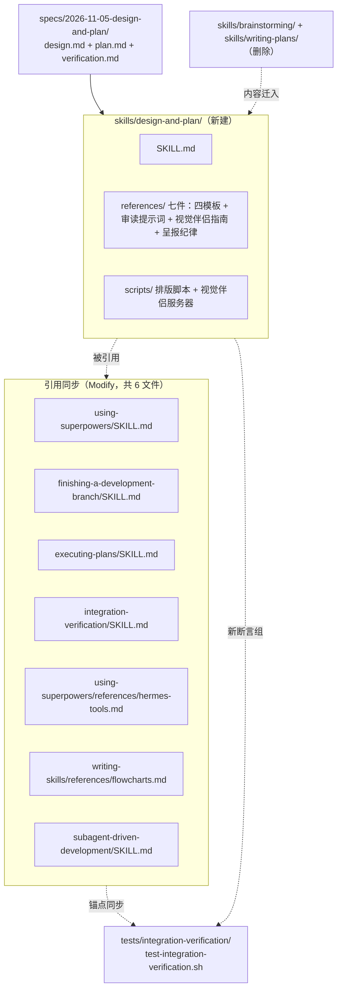

# 实施计划：brainstorming + writing-plans 合并为 design-and-plan

- **目标：** 需求方此后走 superpowers 开发流程时，设计与计划由一个技能一次成稿——产物补齐实现设计与呈报纪律，全套规格一次确认，流程耗时从 2.5h 压到 ≤1.5h。
- **架构：** 新建 `skills/design-and-plan/` 承载合并后流程；两个旧技能目录删除；7 个在役技能文件与 1 个断言资产做引用同步；排版脚本合并迁移并扩展结构槽位。`plan.md` / `design.md` 文件名与任务格式不动，下游执行技能零改动。
- **技术栈：** Markdown 技能文档、bash 排版脚本、node 视觉伴侣服务器（原样迁移）。
- **设计文档（Spec）：** `docs/superpowers/specs/2026-11-05-design-and-plan/design.md`（下称「方案」，其 §N 即本文的出处锚）。
- **实施前决策记录 + 日期：** 2026-11-05。
- **验证方案：** 见同目录 `verification.md`。

## 1. 改动地图

- **新建：** `skills/design-and-plan/`——合并后技能，流程与门在 SKILL.md，模板与纪律外置 references，脚本随迁。
- **修改（引用同步，7 个在役技能文件 + 1 个断言资产）：** 见 Task 6 逐行替换表；全部是技能名与产物清单的字面替换，不改下游逻辑。含既有断言资产 `tests/integration-verification/test-integration-verification.sh` 的锚点同步（该资产 6 个路径变量 BS/WP/PT/MERMAID/BRS/TPL 锚定约 52 条 ck 断言，另有 7 条断言的句锚因本计划对正文的合法改动而失效——失效清单见 Task 6，Task 6 替换后必须同步，否则回归资产整体变红）。
- **删除：** `skills/brainstorming/`、`skills/writing-plans/` 两目录（内容已迁入新技能；删除时机见 Task 7 与裁决项 D1）。
- **不动：** `hooks/session-start`（注入 using-superpowers/SKILL.md，改被注入文件即可）；`RELEASE-NOTES.md`、`docs/superpowers/archived/`、`docs/plans/`（历史记录，不改写）；下游技能对 `plan.md`/`design.md` 文件名的全部引用（名字不变）；视觉伴侣服务器脚本逻辑（`server.cjs`、`helper.js`、`frame-template.html`、`start-server.sh`、`stop-server.sh` 原样迁移）。
- **依赖方向：** Task 1 先行（定义文件名与节名）；Task 2、3 随后定稿模板槽位名（形态声明、六段式段名等）；Task 4（审读提示词）与 Task 5（脚本扩展 + visual-companion）依赖 Task 2/3 的槽位名；Task 6 依赖 Task 1–5 完成且裁决 D1 落定（其断言同步还依赖 Task 2 的迁移落点定稿）；Task 7 收尾验证依赖全部前序任务。串行执行顺序即 1 → 2 → 3 → 4 → 5 → 6 → 7；并行派发时 4/5 不得先于 2/3 定稿。

## 2. 功能单元规格

### Task 1: SKILL.md 本体

**职责：** 新技能的主文档——一条线流程（需求对话 → 四件套成稿 → 自查 → 统一审读 → 结构化呈报 → 执行交接）+ 单确认门 HARD-GATE + 危险信号表；后续所有任务的文件名、节名以本任务定义的为准。

**Files:**
- Create: `skills/design-and-plan/SKILL.md`

**Interfaces:**
- Consumes: 迁移源 = `skills/brainstorming/SKILL.md`（现行版全文）与 `skills/writing-plans/SKILL.md`（现行版全文）的逐节内容（迁移地图见方案 §2.5 两张表）。
- Produces（供后续任务引用的固定名）：
  - frontmatter `name: design-and-plan`；
  - references 七件（方案 §2.2 目录树为准，全部居于 `references/`）：`design-doc-template.md`、`implementation-template.md`、`plan-template.md`、`verification-template.md`、`reporting-rules.md`、`review-prompt.md`、`visual-companion.md`；
  - 产物口径：四件套 = design.md / implementation.md / plan.md / verification.md，外加 decisions.md 裁决日志（五文件同住 `docs/superpowers/specs/<date-feature>/`）。

**内容结构（节序固定）：**
1. frontmatter description——覆盖两个旧技能的全部触发场景：创造性工作开始前（设计阶段）+ 已有设计文档/需求要写实施计划（计划阶段）；并纳入旧触发词以便旧名命中：「头脑风暴」「设计讨论」「我们来构建」「实施计划」「写计划」；以「当……时使用」开头。
2. 开场立意、「首先：你实际知道什么」快速/完备通道——自 brainstorming 原样迁移。
3. 实施顺序——改写为方案 §2.3 一条线：需求对话 → 四件套成稿（decisions.md 随裁决追加）→ 自查 → 排版脚本 → 一个审读子代理审全套 → 批量修订 → 收敛复读 → 结构化呈报 → 确认后执行交接。
4. 先看再问 / 你的第一条消息 / 对话纪律 / 复述 / 列出各方案 / 用 spike 摸底 / 几个相互独立的项目——原样迁移；仅两处定点改：「展示，而非讲述」与「复述」节中视觉伴侣提议时机提前为「第一次复述 UI 相关内容前即提议」（方案 §2.3 要点）。
5. 四件套成稿（新写，替代原「书面设计文档」节）：五个文件各自一段两三句职责 + 指向对应模板文件；存放位置规则（`docs/superpowers/specs/<date-feature>/`，archived 冻结）原样迁移。
6. 自查前置（新写，方案 §5.5）：把统一审读的核对项前置为作者自查清单，指向 `review-prompt.md` 的核对项段。
7. 独立审读（简版）：一个子代理、`review-prompt.md`、四件齐审 + decisions.md 标注一致核对；处置顺序五步与「无子代理时自审」原样迁移。
8. 呈报与确认：单确认门——指向 `reporting-rules.md`，确认对象显式写全四件；确认前不得实施；确认后回改规则。
9. 已裁决两条规则——自 brainstorming 原样迁移。
10. 执行交接——自 writing-plans 原样迁移（子代理驱动 vs 会话内判据 + 话术模板 + REQUIRED SUB-SKILL 两行）。
11. HARD-GATE（方案 §4 改写）：全套规格确认前不得实施；「嗯」「继续」不算确认；spike 例外条款原样保留。
12. 危险信号表——原样迁移 + 方案 §2.5 新增两行：「我把裁决项和确认请求写进了同一条消息」「我用复合问题让『同意』承担多个语义」。

**边界条件：**
- 行数 ≤300 行（方案 §2.2）；超限时优先把细粒度内容外置 references，不删门与清单。
- 呈报段不得复述 reporting-rules 全文——只写「单门 + 对象四件 + 见 references/reporting-rules.md」，防止双源漂移。
- 迁移逐节对照方案 §2.5 处置列执行：标「原样保留」的节不做措辞改写；标「修改后保留」的节只做该行说明的修改；「移除项」表中的跨技能交接语不得迁入。
- 旧技能名（`brainstorming`、`writing-plans`）在 SKILL.md 正文中零出现（frontmatter name 与 description 的旧触发词除外）。

**验收标准：**
- 文件存在且 frontmatter 含合法 `name` 与 `description`（description ≤1024 字符，以「当……时使用」开头，含五个旧触发词全部字样）。
- 行数 ≤300；`grep -c "superpowers:brainstorming\|superpowers:writing-plans"` 输出 0。
- 危险信号表含新增两行原句；HARD-GATE 含「全套规格确认前不得实施」原句；节序与上述 12 项一致。
- 五件产物文件名与 Task 2–5 实际产出文件名逐一对应，无失效引用。

### Task 2: 三件改造模板（design / plan / verification）

**职责：** 设计文档模板加形态声明与条件章、计划模板收缩为工作单、验证方案模板外置成文——给后续项目的成稿定格式。

**Files:**
- Create: `skills/design-and-plan/references/design-doc-template.md`（改造自 `skills/brainstorming/references/design-doc-template.md`）
- Create: `skills/design-and-plan/references/plan-template.md`（改造自 `skills/writing-plans/references/plan-template.md`）
- Create: `skills/design-and-plan/references/verification-template.md`（新建；内容外置自现行 plan-template.md「验证方案文件」段 + 方案 §3.4）

**Interfaces:**
- Consumes: Task 1 定义的产物口径与文件名。
- Produces: 三份模板的章节清单与槽位名——design.md：文首形态声明（产物形态 + 章节裁剪推导）+ 原五章 + 条件章「界面规格」+ 条件章「数据字典」+ 审读附录；plan.md：文首指针行 + 任务依赖图（mermaid）+ 实施顺序声明 + Task 规格（Files / 引用式 Interfaces / 边界条件 / 验收标准）+ 执行交接 + 附录；verification.md：集成面声明与双向映射 → 场景清单 → 通过判据 → 验证环境 → 执行手段 → 产出物。

**改造要点（逐条落实方案）：**
- design-doc-template：按方案 §3.1.a 增形态声明槽位；按 §3.1.b 增「界面规格」条件章（冻结效果图引用 `mockups/` 相对路径、约束级/示意级两级标注、视觉稿定稿冻结机制、无 UI 形态的裁剪推导写法）；按 §3.1.c 增「数据字典」条件章（产品级数据形态；与 implementation.md 的分工示例原样落入）；按 §3.1.d 增「禁止无锚引用」措辞纪律；五章与其余写作要求不动。
- plan-template：按方案 §3.3 收缩——删「两类读者」改为三读者声明（需求方/工程师/执行子代理）；Interfaces 块改引用式（`Consumes: implementation.md §I-N`；Produces 仍列名字与章节号）；文首加任务依赖图与实施顺序声明（含「多任务 Modify 同一文件时顺序不可调换」约束句）；文首指针行原句：`实现设计见同目录 implementation.md；本文件是唯一执行依据。`；「验证方案文件」段移出为一句指针；其余节（任务规模划定、详细度、一个任务包含什么、写作要求 7 条、自审 10 项+新增 3 项、执行交接）按方案 §2.5 迁移——写作要求第 7 条「接口配调用示例」落点改注 implementation.md。
- verification-template：按方案 §3.4——执行手段章改为分层自动化策略；新增「可观测缝」清单节；场景出处约定（`§N`→design.md、`Task N`/`I-N`→plan.md/implementation.md）；按 §3.4.1 增「引擎 + 场景数据分离」节（引擎/场景数据/生命周期/冲突与漂移/起步策略五段）；现行六项内容要求与质量判据、修复闭环轮次上限原样保留。

**边界条件：**
- 条件章在模板中标注「条件：……时必设」，模板自身含裁剪速查表（design 的形态×条件章表按方案 §3.2 表落 implementation-template，design 模板内写条件判据即可，不重复全表）。
- design 模板保持「全文零实现词汇」规则不变（形态声明、条件章内容均不得引入文件名/函数名）。
- plan-template 保留金句「计划是实施者无法独自做出的那批决定的集合」与「为没见过代码库的工程师撰写」于工作单开篇。
- 三份模板任何一处不得引用已删除的旧技能路径（`skills/brainstorming/`、`skills/writing-plans/`）。

**验收标准：**
- 三文件存在于 references/；design 模板含「形态声明」「界面规格」「数据字典」「禁止无锚引用」四个新槽位字样；plan 模板含引用式 Interfaces 示例、任务依赖图节、文首指针原句；verification 模板含「可观测缝」「引擎」「场景数据」与场景出处约定。
- 每份 ≤400 行（写作要求第 5 条）；标题层级 ≤3、列表嵌套 ≤2。
- 对三份模板跑 `bash skills/design-and-plan/scripts/check-doc-structure.sh`（Task 5 产出后）零结构缺损报告——模板自身作为样例文档通过。

### Task 3: 两件新增模板（implementation / reporting-rules）

**职责：** 实现设计模板（给人看的审查载体：数据、接口六段式、流程、规模评估）与呈报纪律（裁决与确认分离的硬规则 + decisions.md 格式）。

**Files:**
- Create: `skills/design-and-plan/references/implementation-template.md`
- Create: `skills/design-and-plan/references/reporting-rules.md`

**Interfaces:**
- Consumes: Task 1 产物口径；Task 2 plan-template 的引用式 Interfaces 格式（`implementation.md §I-N` 编号约定）。
- Produces: implementation.md 章节清单（0 形态声明 / 1 结构设计 / 2 数据与状态设计 / 3 接口设计含六段式与外部接口补充段 / 4 流程设计 / 5 界面实现规格〔条件〕/ 6 运行与部署〔条件〕/ 7 规模评估 / 8 设计依据约束风险 + 章节×形态裁剪速查表）；reporting-rules 九条规则 + decisions.md 条目格式。

**改造要点（逐条落实方案）：**
- implementation-template：方案 §3.2 的完整模板逐段落入（含 §3.2.1 六段式、§3.2.2 外部接口补充段、章节裁剪速查表、形态声明示例 §8.3）；接口示例直接采用方案 §8.1 的六段式真实示例（SettingsWriter.replaceAnthropicEnv）作为「示例接口」节。
- reporting-rules：方案 §4 的九条规则逐条落入（单确认门、分离规则、裁决三段格式、回复模板、解读规则、呈报审查负担缓解、确认后回改、耗时预告、轻量修订通道），回复模板与呈报示例（§8.2）代码块原样保留；文末附 decisions.md 条目格式（方案 §3.5 的示例块 + 三条规则：追加式、回写引用本日志、审读核对标注一致）。

**边界条件：**
- 九条规则条目编号与方案 §4 一一对应，不合并、不拆分——需求方按编号裁决与引用。
- 分离规则（第 2 条）与解读规则（第 5 条）加粗强调；轻量修订通道（第 9 条）须含「门不重开」的适用边界原句。
- implementation-template 中六段式段名（职责/签名/参数表/错误表/示例/被谁依赖）为逐字契约——plan-template 与 review-prompt 引用时用同名。

**验收标准：**
- 两文件存在；implementation-template 含「六段式」六段名全部字样与裁剪速查表全表（5 形态 × 5 章）；reporting-rules 含九条编号规则、回复模板代码块、decisions.md 示例块。
- 方案 §4 每条规则在 reporting-rules 中有且仅有一个对应条目（作者自查逐条对表）。
- 对两份新模板运行 `check-tables.sh` 与 `check-mermaid.sh` 退出码 0。
- 标题层级 ≤3；每份 ≤400 行。

### Task 4: 统一审读提示词

**职责：** 一份审读子代理提示词覆盖四件套 + decisions.md——含影响阈值、条目预算、跨文件一致性核对、形态感知。

**Files:**
- Create: `skills/design-and-plan/references/review-prompt.md`（合并改造自 `skills/brainstorming/review-prompt.md` 与 `skills/writing-plans/review-prompt.md`）

**Interfaces:**
- Consumes: Task 1–3 的全部产物结构与槽位名（四件套章节、六段式段名、形态声明）。
- Produces: 统一审读提示词全文——派发方式段（未参与写作的全新 general-purpose 子代理 + 四件路径 + decisions.md 路径）+ 提示词正文。

**改造要点（逐条落实方案 §5）：**
- 范围改四件齐审（design.md + implementation.md + plan.md + verification.md），decisions.md 用于核对文档标注一致（方案 §5.4）。
- 保留两份旧提示词的全部既有结构：清单 A 完备性（映射表、逐任务推演表、跨任务引用核对）、清单 B 可读性（逐项能/不能 + 表格三数字排版清点）、清单 C 实现效果（逐功能判定能达成/有疑问/不能达成 + 验收原句引用要求）——合并两版清单的核对项，不丢项。
- 新增核对项（方案 §5.4）：跨文件引用一致性（implementation ↔ plan 互引编号存在、design 无锚引用禁令）、形态声明裁剪推导、任务依赖图与实施顺序声明、接口六段式完整性。
- 形态感知（方案 §5.4）：按形态声明裁剪结果审章——不苛求纯 API 项目有界面章，但苛求其外部接口契约段完整。
- 影响阈值与条目预算（方案 §5.1）：高/中/低三级定义原句落入；单清单 ≤15 条、超出按影响截断并注明「已按阈值截断」。
- 批量修订配合（方案 §5.2）：高/中危每条附建议替换文本（可采纳的建议，不是改稿）。
- 复读收敛（方案 §5.3）：复读只核对修订忠实性，新发现上限 3 条、超出退回重修——写入提示词末尾「复读模式」段。

**边界条件：**
- 两份旧提示词的每一张表、每一条核对项在合并版中可指到去处（作者自查对照表）；判定「丢弃」仅限方案 §2.5「移除项」表所列内容。
- 输出格式段保留「位置 + 原句 + 卡住的原因 + 严重度（高/中/低）+ 按重要性排序」与「空清单也要逐项声明本项通过」。
- 提示词正文整体仍在单个代码块内（派发时整段复制），≤200 行。

**验收标准：**
- 文件存在；四件路径占位符（[DESIGN_PATH] [IMPLEMENTATION_PATH] [PLAN_PATH] [VERIFICATION_PATH] [DECISIONS_PATH]）齐备。
- 含「已按阈值截断」「新发现上限 3 条」「形态声明裁剪」字样；三清单 A/B/C 与两张表（映射表、逐任务推演表）俱在。
- 对照两份旧提示词逐条核对无丢项（自查表附于任务完成说明）。

### Task 5: 视觉伴侣改造与脚本迁移

**职责：** 视觉伴侣指南补定稿冻结机制；排版脚本合并为一份并扩展结构槽位；视觉伴侣服务器脚本原样随迁。

**Files:**
- Create: `skills/design-and-plan/references/visual-companion.md`（改造自 `skills/brainstorming/visual-companion.md`）
- Create: `skills/design-and-plan/scripts/` 全套（自两旧目录迁移）
  - 原样迁移：`check-mermaid.sh`、`check-tables.sh`、`start-server.sh`、`stop-server.sh`、`helper.js`、`server.cjs`、`frame-template.html`
  - 改造扩展：`check-doc-structure.sh`

**Interfaces:**
- Consumes: Task 2/3 定义的槽位名（形态声明、任务依赖图、文首指针、decisions.md 条目）。
- Produces: 可运行的脚本集——`bash scripts/check-tables.sh <文件.md>...`、`bash scripts/check-mermaid.sh <文件.md>...`、`bash scripts/check-doc-structure.sh <文件.md>...`；视觉伴侣冻结流程（指南文档承载）。

**改造要点：**
- visual-companion.md 新增「定稿冻结」节（方案 §3.1.b）：需求方每确认一块视觉稿 → 立即将 HTML 落盘 `specs/<date-feature>/mockups/<界面名>.html` 并提交；截图可用 `chrome --headless --screenshot=<输出.png> --window-size=<宽>,<高> <file://路径>` 生成；design.md 界面规格章只允许引用已冻结文件，禁止引用 `.superpowers/brainstorm/` 会话临时目录。其余内容原样迁移。
- check-doc-structure.sh 在现有检查（功能卡片字段、Task 职责句、风险清单表格、决策速览表、mermaid 节点预算）基础上新增槽位检查：文件含「## 0. 形态声明」级标题或「形态声明」行 → 通过；`### Task` 小节所在文件缺失「任务依赖图」字样 → 报告；plan.md 缺文首指针句「实现设计见同目录 implementation.md」→ 报告。新检查只查存在性不判语义，与现有判定原则一致（脚本头注释同步更新）。
- 脚本头注释中的模板引用路径改为新技能路径。

**边界条件：**
- 迁移即字节一致（diff 为空），除 check-doc-structure.sh 与脚本头注释行外不得有任何改动。
- 新增槽位检查对不含该槽位的文档类型不误报：形态声明检查只对含「形态声明」要求的文档启用——脚本按文件名后缀判别不可行（design/implementation/plan/verification 同目录不同名），改为：形态声明与任务依赖图检查仅在文件名含 `design`、`implementation`、`plan` 时启用，verification.md 只查既有通用槽位。
- check-doc-structure.sh 保持 POSIX sh 兼容（现有脚本无 bashism，新增检查沿用 awk）。

**验收标准：**
- `diff -r` 确认原样迁移的 7 个脚本与旧版字节一致；visual-companion.md 含「定稿冻结」节与 headless 截图命令字样。
- 对本需求三件套（design.md / plan.md / verification.md）运行三个脚本：check-tables 与 check-mermaid 退出码 0；check-doc-structure 恰产生 3 份预期差异报告——design.md 缺「形态声明」、plan.md 缺「任务依赖图」、plan.md 缺文首指针句（本计划按现行格式写、无新槽位）——这 3 份报告即新检查生效的证明，输出原样记入验证记录后按预期差异放行；除这 3 份外零新增报告。
- 构造一个含形态声明的最小样例文档（放 /tmp，不入库），check-doc-structure 对它不再报形态声明缺失。

### Task 6: 引用同步（7 个技能文件逐行替换 + 断言资产锚点同步）

**职责：** 全部在役引用点从旧技能名/旧产物清单切到新技能名/新产物清单；保留旧触发词命中能力。

**Files:**
- Modify: `skills/using-superpowers/SKILL.md`
- Modify: `skills/finishing-a-development-branch/SKILL.md`
- Modify: `skills/executing-plans/SKILL.md`
- Modify: `skills/integration-verification/SKILL.md`
- Modify: `skills/using-superpowers/references/hermes-tools.md`
- Modify: `skills/writing-skills/references/flowcharts.md`
- Modify: `skills/subagent-driven-development/SKILL.md`
- Modify: `tests/integration-verification/test-integration-verification.sh`（锚点同步，见下）

**Interfaces:**
- Consumes: Task 1 的技能名与产物口径。
- Produces: 零失效引用的技能网络（验收由 Task 7 的 grep 证明）。

**逐行替换表（逐字契约——执行者按此表逐处替换，不做表外改动）：**

| 文件:行 | 现文（关键片段） | 改为 |
|---------|----------------|------|
| using-superpowers/SKILL.md:30 | 先调用 brainstorming 技能 | 先调用 superpowers:design-and-plan 技能 |
| using-superpowers/SKILL.md:38 | 先用 superpowers:brainstorming，再用实现技能 | 先用 superpowers:design-and-plan，再用实现技能 |
| using-superpowers/SKILL.md:60 | brainstorming 建 specs/<date-feature>/（design.md + plan.md；验证方案按集成面判据决定是否产出）→ writing-plans → 执行 | design-and-plan 建 specs/<date-feature>/（design.md + implementation.md + plan.md + verification.md + decisions.md）→ 执行 |
| using-superpowers/SKILL.md:78 | （设计确认、计划确认及其裁决记录） | （全套规格确认及其裁决记录，载于 decisions.md） |
| finishing-a-development-branch/SKILL.md:177 | 走 brainstorming → writing-plans → 收官把关 → 集成验证 → 收尾完整工作流 | 走 design-and-plan → 收官把关 → 集成验证 → 收尾完整工作流 |
| finishing-a-development-branch/SKILL.md:179 | 设计决策（存放位置与改动分类）归 brainstorming 技能 | 设计决策（存放位置与改动分类）归 design-and-plan 技能 |
| finishing-a-development-branch/SKILL.md:181 | archived 冻结的存放策略见 superpowers:brainstorming 存放位置。 | archived 冻结的存放策略见 superpowers:design-and-plan 的「存放位置」规则。 |
| executing-plans/SKILL.md:24 | 你有一份来自 superpowers:writing-plans 的计划 | 你有一份来自 superpowers:design-and-plan 的计划 |
| integration-verification/SKILL.md:84 | （十项由计划阶段的 writing-plans 保证） | （十项由规格阶段的 design-and-plan 保证） |
| hermes-tools.md:30 | skill_view("brainstorming") | skill_view("design-and-plan") |
| flowcharts.md:51 | （brainstorming 与 writing-plans 两个技能的 scripts/ 目录各有一份） | （design-and-plan 技能的 scripts/ 目录有一份） |
| subagent-driven-development/SKILL.md:31 | manual_or_brainstorm[\"手动执行，或先做头脑风暴\"] | manual_or_brainstorm[\"手动执行，或先走设计阶段\"] |

**断言资产锚点同步（`tests/integration-verification/test-integration-verification.sh`，清单式落点表——执行者按表核改，不做表外改动）：**

| 断言 id（行号） | 失效原因 | 处置 |
|----------------|---------|------|
| 路径变量 BS/BRS（L22、L211） | 旧路径 | 改指 `skills/design-and-plan/SKILL.md` |
| 路径变量 WP（L23） | 旧路径 | 改指 `skills/design-and-plan/SKILL.md` |
| 路径变量 PT（L24） | 旧路径 | 改指 `skills/design-and-plan/references/plan-template.md` |
| 路径变量 TPL（L212） | 旧路径 | 改指 `skills/design-and-plan/references/design-doc-template.md` |
| 路径变量 MERMAID（L25） | 旧路径 | 改指 `skills/design-and-plan/scripts/check-mermaid.sh` |
| 新增变量 VT | — | `skills/design-and-plan/references/verification-template.md`（供下两行使用） |
| pt-verification-file-section（L90） | 「## 验证方案文件」段按 Task 2 移出 plan-template | `$PT` 改 `$VT`，句锚不变（标题在 verification-template.md 中保留） |
| pt-provenance（L92）/ pt-bidirectional-map（L93）/ pt-content-requirements（L94） | 同上，句随段迁 | `$PT` 改 `$VT`，句锚不变 |
| wp-verification-pointer（L83） | 指针句随段移出改写 | 句锚改为新指针句（Task 2 改造要点：指向 `references/verification-template.md` 的那句） |
| us-routing-feature-workflow（L213）/ wdh-us-routing-conditional（L242） | 锚句「验证方案按集成面判据决定是否产出」被 using-superpowers:60 新句替换删除 | 句锚改为新句中的产物清单片段（`design.md + implementation.md + plan.md + verification.md + decisions.md`） |
| fin-discipline-binary-classification（L201） | 锚句含「brainstorming → writing-plans」被替换 | 句锚改为替换表新句「走 design-and-plan → 收官把关 → 集成验证 → 收尾完整工作流」 |
| fin-discipline-upstream-pointer（L207） | 锚句含「归 brainstorming」被替换 | 句锚改为替换表新句「设计决策（存放位置与改动分类）归 design-and-plan」 |
| 其余 wp-*/pt-* 组（L82、L84–L87、L91） | 句面按方案 §2.5「原样保留」迁移存活 | 仅随变量改指，句锚不变；L91（pt-points-to-verification）的路径字样 `docs/superpowers/specs/<date-feature>/verification.md` 须在新 plan-template 的验证方案指针句中原样保留（Task 2 落实） |

- 同步完成后运行整套断言资产：**改前基线必须全绿**（已在审读期实测：当前退出码 0），改后（此时 md 已替换、锚已同步）一轮全绿——两轮结果记入验证记录；改后若出现清单外红断言，按红断言提示核对新文件句面并同步句锚，逐条记录处置。

**边界条件：**
- md 文件仅限上表 12 处；断言资产仅限上方落点表所列变量与断言，其余断言零改动——执行者完成前后各跑一次全仓 grep 对账（见验收标准）。
- 历史文件不改写：`RELEASE-NOTES.md`、`docs/superpowers/archived/**`、`docs/plans/**` 中的旧名一律保留。
- using-superpowers/SKILL.md:30 的「头脑风暴」语义由上下文自然承接（design-and-plan 的 description 已含该词），该行不额外加词。
- 断言资产改前基线全绿先行：若改前就有红断言，先呈报，不得在红基线上叠加同步改动。

**验收标准：**
- 替换后 `grep -rn "superpowers:brainstorming\|superpowers:writing-plans" skills/ hooks/` 零命中；`grep -rn "brainstorming\|writing-plans" skills/` 仅剩本表明确保留处（无——skills/ 下应零残留，Task 7 复核）。
- using-superpowers/SKILL.md:60 的产物清单含五文件名原样。
- 断言资产中旧路径变量（`skills/brainstorming/`、`skills/writing-plans/`）零残留；对同步后资产跑一轮全绿（md 已替换、锚已同步，二者一致）。
- `git diff --stat` 显示恰 8 个文件改动，行数变化与表一致（±5 行以内，断言资产句锚替换允许行内变化）。

### Task 7: 删除旧技能目录与收尾验证

**职责：** 移除两个旧技能目录；跑全量机械验证（零残留引用、脚本可运行、视觉伴侣启停）；整理需求方触发验证交接。

**Files:**
- Delete: `skills/brainstorming/`（整目录）
- Delete: `skills/writing-plans/`（整目录）
- Modify: `tests/integration-verification/test-integration-verification.sh`（新增本需求断言组）

**Interfaces:**
- Consumes: Task 1–6 全部完成；裁决项 D1 的裁决结果。
- Produces: 最终仓库状态——新技能在位、旧目录消失、零失效引用。

**前置条件（裁决 D1 已落定，2026-11-05：验证通过后直接移除）：** 本任务按上述执行（整目录删除）。「deprecated 过渡」备选经需求方裁决不采用，理由：并存期两个 description 抢同一触发场景必歧义，旧触发词命中已由新技能 description 承载。

**边界条件：**
- 新增断言组（对应 verification.md S1/S3/S6/S7，沿用资产现有 `ck` 断言风格，组名前缀 `dap-`）：`dap-no-legacy-refs`（skills/ hooks/ .claude-plugin/ 下 brainstorming/writing-plans 零命中，豁免 design-and-plan 目录名）；`dap-new-skill-in-place`（design-and-plan/SKILL.md frontmatter name 与五触发词在场，出处 verification.md S7）；`dap-hook-chain`（hooks/session-start 经 bash -n 且注入文本源文件含 design-and-plan，出处 S6）；`dap-slot-checks`（check-doc-structure.sh 对缺形态声明样例报红、对含槽位样例通过——样例内联构造于临时目录，出处 S3）。新断言组在删除完成后执行并全绿。
- 删除前运行最终对账：`grep -rn "brainstorming\|writing-plans" skills/ hooks/ .claude-plugin/ docs/superpowers/specs/2026-11-05-design-and-plan/` —— 豁免清单：本需求三件套（plan.md 记录性提及；design.md 方案原文 §2.4/§2.5 表格引用旧名属需求方案记录；verification.md §7 查重记录）与 deprecated 标注（若 D1 选过渡）；豁免外零命中，命中清单先呈报再删。
- 删除后 `ls skills/` 不含两旧目录；`python3 -c "import json;json.load(open('.claude-plugin/plugin.json'))"` 与 `hooks/hooks.json` 合法性不受影响（二者不含技能文件名引用——执行时验证）。
- 删除后整套断言资产（含既有组 + 新增 dap- 组）一轮全绿。

**验收标准：**
- 两旧目录不存在；全仓 grep 对账零命中（豁免清单如上）；hooks/session-start 脚本语法检查通过（`bash -n hooks/session-start`）。
- 断言资产整套（既有组 + 新增 dap- 组）执行一轮全绿，结果原文记入验证记录。
- `bash skills/design-and-plan/scripts/start-server.sh` 能启动并返回含 `screen_dir`/`state_dir` 的 JSON，`stop-server.sh` 能停止（验证后即停，不留进程）。
- 触发验证交接块写好：提示需求方在全新会话发送「我们来构建 X」验证 design-and-plan 被触发——此为合并后的最终闸门，属需求方动作，见 verification.md 场景 S5。

## 3. 设计依据

- **合并而非修补两技能：** 方案 §0 已论证——P5（审读割裂、跨文件不一致漏抓）与 P4（确认语义事故）的根因都是「设计/计划两阶段两套纪律」；单技能单审读单确认门是唯一同时消除两者的结构。候选「保留两技能+共享审读协议」被方案排除：审读上下文仍割裂，确认门仍两道。
- **plan.md 零改动策略：** executing-plans / subagent-driven-development / integration-verification / finishing 四个下游技能全部消费 plan.md；改名或改格式会把改造爆炸半径从 7 个文件扩大到十几个。方案 §2.4 明示不改，本计划遵守。
- **别名走 description 关键词而非保留旧目录：** 技能路由信号由 description 列表承载（本项目既有实证：路由行省略不致失败，description 是唯一信号）。旧目录若保留，两个 description 抢同一触发场景必然歧义；把「头脑风暴」等旧触发词并入新 description 即可保命中。deprecated 过渡（D1 备选）的价值仅在需求方对旧名有肌肉记忆依赖，由 D1 裁决。
- **排版脚本迁移而非重写：** check-mermaid/check-tables 两份字节相同，合并一份即去重；check-doc-structure 扩展三个新槽位检查（形态声明/任务依赖图/文首指针），延续「只查存在性不判语义」的既有判定原则——条件槽位归独立审读。
- **decisions.md 格式落 reporting-rules.md：** 呈报、裁决、回写、裁决日志是同一条纪律链（方案 §4 + §3.5），集中一个文件避免散落；SKILL.md 只留单门与指针。
- **本次任务自身走现行流程三件套：** 新五件套格式尚未存在，自指采用不合法；本计划按现行 plan-template 五章写。统一审读所要求的四件齐审在本需求自身的确认门上不可复现，由现行流程兜底（设计文档已经需求方逐条讨论确认 + 本计划独立审读）；呈报纪律（方案 §4）的行为层效果同样只能由试点检验（方案 §7.7），已在执行交接声明试点复盘义务。
- **scripts/ 随迁是方案 §2.5 视觉伴侣保留条款的落实：** 方案 §2.2 目录树未画 scripts/ 属结构图省略——「视觉伴侣全节原样保留」必然携带其服务器脚本（visual-companion.md 明示依赖 scripts/start-server.sh 等），排版脚本同理（brainstorming SKILL.md 明示运行 scripts/check-*.sh）。不随迁则保留条款自断依赖，故并入 Task 5，不构成范围变更。

## 4. 约束

- **执行期红线：** 全部改动只在 `feature/design-and-plan` 改造分支的工作区进行，**执行期间不做任何 git 提交**；全部任务完成、需求方确认产出后一次性提交（需求方既有裁决：单次快照授权不外推）。
- **迁移保真：** 方案 §2.5 标「原样保留」的节逐字迁移，不改写措辞——这些提示词经实践打磨，改写需 eval 证据（仓库 AGENTS.md 纪律）。
- **下游零改动：** 除 Task 6 逐行替换表 12 处外，任何下游技能文件不得改动。
- **历史不可改写：** RELEASE-NOTES.md、archived/、docs/plans/ 不动。
- **技能正文规则：** SKILL.md ≤300 行；模板 ≤400 行；标题 ≤3 级、列表嵌套 ≤2 层；mermaid 提交前过 check-mermaid.sh。
- **验证纪律：** 改动技能属 writing-skills 管辖——本次基线失败记录即方案 §1 的 P1–P8 实证（真实项目失败优于模拟压力场景）；GREEN 后的触发验证（verification.md S5）在合并后由需求方新会话执行，作为最终闸门。

## 5. 风险清单

| 风险 | 触发条件 | 影响 | 缓解方式 |
|------|---------|------|---------|
| 合并后 SKILL.md 超长稀释指令遵循 | 12 节全迁入后超 300 行 | 触发后执行走样，流程闸门失效 | 细粒度内容外置 references；行数硬约束进 Task 1 验收；触发验证 S5 兜底 |
| 旧触发词丢失导致技能不被触发 | description 未覆盖「头脑风暴」等词 | 「我们来构建 X」落入实现技能，跳过设计 | Task 1 验收标准钉死五个触发词字样；S5 新会话触发测试 |
| 引用同步漏点留下失效引用 | grep 口径外的间接引用（如「设计文档获批后」类交接语） | 下游技能在新流程中指错环节 | Task 6 前后双 grep 对账；审读子代理专项核对交接语 |
| 迁移中改写「原样保留」内容 | 实施者顺手润色 | 违反迁移保真约束，行为塑形内容无 eval 改动 | 约束章红线 + 执行交接时 diff 对照方案 §2.5 处置列 |
| 删除旧目录后 hook 注入失败 | session-start 路径引用断裂（实际不引用旧技能，防御项） | 每个新会话启动报错 | Task 7 验收含 `bash -n` 语法检查；hook 仅读 using-superpowers/SKILL.md，该文件只改内容不挪位 |
| check-doc-structure 新检查误伤存量文档 | 对 archived 或旧格式文档运行 | 假阳性噪音 | 新槽位检查按文件名启用限定（Task 5 边界条件）；脚本不对 archived 自动运行 |

## 执行交接

- **建议执行方式：** 子代理驱动——7 个任务边界清晰、Files/验收标准均可判真伪、任务间仅以文件名与替换表耦合（已在本计划写死），无探索性工作；每任务一份全新上下文可防迁移保真红线被顺手改写侵蚀。
- **必需子技能：** superpowers:subagent-driven-development。
- **请需求方审查：** 各任务的边界条件与验收标准是否忠实覆盖方案的功能清单（§2–§6）与「明确不做」（方案未设独立「明确不做」章，其否定性约束散见 §2.5 移除项表、§7 迁移注意、AGENTS.md fork 政策，均已落入本计划约束章与任务边界条件）。
- **计划确认状态：已确认（2026-11-05，需求方明确确认 plan.md 与 verification.md），执行方式已选定子代理驱动；D1/D2 裁决同步落定（结论见 Task 7 前置条件与执行交接 RELEASE-NOTES 条目）。**
- **实施开始后发现设计必须改：** 停止实施，回到设计确认门；返工还是回滚由需求方决定；已合入 main 的部分用新提交修正，不改写历史。
- **试点复盘义务（方案 §7.7）：** 首个按新流程走完的真实项目收尾时，复盘条目预算 15、复读上限 3、耗时预告等经验参数是否需要调——此为呈报纪律与审读阈值等行为层效果（本计划只有文本在场验收，无会话级行为验证）的唯一检验机制，不得遗漏。
- **RELEASE-NOTES 条目（裁决 D2 已落定，2026-11-05：追加条目）：** 收尾提交后在 RELEASE-NOTES.md 顶部追加一条本合并的变更记录（只追加、不改写既有内容）。

## 独立审读处置记录附录

**审读者身份：** 独立子代理（general-purpose，agentId a994b5c6fe820f51e），2026-11-05，使用 `skills/writing-plans/review-prompt.md`（按三件套范围调整：verification.md 一并审 + 四项补充核对）。审读者对 Task 6 替换表 11 处逐行 grep 实证、断言资产 384 行实测、排版三数字机械清点；作者对高危项逐条机械复核后处置。

**问题清单与逐条处置：**

| # | 严重度 | 问题摘要 | 处置 |
|---|--------|---------|------|
| A1 | 高 | 替换表漏第 12 处旧名引用（finishing:181「见 superpowers:brainstorming 存放位置」——作者侦察时 grep -v archived 过滤器误杀此行） | **采纳**：替换表补行（新句「见 superpowers:design-and-plan 的『存放位置』规则」）；作者已 sed 复核该行原文 |
| A2 | 高 | 断言资产失效集大于同步范围：7 条断言句锚因 Task 2/6 合法改动失效（us-routing×2、wp-verification-pointer、pt-verification-file-section、pt-provenance/bidirectional-map/content-requirements），修复被「零改动」禁区阻断，Task 6/7 全绿验收不可达 | **采纳**：断言同步段重写为清单式落点表（13 行：6 变量改指 + 新增 VT 变量 + 7 条失效断言逐条处置），作者对 L213/L242/L83/L90/L92-94 句锚逐条 grep 实证确认 |
| A3 | 中 | 删除前对账豁免清单未含 design.md/verification.md（二者大量记录性引用旧名），「先呈报再删」不可执行 | **采纳**：豁免清单扩为本需求三件套 |
| A4 | 中 | Task 2–5 内部依赖未声明（4/5 消耗 2/3 槽位名、2 验收依赖 5 脚本），「互相独立成稿」声明与真实依赖矛盾 | **采纳**：依赖方向段重写为串行序 1→2→3→4→5→6→7，禁止 4/5 先于 2/3 定稿 |
| A5 | 中 | dap-new-skill-in-place 无场景出处，违反 verification.md 自声明的出处锚定判据 | **采纳**：新增机械场景 S7（新技能在位 + 触发词承载），断言组出处改为 S1/S3/S6/S7 |
| A6 | 中 | Task 5 预期差异只预案 1 份，实际按新检查必有 3 份（design 缺形态声明、plan 缺依赖图+指针句），另 2 份定性缺失 | **采纳**：Task 5 验收与 S2 期望改为「恰 3 份预期差异，除此外零新增报告」 |
| A7 | 中 | 「约 20 条断言」量级不实（实测 6 变量锚定 52 条 ck 断言） | **采纳**：改动地图改为「6 个路径变量锚定约 52 条 ck 断言 + 7 条句锚失效」 |
| A8 | 低 | 方案 §2.2 目录树未含 scripts/，与计划 Task 5 不一致 | **采纳（标注为作者决定）**：不改需求方案文档；设计依据章新增一条论证——scripts/ 随迁是 §2.5「视觉伴侣全节原样保留」的必然携带（指南明示依赖服务器脚本），属结构图省略而非范围变更 |
| A9 | 低 | 架构行「6 个在役文件」与 Task 6「7 文件」矛盾 | **采纳**：架构行改「7 个在役技能文件 + 1 个断言资产」 |
| A10 | 低 | 替换表 using-superpowers:27 行号错（实为 L78，偏差 51 行） | **采纳**：表行改 :78 |
| B1 | 中 | 断言同步「以实际落点为准逐一核改」与逐字契约红线冲突 | **采纳**：随 A2 清单化消除自由裁量 |
| B2 | 低 | 验收「新旧句并存」表述不可解 | **采纳**：改「md 已替换、锚已同步，二者一致」 |
| B3 | 低 | 「四件套五文件名」数字混用 | **采纳**：改「五件产物文件名」 |
| B4 | 低 | 同 A9 | 同 A9 |
| B5 | 低 | design.md 重复 H1 与重复题注（作者落盘失误，非方案原文问题） | **采纳**：已修复（合并为我加头部与原文引言，保留单一 H1） |
| B6 | 低 | 改动地图 mermaid「五件模板」计数错（实为 7 件 references） | **采纳**：节点文本改「七件：四模板 + 审读提示词 + 视觉伴侣指南 + 呈报纪律」 |
| B7 | 低 | S2 期望出处锚错（check-tables/mermaid 验收在 Task 5 而非 Task 2；Task 3 两份模板无脚本要求） | **采纳**：S2 出处改指 Task 5 + Task 3；Task 3 验收补「对两份新模板跑 check-tables/check-mermaid 退出 0」 |
| C1 | 高 | A1+A2 的组合态：逐表执行则 Task 6 grep 验收为假 + 断言资产 7 条转红且修复被禁，收尾验证与方案 §2.4 目标同时落空 | **采纳**：随 A1、A2 修复，判定为计划问题非设计不可行，不回设计确认门（审读者同判定） |
| C2 | 中 | 方案 §4 呈报分离与 §5 审读阈值的行为层承诺无场景承接，全部押后试点且计划无交接 | **采纳（部分）**：S5 增 S5d 可选观察点（呈报分离行为观察，登记不设机械判据）；试点复盘写入执行交接为强制义务（随 C3）；系统性行为验证维持方案 §7.7 试点归口——方案已明示「参数是经验初值，试点后可调」，本次不扩会话级压测（成本收益不称，作者决定） |
| C3 | 低 | 方案 §7.7 试点复盘无任务无交接承接 | **采纳**：执行交接块新增「试点复盘义务」条目 |
| C4 | 低 | RELEASE-NOTES.md「不改写」与「新增条目」边界未定义，归需求方 | **移交需求方**：列为呈报裁决项 D2 |
| C5 | 低 | 本次自身无四件齐审，「单门因四件齐审而安全」前提对本需求不成立且未声明 | **采纳**：设计依据章补自指例外声明（现行流程兜底 + 行为层归试点） |

**归需求方事项：** C4（→D2）；D1（删旧时机，方案 §7.4 两选项）为计划既有呈报项，非审读新增。

**处置后复读：** 实质修订涉及 Task 1/3/5/6/7、改动地图、设计依据、执行交接、verification.md S2/S5/S7 与双向映射——已交回同一审读子代理收敛复读（同 agentId，2026-11-05）。复读结论：22 项判定中 19 项已忠实落实、2 项处置偏离（A8、C2——作者决定已声明，复读认可论据与事实核证）、1 项未落实（A9/B4：文首架构行漏改）；新发现恰 3 条、未超上限不退回。新发现处置：①约束章「11 处」→ 12 处，已修；②落点表补 L91（pt-points-to-verification）归入存活组并写明句锚保留要求，已修；③D2 正文锚点——执行交接新增「RELEASE-NOTES 条目（裁决项 D2）」条目，已修；A9/B4 遗留的文首架构行「6 个」→「7 个技能文件 + 1 个断言资产」，已修。四项均为数字同步与枚举归类类修订，修订后仅核对同步处，未再开发现轮。
