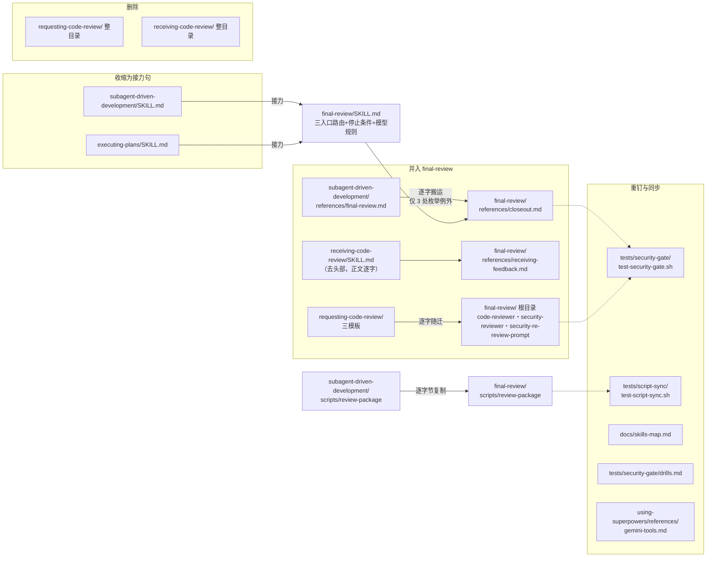

# 审查域合并为 final-review 技能 — 实施计划

## 元数据

- **目标：** 审查域收敛为单一 `final-review` 技能——整分支终审、安全门、收尾从两执行技能迁入；requesting-code-review 与 receiving-code-review 删除、内容并入；两执行技能以一句接力进入。完成后审查域单户，失效 1-5（漂移、分居、寄居、收尾分裂、零耦合维护面）全部消除。
- **架构：** 纯文档与结构测试重组，无运行时代码。新增一个审查域技能（主文件 + 收口规程参考文件 + 接收反馈纪律参考文件 + 三模板随迁 + 审查包脚本副本），删除两个技能目录，结构测试重钉、防漂移测试加一对。
- **技术栈：** Markdown 技能文案、mermaid 流程图、bash 结构测试。
- **设计文档（Spec）：** `docs/superpowers/specs/2026-11-02-requesting-code-review-skill-design.md`（需求方已拍板核心决策，随本计划一并确认细化项）。
- **实施前决策记录 + 日期：** 2026-11-02。执行方式由需求方选定（本计划推荐会话内执行）。

## 1. 改动地图

- **新增：** `skills/final-review/SKILL.md`；`skills/final-review/references/closeout.md`；`skills/final-review/references/receiving-feedback.md`；`skills/final-review/code-reviewer.md`、`security-reviewer.md`、`security-re-review-prompt.md`（三模板逐字随迁）；`skills/final-review/scripts/review-package`（逐字节副本）。
- **修改：** 上图 shrink 与 repin 内的七个既有文件。
- **删除：** `skills/requesting-code-review/` 整目录（三模板随迁后 SKILL.md 无留存价值）；`skills/receiving-code-review/` 整目录；`skills/subagent-driven-development/references/final-review.md`。
- **零改动（既有行为锁定）：** `task-reviewer-prompt.md`、`re-review-prompt.md`、两执行技能的任务循环节与预检、`scripts/review-package` 源文件、`hooks/`、codex 打包脚本、`brainstorming/` 与 `writing-plans/`、历史规格与计划文档。

## 2. 功能单元规格

### Task 1: 创建 final-review 技能（纯新增，不动既有文件）

**Files:**
- Create: `skills/final-review/SKILL.md`
- Create: `skills/final-review/references/closeout.md`
- Create: `skills/final-review/references/receiving-feedback.md`
- Create: `skills/final-review/code-reviewer.md`、`security-reviewer.md`、`security-re-review-prompt.md`
- Create: `skills/final-review/scripts/review-package`
- Test: 既有 security-gate、skill-size、script-sync 三项结构测试全程保持全绿（本任务不得使任何既有测试转红）

**Interfaces:**
- Produces（Task 2 消费的断言锚，逐字）：closeout.md 含 `### 安全门` 节名；`Final: security-gate: clean-pass:`；`Final: security-gate: minor (deferred):`；`Final: security-gate: self-review (no subagent tool)`；`` `[已修复] ` 前缀 ``；APPEND 句全文「安全门的全部行（clean-pass、裁决、minor deferred、self-review）收进你最终消息的 Security gate 小节，其中裁决行同时进 Rulings I made。」；`Final: security-gate: finding (<severity>): <one-liner>`；`不存在第二轮安全修复`；结尾句 `使用 superpowers:finishing-a-development-branch。`
- Produces：三模板与 `requesting-code-review/` 下同名文件逐字节一致（cmp 判定）。
- Produces：receiving-feedback.md 为 receiving-code-review/SKILL.md 去除 frontmatter 头部后的正文逐字（含原一级标题「接收代码审查反馈」）。
- Produces：frontmatter `name: final-review`；description 覆盖三族触发（收官把关——全部任务完成后；临时审查——完成任务/重大功能/合并前；反馈接收——收到审查反馈实施建议前）。
- Produces：主文件含停止条件四件事（语义与 `subagent-driven-development/SKILL.md:20` 一致）与 Model Selection 节（含「限定范围重审用最低档到中档」规则与「显式指定模型」警句）——closeout.md 中「见 SKILL.md 的 Model Selection（模型选择）」「能让正在运行的计划停下的那四件事（SKILL.md 顶部）」「按 Model Selection 显式指定模型」三处泛指句逐字保留，解析目标即本主文件。

**边界条件：**
- 搬运纪律：closeout.md 以 `git show HEAD:skills/subagent-driven-development/references/final-review.md` 为底本逐字搬运，diff 仅允许 3 处枚举例外区：
  - ❌ 「diff 里有别的差异顺手润色」 / ✅ 「逐行对照，非枚举区零差异」
  1. 首段身份句：`superpowers:subagent-driven-development 的一部分` → `superpowers:final-review 的一部分`
  2. 集中修复段新增双形态句（有子代理工具派单个修复子代理；没有则亲自修复并记台账自查标记）——措辞执行者起草，过微测定稿
  3. 限定复审段新增双形态句（有则派发复审、无则亲自按模板复审）——同上
- 微测：两处双形态句各跑 RED/GREEN——RED 用切换前的派发单形态文本、GREEN 用新双形态文本，场景为「终审返回发现项且本环境没有子代理工具」；每臂至少 1 样本另备无指导对照，被标记命中逐一人工阅读；证据记台账。无子代理派发能力时降级为双文本对照核验并记 `Ruling: 微测降级`。
- 入口路由：主文件须使收官流程仅由「全部任务完成后」语境进入；临时审查请求与反馈接收不得触发收口规程——❌ 「有人请审查一段代码就跑整分支终审」 / ✅ 「临时请求止于按模板派发」。
- 不得改变既有行为：`final-review.md`、`requesting-code-review/`、`receiving-code-review/` 在本任务期间保持原样（删除属 Task 2）；零改动清单内文件零字节变化。

**验收标准：**
- closeout.md 与底本 diff 除 3 处枚举区外零差异；receiving-feedback.md 与底本正文 diff 仅 frontmatter 头部；三模板 cmp 无输出。
- `bash skills/final-review/scripts/review-package` 无参数运行打印 usage 退出码 1（与源一致）；与源文件 cmp 无输出。
- description 以收官/临时/反馈三族触发词覆盖（grep 三族关键词各一命中）；name 为 `final-review`。
- 主文件含「限定范围重审用最低档到中档」与停止条件四件事（closeout 泛指句可解析的前置条件）。
- 新文件过 check-mermaid/check-tables；SKILL.md < 20000 字节。
- 既有三项结构测试全绿；微测证据在台账。

### Task 2: 原子切换（单提交）

**Files:**
- Modify: `skills/subagent-driven-development/SKILL.md`
- Modify: `skills/executing-plans/SKILL.md`
- Modify: `tests/security-gate/test-security-gate.sh`
- Modify: `tests/script-sync/test-script-sync.sh`
- Modify: `skills/using-superpowers/references/gemini-tools.md`
- Delete: `skills/requesting-code-review/`（整目录）、`skills/receiving-code-review/`（整目录）、`skills/subagent-driven-development/references/final-review.md`

**Interfaces:**
- Consumes: Task 1 全部断言锚、技能名、三模板新路径。
- Produces：两执行技能各含接力句（含 `superpowers:final-review` 与时机「全部任务完成后」；措辞执行者定稿，约束见边界条件）；test-security-gate.sh 的 `SR`/`RR` 变量改指 `skills/final-review/` 下同名模板、`SDD` 变量改指 closeout.md；script-sync 新增 `check_pair review-package skills/subagent-driven-development/scripts/review-package skills/final-review/scripts/review-package`；gemini-tools.md 适配行改为「引用 `superpowers:final-review` 的 `./code-reviewer.md`」。

**边界条件：**
- **单提交原子性：** 本任务全部改动一次提交；中间态不得单独成提交。
- 接力句约束：单句；含技能名与时机；不含规程复述——❌「接力后附台账行格式」 / ✅「只有一句」。
- test-security-gate.sh 重钉逐断言映射（沿用既有编号）：
  - `SR`/`RR` 变量：改指 `skills/final-review/security-reviewer.md`、`skills/final-review/security-re-review-prompt.md`（断言 1-4、7、8 文本不变，仅路径生效）。
  - `SDD` 变量：改指 `skills/final-review/references/closeout.md`。
  - 断言 5：`gate-authoritative-section` 改对 closeout.md 提取；`ep-gate-reference` **删除**，替换为 `ep-no-gate-rules`：EP 不含 `### 安全门`、`Final: security-gate:`、APPEND 句；`ep-gate-must-pass` 改查 closeout.md 含「所有分支必过」。
  - 断言 6：台账行与前缀句改查 closeout.md；`append-sentence` 与 `append-before-finishing` 仅对 closeout.md 检查——EP 对应句随「## 收尾」节删除。
  - 断言 6b：`gate-finding-ledger-line`、`gate-one-round-rule` 改查 closeout.md；其余不动。
- EP 改动点逐项：流程图 `branch_review`/`triage_and_fix`/`security_gate`/`sg_fix`/`cleanup` 五节点收缩为一个接力节点（承接绿色终点样式）；「## 终审」「### 安全门」「## 收尾」三节替换为「## 审查把关」一节含接力句；概览 L8/L10 与 L28 的「终审」表述改为接力表述（含义保留）；合理化借口表两行含「终审」者保留原文（角色指称仍成立）。
- SDD 改动点逐项：流程图 `final_review`/`cleanup` 两节点收缩为一个接力节点（保留绿色样式）；「## 终审」节替换为接力句；概览 L8 与核心原则 L12 改为接力表述；Model Selection 中「整分支终审就属于这一类……」句删除（规则已迁新技能）；L44 对比句保留原文。
- 引用清理：`grep -rn "requesting-code-review\|receiving-code-review" skills/ tests/` 改后零命中——`docs/skills-map.md` 的引用清理属 Task 3（其重做与本任务分离提交，中间态允许地图滞后一个提交）。
- 不得改变的既有行为：`../subagent-driven-development/scripts/sdd-workspace` 引用保留（EP 准备节，任务循环资产）；三模板与 re-review-prompt.md、task-reviewer-prompt.md 零字节变化；零改动清单内文件零字节变化；`docs/superpowers/` 历史文档不回改。

**验收标准：**
- 全部结构测试绿（security-gate 重钉后、script-sync 含新对、skill-size）。
- `grep -rn "requesting-code-review\|receiving-code-review" skills/ tests/` 零命中；旧规程路径 `grep -rn "references/final-review" skills/ tests/` 零命中（新技能目录名 final-review 的合法命中不受影响；`docs/skills-map.md` 的清零在 Task 3 验收）。
- `grep -n "Final: security-gate:" skills/executing-plans/SKILL.md skills/subagent-driven-development/SKILL.md` 零命中；两文件各含 `superpowers:final-review` 接力句（主文与流程图合计至少两处），不含 APPEND 句与台账行前缀。
- closeout.md 安全门节与删除前底本对应节逐字一致（3 处枚举区除外）。
- 单提交：`git show --stat HEAD` 覆盖本任务全部改动路径；被删目录在 git 中不复存在。

### Task 3: 外围同步与打包验证

**Files:**
- Modify: `docs/skills-map.md`
- Modify: `tests/security-gate/drills.md`

**Interfaces:**
- Consumes: Task 1/2 的技能名、模板新路径、接力结构。

**边界条件：**
- skills-map 流程图：`FR`/`SG` 节点收缩为一个 `final-review` 节点（含「整分支终审→安全门→收尾」摘要）；`RCR` 节点及其全部虚线边删除（接收纪律已由 final-review 承载，图上以 final-review 的入口路由标注覆盖）；`EP`/`SDD` 边改指 final-review 节点；finishing 链不变。
- skills-map 正文：两执行方式段落（约 L81-85）「整分支终审」表述改接力表述；requesting-code-review 与 receiving-code-review 的技能行与模板表行删除或改指（模板表中原指向 requesting-code-review 的行改指 final-review）；新增 final-review 技能行（同既有行粒度，注明三入口）。
- drills.md：「挂载段规则」「按挂载段规则」指称改为「final-review 的收口规程」；模板名 `security-reviewer.md` 不含路径、名称未变，不改；场景定义与执行记录不回改。
- 不得改变的既有行为：零改动清单内文件零字节变化；历史文档不回改。

**验收标准：**
- skills-map 中 grep `requesting-code-review` 与 `receiving-code-review` 零命中、`final-review` 有命中、`RCR` 节点零命中。
- 全部结构测试（security-gate、script-sync、skill-size）全绿。
- codex 打包产物含 final-review 全部文件（运行打包脚本或以发现机制检查输出为证据记台账）。

## 3. 设计依据

- 设计决策 1（域合并吸收两技能）→ Task 1 创建含三模板与接收纪律、Task 2 删除两目录。
- 设计决策 2（命名 final-review）→ frontmatter 与接力句技能名。
- 设计决策 3（三入口路由）→ Task 1 主文件入口路由边界条件与验收。
- 设计决策 4（收尾第三部分）→ closeout.md 含收尾节，随迁逐字。
- 设计决策 5（双形态贯穿）→ Task 1 例外 2/3 与微测——全计划唯一语义变更点。
- 设计决策 6（资产安置）→ 模板随迁、脚本副本+防漂移、两提示词留执行技能跨引。
- **为什么 Task 2 必须单提交，与「每提交皆绿」的调和**：重钉断言与文件位置耦合。Task 1 纯新增、旧世界未扰动、可独立提交且绿；Task 2 切换提交内新旧同时翻转，提交前重钉测试已全绿；Task 3 独立提交、绿。
- **指涉自足化为什么几乎零成本**：final-review.md 的「见 SKILL.md 的 Model Selection」「（SKILL.md 顶部）」「按 Model Selection 显式指定模型」均为泛指，final-review 主文件就位后逐字保留即解析正确——搬运例外面只有 3 处。

## 4. 约束

- 迁移原子性：Task 2 全部改动单提交。
- 逐字搬运纪律：三类随迁内容（收口规程、三模板、接收反馈纪律）零语义变更，例外区各自有界；双形态句须微测证据。
- 触发面：description 覆盖三族触发；收官流程不被临时请求触发（Task 1 入口路由验收）。
- 跨引不增：EP 对 `../subagent-driven-development/` 的引用从 3 处降至 1 处（sdd-workspace）；final-review 对 re-review-prompt.md 一处跨引（现状水平）。
- 历史不回改：`docs/superpowers/specs/`、`docs/superpowers/plans/` 既有文档一律不改。
- 执行技能模型选择、任务循环、预检；task-reviewer-prompt.md、re-review-prompt.md：零字节变化。

## 5. 风险清单

| 风险 | 触发条件 | 影响 | 缓解 |
|------|----------|------|------|
| 重钉断言锚漏改 | Task 2 不照映射清单改 | 假绿或假红，权威源失守 | 逐断言映射在边界条件点名；验收逐条核 |
| 双形态句弱化「缺工具只降级、不免除环节」 | 起草求简 | 会话内终审被静默跳过 | 微测场景专为无子代理环境设计；台账记 GREEN 证据 |
| 三入口互相误触发（收官流程被临时请求触发） | description 或路由措辞含混 | 一次临时请求跑出整分支终审 | Task 1 入口路由验收 + 构建者微测三场景 |
| 接收纪律正文搬运失真 | 去 frontmatter 时顺手改写 | 调优内容语义漂移 | 验收：与底本正文 diff 仅头部；逐行核对 |
| 引用清理漏文件 | 改动清单遗漏未点名文件 | 断链引用 | Task 2 验收全仓 grep 零命中；命中即扩改 |
| 微测无派发能力 | 会话内执行且 harness 无子代理工具 | 双形态句无 RED/GREEN 证据 | 降级为双文本对照核验，`Ruling: 微测降级` 记台账随收官移交 |
| 技能名与环节名混用 | 文档指称不统一 | 读者混淆技能与环节 | 指称纪律：环节称「整分支终审」、技能带 `superpowers:final-review` 全名；Task 2 验收含全名 grep |

## 执行交接

- 建议执行方式：会话内执行。理由：三个任务、切换任务强耦合且验收以机械比对为主（diff/cmp/grep）；每任务一个全新子代理的成本高于收益，一次最强档终审足以把关。
- 必需子技能：会话内执行用 `superpowers:executing-plans`；子代理驱动用 `superpowers:subagent-driven-development`（微测派发天然可用）。
- 请需求方审查：各任务的边界条件与验收标准是否忠实覆盖设计文档的功能清单与「明确不做」清单；特别是 Task 2 的逐断言映射、三入口路由约束与「不得改变的既有行为」清单。
- 明确确认后才进入实施；「嗯」「继续」不算明确确认。
- 实施开始后发现设计必须改：停止实施，回到设计确认门；返工还是回滚由需求方决定；已合入 main 的部分用新提交修正，不改写历史。

## 独立审读处置记录附录

**审读者**：自审（作者亲自按审读提示词三张清单执行；独立子代理审读沿用需求方既有选择——不派发）。本次无独立审读，由需求方在确认时知悉。

| # | 清单 | 问题 | 处置 |
|---|------|------|------|
| 1 | A 完备性 | Task 2 验收 grep 范围含 `docs/skills-map.md`，但地图重做排在 Task 3——Task 2 按自身验收永不过 | 已修：Task 2 grep 范围收窄为 `skills/ tests/`，skills-map 清零移至 Task 3 验收；边界条件注明中间态允许地图滞后一个提交 |
| 2 | C 实现效果 | 核对：设计功能清单 1-5 → Task 1/2/2/2/3 映射逐条有落点；「整分支终审」作为环节名在两执行技能保留原文处（如 SDD 任务循环 L159、合理化表两行）与新结构不冲突——环节术语保留原名是设计既定策略 | 无缺口，不改 |
| 3 | B 可读性 | 锚定核对：EP L8/L10/L28、SDD L8/L12/L44/L110、合理化表两行、gemini-tools.md L39、APPEND 句——全部引自本会话实读文件，无臆写 | 通过，不改 |

清单 A 其余核对：每任务五问齐备；「归需求方」堆为空（三入口路由措辞、接力句措辞已交构建者，属执行层）；约束可判定（diff 零差异、cmp、grep 命中数、字节数）。清单 C 判定：三任务按序执行后，设计文档成功判断标准 1-6 均有对应验收条款；无「单任务通过、组合失效」缺口（收口规程→主文件泛指解析链已在 Task 1 Interfaces 前置条件中钉住）。
