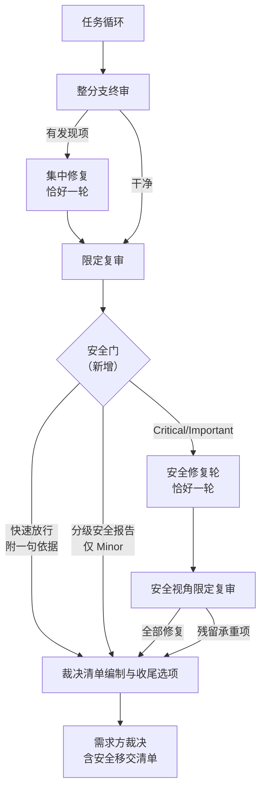

# 安全审查门 — 设计文档

> 读者假设：懂软件研发流程，不熟悉产生本文档的对话；不需要了解本仓库内部实现。

## 术语表

| 术语 | 含义 |
|------|------|
| 需求方 | 提出需求、做确认的人；分支的最终裁决者 |
| 控制者 | 走本工作流、逐任务推进计划的代理 |
| 任务循环 | 逐任务「实施 → 审查 → 修复」的执行阶段 |
| 整分支终审 | 全部任务完成后，由全新上下文的审查者对整个分支做的一次审查 |
| 集中修复 | 终审返回发现项后，恰好一轮、由单个修复者携带完整发现清单的修复 |
| 限定复审 | 只覆盖修复 diff 的复审：逐发现项判定是否修复、检查修复是否引入新问题 |
| 安全门 | 本文新增的专职安全审查关卡，位于收尾链路最后 |
| 快速放行 | 安全门审查者判定改动不触及任何安全面，附一句依据直接放行 |
| 承重 | 指发现项被后续工作依赖、或直接影响合并可行性；承重发现项不能默默搁置 |
| drill | 用预设场景驱动真实会话、对照验收标准检验技能行为的验证方式 |
| 台账 | 控制者维护的进度与裁决记录 |
| 审查包 | 供审查者一次读完的分支改动材料 |
| 最强档 | 当前可用的最高能力模型档位 |
| 熔断 | 修复轮次有硬上限、残留发现项移交而非无限循环的设计 |

## 实施前决策记录 + 日期：2026-11-01

方案方向（决策 1-3）已由需求方在对话中拍板；标注「提议」的决策 4-6 待需求方确认本文档时一并裁决。

## 流程位置图

安全门插在限定复审之后、最终裁决清单（Rulings）编制与工作区删除之前——安全门产生的裁决必须进入 Rulings 清单，修复轮产生的改动必须发生在工作区删除之前。

## 1. 背景与目标

- **解决什么问题**：走完工作流的分支，并入 main 前的把关链路是「整分支终审 → 一轮集中修复 → 限定复审」。安全在终审模板里只有一行泛泛检查（「有无安全问题？」），没有任何具体检查结构。失效方式：数据流类缺陷——不可信输入流向命令执行、SQL、路径拼接、反序列化等危险操作且无校验——不会被系统性发现；审查者清单枚举到哪就查到哪，一行泛泛检查只能换来泛泛的一眼。需求方要求：走完工作流的分支要尽量达到可并入 main 的标准，安全是这道标准里缺失的一块。
- **给谁用**：走本研发工作流的控制者，及其需求方（安全发现项与残留项的最终裁决者）。
- **成功判断标准**（可观察行为）：
  1. 预埋一个数据流缺陷（如拼接执行外部输入）的分支，安全门返回 Critical 级发现项并触发修复轮，不放行；
  2. 纯文档/测试改动的分支，安全门附一句依据快速放行，不产生发现项；
  3. 触发修复时，修复轮恰好一轮，残留发现项出现在需求方的移交清单里，不出现第二轮修复。

## 2. 功能清单

1. **安全门审查**：输入 = 整分支审查包 + 终审发现清单（含已修复项标记）+ 专职安全模板 → 控制者收到：分级安全报告（Critical / Important / Minor，每项附位置、问题、为什么可被利用、如何修），或附一句依据的快速放行判定。附终审发现清单是为了让安全门知道哪些问题已在先修复、聚焦剩余与新引入的面。
   - 本次不做：每任务审查中的安全检查（见 §3 第 7 条）。
2. **数据流导向的检查结构**：审查者按「不可信输入（用户输入、文件、网络、环境变量、LLM/工具输出）→ 危险汇（命令执行、SQL、路径拼接、URL 请求、反序列化、HTML 渲染）之间有无校验/参数化/转义」追踪，外加认证授权边界、密钥与依赖两项。
   - 本次不做：按漏洞类别（SQL 注入、XSS 等）的枚举清单（见 §3 第 1 条）。
3. **安全修复轮**：输入 = Critical/Important 安全发现项清单 → 控制者收到单个修复者的修复报告，含覆盖测试的命令与输出证据。
   - 本次不做：第二轮修复（见 §3 第 6 条）；逐发现项分派修复者。
4. **安全视角限定复审**：输入 = 安全修复 diff 审查包 + 原发现清单 → 控制者收到每项 addressed / not addressed 判定 + 修复引入的新安全问题；非安全观察记入台账，不阻塞。
   - 本次不做：对修复未触及代码的全分支重审。
5. **残留移交**：Minor、快速放行判定、熔断裁决、未修复的承重安全发现项 → 全部进台账 → 需求方通过两条既有渠道看到：控制者最终消息的裁决清单（Rulings），以及进入收尾选项前的呈现。不修改收尾技能自身的文案。
   - 本次不做：自动放弃合并的硬阻塞——是否带残留项合并由需求方裁决。
6. **无子代理环境降级**：输入 = 当前环境无子代理工具 → 控制者在本会话内按同一安全模板亲自自查，产出同构的分级报告或放行判定，修复与复审同样会话内完成。可用性与整分支终审的既有降级模式一致：有全新审查者则派发，没有则自查。
   - 本次不做：跳过安全门——门必过，缺工具只降级形态、不免除把关（依据 §3 第 3 条）。
7. **文档同步**：技能地图的主链路图与审查技能一览表更新 → 读者能看到安全门在流程中的位置与产出。
   - 本次不做：其他文档的连带改写。

## 3. 明确不做

1. **不按漏洞类别枚举检查项**。因为类别清单在非 Web 项目上大半是噪音、会被审查者跳过，在 Web 项目上又永远列不全；数据流检查一条覆盖整个注入家族，且天然领域无关。
2. **不封装平台内置的安全审查命令**。因为零依赖、跨 harness 是本插件的硬约束，内置命令只在单一 harness 提供，封装即破坏可移植性。
3. **不做按改动内容跳过整道门**。因为安全门是合并门槛的组成部分；提供跳过选项会让跳过成为常态。门必过：判据显示改动不触及任何安全面时才放行（成本豁免由门内快速放行承担）。
4. **不新增人工确认点**。因为本工作流的哲学是自主执行、结构化失败走现有停止条件；安全门的产出沿现有机制处置（修复轮自动进行、残留项在收尾时移交需求方）。
5. **不改通用审查模板的既有内容**。因为该模板携带经对抗性验证调优的句子，本次改动不触碰它、也不改写它的任何既有句子；终审顺带发现明显安全问题的事实兜底保留——终审在前、安全门在后，串行不冲突，早发现的问题照旧走集中修复。
6. **不做第二轮安全修复**。因为熔断哲学是修复轮次有硬上限；安全轮的破例必须像终审集中修复一样有界，残留移交而非循环。
7. **不给每任务审查加安全检查项**。因为任务审查是单任务规格闸门，数据流缺陷常跨任务才显形，任务粒度查不出也不该查；发现时机后置由安全门统一承担。

## 4. 关键决策记录

### 决策 1：挂载位置——收尾链路最后（需求方已拍板）

- 候选：① 终审收尾后设专职安全门；② 安全审查与终审同期、共用集中修复；③ 不设专职门，在终审模板内加一个结构化的安全章节。
- 选 ①。依据：把关对象必须是「最终并入状态」——安全审查若在修复前进行，审查的是即将被改动前的代码，把关落空；修复引入的新安全问题也无人以安全视角复查。
- 排除 ②：同上，时序上无法审查最终状态。
- 排除 ③：终审模板的调优结构为双层基准（意图/规格）设计，塞入专职安全深查会稀释其判断力；改它又违反 §3 第 5 条的不触碰约束；且它仍在修复前，把关不了最终状态。它比 ① 便宜（省一次派发），但便宜正是以三项缺陷为代价——这三项是本设计要解决的问题本身。
- 代价：最坏路径多两个子代理（安全修复者 + 安全复审）的串行成本；多数分支安全审查干净，常态只多一个。

### 决策 2：实现形态——自建专职模板（需求方已拍板）

- 候选：① 自建安全审查模板，与通用审查模板并列、两种执行方式共用；② 封装单一平台内置的安全审查命令。
- 选 ①。依据：零依赖、跨 harness；内置命令仅单一 harness 提供。
- 代价：模板开发与验证成本；单一平台用户少一个「直接复用现成命令」的捷径。

### 决策 3：触发范围——所有分支一律过门，门内快速放行（需求方已拍板）

- 候选：① 一律派发 + 审查者可附依据快速放行；② 按改动内容条件跳过整道门。
- 选 ①。依据：门槛属性——跳过选项会让跳过成为常态；把成本豁免交给门内的可判定出口。放行判据与 §2 第 2 条的检查结构同源：改动不触及外部输入处理（含环境变量、文件读取）、认证授权、密钥/依赖、外部通信、LLM 输入/输出处理时放行。
- 代价：纯文档分支也消耗一次子代理派发；判据扫描范围小（单次判定），但派发档位不因放行而降低（见决策 6）。

### 决策 4：通用审查模板去留——不动（提议）

- 候选：① 保持现状；② 删去「有无安全问题？」一行。
- 选 ①。依据：该模板携带调优句子，改动需 eval 证据；终审顺带发现安全问题的事实兜底保留，早发现走集中修复更便宜；串行结构下与专职门无职责冲突。
- 代价：安全相关措辞存在于两处（终审模板一行事实兜底 + 安全门专职结构），需在安全门模板中写明分工边界，防止审查者越界。

### 决策 5：修复处置——专用有界安全修复轮（提议）

- 候选：① Critical/Important 触发恰好一轮安全修复 + 一次安全视角限定复审；② 全部移交需求方不自动修复；③ 并入终审集中修复（不可行——集中修复在安全门之前已收尾，时序上不可能）。
- 选 ①。依据：需求方目的是「尽量达到可并入标准」，自动修复比纯移交更接近该目标；熔断破例有界（仅安全项、仅一轮），残留照旧移交。
- 代价：触发时流程更长；「恰好一轮」的上限写死，不允许以「快修完了」为由续轮。

### 决策 6：安全门角色档位——审查者与复审者最强档（提议）

- 候选：① 审查者与复审者一律最强档；② 分档——放行判定用低档、发现审查用最强档（需控制者先预判分支是否触及安全面）。
- 选 ①。依据：排除 ② 的理由——预判本身要读全分支 diff 才能可信，等于把门内判定搬到门外由控制者重做一遍，控制者上下文因此变重；而「低档误判不触及安全面」正是风险 1 的通道。门只开一次，一律最强档，行为最可预测。
- 角色分派：安全审查者与安全复审者是判断型任务，用最强档（与终审同级）；安全修复者跟随终审集中修复者的既有惯例，不单独定档。
- 代价：常态成本多一次最强档派发；快速放行分支同样按最强档计。

### 留给构建者的部分

- 安全模板的章节结构与措辞——走技能编写流程开发，附对抗性验证证据；边界写明：非安全发现项不展开、不阻塞，记入移交。
- 快速放行判据的最终清单措辞——需可判真伪，放行必须附一句依据且记入台账。判据按「面」组织、检查结构按「源」组织（§2 第 2 条），两者粒度不同：最终措辞须显式写明全部源条目归入哪个面，不留靠推断的对应。
- 两种执行方式文件的挂载措辞——需逐字对齐，防止安全门在一种方式中缺失。
- 安全复审模板——为安全门独立定制，不得沿用通用复审文案中「后续还会进行整分支终审」一类在本位置为假的句子。
- 台账行格式——安全门的放行判定、发现项、熔断裁决各用一行可检索格式，具体措辞由构建者定。
- drill 场景的具体设计与落点——至少覆盖 §1 成功标准的三种情形，外加「应当触发却放行」的反向场景；落点（外部 eval 仓库或本仓库测试）由计划按哪种能驱动真实会话来定，验证证据须随新机制交付。

## 5. 关键约束与可行性风险

- **零依赖、跨 harness**：安全门不引用任何单一平台专有能力、不引入外部依赖；有子代理工具时由通用子代理机制实现，无子代理时降级为会话内自查（§2 第 6 条），两种形态均满足本条。
- **行为塑形内容需验证证据**：本仓库贡献规则要求技能行为改动附对抗性验证证据；新机制不带 drill 证据不得合入。
- **成本量级**：常态（放行或干净）+1 次最强档子代理；触发修复 +2 次；无子代理环境为会话内自查，代价是控制者上下文变重（与终审既有降级模式相同）。主要成本来源是新增审查者本身。
- **风险 1：快速放行判据过宽** → 门形同虚设。缓解：判据与检查结构同源（§3 第 3 条），写成可判真伪的封闭清单，drill 必须含「应当触发却放行」的反向场景。
- **风险 2：两种执行方式挂载措辞不同步** → 安全门在一种方式中被静默跳过。缓解：计划中含逐字对齐检查项；无子代理环境的降级路径（§2 第 6 条）堵住「派不出就跳过」的失效方式。
- **风险 3：与终审发现项的重复报告** → 同一安全问题终审与安全门各报一次，修复者收到重复清单。缓解：安全门的输入规格含终审发现清单（含已修复项标记，§2 第 1 条），审查者据此跳过已修复项、聚焦剩余与新引入的问题。

## 附录：独立审读处置记录

**审读者**：全新通用子代理，未参与写作。输出三张清单：完备性（A）、可读性（B）、方案合理性（C）。逐条处置如下。

**清单 A（完备性）**

| # | 问题 | 处置 |
|---|------|------|
| A1 | 无子代理模式下门的存在形态未定义 | 已处置（作者决定）：新增 §2 第 6 条——跟随终审既有降级模式，会话内按同一模板自查，不跳过 |
| A2 | 移交清单进入收尾选项的兑现机制未定，改收尾技能需 eval 证据 | 已处置（已有答案）：沿用仓库现有机制——终审残留项本就经控制者消息与收尾前呈现传达；§2 第 5 条写明两条渠道，不改收尾技能文案 |
| A3 | 门输入规格缺终审发现清单，风险 3 缓解失效 | 已处置：§2 第 1 条输入补终审发现清单（含已修复项标记），风险 3 缓解重写 |
| A4 | drill 场景落点未定，功能清单无此交付物 | 已处置（作者决定）：留给构建者写明落点由计划定、证据须随新机制交付 |
| A5 | 门相对 Rulings 编制/工作区删除的挂载点未写明 | 已处置：流程位置图下方写明插在限定复审之后、两者之前 |
| A6 | 沿用通用复审文案在本位置为假 | 已处置：留给构建者——安全复审模板独立定制，禁用该类句子 |
| A7 | 修复者与复审者档位未定 | 已处置（作者决定）：决策 6 补角色分派——复审者最强档，修复者跟随集中修复既有惯例 |
| A8 | 台账行格式未定义 | 已处置（作者决定）：留给构建者定措辞，须为可检索格式 |
| — | 已有答案 8 项 | 经作者复核，均与仓库事实相符，无需改稿 |

**清单 C（方案合理性）**

| # | 问题 | 处置 |
|---|------|------|
| C1 | 决策 1 漏掉「终审模板内加结构化安全章节」候选 | 已处置：补为候选 ③ 并写明排除依据（稀释双层基准、违反不触碰约束、把关不了最终状态） |
| C2 | 决策 6 漏掉分档变体，快速放行按最强档未论证 | 已处置：补为候选 ② 并写明排除依据（预判等于门外重做门内判定、低档误判是风险 1 通道） |

**清单 B（可读性）**

| # | 问题 | 处置 |
|---|------|------|
| B1 | §3 第 3 条「判据不合才放行」极性与决策 3 相反 | 已处置：改为「判据显示不触及任何安全面时才放行」 |
| B2 | 放行判据与 §2 检查结构的源清单不一致；「LLM 内容生成」未定义失效方式 | 已处置：两处统一为同一清单，「LLM 内容生成」改为「LLM 输入/输出处理」 |
| B3 | 风险 3 缓解推理跳步 | 已处置：缓解改基于 A3 修复后的输入规格，跳步消除 |
| B4 | 术语表缺「承重」「drill」 | 已处置：两条已入术语表 |
| B5 | 「移动而不改写」为不存在的引文 | 已处置：改为不加引号的转述（§3 第 5 条） |
| B6 | 决策 3「轻量判定」与决策 6 档位表面冲突 | 已处置：决策 3 改为「判据扫描范围小（单次判定）」并显式指向决策 6 |
| B7 | 「秘钥」应为「密钥」 | 已处置：全文替换 |
| B8 | 固定块体例不一（粗体段落 vs H2） | 已处置：术语表、实施前决策记录统一为 H2 固定块 |
| B9 | 流程图 B→C 无条件边暗示修复必然发生 | 已处置：改为「有发现项/干净」条件边 |

**复读（第二回合，同一子代理）**

13 项处置核对全部通过。复读新发现 3 处，处置如下：

| # | 问题 | 处置 |
|---|------|------|
| R1 | §5 零依赖约束「只能由通用子代理机制实现」与 §2 第 6 条会话内自查字面矛盾 | 已处置：约束改写为「不引用平台专有能力、不引入外部依赖」，两种形态均满足本条 |
| R2 | §2 源清单与决策 3 判据清单残差（「工具输出」在判据中无对应面） | 已处置（记入构建者边界）：留给构建者的判据条目补收敛要求——最终措辞须显式写明全部源条目归入哪个面 |
| R3 | §2 第 6 条指针指向 §3 第 3 条不精确 | 已处置：改为「门必过，缺工具只降级形态、不免除把关」的独立表述 |

复读总判定为「修掉 R1 后即可提交需求方确认」；R1 已修，本文档现已提交需求方。
