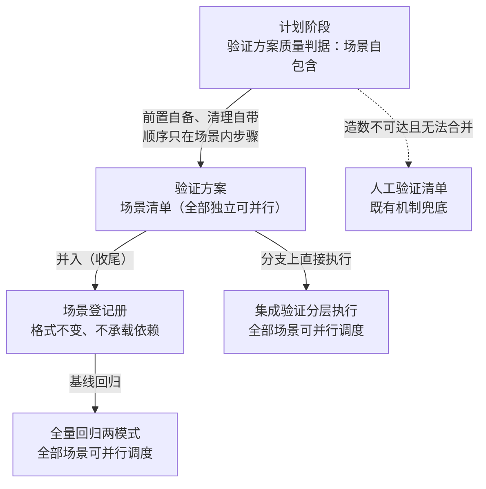

# 设计文档：验证场景自包含——场景间零依赖、并行调度无标注前提

> 读者假设：懂软件工程，不熟悉产生本文档的对话；不需要了解项目内部实现。
>
> 本文档回答：做什么、不做什么、为什么这样取舍、成本量级与主要风险。实现细节留给计划。

**实施前决策记录 + 日期：2026-11-04。设计文档需求方确认：2026-11-05。需求方裁决（多轮对话，2026-11-04）：** (1) 方案 A 定案——场景自包含为硬判据、场景间零依赖、执行端默认并行；「场景间依赖链」概念整体取消，判据名目「顺序依赖显式化」改为「场景自包含」（作者推荐、需求方拍板）；(2) 登记册不承载依赖信息、条目格式不变（2026-11-04 裁决，早于方案拍板）；(3) 跨场景承接以既有机制三条出路消化——造数自备前置 / 合并为路径级场景 / 人工验证清单兜底，不新增链声明机制（作者提议、需求方同意）；(4) 消费端并行语义改为「全部自动化场景默认并行，场景内步骤按序」，不再以任何标注为并行前提；(5) 容量类独占资源属环境属性——由环境声明的「环境要求」槽位承载并发容量声明，执行端按声明容量排队（同池串行、跨池并行），场景判据保持纯自包含；**容量统一默认值为 1**——未声明容量的资源池串行执行（作者建议采纳，需求方附加默认值裁决）；(6) 验收判定 = 断言电池全绿 + 回潮断言红绿有效；真实链路观察不作为本需求验收项，作为下一次需求集成验证的固有观察点（独立审读 A8 呈报，作者建议采纳）。

**术语表**

| 术语 | 含义 |
|------|------|
| 需求方 | 提出需求、做确认的人 |
| 最终用户 | 执行本工作流的编码代理——计划阶段产出验证方案的、执行集成验证与回归的 |
| 验证场景 | 验证方案（需求级 verification.md）场景清单中的一条：前置、操作步骤、期望结果、清理 |
| 自包含 | 场景级判据：前置写明搭建方式或数据来源、清理自带、独立可运行、并行安全；顺序编排只存在于场景内操作步骤 |
| 并行安全 | 自包含的组成要素：不依赖固定端口、固定容器名、共享临时路径等全局资源标识——资源标识层面与任何其他场景并发执行互不干扰；资源容量约束不属此要素，容量由环境声明承载（见「容量池」行） |
| 容量池 | 环境声明中一个资源池的并发容量单位（如容器池并发=4、真机池并发=1）：执行端同池内排队串行、跨池并行；未声明的资源池默认容量 1（2026-11-04 需求方裁决） |
| 路径级场景 | 行为目标为一条关键路径走通的场景——多段操作步骤串在一个场景内，各段断言进期望 |
| 人工验证清单 | 验证方案中写不出确定性步骤的场景条目，汇总呈现由需求方人工执行，不进自动化门禁（既有机制） |
| 形态路由参考 | 集成验证技能按项目形态加载的参考文件：后端 / Web / App 三份 |
| 登记册 | 项目级验证场景登记文件集（模块登记册 + 跨模块登记册），回归技能的输入 |
| 十项名目 | 验证方案质量判据：四性（出处锚定、双向映射、粒度判据、可操作性判据）+ 六项内容要求（本需求改动其中一项的名目） |
| 回潮断言 | 拦截已删除表述重新出现的机械断言 |

## 1. 背景与目标

- **解决什么问题：** 两个具体失效，同根同源——
  1. **并行静默退化为全串行。** 集成验证与全量回归的执行规则都以「标注可并行的可并行」为并行前提，但这条规则的口径定义（「无依赖的标注可并行」）只存在于执行期才加载的形态路由参考——计划阶段产出验证方案的代理读不到它们，验证方案的质量判据里只有「顺序依赖显式化」七个字、无任何格式定义。结果是场景普遍无标注，执行端按「标了才并行」读法把全部场景串行跑完。需求方在集成验证与全量回归中实际观察到并行不发生，此为本次需求的直接动因。
  2. **消费端语义歧义。** 「标注可并行的可并行」存在两种读法：「无依赖即视为可并行」与「标注了的才并行」。歧义使并行能力依赖计划者的措辞运气，而非机械可判的判据。
- **给谁用：** 最终用户是执行本工作流的编码代理——计划阶段按明确判据产出可并行的验证方案，执行阶段无需解读标注即默认并行；需求方是仓库维护者——验证吞吐随场景数提升，判据在方案、登记册、回归三处一致且机械可查。
- **成功判断标准：** 四条可观察行为——
  1. 计划阶段产出的验证方案中，每个自动化场景前置写明搭建方式或数据来源、清理自带、无跨场景承接；顺序编排只出现在场景内操作步骤（❌「场景 B 前置：先跑场景 A」/ ✅「场景 B 前置：按数据来源 X 造数搭建」）。
  2. 执行端（集成验证分层执行、回归两模式）不再以任何场景标注为并行前提——全部自动化场景均可并行调度；实际并发度由环境声明容量池控制（未声明默认 1，串行）；场景内操作步骤按序执行。
  3. 旧表述（「顺序依赖显式化」「标注可并行」「顺序依赖链」）在技能文档与断言电池范围内零残留（归档规格对旧句的原样引用属合法自引用，不在断言范围，与 §2.4、§2.5 同口径）；判据名目「场景自包含」在全部引用点措辞一致。
  4. 既有文档一致性断言全绿，新增回潮断言红绿有效。

## 2. 功能清单

三端关系一图总览（判据单一来源，方案是载体，执行端消费语义而非标注）：

### 2.1 生产端判据替换（writing-plans）

- **定位：** 验证方案质量判据中「顺序依赖显式化」名目替换为「场景自包含」，并给出可判真伪的定义。
- **触发与输入：** 触发——writing-plans 产出验证方案、执行验证方案专项自查的时刻；输入——设计文档与验证方案草稿。
- **执行要点：**
  1. 判据名目「顺序依赖显式化」改为「场景自包含」，进入内容要求六项名目与逐场景自查。
  2. 判据定义（可判真伪，逐场景核对）：前置写明搭建方式或数据来源；清理自带；独立可运行；并行安全（无全局资源标识依赖）；顺序编排只存在于场景内操作步骤。
  3. 跨场景承接两条出路，按序尝试：先造数自备前置（优先，保真度声明判据约束造数与真实路径的等价边界）；造数不可达 → 合并为路径级场景（承接行为就是关键路径的段）。
  4. 仍不可达 → 人工验证清单（既有机制，不伪装自动化）——自包含判据在自动化门禁内无例外。
  5. ❌「以声明依赖链的方式保留跨场景承接」　✅「承接需求消化为造数前置、路径级场景或人工清单三出路之一」
- **出口表：** 单一出口——判据随内容要求六项落进验证方案写作要求与自查清单。
- **本次不做：** 见 §3 第 3 条。

### 2.2 消费端并行语义（集成验证分层执行 + 回归两模式）

- **定位：** 执行端从「标注驱动并行」改为「无标注前提的可并行调度 + 容量池控制并发度 + 场景内按序」，消解歧义读法。
- **触发与输入：** 触发——集成验证 Step 2 分层执行、回归基线模式全量重跑、回归 feature 分支模式双源执行的时刻；输入——验证方案或登记册的全部自动化场景。
- **执行要点：**
  1. 两处执行规则条目改写为同一语义：全部自动化场景可并行调度，不再存在「标注可并行」前提；场景内操作步骤按序执行。
  2. 「一遍跑完、互相不阻断」语义原样保留——并行不改变失败集中呈现与逐项定性的既有裁决链路。
  3. 并行手段由执行端按所在 harness 能力选择（并发调用、并行子代理等）——本设计只定行为要求，不定手段。实际并发度按环境声明的容量池执行：同池内排队串行、跨池并行；未声明的资源池默认容量 1（2026-11-04 需求方裁决「统一默认值为1」）——并发度是项目显式声明升上去的，不是静默放开；所在环境无并行能力时按串行执行，并在结果中标注串行原因（与既有环境受限降级同一呈现模式）。
  4. 执行中发现场景无法独立运行（跨场景承接）→ 按既有缺口机制处理：发现缺口不代写、不修改方案，缺口事实随本次结果一并呈现——发现驱动，不对场景做逐场景自包含预检（预检由计划阶段自查承担，执行端重复预检无新增信息）。
- **出口表：** 单一出口——执行规则条目语义替换，既有出口结构（全绿 / 集中呈现 / 定性裁决）不变。
- **本次不做：** 见 §3 第 4、5 条。

### 2.3 形态路由参考口径同步（三份）

- **定位：** 口径定义的现居地——三份形态参考资产化标准中的「顺序依赖显式化」条目替换为「场景自包含」条目。
- **触发与输入：** 触发——形态路由参考加载前的一致性维护（本次为一次性文案替换）；输入——§2.1 判据定义。
- **执行要点：**
  1. 后端 / Web / App 三份参考的资产化标准条目统一替换，定义与 §2.1 一致（同一句话三处出现，措辞以一处定稿为准同步）。
  2. 并行安全进入资产化标准逐条核对范围——独立容器实例、无固定端口与共享临时路径，成为进门禁资产的核对项。
- **出口表：** 单一出口——三处条目措辞一致。
- **本次不做：** 见 §3 第 5 条。

### 2.4 十项名目一致性（集成验证核对 + writing-plans 自审）

- **定位：** 「十项由计划阶段的 writing-plans 保证」这一契约的两处名目引用同步，契约不破。
- **触发与输入：** 触发——集成验证 Step 2 对照方案质量判据核对、writing-plans 验证方案专项自查的时刻；输入——替换后的名目。
- **执行要点：**
  1. 集成验证 Step 2 核对的十项名目、writing-plans 自审专项的六项名目，「顺序依赖显式化」均替换为「场景自包含」。
  2. 替换后机械核对：旧名目在技能文档与断言电池范围内零残留（与 §2.5 同口径），新名目在全部引用点同形。
- **出口表：** 单一出口——两处名目与 §2.1 完全一致。
- **本次不做：** 无。

### 2.5 文档一致性断言更新与回潮断言

- **定位：** 既有断言电池随文案更新，旧表述上回潮断言，防判据回退。
- **触发与输入：** 触发——本需求文案改动提交时；输入——替换前后的技能文案。
- **执行要点：**
  1. 既有文档一致性断言中涉及「顺序依赖」「标注可并行」的条目更新为新判据断言。
  2. 新增回潮断言：「顺序依赖显式化」「标注可并行」「顺序依赖链」三串在技能文档全库零出现（断言串清单为三串系作者决定——被取消概念「场景间依赖链」的旧执行规则句以「顺序依赖链」承载，仅断言前两串拦不住其不含「标注可并行」的变体回潮）。
  3. 断言先红后绿验证——先在旧文案上确认新断言确实能红，再随改动转绿。
- **出口表：** 单一出口——断言电池全绿。
- **本次不做：** 见 §3 第 6 条。

## 3. 明确不做

1. **登记册条目格式不变更。** 因为场景间零依赖（2026-11-04 需求方裁决），登记册没有依赖信息可承载——加依赖字段是为已取消的概念保留载体。
2. **收尾并入逻辑不变更。** 因为并入对象（场景条目）不含依赖信息，并入机制无需任何适配。
3. **不新增链声明语法或依赖编排机制。** 因为跨场景承接由三条既有机制出路消化（造数前置、路径级场景、人工清单），新机制为少数派场景引入贯穿三个技能的复杂度，且留下基线回归静默破坏链的隐患。
4. **不定义具体并行执行手段。** 因为手段属所在 harness 能力（并发调用、并行子代理等），行为要求已足以驱动执行端并行——写死手段会把技能绑死在单一 harness；容量池并发度声明属环境声明语义（见裁决 5 与术语表），不属此条所指的执行手段。
5. **环境声明文件结构不变更。** 因为环境声明（各层一行怎么跑：入口命令、环境要求）的既有结构足以承载新语义——并发容量声明由「环境要求」槽位的语义细化承载（容量池见术语表），不新增槽位、不改行格式；场景并行安全由判据约束，环境声明只承载容量。
6. **不改任务并行技能（dispatching-parallel-agents）。** 因为它并行的是实施任务，与验证场景并行正交；其描述里的「顺序依赖」一词属任务分解语境，非验证场景语境。
7. **单测层（全量测试套件）不变更。** 因为单测套件的执行方式由项目自身测试框架决定，本需求只覆盖验证场景层。
8. **不做存量登记册场景的一次性并行安全核对。** 因为既有失败处置链路（每失败自动重跑一次 → 偶发记台账 / 稳定失败集中呈现归因定性）足以暴露并处置并行资源冲突——存量场景并行执行暴露的稳定失败按既有归因链路处置，初步归因给理由时把场景资产的并行安全缺陷（资源标识冲突、容量争用）纳入「方案期望不符」一侧的考察范围（既有归因格式为封闭二值枚举，不新增枚举值，理由为自由文本承载）；一次性核对的成本高于首跑暴露加既有链路处置。

## 4. 关键决策记录

| 决策 | 一句话结论 | 拍板状态 | 影响功能项 |
|------|-----------|---------|-----------|
| D1 并行模型 | 场景自包含硬判据、场景间零依赖（方案 A），而非链兜底（方案 B） | 需求方拍板（2026-11-04） | §2.1–2.4 |
| D2 判据名目 | 「顺序依赖显式化」改名「场景自包含」 | 需求方拍板（2026-11-04，随 D1） | §2.1、§2.3、§2.4 |
| D3 承接出路 | 三出路全用既有机制，不新增链机制 | 需求方同意（2026-11-04，随 D1） | §2.1 |
| D4 消费端语义 | 并行调度无标注前提，并发度由容量池控制 | 需求方拍板（2026-11-04，随 D1；容量细化见裁决 5） | §2.2 |
| D5 登记册承载 | 登记册不承载依赖信息、格式不变 | 需求方拍板（2026-11-04，早于 D1） | §3 第 1、2 条 |

### D1 并行模型：自包含硬判据（方案 A）vs 链兜底（方案 B）

1. **候选方案：** A——场景自包含为硬判据，自动化门禁内无例外；B——默认自包含，确实无法自备前置的场景显式声明依赖链、执行端按链串行（本设计上一轮对话的共识，后因新事实修订）。
2. **选了哪个：** A，需求方拍板。
3. **依据：** B 存在登记册承载缺口——链场景经收尾并入登记册后，五字段条目无依赖位，基线模式回归按登记册执行时不知道链的存在，并行执行破坏链；B 的出路（登记册加字段 / 链组打包资产 / 链场景不入册）三者为少数派场景分别改动登记册约定、收尾并入与回归三处机制，且都不干净。A 让「场景自包含」在方案、登记册、回归三处成为同一判据、机械可查、无例外，自动化场景 100% 可并行；B 永远有链场景串行且基线侧链静默失效。
4. **代价或风险：** 极少数造数不可达且无法合并的场景（如强加密签名状态）进人工验证清单，自动化覆盖让渡——有意为之，由既有机制承接；承接类场景造数前置与真实状态的保真度差，由既有保真度声明判据约束（见 §5 风险 3）。成本量级：改动全部为技能文案与断言，无运行时组件，成本以文案一致性核对为主。

### D2 判据名目改名

1. **候选方案：** 改名「场景自包含」；保留旧名目「顺序依赖显式化」重新定义。
2. **选了哪个：** 改名。
3. **依据：** 旧名目暗示「声明依赖」是合法路径，与新语义（依赖即缺口）相悖，保留名目会持续误导计划者；新名目与判据内容同形，机械可查。
4. **代价或风险：** 全库 8 处引用点需同步，遗漏造成两端口径不一致——由 §2.5 回潮断言与机械核对兜底。成本量级：一次性文案替换加断言同步，主要成本来源是引用点机械核对，无持续成本。

### D3 承接出路：三出路全用既有机制

1. **候选方案：** 三出路（造数自备 / 合并路径级场景 / 人工清单）；新增链声明机制作为第四出路。
2. **选了哪个：** 三出路，无第四。
3. **依据：** 绝大多数前置状态可造数到达（粒度判据已有「前置写明搭建方式或数据来源」的地基）；承接行为本身是验证对象时，它就是关键路径的一段，路径级场景是端到端层的自然粒度；真正造数不可达的极少数走人工清单——三条出路覆盖 B 想解决的问题，不引入新机制。
4. **代价或风险：** 见 D1 代价条。

### D4 消费端语义：并行调度无标注前提

1. **候选方案：** 全部场景可并行调度、无标注前提；保留标注驱动但给未标注场景补默认并行语义。
2. **选了哪个：** 无标注前提，并发度由容量池控制（未声明默认 1）。
3. **依据：** 标注驱动的静默串行退化正是本需求的根因（§1 失效 1）——凡依赖计划者标注的模型都重演同一失效；无标注前提使可并行性成为场景判据保证的固有属性，并发度成为项目显式声明的环境属性（裁决 5），两者各归其位。
4. **代价或风险：** 并行放大资源竞争——两层缓解：命名冲突类由判据「并行安全」要素在门禁入口拦截；容量类由环境声明容量池承接（2026-11-04 需求方裁决「容量属环境属性」，默认容量 1），场景判据保持纯自包含，无整类场景让渡进人工清单（见 §5 风险 1）。成本量级：判据与方案侧无新增机制，主要机制成本为容量池调度语义（新术语、排队行为、默认值规则）与环境声明的容量语义细化，加资产化标准新增核对项（§2.3）。

### D5 登记册不承载依赖

1. **候选方案：** 登记册不承载；登记册加依赖字段。
2. **选了哪个：** 不承载，格式不变。
3. **依据：** D1 选定后场景间零依赖，登记册没有信息可承载；D5 早于 D1 裁决，D1 的选定反过来印证了 D5——两个裁决自洽。
4. **代价或风险：** 无——零依赖下此决策无牺牲，无成本产生。

#### 留给构建者的部分

1. **三份形态参考的条目措辞：** 「场景自包含」条目以一处定稿为准、三处机械同步——委托理由：同一句话三处出现，逐处独立措辞反而引入漂移风险；构建者定稿一句、同步两处。
2. **消费端两处执行规则的行文：** 语义已定（全部场景可并行调度 + 容量池控制并发度——同池内排队串行、跨池并行、未声明默认容量 1 + 场景内操作步骤按序 + 一遍跑完互相不阻断保留），具体行文由构建者在「与该文件既有执行规则同句式」约束下定稿——委托理由：两份文件的执行规则各有既有句式，贴合各自文风比强求逐字一致更可读。
3. **「并行安全」要素的最终措辞：** 设计已给要素清单（无固定端口、固定容器名、共享临时路径等全局资源标识），最终措辞由构建者按资产化标准的既有条目句式定——委托理由：判据要素已穷举，措辞贴合上下文即可。
4. **生产端判据定义的落点槽位：** 判据定义写入验证方案模板的哪一句位（写作要求句还是逐场景自查句，与既有「前置写明搭建方式或数据来源」短语并存还是合并），由构建者按模板段既有结构定——委托理由：判据五要素已定，落点是排版决策；既有短语与判据第一要素语义重合，合并与否只影响行文密度，不影响判据内容。
5. **容量池声明语法与同池判定依据：** 环境声明中容量池怎么写（池名显式声明还是按层归属推导）、执行端依据什么判两场景同池，由构建者定——委托理由：默认容量 1 兜底使漏声明的失败方向偏向安全（过度串行），语法选择不改变判据与裁决；边界：同池判定必须机械可查（字符串精确匹配级），声明后的误判方向（同池读成异池）恰是 §5 风险 1 要拦的资源竞争。

## 5. 关键约束与可行性风险

- **约束：**
  1. **技能改动需要评估证据（仓库贡献规则）。** 技能是行为塑形内容，修改须附真实问题陈述与 before/after 依据——本次问题陈述来自需求方在集成验证与回归中的真实观察（§1 失效 1），非臆测修复。验收判定 = 断言电池全绿 + 回潮断言红绿有效（2026-11-04 需求方裁决）；真实链路观察不作为本需求验收项，作为下一次需求集成验证的固有观察点——新执行规则在下一次链路中必然被执行，届时并行是否实际发生随该次结果自然可见。
  2. **文档一致性断言是改动门禁。** 技能文案改动必须同步断言电池，否则测试红——§2.5 是改动的一部分而非可选项。
  3. **「十项由 writing-plans 保证」是跨技能契约。** 名目替换必须两端口一次性完成（§2.4），单端先行会让核对契约短暂失配。
- **可行性风险：**
  1. **并行执行放大资源竞争。** 触发条件——场景资产依赖固定端口、固定容器名、共享临时路径等全局资源标识，或多个场景争用同一容量受限资源；影响——并行下偶发失败激增，误报稳定失败；缓解——命名冲突类由判据「并行安全」要素进入资产化标准逐条核对（§2.3），在门禁入口拦截；容量类由环境声明容量池承接，同池排队、跨池并行，未声明默认容量 1（2026-11-04 需求方裁决）；存量登记册场景暴露的稳定失败按既有归因链路处置，归因理由把并行安全缺陷纳入「方案期望不符」一侧考察（见 §3 第 8 条）。
  2. **判据改名遗漏引用点。** 触发条件——手工替换漏改；影响——计划端与执行端名目失配，「十项保证」契约失效；缓解——技能文档与断言电池范围内的机械核对（与 §2.4、§2.5 同口径）+ 回潮断言（§2.5），零残留是提交前置条件。
  3. **造数前置与真实状态的保真度差。** 触发条件——承接类场景以造数搭建前置，造数路径与真实操作路径不等价；影响——「通过」的含义随保真度偏移，验证把握虚高；缓解——既有保真度声明判据要求写明哪些依赖是真实、哪些是造数及等价性边界，「通过」的含义随声明明确。

## 附录：独立审读处置记录

**审读者身份：** 全新 general-purpose 子代理（未参与写作，2026-11-04）；机械检查三脚本（check-tables / check-mermaid / check-doc-structure）exit 0 在审读前通过。

**前置核验：** 改动面 8 处引用点经审读者机械核验与文档口径一致；另有两处旧串位于断言电池（测试脚本），属 §2.5 范围、不计入 8 处——口径自洽。

**清单 A（完备性）逐条处置：**

| 条目 | 处置 |
|------|------|
| A1（高）成功标准 3「全库零残留」字面不可满足、与 §2.5 口径冲突 | 采纳修订：口径改为「技能文档与断言电池范围内零残留」，归档规格原样引用属合法自引用不在断言范围（与仓库既有测试注释惯例同口径），成功标准 3 重写 |
| A2（中）回潮断言不含「依赖链」串 | 采纳（作者决定）：断言串定为三串——「顺序依赖显式化」「标注可并行」「顺序依赖链」，§2.5 要点 2 更新并标注决定归属 |
| A3（低）生产端判据定义落点未指明 | 采纳：「留给构建者的部分」新增第 4 项（落点槽位委托构建者，判据五要素已定） |
| A4（低）§2.2 要点 4 两读 | 采纳修订：改写为发现驱动，显式「不做逐场景自包含预检」及其理由 |
| A5（低）harness 无并行能力时成功标准 2 的达成口径未写 | 采纳：§2.2 要点 3 补「无并行能力按串行执行并标注串行原因」（环境受限降级同模式） |
| A6（低-中）存量登记册场景无过渡安排 | 采纳（作者决定）：「明确不做」新增第 8 条（不做一次性核对，既有失败处置链路足以暴露并处置）+ §5 风险 1 缓解补「并行资源竞争列入初步归因候选方向」 |
| A7（低）D2/D4/D5 未附成本量级 | 采纳：三处成本量级补齐 |
| A8（中）「真实验证链路观察」无判定标准——归需求方 | 已呈报并裁决（头部裁决 6）：验收 = 断言电池全绿 + 回潮断言红绿有效；真实链路观察为下一次需求固有观察点 |
| A9（中）容量类独占资源让渡口径——归需求方 | 已呈报并裁决（头部裁决 5）：容量属环境属性，环境声明承载并发容量，默认容量 1 |

**清单 B（方案合理性）逐条处置：**

| 条目 | 处置 |
|------|------|
| B0 方案能否解决第 1 章问题 | 通过 |
| B1 D1 并行模型 | 合理（依据原句经审读者引用核对） |
| B2（有疑问）D4 代价条拦截机制与判据定义不匹配；「极少数」量级缺论证 | 采纳修订：随 A9 裁决消解——容量类由容量池承接（不再让渡），D4 代价条改写为两层缓解（命名冲突类门禁拦截 + 容量类容量池承接）；D1 代价条「极少数」保持仅指概念类（造数不可达且无法合并），容量类已由容量池承接、不再属于让渡范围 |
| B3 D2 判据名目改名 | 合理 |
| B4 D3 三出路 | 合理 |
| B5（有疑问）D4 默认并行的代价条 | 采纳修订：同 B2，代价条两层缓解改写后，「独立资源标识」只解决命名冲突的缺口由容量池层补足 |
| B6 D5 登记册不承载依赖 | 合理 |

**清单 C（可读性）逐条处置：**

| 条目 | 处置 |
|------|------|
| C1 成功标准 3 执行口径 / 验收收口两卡点 | 随 A1、A8 修订消解 |
| C2 「六个字」字数误 | 采纳：更正「七个字」 |
| C2 §2.2 要点 4 两读 | 随 A4 修订消解 |
| C2 成功标准 3 括注交叉计数读感 | 采纳：括注重写为引用 §2.4、§2.5 口径 |
| C2 「并行安全」开放列举边界落谁手未写明 | 采纳：术语表「并行安全」行补「资源容量约束不属此要素」边界句 + 新增「容量池」术语行 |
| C2 总览图 GAP 边起点与正文时机归属不齐 | 采纳：删除 GAP 边（缺口呈现机制在 §2.2 正文已完整，图保持三端主链） |
| C3 排版与渲染 | 全部通过（表格列数逐行清点一致、围栏配对完整、mermaid 与结构脚本 exit 0） |

**复读（2026-11-04，同一子代理，10 处修订段落）：** 通过项——头部裁决 (5)(6) 内部一致、「七个字」更正正确、§2.2 要点 1/4 消解原 A4 两读、§2.5 三串断言经仓库核验无误伤（「顺序依赖链」在技能文档的现有落点恰为本次替换的两条执行规则句）、D1「极少数」收窄后与三出路口径自洽、D4 两层缓解与裁决 (5) 自洽（原 B2/B5 缺口成立地消解）、§5 约束 1 与成功标准 4 一致、机械校验全部通过。新发现问题 8 条及处置：

| 新发现 | 处置 |
|--------|------|
| 1（中）「并行资源竞争列入归因候选方向」无落点载体、与封闭二值归因枚举冲突 | 采纳（作者决定）：不改归因枚举，理由自由文本承载——§3 第 8 条与 §5 风险 1 改写为「归因给理由时把并行安全缺陷纳入『方案期望不符』一侧考察」 |
| 2（中）§2.4 要点 2 与 §5 风险 2 残留「全库」旧口径 | 采纳修订：两处口径收窄为「技能文档与断言电池范围内」，与成功标准 3、§2.5 一致 |
| 3（中）构建者第 2 项括注未随容量池裁决更新 | 采纳修订：括注更新为「可并行调度 + 容量池控制并发度（同池串行、跨池并行、未声明默认 1）+ 场景内按序 + 一遍跑完保留」 |
| 4（低-中）「默认并行」口号与新语义未调和、总览图节点字面为假 | 采纳修订：标题改「并行调度无标注前提」、总览图节点改「可并行调度」、§2.2 定位与 D4 速览行同步；「默认」一词的两个对象（标注前提取消 vs 并发度取值）拆开——头部裁决 (4) 保留裁决时原话，语义演进由裁决 (5) 承载 |
| 5（低）容量池同池判定与声明语法无归属 | 采纳：「留给构建者的部分」新增第 5 项（边界：同池判定机械可查，默认容量 1 兜底方向安全） |
| 6（低）「并行安全」两分句张力 | 采纳修订：前分句限定为「资源标识层面与任何其他场景并发执行互不干扰」 |
| 7（低）D4「无新增机制」与容量池分量不符 | 采纳修订：成本量级改为「判据与方案侧无新增机制，主要机制成本为容量池调度语义」；§3 第 4 条补容量池归属边界 |
| 8（信息）附录末行自指占位 | 预期内：本表即复读结论回填 |
