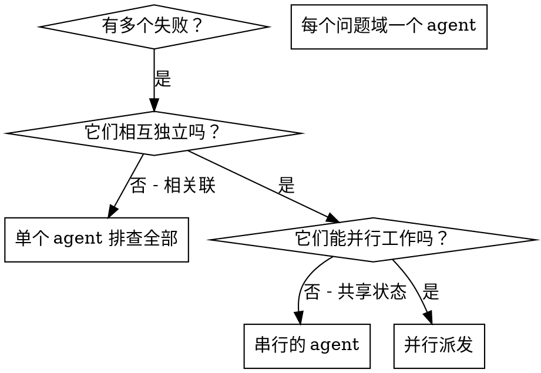

# 并行派发 Agent

## 概述

你把任务委托给拥有隔离上下文的专用 agent。通过精心构造它们的指令与上下文，你确保它们保持专注并完成自己的任务。它们绝不应继承你会话的上下文或历史——你要精确构建出它们所需的一切。这也为你自己的协调工作保住了上下文。

当你面对多个互不相关的失败（不同的测试文件、不同的子系统、不同的 bug）时，按顺序逐一排查是在浪费时间。每项排查相互独立，可以并行进行。

**核心原则：** 每个独立的问题域派发一个 agent。让它们并发工作。

## 何时使用



**适用情形：**
- 3 个以上测试文件失败且根因各不相同
- 多个子系统各自独立地损坏
- 每个问题无需其他问题的上下文即可理解
- 各项排查之间没有共享状态

**不适用情形：**
- 失败彼此相关（修复其一可能连带修复其他）
- 需要理解整个系统状态
- agent 之间会相互干扰

## 模式

### 1. 识别独立的问题域

按损坏的内容对失败分组：
- 文件 A 的测试：工具审批流程
- 文件 B 的测试：批量完成行为
- 文件 C 的测试：中止功能

每个域相互独立——修复工具审批不会影响中止测试。

### 2. 创建聚焦的 Agent 任务

每个 agent 获得：
- **具体范围：** 一个测试文件或子系统
- **清晰目标：** 让这些测试通过
- **约束：** 不改动其他代码
- **预期输出：** 你发现了什么、修复了什么的总结

### 3. 并行派发

在同一条响应中发出全部三个子代理派发——它们会并行运行：

```text
Subagent (general-purpose): "修复 agent-tool-abort.test.ts 的失败测试"
Subagent (general-purpose): "修复 batch-completion-behavior.test.ts 的失败测试"
Subagent (general-purpose): "修复 tool-approval-race-conditions.test.ts 的失败测试"
# 三者同时并行运行。
```

一条响应中的多个派发调用 = 并行执行。一条响应只发一个 = 串行。

### 4. 审查与整合

当 agent 返回后：
- 阅读每份总结
- 确认各修复互不冲突
- 运行完整测试套件
- 整合全部变更

## Agent 提示词结构

好的 agent 提示词具备：
1. **聚焦**——一个清晰的问题域
2. **自包含**——理解该问题所需的全部上下文
3. **明确输出**——agent 应返回什么？

```markdown
修复 src/agents/agent-tool-abort.test.ts 中的 3 个失败测试：

1. "should abort tool with partial output capture" - 预期消息中出现 'interrupted at'
2. "should handle mixed completed and aborted tools" - fast tool 被中止而非完成
3. "should properly track pendingToolCount" - 预期 3 个结果却得到 0

这些是时序/竞态条件问题。你的任务：

1. 阅读测试文件，理解每个测试验证什么
2. 找出根因——是时序问题还是真实 bug？
3. 按以下方式修复：
   - 用基于事件的等待替换任意超时
   - 若发现中止实现中的 bug，则进行修复
   - 若测试针对的是已变更的行为，则调整测试预期

绝不要只是调大超时——找出真正的问题。

返回：你发现了什么、修复了什么的总结。
```

## 常见错误

**❌ 过于宽泛：**“修复所有测试”——agent 会迷失方向
**✅ 具体：**“修复 agent-tool-abort.test.ts”——范围聚焦

**❌ 无上下文：**“修复竞态条件”——agent 不知道在哪里
**✅ 提供上下文：**粘贴错误信息与测试名称

**❌ 无约束：**agent 可能什么都重构
**✅ 有约束：**“不得改动生产代码”或“只修测试”

**❌ 输出含糊：**“修好它”——你不知道改了什么
**✅ 具体：**“返回根因与变更内容的总结”

## 何时不使用

**相关联的失败：**修复其一可能连带修复其他——先合并排查
**需要完整上下文：**理解问题需要看到整个系统
**探索性调试：**你还不知道哪里坏了
**共享状态：**agent 会相互干扰（编辑相同文件、使用相同资源）

## 会话中的真实示例

**场景：**一次大规模重构后，3 个文件中出现 6 个测试失败

**失败：**
- agent-tool-abort.test.ts：3 个失败（时序问题）
- batch-completion-behavior.test.ts：2 个失败（工具未执行）
- tool-approval-race-conditions.test.ts：1 个失败（执行计数 = 0）

**决策：**各域相互独立——中止逻辑、批量完成与竞态条件三者彼此分离

**派发：**
```
Agent 1 → 修复 agent-tool-abort.test.ts
Agent 2 → 修复 batch-completion-behavior.test.ts
Agent 3 → 修复 tool-approval-race-conditions.test.ts
```

**结果：**
- Agent 1：用基于事件的等待替换了超时
- Agent 2：修复了事件结构 bug（threadId 放错了位置）
- Agent 3：增加了对异步工具执行完成的等待

**整合：**所有修复相互独立、无冲突，完整测试套件全绿

## 验证

agent 返回后：
1. **审查每份总结**——了解改了什么
2. **检查冲突**——agent 是否编辑了相同代码？
3. **运行完整套件**——确认所有修复能协同工作
4. **抽查**——agent 可能犯系统性错误
