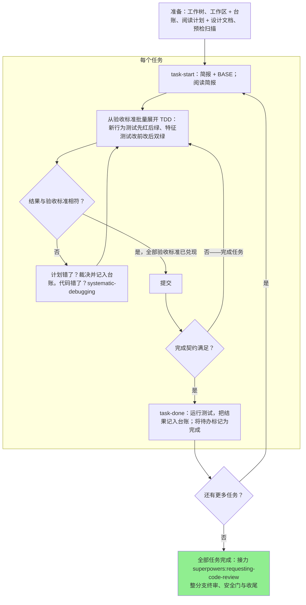

# 执行计划

在本会话中由你自己逐个任务地执行计划：每个任务不派实施者子代理，也不派审查者。全部任务完成后，接力进入 superpowers:requesting-code-review 对整个分支做收官把关。

**为何会话内执行：** 子代理驱动开发为每个任务都要付出一名全新实施者和一名全新审查者，两者都要从零重读代码库。会话内执行付出的只是一个上下文（你的），外加收官把关的一名全新审查者。它放弃的是每个任务一个全新上下文，以及每个任务的第二双眼睛。本技能用其他手段把全新实施者与全新审查者买到的东西保住：简报就是设计文档，台账就是你的记忆，TDD 是每个任务的闸门，requesting-code-review 的收官审查者就是那第二双眼睛。

**核心原则：** 计划已经完成了思考。严格按它执行，每一步都要有你亲眼看着先失败、后通过的测试来证明，并留下在你自己遗忘之后仍然存在的记录。

**叙述：** 在工具调用之间，最多叙述一行简短的话——记录由台账和工具结果承载。

**持续执行：** 不要在任务之间停下来向需求方确认。他们选择会话内执行是为了少花钱，不是为了在每个任务之后回答「要继续吗」。不间断地执行计划中的全部任务。

**要裁决，不要停滞。** 冲突、歧义、计划缺陷——都由你裁决。设计文档是约束性权威，计划是为它作的论证，你的判断裁定二者都未回答的部分。把每个决定以 `Ruling: <what you decided> — <why> — <what it costs if wrong>` 的形式记入台账，然后继续前进。没有台账裁决就偏离计划，等于瞒着人做出决定。

能让你停下来的只有四件事，而且仅此四件：不可逆或具破坏性的操作；安全敏感的动作；发生在此工作树之外、按惯例应先询问的副作用（合并、推送到共享分支、发布）；以及坏到每条前进路径都只能是猜测的计划。遇到这些，停下来问。

## 何时使用

- 你有一份来自 superpowers:writing-plans 的计划，且需求方在交接时选择了会话内执行。
- 你的 harness 没有子代理工具（见 `../using-superpowers/references/` 中的各平台参考）。绝不伪造派发；就在这里执行计划。
- 任务大体相互独立——与 superpowers:subagent-driven-development 的前提条件相同。

一份把决策写尽的任务规格（Files、Interfaces、边界条件、验收标准）会让会话内执行变成按图施工加测试：即使会话内用的是中档模型，它也运行良好，而最强档模型唯一物有所值之处是收官把关，本技能会把 superpowers:requesting-code-review 单独接力出去。需求方选择会话内执行时，把这一点告诉他们。

当需求方希望每个任务都有审查闸门，或计划长到其后面的任务会在压缩后的上下文上运行时，优先选 superpowers:subagent-driven-development。长计划上的会话内执行仍然可行——台账正是让它可恢复的东西——但最后几个任务能从你这里得到的，已经所剩无几。

## 流程

## 准备

确保工作发生在隔离的工作区：使用 superpowers:using-git-worktrees 创建一个，或核实现有工作区。未经需求方明确同意，绝不在 main/master 分支上开始实施。

对话记忆在上下文压缩后不复存在。一个丢失了进度的会话内执行者会去重新实现那些提交早已存在的任务——与控制者重新派发它们是同一种失败，只是这笔账记在你自己的上下文上。进度要记在台账文件里，而不只是待办里。harness 待办是实时视图；台账才是记录。

工作区和台账与 superpowers:subagent-driven-development 共享——同一目录、同一格式——因此一份计划可以在中途更换执行者，新的执行者从同一份台账恢复。

- 每份计划拥有一个工作区：技能启动时，运行 `../subagent-driven-development/scripts/sdd-workspace PLAN_FILE`——它会打印该计划被 git 忽略的目录（`<repo-root>/.superpowers/sdd/<plan-basename>/`），它是本计划——且仅本计划——全部工件的归属地：台账、简报、审查包。其他计划的目录永远不归你读写。
- 在 `<workspace>/progress.md` 查找本计划的台账。如果其第一行写的是你的计划文件，那么凡带 `Task <N>: complete` 行的任务即为 DONE——不要重做；从第一个没有该行的任务恢复。即使你的上下文已不记得做过这些提交，它们也确实存在于 git 中：上下文压缩之后，相信台账和 `git log`，而不是你自己的记忆。如果台账第一行写的是别的计划文件，它记录的就是别的计划的进度：别动它，为自己新建一份全新的。
- 创建台账，第一行写明它的身份：`# SDD ledger — plan: <plan file path>`。
- `git clean -fdx` 会摧毁该工作区（它是被 git 忽略的临时区）；一旦发生，从 `git log` 恢复。

通读一遍计划，记下它的背景与全局约束（Global Constraints），并为每个任务建一个待办。如果计划指明了一份设计文档（Spec），也要读它：设计文档是计划立论所依据的权威，计划内部的冲突一律以它为准。计划若没有可获取的设计文档，要在台账里记一条说明此事——没有设计文档时作出的裁决只是暂定的。

**必需子技能（REQUIRED）：** 现在就加载 superpowers:test-driven-development，要在 Task 1 之前。计划不再预写红绿步骤——任务的验收标准只是起点，把它展开成先失败后通过的测试循环的是你；即使你自认熟知 TDD 的流程，也不豁免你去读它。

在 Task 1 之前，扫描计划，查找任务之间的冲突。计划中的 Interfaces 块告诉你去哪里看：对每个消费早前任务所产物的任务，写一行台账——写明这两个任务、一方产出与另一方消费的对照、以及你发现了什么。毫无共享的任务不写行；任务之间毫无共享的计划，只写一行 `Pre-flight: no shared interfaces`。对其中浮现出来的每一处冲突做出裁决，以设计文档为约束性权威，把裁决记录在该行旁边，然后开始 Task 1。每个任务自身的文本在你读它的简报时才检查，不在这里检查。

## 任务循环

你打印的一切和每份工具结果，都会在本会话余下时间里驻留在你的上下文中。把冗长的测试输出重定向到工作区的一个文件里，读它的尾部；读简报，不要读整份计划。

### 1. 领取任务

- 运行本技能的 `scripts/task-start PLAN_FILE N`。它一次调用就打印出简报路径和 BASE（任务的提交区间从哪个提交切出）。每个任务都要读简报，包括你在准备阶段就记得的任务：你记得的是摘要，简报里才有确切的值、签名、边界条件与验收标准。
- 把该任务的待办标记为 in_progress。

每次工具调用都是一轮，都会重读你的整个上下文。簿记随工作顺带完成——台账追加与提交在同一次调用中进行，绝不单独占一次调用。

### 2. 从验收标准批量展开 TDD

计划的任务不预写红绿步骤——简报给出 Files、Interfaces、边界条件与验收标准，循环由你展开。按照准备阶段已加载的 superpowers:test-driven-development，粒度是任务级批量：

1. 一次性写出本任务的全部测试——新行为测试（断言尚不存在的行为，期望值来自需求）与特征测试（断言本次改动必须保持的既有行为，期望值读自现状）。
2. 运行一次：新行为测试逐条失败（断言中带设计文档的确切取值）——在实现还不存在时就通过的新行为测试，是关于测试本身的一个发现项；特征测试逐条通过——失败的先观察实际输出、把断言对齐到观察值，绝不为此修代码。
3. 批量实现到全部测试通过。
4. 再运行一次：新行为测试全绿；特征测试必须仍然全绿——失败即回归，修代码。
5. 提交。

细粒度循环的例外（bug 修复、算法核心、接口未定的探索任务）与全部边界处置，以 superpowers:test-driven-development 为准。

每轮结果与验收标准的比对有三种结局：

- **相符。** 下一条验收标准。
- **代码错了。** 使用 superpowers:systematic-debugging。找出原因；绝不通过修补症状让测试变绿。
- **计划错了**——某条验收标准或边界条件与设计文档矛盾、早前任务的接口与本任务消费的不匹配、边界条件本身站不住。以能满足设计文档的最小改动做出裁决，以 `Task <N>: Ruling: <finding> — <what you decided and why>` 记入台账，然后继续。裁决是记进台账带走的，不是靠脑子记住的：后面触及同一接口的任务从台账里读它。

一个任务横跨多个提交没有问题；审查区间是从 BASE 切出的，绝不是从 `HEAD~1`。

### 3. 完成契约

在写某个任务的台账行之前，以下各项必须全部为真，且证据就在本会话中——而不是从「diff 看起来没问题」推断出来：

- 简报的每条验收标准都有你写下的对应测试，每个测试都运行过，而且你读过输出。
- 每个测试你都看过它先失败、后通过；该任务的最后一次测试运行通过了——`task-done` 就是那次运行，它会把命令和结果写进台账行。
- 简报边界条件中的每一条，要么有测试钉住，要么有一条台账 `Ruling:` 说明为何不适用。
- 每一处对简报的偏离在台账中都有一条 `Ruling:` 行。

**必需子技能（REQUIRED）：** superpowers:verification-before-completion 约束『任务已完成』这一声明。只要缺少任何一项，任务就没有完成：把它做完。

### 4. 完成任务

用简报为整个任务指定的测试命令，运行本技能的 `scripts/task-done PLAN_FILE N BASE -- <test command>`。它会运行测试、把完整输出保存在工作区、打印尾部，并且——仅当测试通过时——把完成行追加到台账：

`Task <N>: complete (commits <base7>..<head7>, tests: <command> → <result>)`

失败的运行什么也不记录；任务即未完成。记录成功后，把待办标记为完成，领取下一个任务。

## 审查把关

全部任务完成后，使用 superpowers:requesting-code-review 接力：整分支终审、安全门与收尾在那里完成，缺子代理工具只降级形态、不免除环节。

## 常见合理化借口

| 借口 | 现实 |
|--------|---------|
| 「我记得 Task N 说了什么」 | 你记得的是摘要。简报里才有确切的值。去读它。 |
| 「计划的代码是对的，跳过看测试失败这一步」 | 你从未见过它失败的测试，什么也证明不了。它是一个步骤。去运行它。 |
| 「我最后再跑完整测试套件，不必每步都跑」 | 逐步运行是你查明哪一步弄坏了测试的方式。任务结束时的运行是契约，不是替代品。 |
| 「这里计划错了，我直接做对的事」 | 做对的事，并把裁决记入台账。未记入台账的偏离是瞒着人做出的决定。 |
| 「几个任务之后我再补写台账行」 | 上下文压缩不会等你方便。每个任务一行，与提交在同一条消息里。 |
| 「下一个任务之前让我先确认一下」 | 他们选择会话内执行是为了少花钱。进度询问花掉的是他们的时间。只有那四个停止条件能让你停下。 |
| 「我仔细读过自己的 diff；终审审查者是多余的」 | 同一位作者，同样的盲区。审查者是这一轮运行买到的唯一全新上下文。 |
| 「测试应该会过，改动那么小」 | 「应该」不是证据。契约要求命令及其输出。 |
| 「子代理又慢又贵，终审也一并跳过吧」 | 会话内执行已经去掉了每个任务的审查者。对整个分支的一次审查是下限，不是上限。 |
| 「审查者认定是 Minor，那就是 Minor」 | 那个标签评的是设计文档的沉默。要评的是人实际得到什么。先重新分级，再过闸门。 |
| 「修复显而易见，不必先写失败测试」 | 失败测试是「该发现项真实存在、而今已被消除」的唯一证明。没有它，你手里只有一个 diff 和一线希望。 |
| 「顺手把 Minor 也一起修了」 | 你修的每一个 Minor 都是你的需求方没有要求的一个测试、一次修复和一轮套件运行。把它们记入台账；由你的需求方决定。 |
