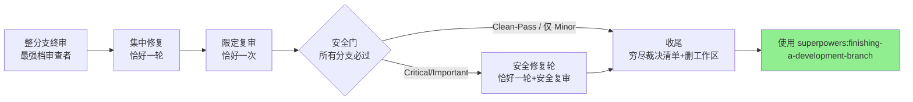

# 代码审查（final-review）

本技能承载审查域的全部纪律：派发审查、接收反馈、收官把关。审查者拿到的是为评估而专门构造的精确上下文——绝不是你的会话历史。收官把关是合并前的最后一道闸：整分支终审 → 安全门 → 收尾，所有分支必过；缺子代理工具只降级形态，不免除环节。

**核心原则：**早审查、常审查；先验证，再实施。技术正确性高于社交舒适度。

## 停止条件

能让你停下的只有四件事，且仅限这四种：不可逆或具破坏性的操作；安全敏感的动作；发生在此工作树之外、按惯例应先询问的副作用（合并、推送到共享分支、发布）；以及坏到每条前进路径都只能靠猜的计划。遇到这四种，停下并询问。

## 入口路由

| 你此刻拿到的是什么 | 走哪个入口 | 产出 |
|---|---|---|
| 临时审查请求（完成任务、实现重大功能、合并之前，或任何「帮我审查」） | 「如何请求」——按模板派发即止 | 一份审查报告 |
| 收到审查反馈（需求方转交、审查者报告、PR 评论，任何来源） | 「接收审查反馈」——先验证再实施 | 实施或有理有据的反驳 |
| 收官把关（实施计划全部任务完成后，由执行技能接力进入） | 「收官流程」 | 穷尽裁决清单 + 安全门小节 |

❌ 有人请审查一段代码，就跑整分支终审与安全门；✅ 临时请求止于按模板派发。收官流程只由「全部任务已完成」的事实或执行技能的接力句进入。

## 如何请求（临时审查）

**强制时机：**实现重大功能之后；合并到 main 之前。**可选但有价值：**卡住时（新视角）；重构之前（基线检查）；修复复杂 bug 之后。

**1. 获取 git SHA：**

```bash
BASE_SHA=$(git merge-base origin/main HEAD)
HEAD_SHA=$(git rev-parse HEAD)
```

**2. 派发审查者：**派发一个 general-purpose 子代理，把 [code-reviewer.md](code-reviewer.md) 模板填空后作为提示词。占位符见模板尾部说明：审查摘要、需求或设计文档路径、BASE_SHA、HEAD_SHA。要显式指定模型——省略会静默继承会话模型（见 Model Selection）。

模板族：[code-reviewer.md](code-reviewer.md)（代码审查，收官流程同用它）；[security-reviewer.md](security-reviewer.md) 与 [security-re-review-prompt.md](security-re-review-prompt.md)（安全审查与安全复审，由收官流程的安全门按规程使用）。

## 接收审查反馈

收到审查反馈——无论来自需求方、审查者还是 PR 评论——实施之前先验证：通读、用自己的话复述、对照代码库核查、评估技术成立性、技术性回应或有理有据地反驳、一次只做一项且每项都测试。禁止表演性认同（「你说得完全对！」「说得好！」）；禁止验证之前动手；各项不清晰时先澄清全部项再实施。

完整纪律：读 [references/receiving-feedback.md](references/receiving-feedback.md) 并照做——含按来源区分的处理、外部审查者的五步核查、YAGNI 检查、何时反驳与如何得体更正、GitHub 评论串的回复位置。

## 收官流程（整分支终审 → 安全门 → 收尾）

实施计划全部任务完成后进入。流程骨架：



规程全文：读 [references/closeout.md](references/closeout.md) 并照做——它涵盖审查包生成（`bash scripts/review-package PLAN_FILE MERGE_BASE HEAD`，MERGE_BASE = 分支的起始提交，例如 `git merge-base main HEAD`）、整分支终审、唯一的一轮集中修复、恰好一次限定复审、安全门与收尾。派发前读 Model Selection——收官审查是判断型任务，用可用的最强档模型。

## Model Selection（模型选择）

**收官审查与安全门**：判断型任务，用可用的最强档模型，而不是会话默认模型；安全复审同为最强档——本节「限定范围重审用最低档到中档」的规则不适用于安全门复审（依据见安全门设计文档决策 6）。

**审查任务**：以同样的判断力选模型，按 diff 的规模、复杂度与风险调节。小型机械性 diff 不需要最强档模型；细微的并发改动需要。针对小型修复 diff 的限定范围重审用最低档到中档。

**派发子代理时始终显式指定模型。**省略模型参数时，子代理会继承你会话的模型——通常是最强档也最贵的——这会无声地让本节失效。
