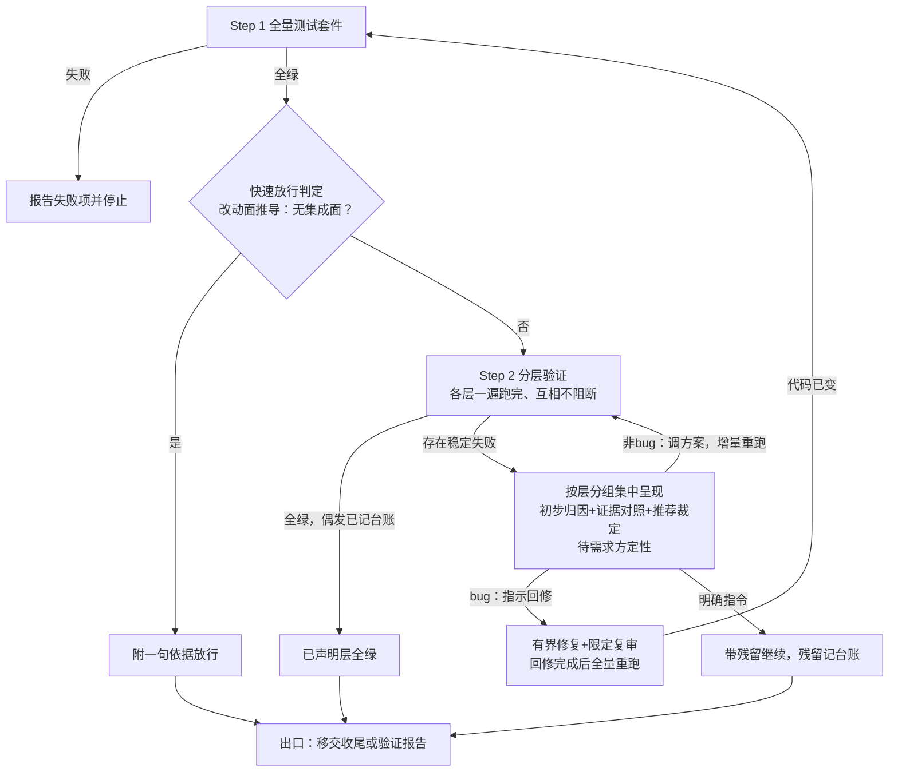

# 集成验证

任务循环的 TDD 证明单任务行为，终审与安全门证明代码质量与安全——没有谁证明过「集成层成立」：模块组装、接口兼容、构建产物可运行、关键路径端到端。本技能补这道闸：Step 1 全量测试套件，Step 2 分层验证（按需求级验证方案与形态路由执行）。验证是最终状态把关——失败不做自动修复轮，一遍跑完后集中呈现，由需求方定性裁决。

流程骨架：



## 触发

两种触发，出口语义不同，出口凭据机制共用：

| 触发 | 进入方式 | 出口语义 |
|---|---|---|
| 链路接力 | 审查收官技能（superpowers:requesting-code-review）收尾段移交进入 | 产生移交语义：出口后移交收尾技能（superpowers:finishing-a-development-branch） |
| 单独调用 | 需求方直接调用——开发中途验证分支集成状态、或失败修复后的复查 | 出口为验证报告（全绿，或集中呈现 + 定性裁决），无移交语义 |

输入：目标分支 + 需求级验证方案（随实施计划存放：`docs/superpowers/specs/<date-feature>/plan.md` 的验证方案章；无计划按未声明）+ 项目声明（`docs/superpowers/verification/environment.md`，见 Step 2）。对合并结果的复验同样按层执行、同一判据。

## 项目级方案文件集与登记册约定

项目级方案目录 `docs/superpowers/verification/`，含 `environment.md`（环境与手段：各层一行怎么跑——入口命令、环境要求）、`modules/<module>.md`（模块场景登记册）、`cross-module.md`（跨模块场景）。场景登记册每条一行：

```
- <场景id> | <层级 L1|L2|L3|兼容> | <资产路径> | <状态 normal|待合并|已知不修> | <期望一句话>
```

- 场景 id 全库唯一，是并入、回归与台账引用的主键；id 为登记册自有命名（模块前缀 + 序号，如 `REC-L1-002`），方案声明的场景 id 不入条目格式、经台账与计划文档溯源；`待合并`（资产不在基线）与`已知不修`不计入回归失败，回归报告单列呈现。场景登记册是回归技能的输入。
- 登记册写操作串行，不接受并行并入：并入前先同步基线最新登记册；仍有冲突时，控制者能机械判定的合并（互不重叠的新增条目）自行处理，覆盖面重叠或同场景相冲突的非机械合并，与需求方讨论后决定。
- 登记册在首次并入时初始化（并入在收尾技能做，不在本技能）；`environment.md` 在本技能首次运行时初始化（见 Step 2）。

## 凭据新鲜度检查（Step 1 之前）

Step 1 之前先判台账凭据新鲜度：台账存在集成验证出口凭据（「已声明层全绿」或「带残留继续」）、凭据记录的 HEAD 与当前 HEAD 一致、且工作区干净（`git status --porcelain` 为空）——三判据全部满足 → 附一句依据免跑本技能（本次不重跑），判据与收尾技能 Step 1 的免跑条件同构；凭据缺失或任一不满足 → 正常执行 Step 1。

## Step 1 全量测试套件

运行项目全量测试套件——单测层在此覆盖，命令以项目声明/构建配置为准（`npm test` / `cargo test` / `pytest` / `go test ./...` 等）。

**失败即停**：报告单测失败项并停止，Step 2 不执行——单测是基础，套件未绿时集成验证无意义。

❌「单测失败仍跑集成层」　✅「单测失败即报告并停止」

全绿后先做快速放行判定（见下文「快速放行」），未放行才进入 Step 2。

## 快速放行

Step 1 全绿后、分层执行前判定。真值来源是控制者对分支改动面的推导：不触及任何模块组装点、外部接口、运行边界 → 判定「无集成面」，附一句依据放行——放行依据恰好一句，不产生发现项。计划的集成面声明仅作对照输入而非真值来源：推导与声明不一致时以推导为准，差异记入台账。不经计划的分支同样适用。

无集成面是技能内出口而非免检——集成验证必过（同安全门哲学），放行跳过的是无对象的分层执行，不是本技能。

## Step 2 分层验证

先核对两份声明：

1. **项目声明**：`docs/superpowers/verification/environment.md` 不存在 → 控制者代拟初稿（各层一行怎么跑：入口命令、环境要求，每层标注预期时长上限——冒烟集「有界」的判据，参照形态路由）、需求方确认后创建，再继续——避免首轮验证整体陷入「未声明」。
2. **需求级验证方案**：对照方案质量判据核对——出处锚定、双向映射、粒度判据、可操作性判据，加确定性固定策略、保真度声明、副作用隔离、顺序依赖显式化、既有登记册查重、失败证据采集（十项由计划阶段的 writing-plans 保证）。发现缺口不代写、不修改方案，缺口事实随本次结果一并呈现。

按项目形态加载形态路由参考（后端 / Web / App；混合形态按模块各自路由；Electron/Tauri 走 Web 路由；形态外项目不走路由，按项目声明执行集成层与可运行层）。形态参考是默认方案，项目声明可覆盖执行器选择（覆盖后方案结构与资产化标准不变）。工具链属于被验证的项目：各层执行前按项目声明做前置检查（容器运行时、浏览器、模拟器等），发现工具或环境缺失走环境受限降级，不代装依赖。

层与深度分级（分级只覆盖三个运行层）：

| 层 | 分级 | 验什么 |
|---|---|---|
| 集成层 | L1 组装验证 | 真实数据库/中间件协作下跨模块组装成立 |
| 接口兼容层 | 不分级——diff 型检查 | 分支对基线无破坏性变更（按项目声明的接口规范与检测方式，不依赖运行环境） |
| 可运行层 | L2 可运行验证 | 构建产物能启动、健康检查通过（本地执行） |
| 端到端层 | L3 端到端场景验证 | 冒烟集关键路径 |

单测层不经此表——由 Step 1 全量套件覆盖。进门禁的必须是确定性脚本资产（进版本库、可重复执行、断言确定性）；方案中的人工验证清单条目不伪装自动化，汇总呈现由需求方人工执行。

执行规则：

- 方案声明了顺序依赖链的场景按链执行；标注可并行的可并行。
- 各层与场景一遍跑完、互相不阻断——不因失败中断后续层。
- 每个失败场景自动重跑一次（重跑整个场景，不是失败步骤）：重跑通过 → 记偶发稳定性信号（台账），不阻塞；重跑仍失败（稳定失败）→ 不中断执行，收集至集中报告。
- 某层未在声明与方案中出现 → 逐层标注「未声明」，随移交呈现，不阻塞。

全部层执行完毕后：无稳定失败（全绿，偶发已记台账）→ 走出口；有稳定失败 → 按层分组集中呈现，逐项含层级/场景/归属 + 初步归因及证据对照 + 推荐裁定及理由，然后进入失败定性裁决——待需求方定性，逐项裁定。

每个稳定失败项的呈现格式：

```
[<层级>] <场景id>（归属：<模块>）
期望（方案原文）：<期望原文摘录>
实际（日志摘录）：<失败日志摘录>
证据：<按方案声明的采集物——截图/trace/日志范围>
初步归因：<代码缺陷嫌疑 | 方案期望不符> — <理由>
推荐裁定：<非 bug | bug> — <理由>
```

初步归因由控制者给出、可能错误甚至有诱导倾向——证据对照与定性权在需求方。

❌「首个稳定失败即中断后续层」　✅「全部层执行完毕后集中呈现」

## 失败定性裁决

集中呈现后待需求方定性，每个稳定失败项三选一：

**定性「非 bug」**（行为符合预期，或方案期望有误）→ 调整需求级验证方案——修正场景期望/前置/判据 → 仅重跑被定性的失败条目（增量重跑：通过则并入当次结果，其余层结果沿用）。不设机械轮次上限——每轮调整由需求方定性触发，裁决即熔断；连续调整仍未通过时，提示需求方考虑改判带残留继续或废弃场景。

**定性「bug」** → 需求方二选一：

- **指示回修**：一次有界修复 + 一次覆盖回修 diff 的限定复审（触及安全敏感面用安全视角模板）；回修完成后全量重跑本技能——Step 1 + Step 2 全部层，代码已变，需全量确认无回归。
- **明确指令带残留继续**：残留记入台账，随移交呈现。

铁律：需求方未定性时，控制者不得修改方案期望——「为通过而改期望」让验证迁就实现，测试搬运是最廉价的作弊路径。模糊授权语（「你看着办」「你决定」「随便怎么处理」）不构成定性——仍是需求方未定性状态：控制者只能等待逐项定性或重申三选一，不得据此修改方案期望、修改设计文档或跳过裁决。

❌「场景连败两轮后控制者放宽期望让验证通过」　✅「两轮定性裁决均由需求方明示后才调整」

## 环境受限降级

某运行层在当前环境不可执行（无容器运行时、无浏览器、模拟器不可达）→ 在三个运行层内降级到环境可支撑的最深层级，剩余层级以「环境外验证项」随移交呈现，逐项写明人工验证步骤。接口兼容层不依赖运行环境，不随运行层降级。

验证深度判据：已声明且环境可达的最深层完成验证。环境可达但未声明的层标注「未声明」；已声明但环境不可达的层走降级——两种缺口都随移交呈现，不静默跳过。

## 出口

| 出口 | 链路接力 | 单独调用 |
|---|---|---|
| 已声明层全绿 / 快速放行 | 移交收尾技能 | 验证报告 |
| 带残留继续 | 移交收尾技能（残留随移交呈现） | 验证报告（含残留清单） |
| 存在未声明层 / 降级 | 随移交呈现，不阻塞 | 单列进报告 |
| Step 1 失败即停 | 报告失败项并停止，Step 2 不执行 | 报告失败项并停止，Step 2 不执行 |

固定免责句：全绿出口必须附带「集成层全绿提高把握、不证明无缺陷」——验证提高把握，不承诺全绿即无缺陷。

门禁钩子（可选，项目级配置，不默认强加）：按所在 harness 的钩子机制配置「测试未通过不允许结束会话」；无钩子机制的 harness 以本技能的停止条件兜底。

## 台账记录

本技能的全部出口与裁决记入控制者台账，行格式可检索：

| 事件 | 台账行 |
|---|---|
| 出口凭据 | `集成验证凭据: <已声明层全绿 或 带残留继续> HEAD=<sha>` |
| 快速放行 | `集成验证快速放行: <一句依据> HEAD=<sha>` |
| 偶发 | `集成验证偶发: <场景id> 重跑通过 — 稳定性信号` |
| 稳定失败 | `集成验证稳定失败: <场景id> <层级>` |
| 残留 | `集成验证残留: <一句话>` |
| 未声明/降级 | `集成验证缺口: <层名> <未声明 或 降级至L<n>>` |

出口凭据机制两种触发共用：全绿或带残留继续均记台账凭据 + 当时 HEAD。免跑判据三条件通用（收尾技能消费）：台账存在集成验证出口凭据 + HEAD 一致 + 工作区干净（`git status --porcelain` 为空）——三者机械可判；凭据仅「已声明层全绿」与「带残留继续」两类，快速放行判定记台账但不产生凭据。
