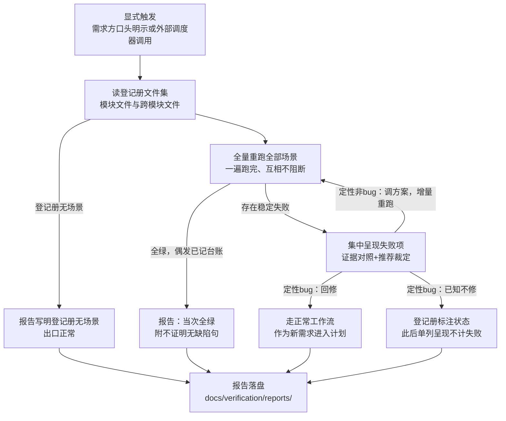

# 全量回归

集成验证（superpowers:integration-verification）把关「本分支改动」——在分支链路内、按需求级验证方案执行；本技能把关「整个项目基线」——在分支链路之外、按项目级整体验证方案（场景登记册文件集）在基线上全量重跑，检测跨分支的历史累积回归。回归不承担代码修复：一遍跑完后集中呈现，由需求方逐项定性裁决，裁决完成后技能结束。

流程骨架：



## 触发

仅显式触发——需求方口头明示或外部调度器显式调用，绝不隐式自动运行。回归是全项目成本动作，隐式触发会让需求方失去对成本的控制：本技能不在任何链路内自动接力，不随收尾或并入发生，也没有内置定时调度——外部调度器要触发回归，同样走显式调用本技能这一条路。

输入：显式触发指令 + 基线（默认主开发线最新，需求方可指定）+ 项目级整体验证方案文件集（`docs/verification/`）。

## 项目级方案文件集

文件集目录与登记册条目格式以 superpowers:integration-verification 的「项目级方案文件集与登记册约定」为准：目录 `docs/verification/`，含 `environment.md`（项目声明：各层一行怎么跑——入口命令、环境要求）与场景登记册文件集——`modules/<module>.md`（模块场景登记册）+ `cross-module.md`（跨模块场景），每条一行：

```
- <场景id> | <层级 L1|L2|L3|兼容> | <资产路径> | <状态 normal|待合并|已知不修> | <期望一句话>
```

场景 id 是回归引用的主键；`normal` 条目全量重跑；`待合并`（资产不在基线，如 PR 未合并）与`已知不修`条目跳过——不计失败，报告各自单列呈现。`待合并`持续呈现直至合并或指示废弃，`已知不修`持续呈现直至指示修复或废弃（废弃即移除条目）。登记册写操作沿用串行约定（见 superpowers:integration-verification）：本技能对登记册的全部写操作（期望修正、状态标注、废弃移除）同样先同步基线最新登记册；冲突时控制者能机械判定的合并自行处理，覆盖面重叠或同场景相冲突的与需求方讨论后决定。

## 执行（全量重跑）

读登记册文件集全部场景文件，`normal` 场景全量重跑——重跑整个场景，不是失败步骤。执行手段按项目声明（`environment.md`）；项目声明可覆盖执行器选择，覆盖后资产化标准不变。进门禁的必须是确定性脚本资产（进版本库、可重复执行、断言确定性）；登记册指向人工验证清单的条目不伪装自动化，汇总呈现由需求方人工执行。

形态路由：按各场景归属模块的形态加载 superpowers:integration-verification 的形态参考——后端 `skills/integration-verification/references/backend.md`、Web `references/web.md`、App `references/mobile.md`；混合形态按模块各自路由；跨模块场景由涉及模块的路由共同执行；Electron/Tauri 走 Web 路由；形态外项目不走路由，按项目声明执行。

执行规则（与集成验证同判据）：

- 方案声明了顺序依赖链的场景按链执行；标注可并行的可并行。
- 场景一遍跑完、互相不阻断——不因失败中断后续场景。
- 每个失败项先自动重跑一次（重跑整个场景）：重跑通过 → 记偶发稳定性信号（台账），不阻塞；重跑仍失败（稳定失败）→ 收集至集中呈现。
- 各层执行时长随报告标注——全量时长随登记册增长，成本可见。

❌「首个失败即中断逐项处置」　✅「一遍跑完后集中呈现」

## 失败归因与集中呈现

全部场景执行完毕后集中呈现全部稳定失败项，逐项：

```
[<层级>] <场景id>（归属：<模块>）
期望（登记册条目原文）：<期望原文摘录>
实际（日志摘录）：<失败日志摘录>
证据：<按方案声明的采集物——截图/trace/日志范围>
初步归因：<代码缺陷嫌疑 | 方案期望不符> — <理由>
推荐裁定：<非 bug | bug> — <理由>
```

证据对照是两条原文并置——失败日志摘录与登记册期望原文，不经控制者转述。初步归因由控制者给出、可能错误甚至有诱导倾向——证据对照与定性权在需求方。

## 失败定性裁决

定性裁决三路：非 bug → 调整项目级方案（修正期望或废弃场景，废弃即移除条目），仅重跑被定性条目（增量重跑）；bug → 需求方再选回修（走正常工作流，作为新需求进入计划）或已知不修（登记册标注状态）。集中呈现后待需求方逐项定性：

**定性「非 bug」**（行为符合预期，或登记册期望有误）→ 控制者调整项目级方案——修正场景期望，或废弃场景（废弃即移除条目）→ 仅重跑被定性的失败条目（增量重跑：通过则并入当次结果，其余场景结果沿用）。不设机械轮次上限——每轮调整由需求方定性触发，裁决即熔断；连续调整仍未通过时，提示需求方考虑改判已知不修或废弃场景。

**定性「bug」** → 需求方二选一：

- **回修**：走正常工作流——作为新需求进入计划；本技能不修代码、不开修复轮。当次结果仍按失败呈现，回修后的确认由该需求自己的链路承担。
- **已知不修**：登记册标注状态——当次结果仍按失败呈现，此后回归跳过该条、单列呈现、不计为失败，直至指示修复或废弃（废弃即移除条目）。

铁律：需求方未定性时，控制者不得修改方案期望——「为通过而改期望」让验证迁就实现，测试搬运是最廉价的作弊路径。

❌「连续失败后放宽期望让回归通过」　✅「每轮方案调整均由需求方定性后才动」

## 首次回归

登记册文件集不存在，或各模块文件与跨模块文件均无场景条目 → 报告写明「登记册无场景，无可回归项」，落盘后出口正常——首次回归不是错误，是无对象。项目走过需求链路但从未并入（每次都选「保持分支原样」）的，登记册同样为空，按同一出口。

## 报告落盘

报告写入 `docs/verification/reports/YYYY-MM-DD-<label>.md`——`<label>` 为当次触发的简短标识（需求方给定，或按当次回归范围拟定）。报告只呈现当次结果：

- **当次结果**：登记册全部场景的重跑结果（通过/偶发/稳定失败，各层执行时长）。
- **失败项**：每个稳定失败项的层级、场景、归属，加归因、证据对照、推荐裁定与需求方裁决。
- **待合并清单**：资产不在基线的场景，逐条单列。
- **已知不修清单**：登记册处于该状态的场景，逐条单列。

全绿出口必须附带固定免责句：「回归全绿提高把握、不证明无缺陷」。报告不产生任何变更类摘要、动作日志或跨次对比——设计已裁决不做记录，当次结果即报告的全部内容。

## 台账记录

偶发与稳定失败记入控制者台账，行格式可检索：

| 事件 | 台账行 |
|---|---|
| 偶发 | `回归偶发: <场景id> 重跑通过 — 稳定性信号` |
| 稳定失败 | `回归稳定失败: <场景id> <层级>` |

台账只服务当次裁决与稳定性信号，不构成跨次记录。

## 出口

裁决完成后技能结束——无移交语义，出口就是报告落盘：

| 出口 | 条件 |
|---|---|
| 报告落盘（全绿） | 全部场景通过，偶发已记台账；附免责句 |
| 报告落盘（含失败项与裁决） | 稳定失败经集中呈现与定性裁决，裁决结果入报告 |
| 报告落盘（登记册无场景） | 首次回归或登记册为空；出口正常 |
