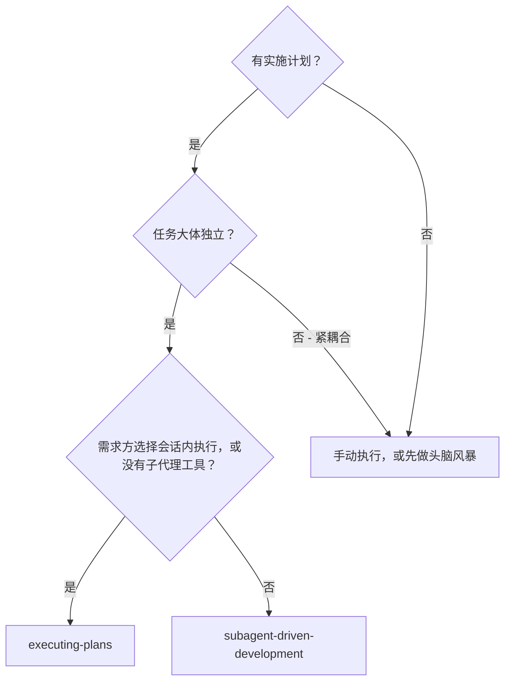
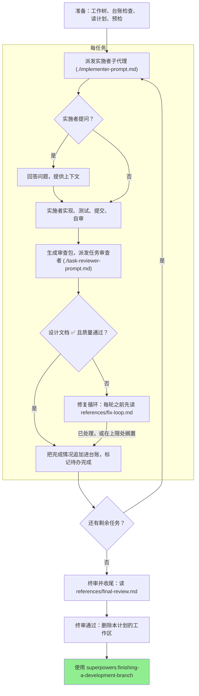

# 子代理驱动开发

执行计划的方式：为每个任务派发一个全新的实施者（implementer）子代理，每个任务之后进行一次任务审查（设计文档符合性 + 代码质量），最后进行一次全面的整分支终审。

**为什么用子代理：**你把任务委托给拥有隔离上下文的专用 agent。通过精心构造它们的指令与上下文，你确保它们保持专注并完成自己的任务。它们绝不应继承你会话的上下文或历史——你要精确构建出它们所需的一切。这也为你自己的协调工作保住了上下文。

**核心原则：**每任务一个全新子代理 + 任务审查（设计文档 + 质量）+ 全面终审 = 高质量、快速迭代

**叙述：**工具调用之间至多叙述一行简短文字——记录由台账与工具结果承载。

**持续执行：**任务之间不要停下来向需求方请示。不间断地执行计划中的全部任务。停止的理由只有下文点名的四种，或全部任务完成。「我该继续吗？」之类的询问和进度汇报是在浪费需求方的时间——他们要你执行计划，那就执行。

**要裁决，不要停滞。**计划一旦运行，就不等待任何人。冲突、歧义、计划缺陷、一项需要请示批准才能突破的上限——都由你裁决。设计文档是约束性权威，计划是依据它展开的论证，两者都未回答的问题由你的判断裁定。把每个决定按 `Ruling: <what you decided> — <why> — <what it costs if wrong>` 记入台账，然后继续前进。错误的裁决，代价是需求方看得见、也能撤销的返工；在一个问题上停滞不前的会话，代价是他们的一整天，且一无所获。

让你停下的只有四件事，且仅限这四种：不可逆或具破坏性的操作；安全敏感的动作；发生在此工作树之外、按惯例应先询问的副作用（合并、推送到共享分支、发布）；以及坏到每条前进路径都只能靠猜的计划。遇到这四种，停下并询问。

## 适用时机

**对比 Executing Plans（会话内执行）：**
- 每个任务用全新子代理（无上下文污染），而不是让同一个上下文做完所有任务
- 每个任务之后都审查（设计文档符合性 + 代码质量），而不是只在最后审查
- 代价是每个任务、每次审查各耗一个全新上下文；会话内执行则是一个上下文外加一个终审审查者
- 两者都在本会话中运行，共享同一计划工作区与台账，且任务之间都不停顿

## 流程

## 准备

确保工作发生在隔离的工作区：使用 superpowers:using-git-worktrees 创建一个，或核实现有工作区。未经需求方明确同意，绝不在 main/master 分支上开始实施。

对话记忆无法在上下文压缩后留存。真实会话中，丢失进度位置的控制者曾把已完成的整个任务序列重新派发一遍——这是迄今观察到的最昂贵的一例失败。进度要记在台账文件里，而不是只记在待办里。

- 每个计划拥有一个工作区：技能启动时，运行本技能的 `bash scripts/sdd-workspace PLAN_FILE`——它会打印该计划的 git 忽略目录（位于 `<repo-root>/.superpowers/sdd/` 之下），本计划（且仅本计划）的全部工件（artifact）都存放于此：台账、简报、报告、审查包。其他计划的目录绝不归你读写。
- 在 `<workspace>/progress.md` 检查本计划是否已有台账。若已存在，先读 [references/resuming.md](references/resuming.md) 再做任何其他事：它会说明这本台账属于谁、该从哪里恢复。
- 创建台账，并把它的身份写成第一行：`# SDD ledger — plan: <plan file path>`。
- 台账是你的恢复地图：它点名的提交在 git 中真实存在，哪怕你的上下文已不记得创建过它们。上下文压缩之后，信台账和 `git log`，别信你自己的回忆。
- `git clean -fdx` 会摧毁该工作区（它是被 git 忽略的临时区）；一旦发生，用 `git log` 恢复。

通读一遍计划，记下它的上下文与全局约束（Global Constraints），并为每个任务建一个待办。如果计划指明了一份设计文档（Spec），也要读它：设计文档是计划立论所依据的权威，计划内部的冲突一律以它为准。没有可获取设计文档的计划，要在台账里记一条说明此事——在没有设计文档的情况下做出的裁决只是暂定的。

派发 Task 1 之前，读 [references/preflight.md](references/preflight.md)，并执行其中描述的冲突扫描。扫描得到的表格与裁决记入台账。

## Model Selection（模型选择）

每个角色都用能胜任它的最低档模型，以节省成本、提高速度。

**机械性实施任务**（孤立函数、清晰的设计文档、1-2 个文件）：使用快速的最低档模型。计划写得足够明确时，多数实施任务都是机械性的。

**集成与判断类任务**（多文件协调、模式匹配、调试）：使用标准档模型。

**架构与设计任务**：使用可用的最强档模型。整分支终审就属于这一类——用可用的最强档模型派发它，而不是会话默认模型。

**审查任务**：以同样的判断力选模型，按 diff 的规模、复杂度与风险调节。小型机械性 diff 不需要最强档模型；细微的并发改动需要。针对小型修复 diff 的限定范围重审用最低档到中档。

**修复循环升级（第 4-5 轮）**：使用比卡住的实施者至少高一档的模型。

**派发子代理时始终显式指定模型。**省略模型参数时，子代理会继承你会话的模型——通常是最强档也最贵的——这会无声地让本节失效。

**轮数比 token 价格更关键。**实际耗时（wall-clock）与上下文成本随子代理所花的轮数伸缩，而最低档模型在多步骤工作上通常要多花 2-3 倍轮数——总成本反而更高。审查者，以及依据纯文字描述工作的实施者，都以中档模型为下限。当计划的任务文本包含要写出的完整代码时，实施就只是转写加测试：这样的实施者用最低档。单文件机械修复也用最低档。

**任务复杂度信号（实施任务）：**
- 涉及 1-2 个文件且有完整设计文档 → 最低档模型
- 涉及多个文件且有集成关切 → 标准档模型
- 需要设计判断或对代码库的广泛理解 → 最强档模型

## 任务循环

**同类型小改动：**当计划列出多个跨文件、同类型的小改动时，派发它们之前先读 [references/batching.md](references/batching.md)。

你粘进派发提示词的每一份内容——以及子代理回显的每一份内容——都会驻留在你的上下文中直到会话结束，并在其后每一轮被重复读取。工件要用文件来交接。

**等待已派发的子代理：**绝不以短超时轮询等待接口（wait interface），也绝不陷入一次无声且无限期的等待。只要还有本地工作——更新台账、打包下一次审查、阅读报告——就继续做；子代理结果会自行送达。真正空闲时，按范围有限的时段等待（平台支持时为五到十分钟），时段之间发一行状态并清点你尚在运行的子代理：把它们列出来，追查任何已完成却未上报的。范围有限的时段几乎保住长等待的全部效率，同时保证卡住或失联的子代理在几分钟内就被察觉，而不是拖到会话结束。

### 1. 派发实施者

派发前先记录 BASE（`git rev-parse HEAD`）——审查包和各修复轮的 diff 都需要它。

- **任务简报：**派发实施者之前，运行本技能的 `bash scripts/task-brief PLAN_FILE N`——它把该任务的全文提取到一个唯一命名的文件并打印路径。撰写派发内容时，让简报保持为需求的唯一来源。派发内容应包含：（1）一行话说明本任务在项目中的位置；（2）简报路径，介绍语为「先读这个——它是你的需求，其中的确切取值须逐字采用」；（3）来自更早任务、而简报里无从得知的接口与决定；（4）你对简报中注意到的任何歧义的裁定；（5）报告文件路径与报告契约。确切取值（数字、魔法字符串、签名、测试用例）只出现在简报里。绝不让子代理通读整个计划文件。
- **报告文件：**实施者的报告文件以简报命名（简报 `…/task-N-brief.md` → 报告 `…/task-N-report.md`），并把路径写进派发提示词。实施者把完整报告写在里面，只返回状态、提交、一行测试摘要与关切事项。
- 派发提示词描述的是一个任务，而不是会话历史。不要把累积的前序任务摘要（「Task 1-3 之后的状态」）粘贴进后续派发——真实会话中有一次派发达到 42k 字符，其中 99% 是粘贴进去的历史。全新子代理需要的是：它的任务、它接触的接口、以及全局约束。仅此而已。
- 派发内容要带上禁派子代理契约（实施者模板中已写入）：实施者绝不派发子代理——既不派帮手，更绝不派审查者。审查由你在收到报告之后派发。真实会话中，实施者自己派生的每个审查者都与控制者派发的任务审查重复——每个任务平白多出一次完整的额外审查。
- 如果更早的任务在本任务触及的区域里搁置过某个发现项，就把指向那条台账条目的指引带进派发内容。
- 从派发结果中记录实施者的 agent 身份——修复循环第 1-3 轮恢复的就是这个 agent。
- 绝不并行派发多个实施子代理（会引发冲突）。

模板：[implementer-prompt.md](implementer-prompt.md)

### 2. 处理报告

实施者子代理会报告四种状态之一。逐一妥善处理：

**DONE:** 生成审查包（`bash scripts/review-package PLAN_FILE BASE HEAD`，在本技能目录下运行——它会打印它所写文件的唯一路径；BASE 是你派发实施者之前记录的那个提交——绝不用 `HEAD~1`，它会无声丢掉多提交任务里除最后一个提交之外的全部提交），然后用打印出的路径派发任务审查者。

**其他任何状态**（DONE_WITH_CONCERNS、NEEDS_CONTEXT、BLOCKED）：每次遇到都读 [references/handling-reports.md](references/handling-reports.md) 并照做。

如果实施者提问——开工前或任务中途——清晰而完整地回答，必要时提供补充上下文，不要催它仓促进入实现。

### 3. 审查任务

每任务审查是以任务为范围的闸门。全面审查只发生一次，即在整分支终审时。绝不跳过任务审查，也绝不接受缺少任一判定的报告——设计文档符合性与任务质量两者缺一不可。实施者自审绝不能替代任务审查；两者都需要。

- 把 diff 以文件形式交给审查者：运行本技能的 `bash scripts/review-package PLAN_FILE BASE HEAD`，把它打印的文件路径传给审查者（没有 bash 时：用 `git log --oneline`、`git diff --stat` 和 `git diff -U10` 生成该范围的输出，重定向到一个唯一命名的文件）。这些输出绝不进入你自己的上下文，而审查者在一次 Read 调用里就能看到提交列表、stat 摘要与带上下文的完整 diff。使用你派发实施者之前记录的 BASE——绝不用 `HEAD~1`，它会无声截断多提交任务。绝不在没有 diff 文件的情况下派发任务审查者。
- **审查者输入：**任务审查者拿到三个路径——同一份简报文件、报告文件与审查包——外加约束本任务的全局约束。
- 你交给审查者的全局约束块是它的注意力透镜。从计划的全局约束（Global Constraints）小节或设计文档中逐字复制约束性要求：确切取值、确切格式，以及组件之间明示的关系（「与 X 布局相同」「与 Y 匹配」）。审查者模板已自带流程规则（YAGNI、测试卫生、审查方法）——约束块承载的是本项目设计文档所要求的内容。
- 不要在没有具体、针对本任务的理由时添加开放式指令，例如「检查所有用到的地方」或「有用就跑一下并发测试」
- 不要让审查者重跑实施者已在同一份代码上跑过的测试——实施者的报告携带着测试证据
- 不要替审查者预判发现项——绝不指示审查者忽略或不标记某个具体问题。如果你认为某个发现项会是误报，让审查者提出它，然后在修复循环中裁决。如果你正在写的提示词里出现「不要标记」「别把 X 当缺陷」「至多 Minor」「计划已经选定了」——停下：你在预判，通常是为了给自己省掉一轮修复循环。

如果审查者报告了「⚠️ Cannot verify from diff」条目，在把任务标记为完成之前，先读 [references/cannot-verify.md](references/cannot-verify.md)。

模板：[task-reviewer-prompt.md](task-reviewer-prompt.md)

### 4. 修复循环

当审查报告出现设计文档 ❌、任何 Critical（必须修复）或 Important（应当修复）发现项、或你确认为真实缺口的 ⚠️ 条目时，循环触发。

它触发时，读 [references/fix-loop.md](references/fix-loop.md) 并照做。每轮开始前都要重读它，即使本会话中早前已读过：它载有轮数上限、熔断，以及每轮写入的台账行，而你对它的记忆在上下文压缩后不会留存。

### 5. 完成任务

当审查返回干净——或每个未决发现项都已到轮数上限、附上裁决后搁置——把完成行追加进台账，并与其他簿记放进同一条消息：

- `Task <N>: complete (commits <base7>..<head7>, review clean)`
- `Task <N>: complete (commits <base7>..<head7>, <K> parked)`——熔断触发后使用这一行

然后把待办标记为完成并继续。只要审查中仍有 Critical/Important 未决问题既未修复、也未在轮数上限处附裁决搁置，就绝不进入下一个任务。

## 终审

全部任务完成后，读 [references/final-review.md](references/final-review.md) 并照做。它涵盖整分支终审、其中唯一的一轮集中修复（fix wave），以及你如何收尾。

## 常见合理化借口

| 借口 | 现实 |
|--------|---------|
| 「设计文档符合性够接近了」 | 审查者发现设计文档缺口 = 未完成。修复，或触及上限后裁决——只有这两条出口。 |
| 「我自己修就好，派发是开销」 | 控制者亲手修会污染你的上下文并跳过审查。恢复实施者继续。 |
| 「再来一轮就会收敛」 | 过了上限，轮次不会收敛——失败是结构性的。做出裁决并分流处理。 |
| 「反正审查者总会找出新问题」 | 限定范围的重审只验证修复本身，不会越出修复范围。未触及代码上的新发现项进台账，不进循环。 |
| 「这个发现项明显错了，我把它丢掉」 | 你只在上限处裁决，且每条裁决都是一条台账记录。静默丢弃是被禁止的。 |
| 「修复很小，跳过复审吧」 | 未经审查的修复正是回归落地的方式。每轮都以限定范围的重审结束。 |
| 「审查拖慢循环」 | 没有审查的循环只是未经验证的空转。审查是循环的刹车与转向。 |
| 「台账簿记是开销」 | 能在上下文压缩后留存下来的正是台账。没有台账的控制者曾把已完成的整个任务序列重新派发一遍。 |
| 「实施者自己派了审查者——免费的额外保障」 | 那等于把同一份 diff 按同等成本再审一遍，且判定不被采纳；任务审查才是闸门。实施者自行派生的审查者是应当标记的缺陷，而不是严谨的体现。 |
