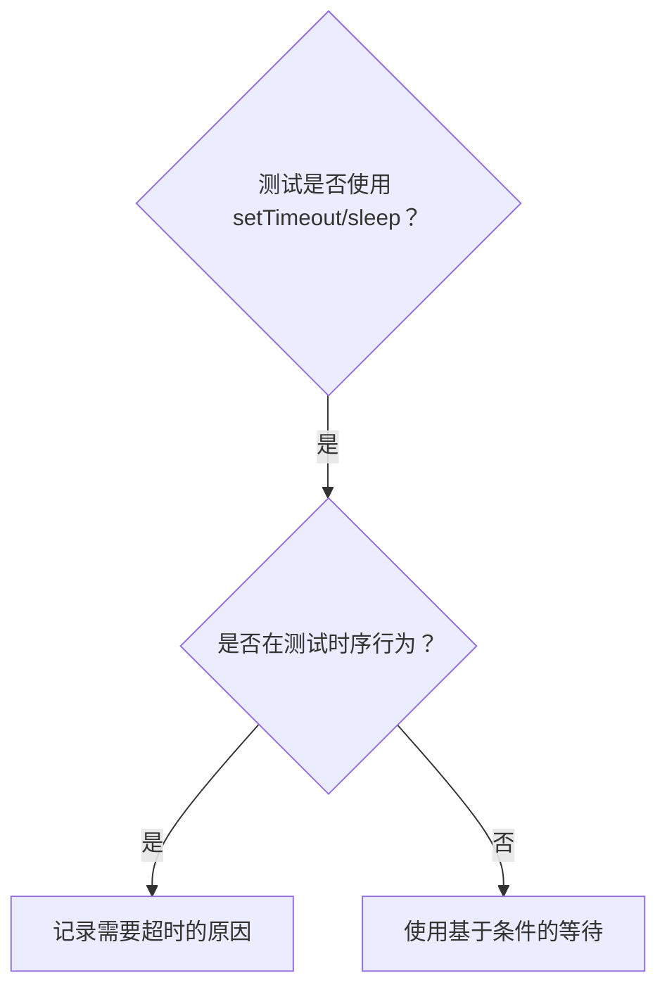

# 基于条件的等待

## 概述

不稳定测试（flaky tests）常用任意设定的延时来猜测要等多久。这会制造竞态条件：测试在快的机器上通过，但在有负载时或 CI 中失败。

**核心原则：**等待你真正关心的实际条件，而不是猜测要等多久。

## 何时使用



**适用情况：**
- 测试中存在任意设定的延时（`setTimeout`、`sleep`、`time.sleep()`）
- 测试不稳定（有时通过，有负载时失败）
- 测试并行运行时会超时
- 等待异步操作完成

**不适用情况：**
- 测试真实的时序行为（防抖、节流间隔）
- 若使用任意超时，必须记录「为什么」

## 核心模式

```typescript
// ❌ 修改前：猜测时间
await new Promise(r => setTimeout(r, 50));
const result = getResult();
expect(result).toBeDefined();

// ✅ 修改后：等待条件成立
await waitFor(() => getResult() !== undefined);
const result = getResult();
expect(result).toBeDefined();
```

## 快速参考：常用模式

| 场景 | 模式 |
|----------|---------|
| 等待事件 | `waitFor(() => events.find(e => e.type === 'DONE'))` |
| 等待状态 | `waitFor(() => machine.state === 'ready')` |
| 等待计数 | `waitFor(() => items.length >= 5)` |
| 等待文件 | `waitFor(() => fs.existsSync(path))` |
| 复杂条件 | `waitFor(() => obj.ready && obj.value > 10)` |

## 实现

通用轮询函数：
```typescript
async function waitFor<T>(
  condition: () => T | undefined | null | false,
  description: string,
  timeoutMs = 5000
): Promise<T> {
  const startTime = Date.now();

  while (true) {
    const result = condition();
    if (result) return result;

    if (Date.now() - startTime > timeoutMs) {
      throw new Error(`Timeout waiting for ${description} after ${timeoutMs}ms`);
    }

    await new Promise(r => setTimeout(r, 10)); // 每 10ms 轮询一次
  }
}
```

完整实现见本目录下的 `condition-based-waiting-example.ts`，其中包含来自真实调试会话的领域专用辅助函数（`waitForEvent`、`waitForEventCount`、`waitForEventMatch`）。

## 常见错误

**❌ 轮询过快：** `setTimeout(check, 1)`——浪费 CPU
**✅ 修复：** 每 10ms 轮询一次

**❌ 不设超时：** 条件永不满足时无限循环
**✅ 修复：** 始终设置超时，并给出清晰的错误信息

**❌ 陈旧数据：** 在循环前缓存状态
**✅ 修复：** 在循环内部调用 getter，以获取最新数据

## 何时任意超时才是正确的

```typescript
// 工具每 100ms tick 一次——需要 2 个 tick 才能验证部分输出
await waitForEvent(manager, 'TOOL_STARTED'); // 先：等待条件成立
await new Promise(r => setTimeout(r, 200));   // 再：等待定时行为
// 200ms = 100ms 间隔下的 2 个 tick——已注明理由并经过论证
```

**要求：**
1. 先等待触发条件成立
2. 基于已知时序（而非猜测）
3. 用注释说明「为什么」

## 实际效果

来自一次调试会话（2025-10-03）：
- 修复了 3 个文件中的 15 个不稳定测试
- 通过率：60% → 100%
- 执行时间：缩短了 40%
- 不再有竞态条件
