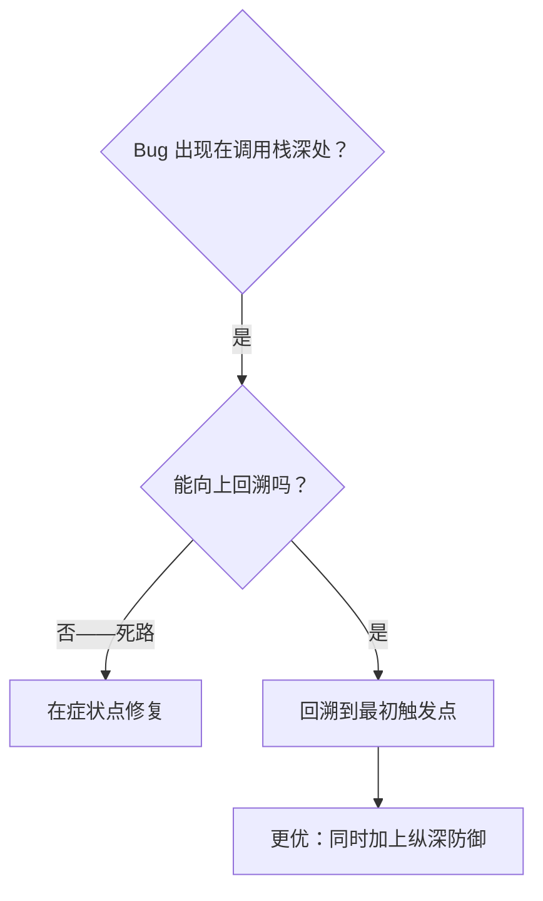
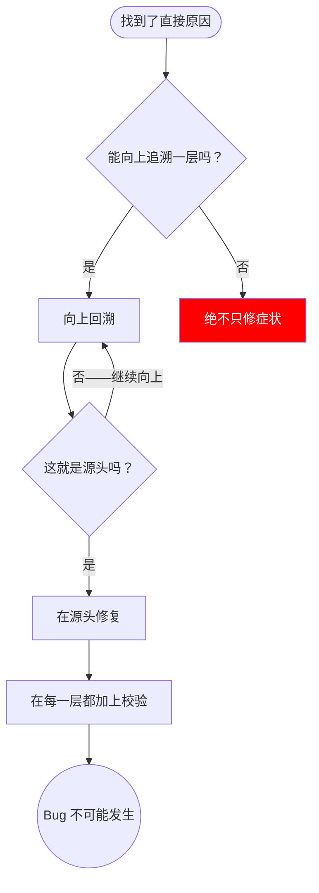

# 根因追踪

## 概述

Bug 常常在调用栈深处显现（git init 在错误的目录里执行、文件创建在错误的位置、数据库用错误的路径打开）。你的直觉是在错误出现的地方修复，但那只是在处理症状。

**核心原则：** 沿调用链向上回溯，直到找到最初的触发点，然后在源头修复。

## 何时使用



**适用场景：**
- 错误发生在执行流程深处（而非入口点）
- 堆栈跟踪显示出很长的调用链
- 不清楚无效数据源自何处
- 需要找出是哪个测试/哪段代码触发了问题

## 追踪过程

### 1. 观察症状
```
Error: git init failed in ~/project/packages/core
```

### 2. 找出直接原因
**哪段代码直接造成了它？**
```typescript
await execFileAsync('git', ['init'], { cwd: projectDir });
```

### 3. 追问：谁调用了它？
```typescript
WorktreeManager.createSessionWorktree(projectDir, sessionId)
  → 由 Session.initializeWorkspace() 调用
  → 由 Session.create() 调用
  → 由测试代码中的 Project.create() 调用
```

### 4. 继续向上追踪
**传入的值是什么？**
- `projectDir = ''`（空字符串！）
- 空字符串作为 `cwd` 会被解析为 `process.cwd()`
- 那正是源码目录！

### 5. 找出最初触发点
**空字符串是从哪来的？**
```typescript
const context = setupCoreTest(); // 返回 { tempDir: '' }
Project.create('name', context.tempDir); // 在 beforeEach 之前就被访问了！
```

## 添加堆栈跟踪

当无法手动回溯时，加上插桩：

```typescript
// 在出问题的操作之前
async function gitInit(directory: string) {
  const stack = new Error().stack;
  console.error('DEBUG git init:', {
    directory,
    cwd: process.cwd(),
    nodeEnv: process.env.NODE_ENV,
    stack,
  });

  await execFileAsync('git', ['init'], { cwd: directory });
}
```

**关键：** 在测试中使用 `console.error()`（不要用 logger——其输出可能不会显示）

**运行并捕获：**
```bash
npm test 2>&1 | grep 'DEBUG git init'
```

**分析堆栈跟踪：**
- 寻找测试文件名
- 找到触发调用的行号
- 识别模式（同一个测试？同一个参数？）

## 找出是哪个测试造成了污染

如果某个东西在测试期间出现，但你不知道出自哪个测试：

使用本目录下的二分排查脚本 `find-polluter.sh`：

```bash
bash ./find-polluter.sh '.git' 'src/**/*.test.ts'
```

逐个运行测试，在第一个污染源处停下。用法见脚本内说明。

## 真实案例：空的 projectDir

**症状：** `.git` 被创建在了 `packages/core/`（源码）里

**回溯链：**
1. `git init` 运行于 `process.cwd()` ← cwd 参数为空
2. WorktreeManager 被调用时传入空的 projectDir
3. Session.create() 传入了空字符串
4. 测试在 beforeEach 之前访问了 `context.tempDir`
5. setupCoreTest() 初始时返回 `{ tempDir: '' }`

**根因：** 顶层变量初始化访问到了空值

**修复：** 把 tempDir 改成了 getter，如果在 beforeEach 之前被访问就抛出异常

**同时加上了纵深防御：**
- 第 1 层：Project.create() 校验目录
- 第 2 层：WorkspaceManager 校验非空
- 第 3 层：NODE_ENV 守卫拒绝在 tmpdir 之外执行 git init
- 第 4 层：在 git init 之前记录堆栈跟踪

## 关键原则



**绝不只在错误出现的地方修复。** 要向上回溯，找到最初的触发点。

## 堆栈跟踪技巧

**在测试中：** 使用 `console.error()` 而不是 logger——logger 可能被抑制
**在操作之前：** 在危险操作之前记录日志，而不是等它失败之后
**包含上下文：** 目录、cwd、环境变量、时间戳
**捕获堆栈：** `new Error().stack` 会显示完整的调用链

## 实际成效

来自一次调试会话（2025-10-03）：
- 通过 5 层回溯找到了根因
- 在源头修复（getter 校验）
- 加上了 4 层防御
- 1847 个测试通过，零污染
