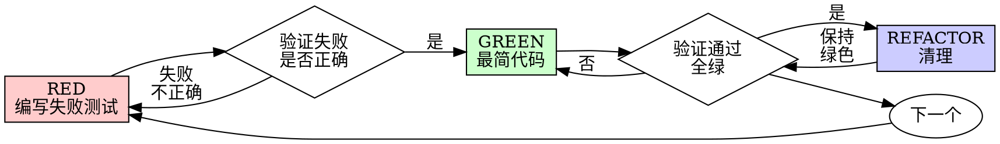

# 测试驱动开发（TDD）

## 概述

先写测试。看它失败。写最简代码让它通过。

**核心原则：** 如果你没有亲眼看测试失败，你就不知道它测的是不是对的东西。

**在字面上违反规则，就是违反规则的精神。**

## 何时使用

**始终适用：**
- 新功能
- bug 修复
- 重构
- 行为变更

**例外（问你的需求方）：**
- 用完即弃的原型
- 生成的代码
- 配置文件

想着「就这一次，跳过 TDD」？停下。这就是在给自己找借口。

## 铁律

```
没有先行失败的测试，绝不写生产代码
```

在测试之前写了代码？删掉。从头再来。

**没有例外：**
- 不许留作「参考」
- 不许在写测试时「改造」它
- 不许看它
- 删除就是删除

从测试出发全新实现。没有商量余地。

## 红绿循环（Red-Green-Refactor）



### RED - 编写失败测试

写一个最小的测试，展示应该发生什么。

<Good>
```typescript
test('retries failed operations 3 times', async () => {
  let attempts = 0;
  const operation = () => {
    attempts++;
    if (attempts < 3) throw new Error('fail');
    return 'success';
  };

  const result = await retryOperation(operation);

  expect(result).toBe('success');
  expect(attempts).toBe(3);
});
```
命名清晰，测的是真实行为，只测一件事
</Good>

<Bad>
```typescript
test('retry works', async () => {
  const mock = jest.fn()
    .mockRejectedValueOnce(new Error())
    .mockRejectedValueOnce(new Error())
    .mockResolvedValueOnce('success');
  await retryOperation(mock);
  expect(mock).toHaveBeenCalledTimes(3);
});
```
命名含糊，测的是 mock 而不是代码
</Bad>

**要求：**
- 一个行为
- 清晰的命名
- 真实代码（除非不可避免，不用 mock）

### 验证 RED - 亲眼看它失败

**强制。绝不跳过。**

```bash
npm test path/to/test.test.ts
```

确认：
- 测试失败（而不是报错）
- 失败信息符合预期
- 失败原因是功能缺失（而不是拼写错误）

**测试通过了？** 你测的是既有行为。修改测试。

**测试报错了？** 修掉错误，重跑直到它正确地失败。

### GREEN - 最简代码

写最简单的代码让测试通过。

<Good>
```typescript
async function retryOperation<T>(fn: () => Promise<T>): Promise<T> {
  for (let i = 0; i < 3; i++) {
    try {
      return await fn();
    } catch (e) {
      if (i === 2) throw e;
    }
  }
  throw new Error('unreachable');
}
```
刚好够让测试通过
</Good>

<Bad>
```typescript
async function retryOperation<T>(
  fn: () => Promise<T>,
  options?: {
    maxRetries?: number;
    backoff?: 'linear' | 'exponential';
    onRetry?: (attempt: number) => void;
  }
): Promise<T> {
  // YAGNI
}
```
过度设计
</Bad>

不要添加功能、重构其他代码，或做超出测试范围的「改进」。

### 验证 GREEN - 亲眼看它通过

**强制。**

```bash
npm test path/to/test.test.ts
```

确认：
- 测试通过
- 其他测试仍然通过
- 输出干净（无错误、无警告）

**测试失败？** 修代码，不是修测试。

**其他测试失败？** 立即修。

**「其他测试」指的是项目的测试套件，而不只是你的文件。** 你写的那个测试跑绿了，不等于测试套件全绿。在宣布改动完成之前，运行项目自己的测试命令（不带任何参数的 `pytest`、`npm test`、`cargo test`——仓库用哪个就跑哪个），即使你的任务只点名了一个测试文件。任务里的范围声明限定的是交付物，不是你的验证范围。那次运行暴露的任何失败——包括不是你造成的失败——都要在报告中点名；看着红色测试从屏幕上滚过却只字未提，你交出的就是一份靠隐瞒造出的假报告。

### REFACTOR - 清理

只在变绿之后：
- 消除重复
- 改进命名
- 提取辅助函数

保持测试全绿。不要添加行为。

### 重复

为下一个功能编写下一个失败测试。

## 好测试

| 质量 | 好 | 坏 |
|------|-----|-----|
| **最小化** | 只测一件事。名字里出现「and」？拆开。 | `test('validates email and domain and whitespace')` |
| **清晰** | 名字描述行为 | `test('test1')` |
| **展示意图** | 展示期望中的 API | 让人看不清代码应该做什么 |

写或改任何测试时，阅读 [writing-good-tests.md](writing-good-tests.md)，遵守这些让测试保持诚实的规则：
- 在写下测试之前，先说出会让它失败的那个生产代码改动
- 断言真实行为，绝不断言 mock 行为
- 只为测试服务的代码放进测试辅助模块，不要放进生产代码的类里
- mock 一个依赖之前，先弄清它的副作用

## 常见合理化借口

| 借口 | 现实 |
|------|------|
| 「太简单不用测」 | 简单代码也会坏。写测试只要 30 秒。 |
| 「我稍后再测」 | 事后写的测试会立即通过——这什么都证明不了。它们可能测错了对象、测了实现而不是行为，或者漏掉你忘记的那个边界情况。你从没看过它失败，所以从没证明过它能抓住 bug。测试先行强迫你经历那次失败。 |
| 「事后测试也能达成同样的目标（要精神，不要仪式）」 | 事后测试回答的是「这段代码做了什么？」；测试先行回答的是「这段代码应该做什么？」事后写的测试会被你已经写好的代码带偏——你验证的是你记得的情况，而不是你本会发现的情况。只有覆盖率，没有测试有效的证明。 |
| 「已经手动测过了」 | 手动测试是临时凑合的：没有记录下覆盖了哪些情况，代码变更后无法重跑，压力之下容易漏掉情况。「我试过没问题」≠ 全面。自动化测试每次都以同样的方式运行。 |
| 「删掉 X 小时的工作太浪费」 | 沉没成本谬误——无论如何，那段时间都已经花掉了。真正的选择是：用 TDD 重写（高置信），还是保留它再事后补测试（低置信，大概率有 bug）。留下你不信任的代码才是浪费。 |
| 「留着当参考，测试照样先写」 | 你会去「改造」它。那就是事后测试。删除就是删除。 |
| 「需要先探索一下」 | 可以。探索完就丢掉，从 TDD 开始。 |
| 「测试难写 = 设计不清晰」 | 听测试的。难测试 = 难使用。 |
| 「TDD 会拖慢我」 | TDD 正是务实之路：在提交前抓住 bug、防止回归、让你无所畏惧地重构。所谓「务实」的捷径意味着在生产环境里调试——更慢，而不是更快。 |
| 「手动测试更快」 | 手动测试证明不了边界情况。每次改动你都得重测一遍。 |
| 「既有代码没有测试」 | 你正在改进它。给既有代码补上测试。 |

## 危险信号 - 停下，从头再来

- 先写代码后写测试
- 实现之后再写测试
- 测试立即通过
- 说不出测试为什么失败
- 测试「以后」再补
- 用「就这一次」当合理化借口
- 「我已经手动测过了」
- 「事后测试也能达到同样的目的」
- 「重要的是精神，不是仪式」
- 「留着当参考」或「改改既有代码」
- 「已经花了 X 小时，删掉太浪费」
- 「TDD 太教条，我在讲务实」
- 「这次不一样，因为……」

**以上任何一条都意味着：删掉代码，用 TDD 从头再来。**

## 示例：Bug 修复

**Bug：** 空邮箱被接受

**RED**
```typescript
test('rejects empty email', async () => {
  const result = await submitForm({ email: '' });
  expect(result.error).toBe('Email required');
});
```

**验证 RED**
```bash
$ npm test
FAIL: expected 'Email required', got undefined
```

**GREEN**
```typescript
function submitForm(data: FormData) {
  if (!data.email?.trim()) {
    return { error: 'Email required' };
  }
  // ...
}
```

**验证 GREEN**
```bash
$ npm test
PASS
```

**REFACTOR**
如有需要，把校验提取出来以支持多个字段。

## 验证清单

在标记工作完成之前：

- [ ] 每个新增的函数/方法都有测试
- [ ] 实现之前，亲眼看每个测试失败
- [ ] 每个测试都因预期的原因失败（缺功能，而不是拼写错误）
- [ ] 为让每个测试通过，写了最简代码
- [ ] 所有测试通过
- [ ] 输出干净（无错误、无警告）
- [ ] 测试使用真实代码（只有在不可避免时才用 mock）
- [ ] 覆盖了边界情况和错误

复选框勾不全？那就是跳过了 TDD。从头再来。

## 卡住时

| 问题 | 解决办法 |
|------|----------|
| 不知道怎么测 | 写出你期望中的 API。先写断言。问你的需求方。 |
| 测试太复杂 | 设计太复杂。简化接口。 |
| 什么都得 mock | 代码耦合太重。使用依赖注入。 |
| 测试准备工作太庞大 | 提取辅助函数。还是复杂？简化设计。 |

## 与调试的衔接

发现了 bug？写一个能复现它的失败测试。走 TDD 循环。测试证明修复有效，并防止回归。

绝不在没有测试的情况下修 bug。

## 最终规则

```
生产代码 → 测试已存在且先看过它失败
否则 → 不是 TDD
```

未经你的需求方许可，不得有任何例外。
