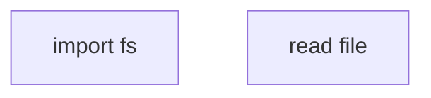

# 编写技能

## 概述

**编写技能就是将测试驱动开发应用到流程文档上。**

**个人技能存放在你的运行时的技能目录中**（Claude Code 上是 `~/.claude/skills/`）——Codex 与 Gemini 这两个运行时的路径见 [codex-tools.md](../using-superpowers/references/codex-tools.md) 或 [gemini-tools.md](../using-superpowers/references/gemini-tools.md)。Codex、Copilot CLI 与 Gemini CLI 也都能识别 `~/.agents/skills/` 这个跨运行时通用的路径。

你先写测试用例（带子代理的压力场景），看着它们失败（基线行为），再写技能（文档），看着测试通过（agent 遵守），最后重构（堵住漏洞）。

**核心原则：**如果你没有亲眼见过 agent 在没有该技能时失败，你就不知道这个技能教的是不是正确的东西。

**必读背景：**使用本技能之前，你必须理解 superpowers:test-driven-development。该技能定义了基本的 RED-GREEN-REFACTOR 循环。本技能将 TDD 适配到文档上。

**官方指南：**Anthropic 官方的技能编写最佳实践见 references/anthropic-best-practices.md。本文档在以 TDD 为核心的方法之外，再提供一些额外的模式与指南作为补充。

## 什么是技能？

**技能**是经过验证的技术、模式或工具的参考指南。技能帮助未来的 agent 找到并应用有效的方法。

**技能是：**可复用的技术、模式、工具、参考指南

**技能不是：**关于你某一次如何解决问题的叙述

## 技能的 TDD 对照表

| TDD 概念 | 技能创建 |
|-------------|----------------|
| **测试用例** | 带子代理的压力场景 |
| **生产代码** | 技能文档（SKILL.md） |
| **测试失败（RED）** | 没有技能时 agent 违反规则（基线） |
| **测试通过（GREEN）** | 有技能时 agent 遵守 |
| **重构** | 在保持遵守的同时堵住漏洞 |
| **先写测试** | 在编写技能之前就运行基线场景 |
| **看着它失败** | 确切记录 agent 使用的合理化借口 |
| **最小代码** | 编写针对那些具体违例的技能 |
| **看着它通过** | 验证 agent 现在遵守了 |
| **重构循环** | 找出新的合理化借口 → 堵住 → 重新验证 |

整个技能创建过程遵循 RED-GREEN-REFACTOR。

## 何时创建技能

**满足以下条件时创建：**
- 这项技术对你来说并非直觉上显而易见
- 你在跨项目工作中还会再次查阅它
- 模式广泛适用（不是项目专属）
- 其他人也能受益

**以下情况不要创建：**
- 一次性方案
- 别处已有完善文档的标准做法
- 项目专属约定（放进你的指令文件）
- 机械性约束（如果用 regex/校验就能强制执行，就把它们自动化——文档留给需要判断力的场合）

## 技能类型

### 技法
有具体步骤可循的方法（condition-based-waiting、root-cause-tracing）

### 模式
思考问题的方式（flatten-with-flags、test-invariants）

### 参考
API 文档、语法指南、工具文档（office docs）

## 目录结构


```
skills/
  skill-name/
    SKILL.md              # 主参考（必需）
    supporting-file.*     # 仅在需要时
```

**扁平命名空间**——所有技能位于同一个可搜索的命名空间内

**独立成文件的情形：**
1. **重型参考材料**（100+ 行）——API 文档、完整语法
2. **可复用工具**——脚本、实用程序、模板

**保持内联：**
- 原则与概念
- 代码模式（< 50 行）
- 其余一切

## 编写 SKILL.md

技能的 `description` 只说明何时使用它：触发条件与症状，以「当……时使用」开头。它绝不概述技能的工作流，因为读到工作流概述的 agent 会照着概述执行，而不是去读技能本身。

当你编写或修改技能的 frontmatter、name 或 description，或者需要削减其篇幅时，阅读 [references/discovery.md](references/discovery.md)：内容包括 SKILL.md 模板、description 与关键词指南、命名、token 预算，以及交叉引用其他技能。

## 流程图

当你在技能中新增或修改流程图时，先阅读 [references/flowcharts.md](references/flowcharts.md)：流程图何时才配得上一席之地、mermaid 风格规则，以及如何渲染一张流程图。

## 代码示例

**一个出色的示例胜过许多平庸的示例**

选择最相关的语言：
- 测试技术 → TypeScript/JavaScript
- 系统调试 → Shell/Python
- 数据处理 → Python

**好示例：**
- 完整且可运行
- 注释完善，解释「为什么」
- 来自真实场景
- 清晰展示该模式
- 可直接改造（不是泛用模板）

**不要：**
- 用 5 种以上的语言实现
- 创建填空式模板
- 写牵强的示例

你很擅长移植——一个卓越的示例就够了。

## 文件组织

### 自包含技能
```
defense-in-depth/
  SKILL.md    # 全部内联
```
适用情形：内容全部放得下，不需要重型参考材料

### 带可复用工具的技能
```
condition-based-waiting/
  SKILL.md    # 概述 + 模式
  example.ts  # 可运行的辅助代码，供改造
```
适用情形：工具是可复用的代码，不只是叙述

### 带重型参考材料的技能
```
pptx/
  SKILL.md       # 概述 + 工作流
  pptxgenjs.md   # 600 行 API 参考
  ooxml.md       # 500 行 XML 结构
  scripts/       # 可执行工具
```
适用情形：参考材料太大，无法内联

在正文中通过其解释器来调用技能自带的脚本（`bash scripts/tool.sh`、`node scripts/tool.js`），绝不要用裸路径调用：某些 harness 的插件打包工具会剥离可执行位，裸写 `scripts/tool.sh` 在那里会以 `Permission denied` 失败。

## 铁律（与 TDD 相同）

```
没有先行失败的测试，绝不写技能
```

这适用于全新技能，也适用于对既有技能的修改。

测试之前就写了技能？删掉。从头再来。
不测试就修改技能？同样的违例。

**没有例外：**
- 不适用于「简单新增」
- 不适用于「只是加一节」
- 不适用于「文档更新」
- 不要把未测试的修改留作「参考」
- 不要在运行测试期间「顺手改」
- 删除就是删除

**必读背景：**superpowers:test-driven-development 技能解释了这为什么重要。同样的原则适用于文档。

## 测试所有类型的技能

不同类型的技能需要不同的测试方法：

### 纪律约束类技能（规则/要求）

**示例：**TDD、verification-before-completion、designing-before-coding

**测试手段：**
- 学术式提问：他们是否理解规则？
- 压力场景：他们在压力下是否遵守？
- 多重压力叠加：时间 + 沉没成本 + 疲惫
- 识别合理化借口，并添加明确的反驳

**成功标准：**agent 在最大压力下仍遵守规则

### 技法类技能（操作指南）

**示例：**condition-based-waiting、root-cause-tracing、defensive-programming

**测试手段：**
- 应用场景：他们能否正确运用该技法？
- 变体场景：他们是否处理边界情况？
- 缺失信息测试：指令是否有缺口？

**成功标准：**agent 成功将技法应用到新场景

### 模式类技能（心智模型）

**示例：**reducing-complexity、信息隐藏概念

**测试手段：**
- 识别场景：他们是否识别出模式何时适用？
- 应用场景：他们能否使用该心智模型？
- 反例：他们是否知道何时不该应用？

**成功标准：**agent 正确识别何时/如何应用模式

### 参考类技能（文档/API）

**示例：**API 文档、命令参考、库指南

**测试手段：**
- 检索场景：他们能否找到正确的信息？
- 应用场景：他们能否正确使用找到的信息？
- 缺口测试：常见用例是否都被覆盖？

**成功标准：**agent 找到参考信息并正确应用

## 跳过测试的常见合理化借口

| 借口 | 现实 |
|--------|---------|
| 「这个技能显然写得很清楚」 | 对你清楚 ≠ 对其他 agent 清楚。测试它。 |
| 「它只是个参考」 | 参考材料也可能有缺口、有含糊的小节。测试检索。 |
| 「测试是小题大做」 | 未测试的技能必有问题。无一例外。15 分钟的测试省下数小时。 |
| 「等出了问题我再测」 | 问题 = agent 用不了这个技能。部署之前就测试。 |
| 「测试太繁琐」 | 测试没有在生产中调试坏技能那么繁琐。 |
| 「我有信心它没问题」 | 过度自信必然出问题。照样测试。 |
| 「学术式审查就够了」 | 读过 ≠ 用过。测试应用场景。 |
| 「没时间测试」 | 部署未测试的技能，之后要花更多时间修复。 |

**这些借口全都意味着：部署之前先测试。没有例外。**

## 让形式匹配失败类型

在编写指导之前，先对基线失败分类。能可靠防住某一类失败的形式，在另一类上会产生可测量的反效果。

| 基线失败 | 正确形式 | 错误形式 |
|---|---|---|
| 在压力下跳过/违反规则（心里清楚，还是照做） | 禁令 + 合理化借口表 + 危险信号（见 references/bulletproofing.md） | 软性指导（「建议……」「不妨……」） |
| 遵守了，但产出的形状不对（提示词臃肿、审查结论（verdict）被埋没、复述设计文档） | 正向配方或契约：直接说明产出「是什么」——由哪些部分组成、按什么顺序 | 禁令清单（「不要复述」「绝不叙述」） |
| 在本来就会产出的内容中漏掉某个必需元素 | 结构性：在他们填写的模板中设一个必填（REQUIRED）字段或槽位 | 模板旁边的散文式提醒 |
| 行为应当取决于某个条件 | 以可观察谓词为键的条件式（「如果任务简报存在，就引用它」） | 无条件规则 + 豁免条款 |

**为什么禁令在行为塑造问题上适得其反：**在与之竞争的激励（如「让提示词自包含」）之下，agent 会与「不要 X」讨价还价。在针对派发提示词指导的正面对比措辞测试中，禁令组产出的不良内容明显多于配方组（两组分布完全分离），甚至比无指导对照组的趋势还要更差——要对自己的具体情形做微测，而不是想当然，但绝不要默认选择禁令。配方没有留下任何可讨价还价的余地：产出要么符合所述形状，要么不符合。

**无论选择哪种形式都要遵守的规则：**
- **不设细微让步条款。**「除非重要，否则不要 X」会重新打开讨价还价的空间——在同样的措辞测试中，给一条制胜配方追加哪怕一条细微让步条款，都会让它从稳定一致退化成忽好忽坏的噪声。真正的例外要表达成独立的条件式，以可观察谓词为键。
- **豁免条款限制不了规则的作用范围。**「本限制不适用于代码块」依然会压制代码块。如果产出的某部分必须豁免，就重新设计结构，让规则根本够不到那部分。

## 防御合理化借口

当基线失败属于纪律失败时，在编写指导之前阅读 [references/bulletproofing.md](references/bulletproofing.md)：内容包括堵漏洞、「精神与字面」这条界线、合理化借口表，以及危险信号清单。

## 技能的 RED-GREEN-REFACTOR

遵循 TDD 循环：

### RED：写失败测试（基线）

在没有技能的情况下，用子代理运行压力场景。逐字记录确切行为：
- 他们做了哪些选择？
- 他们使用了哪些合理化借口（逐字）？
- 哪些压力触发了违例？

这就是「看着测试失败」——在编写技能之前，你必须先看到 agent 自然状态下会做什么。

### GREEN：写最小技能

编写针对那些具体合理化借口的技能。不要为假设情形添加额外内容。

在有技能的情况下运行相同场景。agent 现在应当遵守。

### REFACTOR：堵住漏洞

agent 找到了新的合理化借口？添加明确的反驳。反复重测，直到无懈可击。

### 在完整场景之前先微测措辞

完整压力场景的运行是最终闸门，但每轮迭代又慢又贵。先用微测验证措辞本身：

1. **每次调用仅一个全新上下文样本**——直接发起一次原生 API 调用；如果没有 API 访问权限，就用一次性子代理。系统提示词（system prompt）= 这段指导实际所处的真实语境（完整的技能或提示词模板，而不是孤立的指导）；用户消息（user message）= 一个会诱发该失败的任务。
2. **始终包含一个无指导对照组。**如果对照组没有表现出该失败，那就没有东西可修——停下，不要编写这段指导。
3. **每个变体重复 5 次以上。**单个样本会撒谎。
4. **人工阅读每一个被标记的命中。**你可以用程序打分，但复述模板措辞的回声式输出、场景文本里引用过的反例，会被误判为命中；只靠自动统计会同时高估失败和成功。
5. **方差本身就是一个指标。**指导起作用时，各次重复会收敛到同一形状。五次重复出现五种不同解读，说明措辞没有约束力——先收紧形式，再增加字数。

微测验证的是措辞；对纪律类技能而言，微测不能取代压力场景。

**测试方法：**完整的测试方法见 [references/testing-skills-with-subagents.md](references/testing-skills-with-subagents.md)：
- 如何编写压力场景
- 压力类型（时间、沉没成本、权威、疲惫）
- 系统性地堵漏洞
- 元测试技术

## 反模式

### ❌ 叙述式示例
「在 2025-10-03 的会话中，我们发现空的 projectDir 导致了……」
**为什么不好：**过于具体，不可复用

### ❌ 多语言稀释
example-js.js、example-py.py、example-go.go
**为什么不好：**质量平庸，维护负担

### ❌ 流程图里放代码

**为什么不好：**无法复制粘贴，难以阅读

### ❌ 泛化标签
helper1、helper2、step3、pattern4
**为什么不好：**标签应当有语义含义

## 停下：转向下一个技能之前

**写完任何一个技能后，你都必须停下，完成部署流程。**

**绝不要：**
- 不经逐个测试就批量创建多个技能
- 当前技能尚未验证就转向下一个
- 以「批量更高效」为由跳过测试

**下面的部署清单对每一个技能都是强制的。**

部署未测试的技能 = 部署未测试的代码。这违反了质量标准。

## 技能创建清单（TDD 适配版）

**重要：下面的每一项清单条目都要创建一个待办。**

**RED 阶段——写失败测试：**
- [ ] 创建压力场景（纪律类技能需要 3 种以上叠加压力）
- [ ] 在没有技能的情况下运行场景——逐字记录基线行为
- [ ] 找出合理化借口/失败中的模式

**GREEN 阶段——写最小技能：**
- [ ] name 只用字母、数字、连字符（不含括号/特殊字符）
- [ ] YAML frontmatter 含必需的 `name` 与 `description` 字段（description 最长 1024 字符；见[规范](https://agentskills.io/specification)）
- [ ] description 以「当……时使用」开头，并包含具体的触发条件/症状
- [ ] description 用第三人称书写
- [ ] 全文贯穿便于搜索的关键词（错误、症状、工具）
- [ ] 概述清晰，含核心原则
- [ ] 针对 RED 阶段发现的具体基线失败给出应对
- [ ] 指导形式与失败类型匹配（见「让形式匹配失败类型」）
- [ ] 对行为塑造类指导：措辞已对照无指导对照组做过微测（5 次以上重复，每个被标记的命中都人工读过）——纯参考类技能不适用
- [ ] 代码内联，或链接到单独文件
- [ ] 一个出色示例（不是多语言）
- [ ] 在有技能的情况下运行场景——验证 agent 现在遵守

**REFACTOR 阶段——堵住漏洞：**
- [ ] 从测试中识别新出现的合理化借口
- [ ] 添加明确的反驳（如果是纪律类技能）
- [ ] 用全部测试轮次构建合理化借口表
- [ ] 创建危险信号清单
- [ ] 反复重测，直到无懈可击

**质量检查：**
- [ ] 仅当决策并非显而易见时才放小型流程图
- [ ] 速查表
- [ ] 常见错误小节
- [ ] 无叙述性故事
- [ ] 辅助文件只用于工具或重型参考材料

**部署：**
- [ ] 将技能提交进 git 并推送到你的 fork（如果已配置）
- [ ] 如果广泛有用，考虑通过 PR 回馈上游

## 发现工作流

未来的 agent 如何找到你的技能：

1. **遇到问题**（「测试不稳定」）
2. **搜索技能**（grep 各条 description、浏览分类）
3. **找到技能**（description 匹配）
4. **扫一眼概述**（这与我相关吗？）
5. **阅读模式**（速查表）
6. **加载示例**（只在实现时）

**针对这个流程做优化**——让可搜索的词出现在开头，并在全文反复出现。
