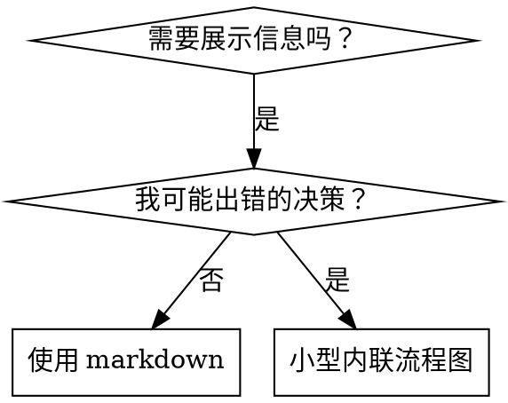

# 技能中的流程图

本文属于 superpowers:writing-skills。

## 流程图用法



**仅在以下情况使用流程图：**
- 非显而易见的决策点
- 可能过早停止的流程循环
- “何时用 A 还是 B”的决策

**绝不将流程图用于：**
- 参考资料 → 表格、列表
- 代码示例 → Markdown 块
- 线性指令 → 编号列表
- 不带语义的标签（step1、helper2）

graphviz 的风格规则见本目录下的 `graphviz-conventions.dot`。

**为需求方做可视化：**使用 writing-skills 目录下的 `render-graphs.js` 将某个技能的流程图渲染为 SVG，在该目录下运行：
```bash
node ./render-graphs.js ../some-skill           # 每个图单独输出
node ./render-graphs.js ../some-skill --combine # 所有图合入一个 SVG
```
