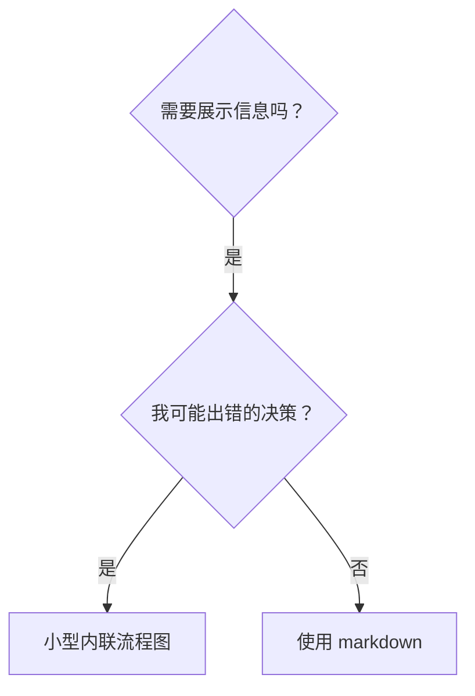

# 技能中的流程图

本文属于 superpowers:writing-skills。

## 流程图用法

**仅在以下情况使用流程图：**
- 非显而易见的决策点
- 可能过早停止的流程循环
- “何时该用 A、何时该用 B”的决策

**绝不将流程图用于：**
- 参考资料 → 表格、列表
- 代码示例 → Markdown 块
- 线性指令 → 编号列表
- 没有实际含义的标签（step1、helper2）

## mermaid 风格规则

| 元素 | mermaid 写法 |
|---|---|
| 决策问题 | 菱形 `{"问题？"}` |
| 动作 | 方框 `["做某事"]` |
| 状态、流程入口 | 体育场 `(["某状态"])` |
| 流程终点 | 双圆 `(("完成"))` |
| 警告/禁止 | 方框 + `style id fill:red,color:white` |
| 二元决策的边 | `A -->\|是\| B`、`A -->\|否\| B` |
| 多分支的边 | 每条边标注具体条件 |
| 跨流程触发 | 虚线 `A -.->\|触发\| B` |

- 节点 id 用简短的英文语义词（`can_backtrace`、`fix_root`），全部文字放进双引号
- 命名：问题以？结尾；动作以动词开头；命令原样放进方框；状态描述处境，不用「步骤 N」这类泛化标签
- 多行文字用 ` ` 换行

## 语法红线（机械可查）

违反任意一条都会导致渲染失败或退化到不可移植写法。提交前运行 `bash scripts/check-mermaid.sh <文件.md>`（brainstorming 与 writing-plans 两个技能的 scripts/ 目录各有一份）。

- subgraph 标题一律 `subgraph id["标题"]` 形态——裸标题位置的文法不接受 HTML 标记，换行 ` ` 写在引号内（实例：` ` 写在裸标题里触发 TAGSTART 解析错误）
- 节点文本与含空格或特殊字符的边标签放进双引号；` ` 换行只出现在引号内
- 引号外的文本不放 ASCII 圆括号——文字放进引号，或改用全角（）（形状语法 `[(…)]`、`([…])`、`((…))`、`[[…]]`、`[/…/]`、`[\…\]` 除外）
- 边标签保持单行——两行信息合并为一行或移入节点文本
- 换行用 ` `，不用 ` `
- mermaid 围栏必须闭合

**为需求方做可视化：**mermaid 图在 GitHub、VS Code、Typora、Obsidian 等支持 mermaid 的 markdown 阅读器中直接渲染，无需额外工具；需要导出图片时用 mermaid-cli（`npx @mermaid-js/mermaid-cli -i graph.mmd -o graph.svg`）。
